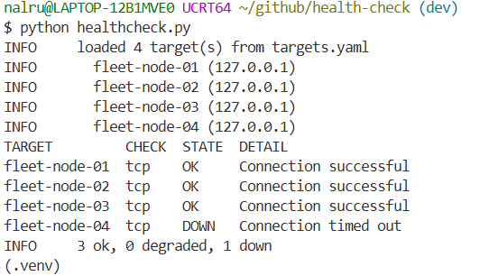

# Python Health Check CLI Group Project – My Contributions

## Source Code

- [View my contributions in the original group project repository](https://github.com/tech613-devops-first-python-project/group-project-health-check-cli-starter-repo/tree/nowres-healthcheck)

- [View my GitHub commits](https://github.com/tech613-devops-first-python-project/group-project-health-check-cli-starter-repo/commits/nowres-healthcheck/?author=n-al-rubaie)

## Project Overview

A collaborative Python project to develop a command-line tool for monitoring the health of multiple servers (fleet nodes). The tool performs health checks and reports the results.

This was a group project completed as part of my DevOps training.

## My Contributions

I contributed to the project across four files:

### 1. `config.py` – Configuration Loading and Validation

- Implemented YAML configuration loading.
- Added validation for configuration structure, required fields, and data types.
- Validated timeout values, disk usage thresholds, target ports, and health-check URLs.
- Added error handling to identify and report configuration problems.

### 2. `targets.yaml` – Fleet Configuration

- Added port numbers and HTTP health-check URLs for each fleet node.
- Configured default timeout and disk usage threshold values.

### 3. `checks/tcp.py` – TCP Health Checks

- Implemented TCP connection checking using Python's socket library.
- Added timeout handling and error handling for DNS resolution failures, refused connections, and other connection errors.
- Measured connection latency and returned structured health-check results.

### 4. `healthcheck.py` – Target Health Checks

- Implemented the `check_target()` function to execute TCP health checks using each target's configuration.
- Returned the health-check results for the target.

## Purpose of each .py file

### 1. `config.py` – Loads and validates configuration

- Reads the YAML configuration file.
- Checks that the settings and required values are valid.

### 2. `targets.yaml` – Stores server information

- Lists the servers to check.
- Stores their IP addresses, ports, health URLs, and default settings.

### 3. `checks/tcp.py` – Checks server connections

- Attempts to connect to each server using TCP.
- Detects connection failures and measures connection time.

### 4. `healthcheck.py` – Runs the health checks

- Uses the target information and configuration.
- Calls the TCP checker for each target.
- Collects and returns the results.

## How to Run the Project

### 1. Clone the Repository

```bash
git clone https://github.com/tech613-devops-first-python-project/group-project-health-check-cli-starter-repo.git
cd group-project-health-check-cli-starter-repo
```

### 2. Create a Virtual Environment

```bash
python -m venv .venv
```

### 3. Activate the Virtual Environment

**Windows (Git Bash):**

```bash
source .venv/Scripts/activate
```

**Linux / macOS:**

```bash
source .venv/bin/activate
```

### 4. Install Dependencies

```bash
python -m pip install -r requirements.txt
```

### 5. Start the Simulated Server Fleet

Open a terminal and run:

```bash
python fleet/run_fleet.py
```

Keep this terminal running while you perform the health checks.

### 6. Run the Health-Check CLI

Open a second terminal, navigate to the project directory, activate the virtual environment, and run:

```bash
python healthcheck.py
```

The CLI will load the targets from `targets.yaml`, perform the configured health checks and display the results in the terminal.

### 7. Stop the Simulated Servers

When you have finished, return to the first terminal and press `Ctrl + C` to stop the simulated fleet.

## Example Output

The screenshot below shows the health-check CLI running against four simulated fleet nodes.

The tool successfully:
- Loaded the four targets from `targets.yaml`.
- Performed TCP connection checks on each target.
- Identified three nodes with successful connections.
- Detected one node with a failed connection.
- Displayed the results in a summary table.

This demonstrates how the CLI identifies and reports the connection status of multiple servers.

