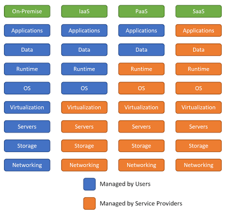

## 1. What is cloud computing?

**Cloud computing** is the delivery of computing services, such as servers, storage, databases and software, over the internet instead of relying on your own computer or physical servers. 

Instead of buying and maintaining every server yourself, you can rent computing resources from a cloud provider and scale them up or down when needed.

## 2. On-premises vs cloud

### On-premises (on-prem)

The organisation owns or directly manages computing equipment in its own building or data centre. It is responsible for purchasing, housing, powering, cooling, maintaining and securing that infrastructure.

**Example:** A company buys physical servers, installs them in its office server room, and employs IT staff to maintain them.

### Cloud

A cloud provider operates data centres and offers computing resources as services. The customer selects and configures the services it needs, and pays according to the pricing model.

**Example:** A company hosts its website on Amazon Web Services (AWS), Microsoft Azure or Google Cloud instead of buying its own physical web servers.

### Hybrid approach

Many organisations use both: some systems remain on-premises while others run in the cloud. This can be useful when older systems, data-location rules or existing investments make a full move impractical.

| Topic | On-premises | Cloud |
|---|---|---|
| Initial spending | Often high: buy hardware and facilities | Often lower upfront: rent services |
| Capacity | Plan and purchase ahead | Can often scale on demand |
| Maintenance | Organisation manages physical infrastructure | Provider manages physical infrastructure; customer still manages its chosen services |
| Control | High direct control | Control depends on the service model |
| Costs | Hardware, power, space, staff, refreshes | Usage, subscriptions, support, data transfer and operational costs |

## 3. The four cloud deployment models

A **Cloud deployment model** describe how cloud infrastructure is owned, shared and used.

## Cloud Deployment Models

### 1. Simple Deployment Models

Organisations typically choose between **Public Cloud** and **Private Cloud**.

- **Public Cloud**
  - Shared infrastructure used by multiple customers, with each customer's resources logically separated.
  - Analogy: A building with many flats, where each tenant has their own private space.
  - Often more cost-effective and offers a wider range of services.

- **Private Cloud**
  - Infrastructure dedicated to a single organisation, without sharing the cloud environment with other organisations.
  - Offers greater control and may be preferred for security, regulatory or data protection requirements, such as GDPR.

### 2. Complex Deployment Models

- **Hybrid Cloud**
  - Combines public cloud with private cloud or on-premises infrastructure.
  - Example: Keeping sensitive systems private while using public cloud for scalability.

- **Multi-Cloud**
  - Uses multiple public cloud providers, such as AWS, Google Cloud Platform (GCP) and IBM Cloud.
  - Benefits may include access to different providers' strengths, improved resilience and reduced reliance on a single provider.
  - Example: A financial institution uses one provider for its main applications and another for backups or disaster recovery.

**Memory aid:** Public = available to many customers; Private = dedicated to one organisation; Hybrid = connected mix; Community = shared by organisations with common needs.

> These models describe the overall deployment arrangement. They are different from IaaS, PaaS and SaaS, which describe the type of service provided.

## 4. The three main cloud service types

The main difference is **how much you manage yourself versus how much the provider manages for you**.

### 4.1 IaaS — Infrastructure as a Service

The provider supplies core infrastructure such as virtual machines, storage and networking. The customer generally manages the operating system, installed software, applications and data.

**Think of it as:** renting an empty computer in a data centre.

**Examples:**
- AWS EC2
- Azure Virtual Machines
- Google Compute Engine

**Typical customer responsibilities:** operating-system updates, installed applications, access permissions, application configuration and data.

**Typical provider responsibilities:** physical data centres, hardware, physical networking and the underlying virtualisation layer.

### 4.2 PaaS — Platform as a Service

The provider manages the underlying infrastructure and much of the operating platform, allowing the customer to focus on deploying and running applications.

**Think of it as:** renting a managed environment where you bring your code.

**Examples:**
- Azure App Service
- Google App Engine
- AWS Elastic Beanstalk

**Typical customer responsibilities:** application code, data, application settings and access controls.

**Typical provider responsibilities:** physical infrastructure, operating system and much of the runtime/platform maintenance.

### 4.3 SaaS — Software as a Service

The provider delivers a ready-to-use application, usually through a web browser or app. The customer mainly manages how it is used, including users, permissions and data.

**Think of it as:** using a finished product rather than building or maintaining the platform.

**Examples:**
- Microsoft 365
- Gmail / Google Workspace
- Salesforce

**Typical customer responsibilities:** user accounts, permissions, data, safe usage and available security settings.

**Typical provider responsibilities:** operating the application and managing the underlying platform and infrastructure.

### Quick comparison

| Service type | You mainly manage | Provider mainly manages | Analogy |
|---|---|---|---|
| IaaS | OS, apps, data and configuration | Physical infrastructure and virtualisation | Rent a computer |
| PaaS | Your application, data and settings | Infrastructure, OS and managed platform | Bring code to a ready platform |
| SaaS | Users, access and how you use the app | The application and its platform | Use a finished application |

### Shared responsibility image

## 5. Main advantages of cloud computing

- **Scalability:** increase or reduce resources as demand changes.
- **Speed:** provision infrastructure in minutes rather than waiting to purchase and install hardware.
- **Lower upfront investment:** avoid buying all the hardware before a project starts.
- **Global reach:** deploy services in different regions closer to users.
- **Resilience options:** use backups, multiple availability zones and disaster recovery services.
- **Managed services:** let the provider handle some infrastructure maintenance.
- **Access to newer technology:** use managed databases, analytics, AI and machine-learning services without building everything from scratch.
- **Usage visibility:** billing and monitoring tools can help teams track consumption and optimise costs.

These are potential advantages, not automatic guarantees. They depend on design, configuration, skills and cost management.

## 6. Potential disadvantages

- **Uncontrolled spending:** idle resources, oversized servers, storage and data transfer can create unexpectedly high bills.
- **Provider dependency / lock-in:** applications may rely on provider-specific tools, making migration harder.
- **Internet and connectivity dependence:** remote cloud services usually need reliable network access.
- **Security misconfiguration:** exposed storage, excessive permissions or leaked credentials can put systems at risk.
- **Outages:** providers and individual services can experience downtime.
- **Compliance and data-location needs:** organisations must check legal, regulatory and contractual requirements.
- **Less direct control:** customers cannot directly manage the provider's physical infrastructure.
- **Skills and complexity:** cloud environments still need trained people to design, secure, monitor and operate them.
- **Migration effort:** moving data and applications can be expensive and disruptive.

Cloud does not automatically mean secure, resilient or well managed. The customer must configure and operate its side of the shared-responsibility model properly.

## 7. CapEx vs OpEx

### CapEx — Capital Expenditure

Money spent acquiring or improving long-lived assets.

**Cloud-related example:** buying physical servers, storage equipment and networking hardware for your own data centre. The organisation may depreciate eligible assets over time under its accounting rules.

### OpEx — Operating Expenditure

Ongoing costs incurred to run a business or service.

**Cloud-related example:** monthly charges for virtual machines, storage, managed databases, support and data transfer.

| CapEx-style approach | OpEx-style approach |
|---|---|
| Purchase hardware upfront | Pay for cloud services as they are consumed or subscribed to |
| Capacity is planned in advance | Capacity can often be adjusted as needs change |
| Organisation handles hardware lifecycle | Provider handles physical hardware lifecycle |
| Risk of buying too much or too little capacity | Risk of ongoing usage charges growing unexpectedly |

**Important:** cloud costs are not always treated as OpEx in every accounting or contractual situation. Accounting treatment depends on the arrangement and applicable rules.

### Which do businesses usually prefer?

Many businesses value the cloud's lower upfront spending and flexibility, which can shift some costs from large capital purchases to ongoing operating costs. This helps new projects start sooner and makes it easier to match capacity to demand.

However, there is no universal preference. Businesses with stable, heavy workloads, existing data centres, strict requirements or specialist hardware needs may prefer to own or colocate some infrastructure. Financial reporting, tax and procurement requirements also influence the choice.

## 8. Is cloud always cheaper?

**No.** Cloud is often attractive for variable demand, rapid experimentation and services that benefit from managed operations. It can be more expensive for predictable, continuously high workloads if resources are not optimised or if owning infrastructure would be cheaper over its useful life.

Compare **total cost of ownership (TCO)** rather than just the server price.

Include:
- Compute, memory and storage charges
- Data transfer and network charges
- Support plans and software licences
- Backups, security, logging and monitoring
- Staff time for operating and maintaining systems
- Migration, training and refactoring costs
- Hardware, electricity, cooling, space and replacement costs for on-premises systems
- Downtime risk, resilience and disaster recovery

### Real-world example: 37signals

Software company 37signals (the company behind Basecamp and HEY) publicly described moving workloads away from public cloud infrastructure towards owned hardware in colocation facilities. Its leadership argued that predictable workloads could be cheaper to run on owned hardware at its scale. This is a useful example of why cloud is not always the lowest-cost option, but it is **one company's experience**, not proof that every business should leave the cloud.

- [37signals: “Why we're leaving the cloud”](https://world.hey.com/dhh/why-we-re-leaving-the-cloud-654b47e0)
- [The Register's coverage of the move](https://www.theregister.com/2023/02/22/37signals_cloud_exit/)

### When cloud may be cheaper

- A start-up does not need to buy servers before launching.
- A seasonal retailer scales up for a busy period and scales down afterwards.
- A team uses a managed database instead of maintaining database servers itself.
- A temporary test environment is shut down when no longer needed.

### When on-premises may be cheaper

- A workload runs at consistently high utilisation around the clock.
- An organisation already owns suitable equipment and has skilled staff.
- Data transfer or cloud licensing costs are unusually high.
- The business can operate hardware efficiently and does not need cloud elasticity.

**Practical lesson:** estimate the workload, measure actual use, set budgets and alerts, remove unused resources, and review the bill regularly. Make the decision based on TCO, reliability, risk and flexibility, not the headline compute price alone.

## 9. Guaranteed service levels: SLA, SLO and SLI

These terms are often used in cloud operations and Site Reliability Engineering (SRE). They describe how service reliability is measured, targeted and contractually promised.

### SLI — Service-Level Indicator

A **measurement** of how a service is performing.

Examples:
- Percentage of successful HTTP requests
- Request latency, such as the percentage of requests completed in under 300 milliseconds
- Error rate
- Availability measured over a time window

### SLO — Service-Level Objective

A **target** for an SLI over a defined period.

Example: “At least 99.9% of valid requests should succeed over a rolling 30-day period.”

An SLO is an engineering or service target. It may be an internal goal and does not, by itself, necessarily promise compensation to customers.

### SLA — Service-Level Agreement

A **formal agreement** that defines the service level promised to a customer and what happens if the provider fails to meet its terms. It may offer service credits or another specified remedy, subject to its conditions.

Example: “If the covered service's monthly availability falls below the level stated in the contract, an eligible customer may claim service credits.”

### Easy way to remember

| Term | Meaning | Question it answers |
|---|---|---|
| SLI | Indicator / measurement | What happened? |
| SLO | Objective / target | What are we aiming for? |
| SLA | Agreement / commitment | What have we promised, and what happens if we fail? |

**Example together:** measure successful requests (SLI), aim for 99.9% success each month (SLO), and define any customer remedy for falling below a contractual availability level (SLA).

Do not assume every outage leads to compensation. SLAs can define exclusions, eligibility rules, claim deadlines and remedies. Read the exact service-specific SLA. Google's [SRE explanation of SLI, SLO and SLA](https://cloud.google.com/blog/products/devops-sre/sre-fundamentals-sli-vs-sla-vs-slo) is a useful reference.

## 10. Cloud computing market share

Market share depends on what is being measured. The figures below refer to **global cloud infrastructure services spending**, rather than all cloud software, private data centres or every cloud-related product.

Synergy Research Group reported the following shares for **Q4 2025**:

| Provider | Approximate market share |
|---|---:|
| Amazon Web Services (AWS) | 28% |
| Microsoft Azure | 21% |
| Google Cloud | 14% |
| All other providers combined | 37% |

The three largest providers therefore accounted for about 63% of the measured market. These are dated estimates for one market segment, not permanent figures or a measure of every cloud business.

Sources:
- [Synergy Research Group, Q4 2025 cloud infrastructure market](https://www.srgresearch.com/articles/genai-helps-drive-quarterly-cloud-revenues-to-119-billion-in-q4)
- [TechTarget's report on the same market figures](https://www.techtarget.com/it-infrastructure/news/366638805/GenAI-drives-119B-cloud-revenues-in-Q4)

## 11. The Big Three cloud providers

### 11.1 Amazon Web Services (AWS)

**Known for:** being the market leader in cloud infrastructure services, a broad range of cloud products, and a mature ecosystem.

**Why choose AWS?**
- Extensive range of infrastructure and managed services
- Broad global infrastructure
- Large partner, training and professional community
- Useful for general cloud engineering, platform operations, serverless systems, data and DevOps

**Examples of services:** EC2 (virtual servers), S3 (object storage), RDS (managed relational databases), Lambda (serverless compute) and VPC (virtual networking).

**Possible trade-off:** its large catalogue can feel overwhelming to beginners, and cost control requires care.

Official site: [AWS](https://aws.amazon.com/)

### 11.2 Microsoft Azure

**Known for:** strong integration with Microsoft's enterprise ecosystem, including Windows Server, Microsoft Entra ID, Microsoft 365 and many existing corporate IT environments.

**Why choose Azure?**
- A natural fit for many organisations already using Microsoft technologies
- Strong hybrid-cloud and enterprise management options
- Integration with Microsoft's identity, security, data and developer tools
- Relevant for organisations using Windows Server, Active Directory and Microsoft business applications

**Examples of services:** Azure Virtual Machines, Azure Blob Storage, Azure SQL Database, Azure App Service and Azure Functions.

**Possible trade-off:** licensing, product choices and the wider Microsoft ecosystem can be complex.

Official site: [Microsoft Azure](https://azure.microsoft.com/)

### 11.3 Google Cloud Platform (GCP)

**Known for:** data analytics, data engineering, AI and machine learning, Kubernetes and Google's global infrastructure.

**Why choose Google Cloud?**
- Strong data and analytics products, including BigQuery
- AI and machine-learning services
- Kubernetes heritage and managed Kubernetes through Google Kubernetes Engine (GKE)
- Useful for data-intensive applications and cloud-native engineering

**Examples of services:** Compute Engine, Cloud Storage, BigQuery, Google Kubernetes Engine and Cloud Run.

**Possible trade-off:** an organisation may find fewer existing internal skills or integrations if its estate is built mainly around another provider.

Official site: [Google Cloud](https://cloud.google.com/)

### How to choose between them

There is no single best provider for every workload. Compare the services you need, total cost, staff skills, existing licences, region availability, security requirements, support, reliability and how difficult it would be to migrate later.

## 12. Bonus: certification paths for the Big Three

Certification programmes change, and certifications are not always strict prerequisites for one another. Treat these as sensible learning routes, then verify the current exam and requirements on the official pages.

### AWS path

1. **Beginner:** AWS Certified Cloud Practitioner (optional if you already have solid cloud fundamentals).
2. **Associate:** choose based on your goal:
   - Solutions Architect – Associate for designing cloud systems
   - Developer – Associate for building applications on AWS
   - CloudOps Engineer – Associate / relevant operations certification for operating and troubleshooting infrastructure
   - Data Engineer – Associate for data platforms
3. **Advanced:** consider Solutions Architect – Professional or DevOps Engineer – Professional after hands-on experience.
4. **Specialise:** consider security, networking, machine learning or other current specialty-related paths.

Official resources: [AWS Certification](https://aws.amazon.com/certification/) and [AWS Cloud Practitioner](https://aws.amazon.com/certification/certified-cloud-practitioner/).

### Microsoft Azure path

1. **Beginner:** Microsoft Certified: Azure Fundamentals (AZ-900).
2. **Associate:** choose a role:
   - Azure Administrator Associate (AZ-104) for managing infrastructure
   - Azure Developer Associate (AZ-204, subject to current programme status) for application development
   - Data or security certifications for a specialist direction
3. **Advanced:** consider Azure Solutions Architect Expert or Azure DevOps Engineer Expert, checking their current prerequisites and required exams.
4. **Specialise:** follow a current Microsoft role-based path in security, data, AI, networking or operations.

Official resources: [Microsoft Credentials](https://learn.microsoft.com/credentials/) and [Azure Fundamentals](https://learn.microsoft.com/en-us/credentials/certifications/azure-fundamentals/).

### Google Cloud path

1. **Beginner/business foundations:** Cloud Digital Leader (optional for a technical learner).
2. **Associate:** Associate Cloud Engineer for deploying, securing and operating cloud solutions.
3. **Professional:** choose a role-based certification, for example:
   - Professional Cloud Architect
   - Professional Cloud DevOps Engineer
   - Professional Data Engineer
   - Professional Cloud Security Engineer
4. **Specialise:** follow the relevant professional learning path and build practical experience with the services used in that role.

Official resources: [Google Cloud Certifications](https://cloud.google.com/learn/certification), [Cloud Digital Leader](https://cloud.google.com/learn/certification/cloud-digital-leader), [Associate Cloud Engineer](https://cloud.google.com/learn/certification/cloud-engineer) and [Professional Cloud Architect](https://cloud.google.com/learn/certification/cloud-architect).

## 13. Which path would I pursue, and why?

For a beginner building practical DevOps skills, I would start with **one provider rather than trying to learn all three at once**.

A sensible first route would be:
1. Learn cloud fundamentals, networking, Linux, Git, IAM (identity and access management), monitoring and basic security.
2. Practise by deploying a small Linux virtual machine and a web server.
3. Learn how to manage configuration, logs, alerts, backups and costs.
4. Automate the deployment with a script or infrastructure-as-code tool.
5. Choose a provider-specific associate certification once the practical concepts make sense.

## 14. Quick revision summary

- **Cloud computing:** computing services delivered over the internet on demand.
- **On-premises:** the organisation manages its own infrastructure; **cloud:** a provider manages the underlying infrastructure.
- **Deployment models:** public, private, hybrid and community.
- **Service types:** IaaS (infrastructure), PaaS (managed platform) and SaaS (finished software).
- **CapEx:** spending on long-lived assets; **OpEx:** ongoing operating costs.
- **Cloud is not always cheaper:** compare total cost of ownership and the workload's usage pattern.
- **SLI:** measurement; **SLO:** target; **SLA:** contractual commitment and remedy.
- **Big Three:** AWS, Microsoft Azure and Google Cloud.
- **Certifications:** pick a role, build practical skills, and check the provider's current certification requirements.

