# Deploy an Application on AWS (Node.js)
## Manual Deployment of a Monolithic Application

### 1. Application Requirements

The monolithic application uses the following technologies:

- **Node.js 20:** Runs the application, accesses databases and interacts with files on the server.
- **Port 3000:** The port used by the Node.js application.
- **HTML:** Structures the web page.
- **Nginx:** A web server that listens on port 80 by default.
- **Linux:** The operating system running on the AWS EC2 instance.
- **Application code:** The files required to run the application.

**Important:** The relevant ports must be allowed through the AWS EC2 security group firewall. Otherwise, incoming connections may be denied.

- **Port 80:** HTTP traffic, typically handled by Nginx.
- **Port 3000:** Direct access to the Node.js application.

### 2. What Is a Port?

A port is a numbered communication endpoint on a computer that directs network traffic to the correct application or service.

**Analogy:** Imagine a computer is a building, and each port is a numbered door leading to a different service.

Examples:

- **Port 80:** Commonly used for HTTP websites.
- **Port 22:** Commonly used for SSH remote access.
- **Port 3000:** Often used by Node.js applications.

A port is a logical endpoint, not a physical connection.

### 3. Application Architecture

The application uses a monolithic architecture with a two-tier setup.

- **Monolith:** The frontend and backend are combined into one application.
- **Two-tier architecture:** The application is organised into two main tiers, such as a client and an application server, or an application and a database.
- **N-tier architecture:** The application is divided into multiple tiers or layers.
- **Microservices:** The application is divided into smaller, independently deployable services.

**Note:** A monolithic application and a two-tier architecture describe different things. A monolith can still use a two-tier architecture.

### 4. What Does LTS Mean?

**LTS** stands for **Long-Term Support**.

LTS software versions receive support for an extended period, which can include security updates, bug fixes and maintenance.

This makes LTS versions useful for production environments.

### 5. Why Is Linux Good for Servers?

- **Lightweight:** Linux distributions can run efficiently with relatively few system resources.
- **Control over updates:** Administrators can generally control when package updates are installed, making Linux stable. 
- **Server support:** Linux is widely used for hosting websites and applications.
- **Command-line tools:** Administrators can manage servers remotely using commands.
- **Open Source:** Linux is free and open source.


### 6. What Is an SSH Key Pair?

An SSH key pair provides a secure way to authenticate when connecting to a remote server.

It consists of two keys:

- **Private key:** Kept secret on your local computer.
- **Public key:** Installed or configured on the remote server to allow authentication.

For an AWS EC2 instance, the private key can be used to connect securely to the instance through SSH.

**Important:** Never share your private SSH key.

---


# Instructions on deploying nodejs20-sparta-tictactoe-v1

## 1. Create an instance of the Virtual Machine on AWS


## Launch an EC2 Instance

1. Open the **AWS Management Console**.
2. Go to **Instances**.
3. Click **Launch instances**.

## Configure the Instance

**Name**

```text
tech613-yourfirstname-node20-app
```

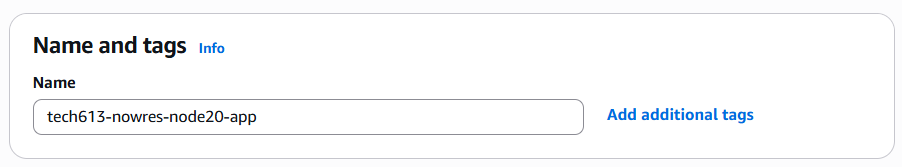

**Operating system**

- OS: Ubuntu
- Amazon Machine Image (AMI): Ubuntu Server 24.04 LTS

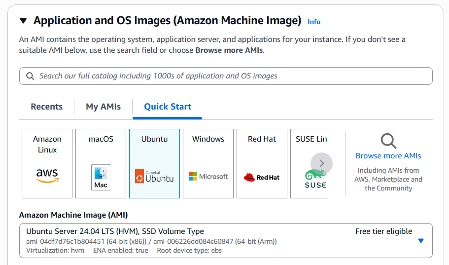

**Key pair login**

Select or create the key pair named:

```text
tech613-yourfirstname-aws-key
```

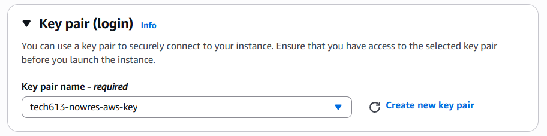

Keep the private key file secure.

## Configure Network Settings

Under **Network settings**:


1. Choose **Create security group**.
2. Add a security group name, e.g: **tech613-yourfirstname-node20-app-sg**
2. Add the required inbound security group rules:

| Type | Protocol | Port | Source
|---|---|---|---:|
| HTTP | TCP | 80 | 0.0.0.0/0
| Custom TCP | TCP | 3000 | 0.0.0.0/0
| SSH| TCP | 22 | 0.0.0.0/0


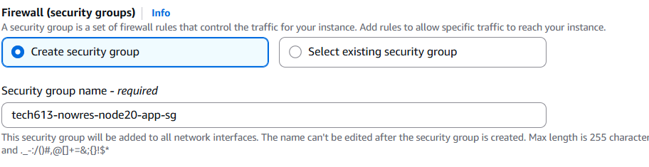
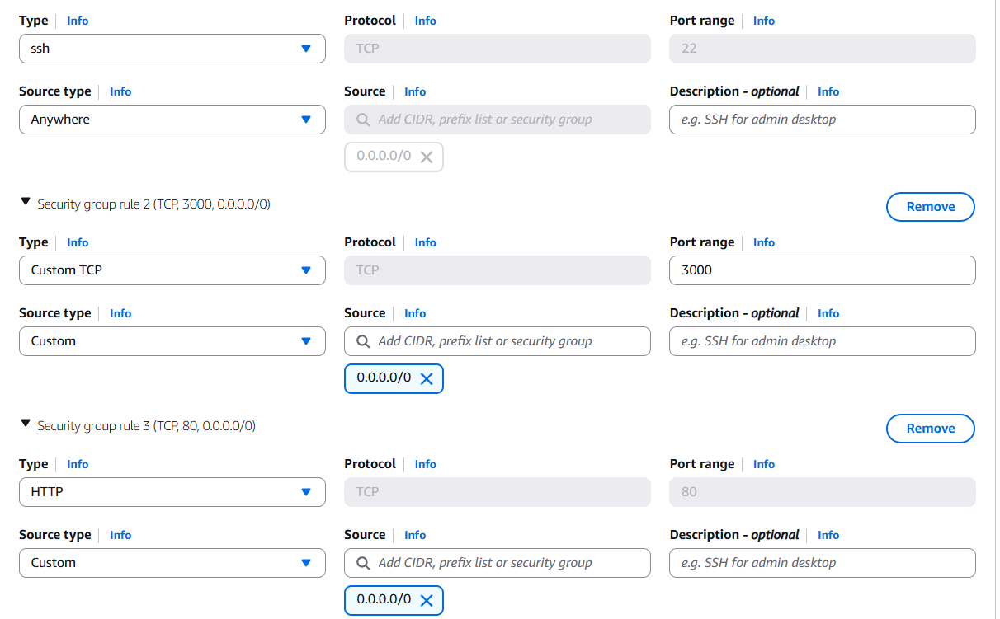

Finally, click on **Launch**.


## 2. Run the AWS Ubuntu VM

Open bash, change to .ssh directory by typing in: 

```bash
cd .ssh
```
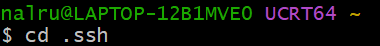

Then run the VM by clicking **Connect to Instance** on AWS and the copying and pasting the ssh code under **Connect to your instance using its Public DNS** in your bash. Then type in yes, and your AWS Ubuntu VM will start running.

(Your public DNS address will be different to the one below: ec2-54-77-85-253.eu-west-1.compute.amazonaws.com)

```bash
ssh -i "tech613-nowres-aws-key.pem" ubuntu@ec2-54-77-85-253.eu-west-1.compute.amazonaws.com
```
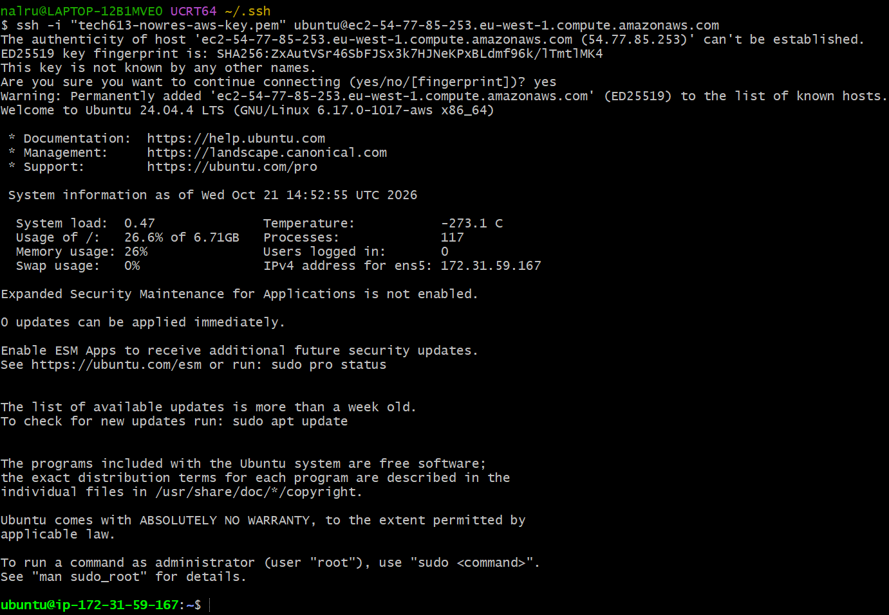


## 3. Copy the Application to AWS EC2

The application files are contained in the following folder:

`nodejs20-sparta-tictactoe-v1`

The `scp` command copies files between computers securely over SSH.

### Run this command in your local Git Bash terminal

In your local Git Bash terminal, change directory to wherever your `nodejs20-sparta-tictactoe-v1` is stored by using `cd pathtofile/`

Then run the code below, replace 63.33.2125.57 with your actual public IPv4 address that can be found in the instance summary page on AWS.
```bash
scp -i ~/.ssh/tech613-nowres-aws-key.pem -r nodejs20-sparta-tictactoe-v1 ubuntu@63.33.215.57:/home/ubuntu
```

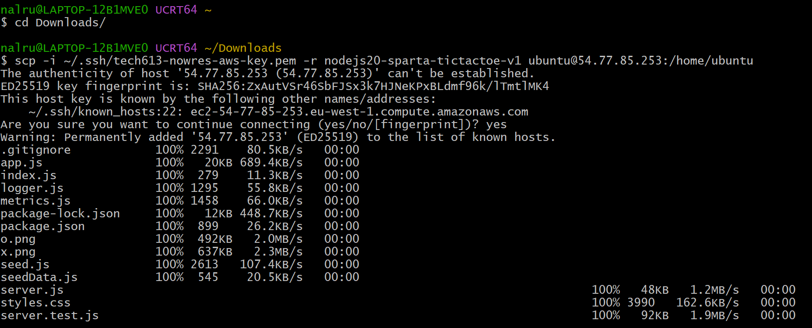

### Explanation of Each Part

| Command | Meaning |
|---|---|
| `scp` | Securely copies files between computers over SSH. |
| `-i ~/.ssh/tech613-nowres-aws-key.pem` | Specifies the private SSH key used for authentication. |
| `-r` | Copies a directory recursively, including its contents and subfolders. |
| `nodejs20-sparta-tictactoe-v1` | The local application folder to copy. |
| `ubuntu` | The username on the remote EC2 instance. |
| `63.33.215.57` | The public IPv4 address of the EC2 instance. |
| `:/home/ubuntu` | The destination directory on the EC2 instance. |

**Note:** If you want to copy a ZIP file instead of a folder, remove `-r` and specify the ZIP filename.

For example:

```bash
scp -i ~/.ssh/tech613-nowres-aws-key.pem nodejs20-sparta-tictactoe-v1.zip ubuntu@63.33.215.57:/home/ubuntu
```

Replace the example IP address, key filename and application filename with the correct values for your environment.

Now your file has been copied to the AWS Ubuntu VM.

---

## 4. Update the Package List

### Update the package list

Go to your bash where the Ubuntu VM is running, and run the code below and run:

```bash
sudo apt update -y
```


This refreshes the local package index so Ubuntu knows which package versions are available.

It does not upgrade the installed software itself.

### Upgrade installed packages

Run the code below to upgrade the package:

```bash
sudo apt upgrade -y
```

This upgrades installed packages where updates are available.

- `sudo`: Runs the command with administrative privileges.
- `apt`: Ubuntu's package management tool.
- `update`: Refreshes the package index.
- `upgrade`: Installs available upgrades for installed packages.
- `-y`: Automatically answers yes to confirmation prompts.

---

## 5. Unzip the Application (If Required)

If you copied a ZIP file to the EC2 instance, install the unzip utility:

```bash
sudo apt install unzip -y
```

Then extract the ZIP file:

```bash
unzip name-of-file.zip
```

Replace `name-of-file.zip` with the actual filename.

For example:

```bash
unzip nodejs20-sparta-tictactoe-v1.zip
```

You do not normally need `sudo` to extract files into your own `/home/ubuntu` directory.

---

## 6. Install nginx

Nginx is a web server that commonly listens on **port 80** to handle HTTP requests.

Install it using:

```bash
sudo apt install nginx -y
```


### Test Nginx

1. Open the AWS Management Console.
2. Navigate to your EC2 instance.
3. Find its public IPv4 address.
4. Open a new browser tab.
5. Enter the following URL:

```text
http://PUBLIC_IP_ADDRESS
```

For example:

```text
http://54.77.85.253
```

If Nginx is running and port 80 is allowed in the security group, you should see the default Nginx welcome page.

---

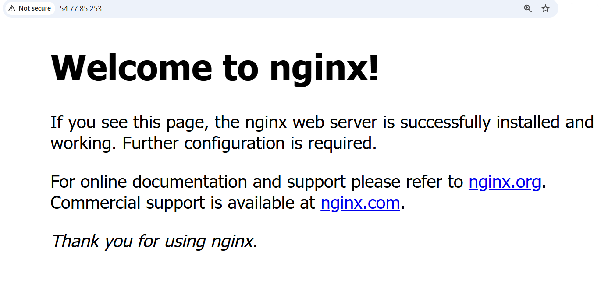

## 7. Install Node.js 20

Node.js allows the server to run JavaScript outside the browser.

### Step 1: Download the NodeSource setup script

```bash
curl -sL https://deb.nodesource.com/setup_20.x -o nodesource_setup.sh
```
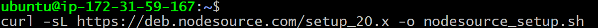
This downloads the setup script into a file called `nodesource_setup.sh`.

It does not run the script or install Node.js.

- `curl`: Transfers data from a URL.
- `-s`: Runs quietly.
- `-L`: Follows redirects.
- `-o nodesource_setup.sh`: Saves the downloaded content to the specified file.

### Step 2: Run the setup script

```bash
sudo bash nodesource_setup.sh
```

This runs the NodeSource setup script, which configures the package repository needed to install Node.js 20.

### Step 3: Install Node.js

```bash
sudo apt install nodejs -y
```

This installs Node.js and its associated npm package manager.

### Step 4: Verify the installation

Check the Node.js version:

```bash
node -v
```

Check the npm version:

```bash
npm -v
```
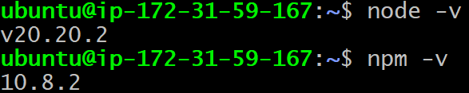
The Node.js version should be in the `v20.x.x` series.

---

## 8. Run the Node.js Application

### Step 1: Navigate to the application directory

On the Ubuntu EC2 instance, move into the application folder:

```bash
cd /home/ubuntu/nodejs20-sparta-tictactoe-v1/app
```


This assumes the copied or extracted folder is located directly inside `/home/ubuntu`.

### Step 2: Install application dependencies

```bash
npm install
```
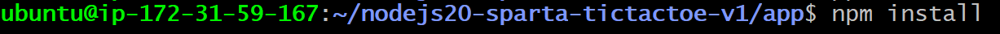


This reads the project's `package.json` file and installs the required Node.js packages, usually into a `node_modules` directory.

### Step 3: Start the application

```bash
npm start
```

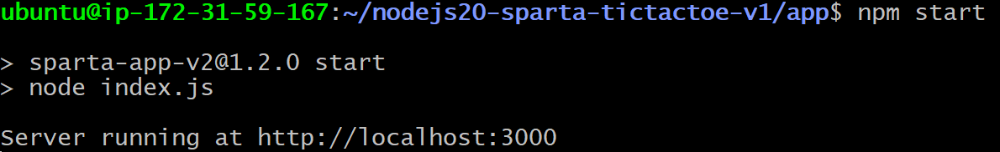

This runs the start script defined in the project's `package.json` file.

If the application is configured correctly, it should start listening on its configured port, which in this example is port 3000.

Keep in mind that `npm start` normally runs in the foreground. Closing the SSH session may stop the application unless it is configured to run as a background service or managed by a process manager.

---

## 9. Test the Application in Your Browser

Once the Node.js application is running, open:

```text
http://54.77.85.253:3000/
```

Replace `54.77.85.253` with your EC2 instance's public IPv4 address.

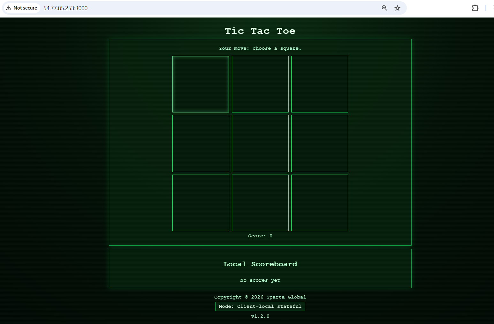

The URL consists of:

- `http://`: The HTTP protocol.
- `54.77.85.253`: The EC2 instance's public IPv4 address.
- `:3000`: The port on which the Node.js application listens.
- `/`: The root path of the application.

**Important:** For this direct URL to work, the Node.js application must be running, listening on an externally reachable network interface, and port 3000 must be allowed in the EC2 security group and any other relevant firewall.

---

