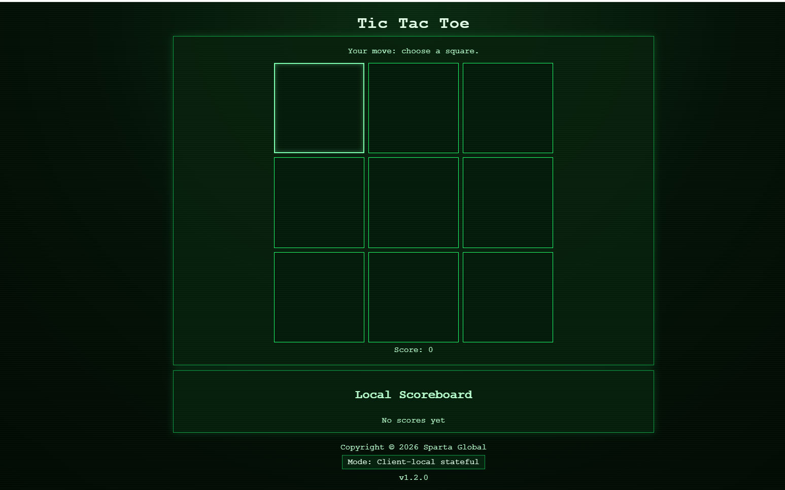

# Deploy a Node.js Application on AWS EC2 Using User Data and Nginx

## Objective

Automatically deploy the Tic-Tac-Toe Node.js application on an AWS EC2 instance using User Data, and configure Nginx as a reverse proxy to forward incoming HTTP requests to the application.

This approach reduces manual setup, makes deployment repeatable and demonstrates cloud infrastructure automation.


## 1. Architecture

The deployment uses the following components:

- **AWS EC2:** Provides the virtual server.
- **AWS User Data:** Runs a Bash script when the instance first boots to install and configure the required software.
- **Node.js:** Runs the Tic-Tac-Toe application on port `3000`.
- **npm:** Installs the application's dependencies.
- **PM2:** Manages the Node.js application process.
- **Nginx:** Receives public HTTP requests on port `80` and forwards them to Node.js on port `3000`.

### Request flow

```text
User's browser
      |
      | HTTP request to http://EC2-PUBLIC-IP
      v
Nginx (port 80)
      |
      | Reverse proxy to http://127.0.0.1:3000
      v
Node.js application (port 3000)
      |
      | Returns the response
      v
Nginx
      |
      v
User's browser
```

## 2. Launch an EC2 Instance

In the AWS Console, navigate to **EC2 → Launch instances**.

Configure the instance as follows:

- **Name:** `tech613-nowres-node20-app`
- **AMI:** Ubuntu Server 24.04 LTS
- **Instance type:** Use the instance type specified by your course or project requirements.
- **Security group inbound rules:**
  - HTTP: TCP port `80`, from `0.0.0.0/0` for a publicly accessible website.
  - SSH: TCP port `22`, restricted to your IP address if required.
  - Port `3000`: Only open temporarily for direct testing if necessary. Public access is not required when using Nginx as a reverse proxy.

Expand **Advanced details** and locate the **User data** field.

## 3. User Data Deployment Script

Paste the following script into the User Data field before launching the instance.

```bash
#!/bin/bash
set -euxo pipefail

# Save output for troubleshooting
exec > /var/log/user-data.log 2>&1

# Update package lists and install required tools
apt-get update -y
apt-get install -y curl unzip nginx

# Install Node.js 20
curl -fsSL https://deb.nodesource.com/setup_20.x \
  -o /tmp/nodesource_setup.sh
bash /tmp/nodesource_setup.sh
apt-get install -y nodejs

# Download the application from GitHub
cd /home/ubuntu

curl -fL \
  https://github.com/n-al-rubaie/nodejs20-sparta-tictactoe-v1/archive/refs/heads/main.zip \
  -o /tmp/tictactoe.zip

# Extract the application
unzip -o /tmp/tictactoe.zip -d /tmp
rm -rf /home/ubuntu/app
mv /tmp/nodejs20-sparta-tictactoe-v1-main /home/ubuntu/app

# Set application ownership
chown -R ubuntu:ubuntu /home/ubuntu/app

# Install application dependencies
cd /home/ubuntu/app
sudo -u ubuntu npm install

# Install PM2
npm install -g pm2

# Configure Nginx as a reverse proxy
cat > /etc/nginx/sites-available/tic-tac-toe <<'EOF'
server {
    listen 80 default_server;
    listen [::]:80 default_server;

    server_name _;

    location / {
        proxy_pass http://127.0.0.1:3000;
        proxy_http_version 1.1;

        proxy_set_header Host $host;
        proxy_set_header X-Real-IP $remote_addr;
        proxy_set_header X-Forwarded-For $proxy_add_x_forwarded_for;
        proxy_set_header X-Forwarded-Proto $scheme;
    }
}
EOF

# Enable the Nginx site
ln -sfn /etc/nginx/sites-available/tic-tac-toe \
  /etc/nginx/sites-enabled/tic-tac-toe

# Disable the default Nginx site
rm -f /etc/nginx/sites-enabled/default

# Test the Nginx configuration
nginx -t

# Enable and start Nginx
systemctl enable nginx
systemctl restart nginx

# Start the Node.js application with PM2
sudo -u ubuntu -H pm2 start /home/ubuntu/app/index.js \
  --name tic-tac-toe

# Save the PM2 process list
sudo -u ubuntu -H pm2 save

# Configure PM2 to start the app after reboot
env PATH="$PATH:/usr/bin" pm2 startup systemd -u ubuntu \
  --hp /home/ubuntu

echo "User Data deployment complete"
```

**Important:** Test this script on a fresh instance before relying on it. The script assumes the repository's `main` branch contains `index.js` at its root and that the application listens on port `3000`. If your repository uses a different structure or start command, adjust the script accordingly.

For a more secure production deployment, pin a specific application version instead of downloading the latest contents of `main`, and review how secrets and configuration are supplied.

## 4. How Nginx Works

Nginx acts as a reverse proxy between the user's browser and the Node.js application.

When a user visits:

```text
http://YOUR-EC2-PUBLIC-IP
```

Nginx receives the request on port `80` and forwards it to:

```text
http://127.0.0.1:3000
```

The Node.js application processes the request and returns its response through Nginx to the browser.

### Main Nginx directives

| Directive | Purpose |
|---|---|
| `listen 80;` | Listens for HTTP traffic on port 80. |
| `server_name _;` | Matches requests using this catch-all server configuration. |
| `location /` | Applies the proxy rules to requests under `/`. |
| `proxy_pass` | Forwards requests to the Node.js application. |
| `proxy_set_header Host $host;` | Passes the original host name to the application. |
| `proxy_set_header X-Real-IP $remote_addr;` | Passes the connecting client's IP address. |
| `proxy_set_header X-Forwarded-For` | Preserves the forwarded client IP chain. |
| `proxy_set_header X-Forwarded-Proto $scheme;` | Indicates the original request's protocol. |

Nginx does not replace Node.js or PM2. It handles incoming web traffic, while Node.js runs the application and PM2 manages its process.

## 5. What the User Data Script Automates

| Command or tool | Purpose |
|---|---|
| `apt-get update` | Updates package lists. |
| `apt-get install` | Installs required software. |
| `curl` | Downloads the Node.js setup script and application archive. |
| `unzip` | Extracts the application files. |
| `npm install` | Installs Node.js dependencies. |
| `pm2` | Manages the application process. |
| Nginx configuration | Routes public requests to the application. |
| `nginx -t` | Checks Nginx configuration syntax. |
| `systemctl enable nginx` | Enables Nginx to start on boot. |
| `pm2 save` and `pm2 startup` | Help restore the application process after a reboot. |

## 6. Testing the Deployment

Wait for the EC2 instance to finish running User Data.

### Check the application process

If you have SSH access, connect to the instance and run:

```bash
sudo -u ubuntu -H pm2 status
```

Confirm that `tic-tac-toe` is online.

### Test Node.js locally

```bash
curl -I http://127.0.0.1:3000
```

This checks whether the application responds directly.

### Test Nginx configuration

```bash
sudo nginx -t
```

Look for a successful configuration test.

### Check Nginx status

```bash
sudo systemctl status nginx
```

### Test Nginx locally

```bash
curl -I http://127.0.0.1
```

### Test from your browser

Open:

```text
http://YOUR-EC2-PUBLIC-IP
```

Replace the placeholder with your instance's public IPv4 address.

Confirm that the Tic-Tac-Toe application loads through Nginx.




## Key Takeaway

This project combines AWS EC2, Bash automation, Node.js, npm, PM2 and Nginx to deploy a web application.

**User Data automates server setup. Nginx forwards web requests. Node.js runs the application. PM2 manages the application process.**

Together, these components demonstrate a repeatable approach to deploying a Node.js application on AWS.