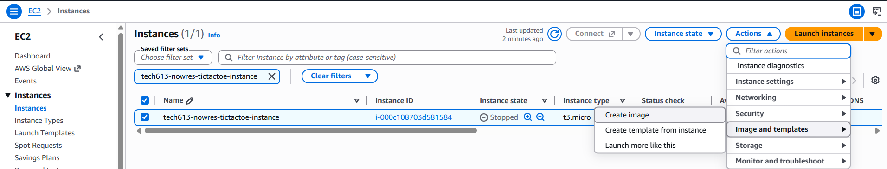
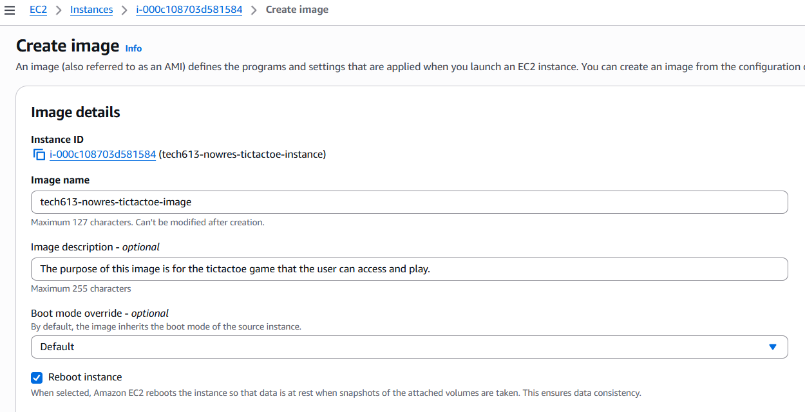
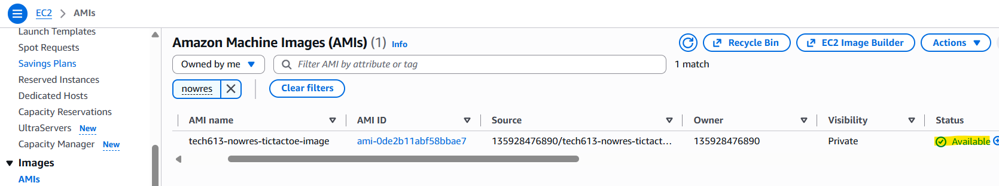
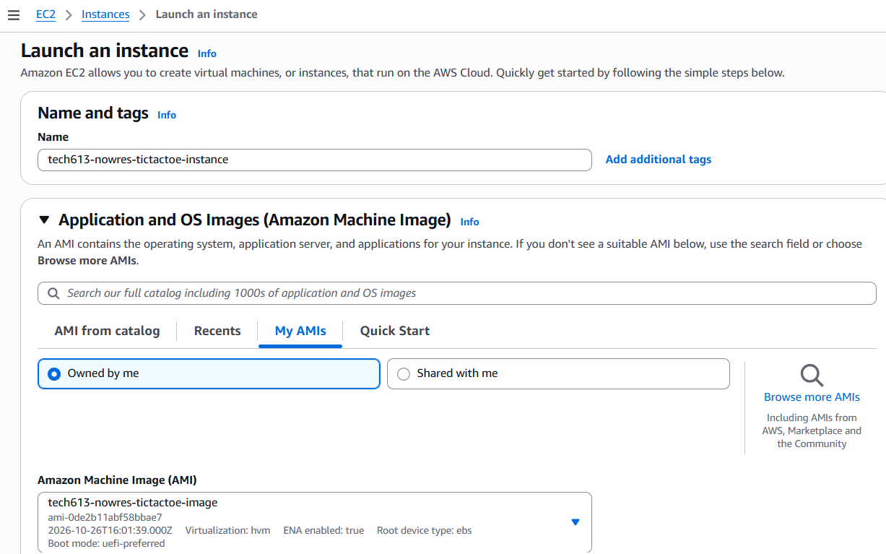
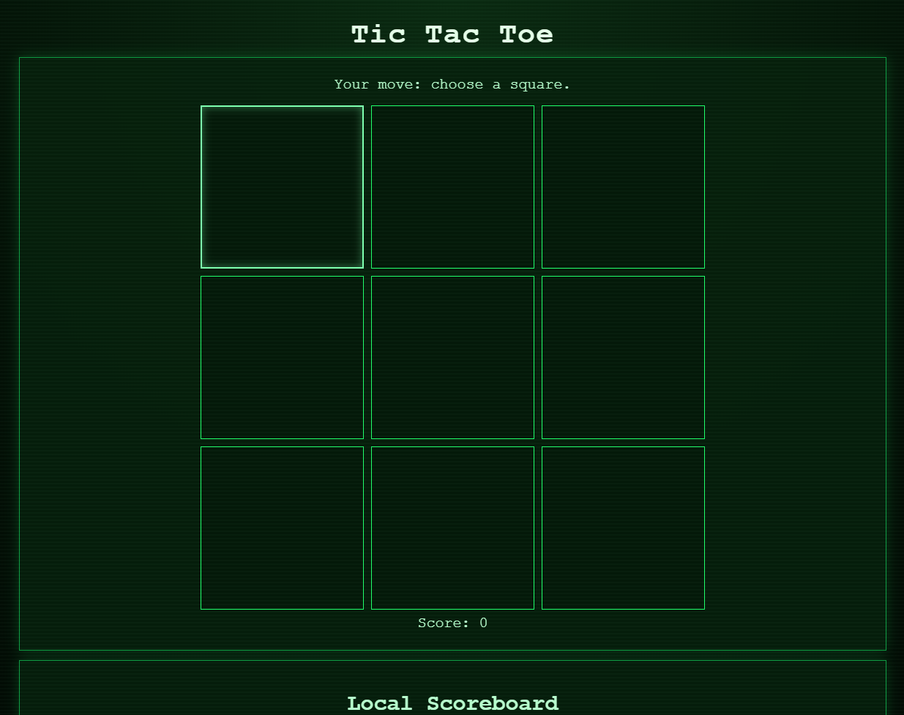

# Building an Amazon Machine Image (AMI) for the Node.js Tic-Tac-Toe App on AWS EC2

This guide covers how to deploy a Node.js tic-tac-toe app on EC2 using a user-data script, turn the configured instance into an Amazon Machine Image (AMI), and test that image by launching a new instance from it.

**Final architecture:**

```
Browser → port 80 → Nginx → localhost:3000 → Node app (managed by PM2)
```

---


## 1. Create the AMI

### Using the console

1. Go to **EC2 → Instances** and select your instance. Ensure that the state of your instance is set to "Stopped".
2. Click **Actions → Image and templates → Create image**.



3. Enter a name, for example `tech613-yourname-tictactoe-image`, and a short description.
4. Leave **Reboot instance** checked. EC2 will briefly reboot the instance to take a consistent snapshot, and your SSH session will drop. This is expected.

5. Click **Create image** at the bottom of the screen.
6. Go to **EC2 → AMIs** (make sure you are in the same region, `eu-west-1`) and wait until the status changes from `pending` to `available`. This usually takes a few minutes.




---

## 2. Test the AMI

An AMI is only a template. To run it, you must launch an instance from it.

1. Go to **EC2 → AMIs** and select your AMI. Check that its status is `available`.
2. Ensure that all other settings are the same as your EC2
3. Click **Launch instance**.



5. Click **View all instances** and wait for the instance to show **Running** and **2/2 checks passed** (1 to 2 minutes).
6. Select it and copy its **Public IPv4 address**. This is a **different IP** from the original instance.
7. Open `http://<new-public-ip>` in your browser.

If the game loads, the AMI works. It also proves the app survives a reboot, since Nginx and PM2 both start automatically.




# A new user data script that deploys the app using the AMI

This new script deploys the tic-tac-toe app on instances launched from the pre-built AMI. Since Node, Nginx and PM2 are already installed, it only pulls the latest code and restarts the app, so deployment takes seconds instead of minutes.

---

## Prerequisites

- The instance is **running** and has a public IPv4 address
- Port **22** (SSH) is open in its security group
- You have the key pair `.pem` file used to launch it
- The instance has internet access (it needs to reach GitHub)

---

## Paste and Run Over SSH

### 1. Connect to the instance

```bash
ssh -i your-key.pem ubuntu@<public-ip>
```

### 2. Create the script file

```bash
nano update-app.sh
```

Paste in the script below, then save and exit:

- `Ctrl+O`, then `Enter` to save
- `Ctrl+X` to exit

```bash
#!/bin/bash
# User data for instances launched from the tic-tac-toe AMI.
# Node.js, Nginx and PM2 are already installed in the image, so this script
# only refreshes the app code, restarts the app, and checks that it responds.
set -euxo pipefail

# Save output for troubleshooting (separate from the original script's log)
exec > /var/log/user-data-ami.log 2>&1

APP_DIR=/home/ubuntu/app
REPO_ZIP=https://github.com/n-al-rubaie/nodejs20-sparta-tictactoe-v1/archive/refs/heads/main.zip
APP_NAME=tic-tac-toe

# Download the latest version of the app
curl -fL "$REPO_ZIP" -o /tmp/tictactoe.zip
rm -rf /tmp/nodejs20-sparta-tictactoe-v1-main
unzip -o /tmp/tictactoe.zip -d /tmp

# Stop the running copy before replacing its files
sudo -u ubuntu -H pm2 delete "$APP_NAME" || true

# Replace the app folder with the fresh code
rm -rf "$APP_DIR"
mv /tmp/nodejs20-sparta-tictactoe-v1-main "$APP_DIR"
chown -R ubuntu:ubuntu "$APP_DIR"

# Install dependencies
cd "$APP_DIR"
sudo -u ubuntu npm install

# Start the app and save the process list so it survives reboots
sudo -u ubuntu -H pm2 start "$APP_DIR/index.js" --name "$APP_NAME"
sudo -u ubuntu -H pm2 save

# Make sure Nginx is running with the config already baked into the image
nginx -t
systemctl enable nginx
systemctl restart nginx

# Health check: wait up to 30 seconds for the app to answer through Nginx
for i in $(seq 1 15); do
  if curl -fsS -o /dev/null http://localhost; then
    echo "App is responding through Nginx"
    break
  fi
  sleep 2
done

echo "AMI user data deployment complete"
```

### 3. Run it as root

```bash
sudo bash update-app.sh
```

The script sends all its output to a log file, so nothing prints on screen while it runs. To watch progress, open a second SSH session and run:

```bash
tail -f /var/log/user-data-ami.log
```

Otherwise just wait for the prompt to return (usually well under a minute).

### 4. Verify

```bash
tail -n 5 /var/log/user-data-ami.log   # should end with "AMI user data deployment complete"
pm2 list                               # tic-tac-toe should be "online"
curl -I http://localhost               # should return HTTP/1.1 200 OK
```

### 5. Check in the browser

Open `http://<public-ip>`. Use `http://`, not `https://`, because there is no SSL certificate.

The tictactoe game should appear.

---

