# Tic-Tac-Toe: 2-Tier Deployment on AWS

## Purpose

This project deploys a Tic-Tac-Toe web app using a 2-tier architecture on AWS EC2:

- **App tier:** a Node.js app (managed with pm2) on one Ubuntu VM.
- **Database tier:** MongoDB 7.0 on a separate Ubuntu VM, which stores the game data.

The two VMs communicate over their private IPs on port 27017. Keeping the database on its own VM means each tier can be rebuilt, backed up or scaled independently.

## Why MongoDB?

The app stores its game data (scores) in MongoDB so it can show it back to users.

| Mode | Where data lives | Behaviour |
|---|---|---|
| **Persistent with Mongo DB** | MongoDB on the DB VM | Scores survive page refreshes, cleared browser data and app restarts. All users and devices see the same data. |


Keeping the data in MongoDB on a separate VM also means the app tier can be rebuilt or replaced without losing the data.

> **Note:** port 27017 is open to `0.0.0.0/0` with no authentication. This is for learning only and is not suitable for production.


## Create an instance for MongoDB

* Select Ubunu 24 and give  it a name: tech613-yourname-mongodb

## Create security group 

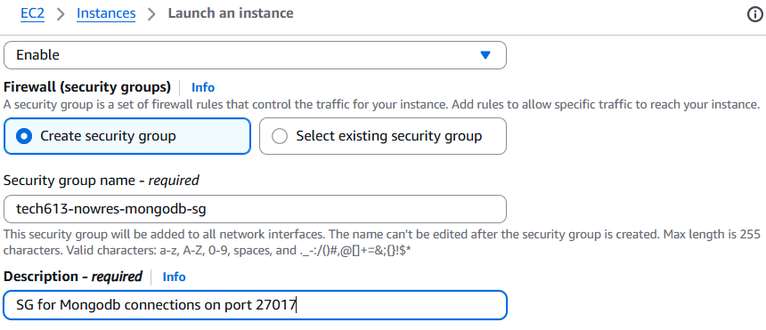


## Inbound security group rules 

* MongoDB default port = 27017

* Source = 0.0.0.0/0 (Not secure, using for learning purposes only)


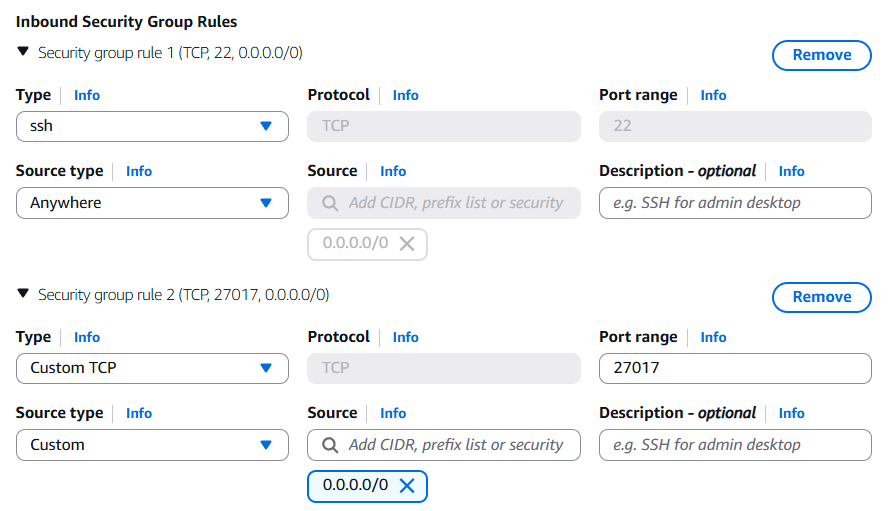

Connect to the VM using bash. 


## Update the package list, not the installed software itself 
```bash
sudo apt update -y
```

## Then upgrade installed packages, using:
```bash
sudo apt upgrade -y
```


## GPGP code 
Run the command below, it downloads MongoDB's digital signature key so the server can trust and verify MongoDB software before installation.

```bash
curl -fsSL https://www.mongodb.org/static/pgp/server-7.0.asc | \
   sudo gpg -o /usr/share/keyrings/mongodb-server-7.0.gpg \
   --dearmor
```


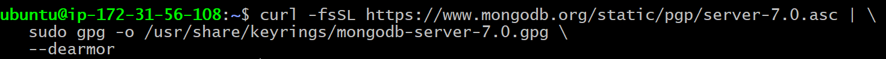

## Resiger MongoDB

Run the command below, it registers the MongoDB software repository with Ubuntu so MongoDB can be downloaded and installed using APT.

```bash
echo "deb [ arch=amd64,arm64 signed-by=/usr/share/keyrings/mongodb-server-7.0.gpg ] https://repo.mongodb.org/apt/ubuntu jammy/mongodb-org/7.0 multiverse" | sudo tee /etc/apt/sources.list.d/mongodb-org-7.0.list
```

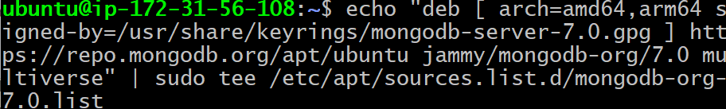


## Update the package list, not the installed software itself 
```bash
sudo apt update -y
```


## Install MongoDB

Run the command below, it installs MongoDB version 7.0.22 and all the required components on the Ubuntu server without asking for installation prompts.

```bash
sudo DEBIAN_FRONTEND=noninteractive apt-get install -y \
   mongodb-org=7.0.22 \
   mongodb-org-database=7.0.22 \
   mongodb-org-server=7.0.22 \
   mongodb-mongosh \
   mongodb-org-shell=7.0.22 \
   mongodb-org-mongos=7.0.22 \
   mongodb-org-tools=7.0.22 \
   mongodb-org-database-tools-extra=7.0.22
```


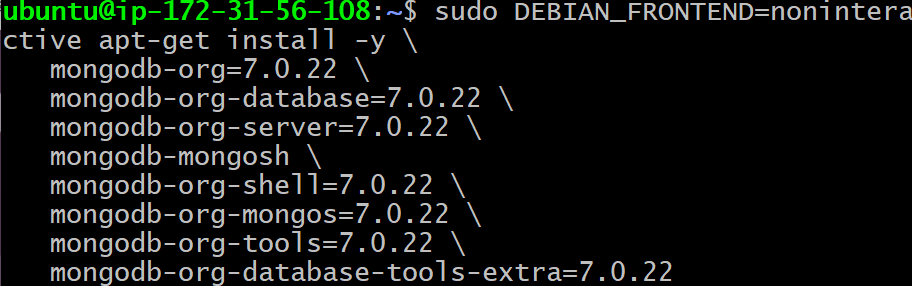

## Check if MongoDB works

```bash
Sudo systemctl status mongod
```
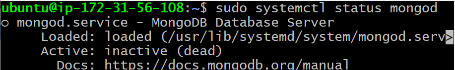


## Open mongod.conf


Change directory to: 
```bash
cd etc/
```
Then open mongod.conf:
```bash
sudo nano mongod.conf
```


Change bindIp to: 0.0.0.0


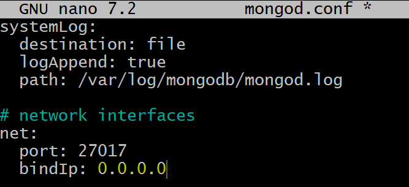

## Run mongod


Go back to home directory
```bash
cd
```

## Run mongo:

```bash
sudo systemctl start mongod
```


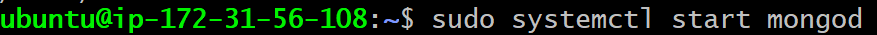


## Check its status:

```bash
sudo systemctl status mongod
```

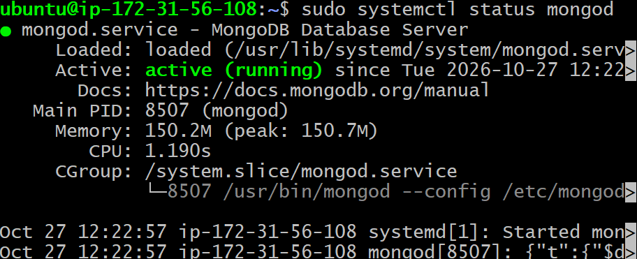


## Enable mongod

```bash
sudo systemctl enable mongod
```
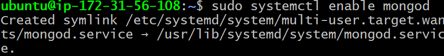


## 2-Tier Deployment 

In your tictactoe VM, change to the app folder, run the command below. It creates an environment variable called MONGODB_URI that stores the address of the MongoDB database. The Tic Tac Toe application uses this variable to know where the database is located and how to connect to it.


Replace `63.35.220` with the Public IP address of your MongdoDB instance.

```bash
export MONGODB_URI=mongodb://63.35.220.151:27017/tictactoe
```

Check the env by using:
```bash
printenv MONGODB_URI
```

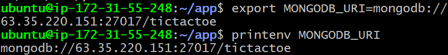

Run the command below, it stops all applications managed by PM2 and completely shut down the PM2 process manager.

```bash
pm2 kill
```

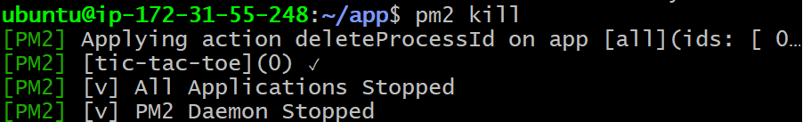

Install the env by running the code below:
```bash
npm install
```
```bash
pm2 start index.js --name tic
```

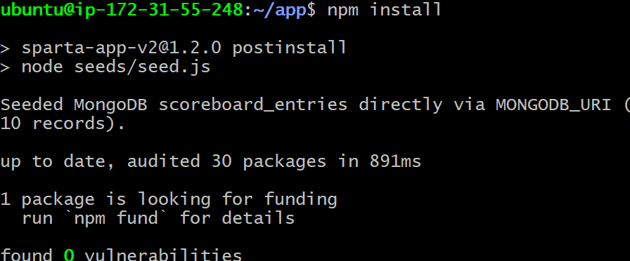

Run the tictactoe application by running the public IP address of the tictactoe VM in your web browser. Ensure that you run it as http and not https.

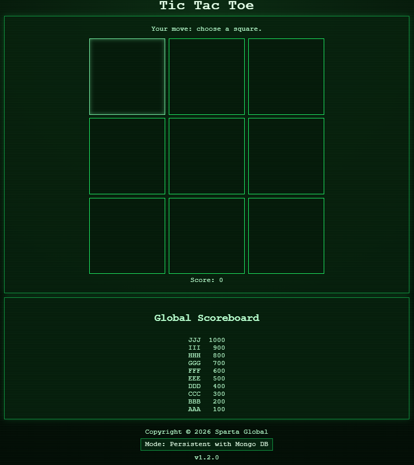