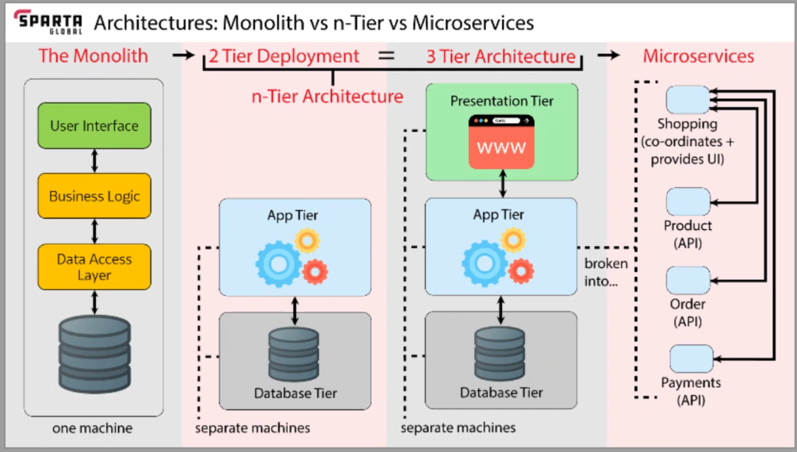

# Tiers of development

## Monolith vs n-Tier vs Microservices diagram

## Monolith

Monolith architecture

Pros = simple

Cons = generally you want to move away from it. It one things fail, entire system falls down. Slow to start up.

## 2 Tier 

2 Tier Deployment 

2 Tiers = App Tier and Database Tier

Pros = faster to deploy each thing individually, more robust and modular

Cons = more complex

## 3 Tier Deployment 
3 Tiers = App Tier ,Database Tier and Presentation Tier

## Microservices
Pros = Individual services scaled, can isolate problems. 

Cons = more complex

