# Monitoring 


## Why We Need Monitoring

Cloud apps run on VMs that can get overloaded. Without monitoring, you only find out something is wrong when users complain or the app crashes. Monitoring lets you see problems early and react (or let the system react) before they become outages.

In the diagram, every scenario starts the same way: an app VM whose CPU load is monitored by a cloud service (AWS CloudWatch, Azure Monitor, or Google Cloud Monitoring). What differs is what you do with that data.

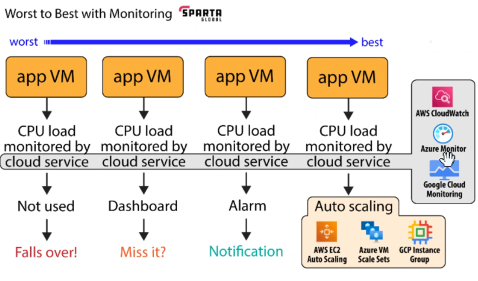

## Worst to Best
## Not used → “Falls over!” (Worst)

The CPU data is collected, but nobody looks at it or acts on it. When load spikes, the VM overloads and crashes with no warning.

## Dashboard → “Miss it?”

You can see the CPU load on a dashboard, which is better. But it relies on a human watching at the right moment. If nobody is looking when the spike happens, you miss it.

## Alarm → Notification

You set a threshold (e.g. CPU above 80%) and the system alerts you automatically by email, SMS, or chat. You no longer need to stare at a screen, but a person still has to respond.

## Auto scaling (Best)

The monitoring data triggers an automatic action: extra VMs are added when load is high and removed when it drops. No human is needed, and the app stays available. 


# Creating a Detailed Monitoring Dashboard

## Part 1: Enable detailed monitoring

1. Open the **instance summary** page.
2. Scroll down and click the **Monitoring** tab.
3. Click **Manage detailed monitoring**.
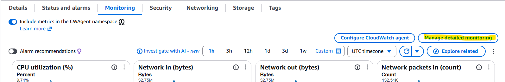

4. Click **Enable**, then **Confirm**.
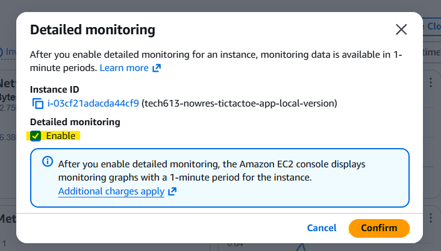


## Part 2: Add a graph to a dashboard

1. In the **Monitoring** section, click the **three dots** on a graph.
2. Click **Add to dashboard**.
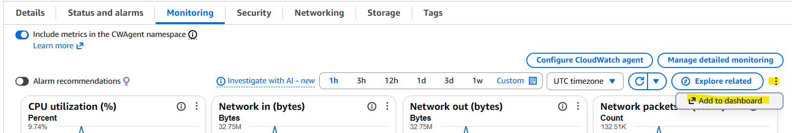

3. Click **Create new**.
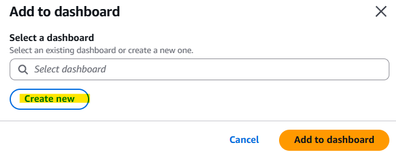
4. Name the dashboard `tech613-yourname-app-dasboard`.
5. Click on **Create** and then **Add to dashboard**.
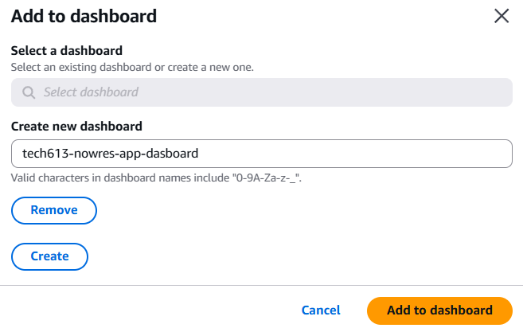


Once completed, the dashboard shall now appear. The dashboard can now be customised.

To delete a widget, click on the three dots on a widget and then **Delete**.

You can also rearrange widgets by dragging them to a new position on the dashboard. To resize a widget, click and drag its bottom-right corner.
## Dashboard example

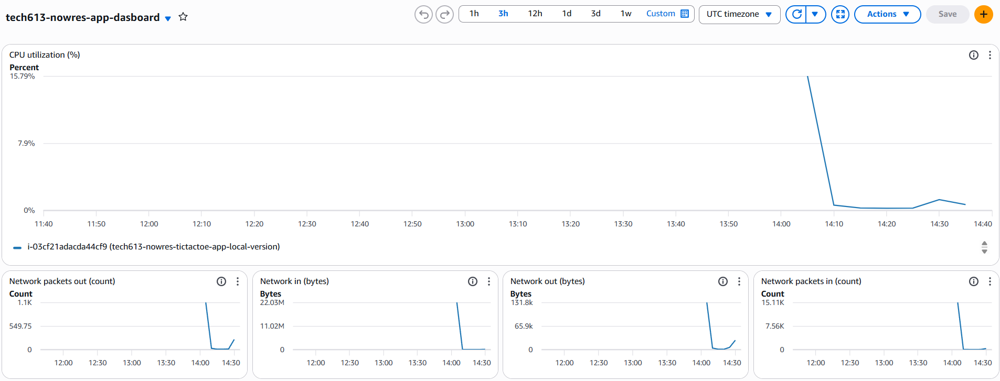


# Performance testing
**Load testing** checks that your app works properly under the expected amount of traffic (e.g. 1,000 users on a normal busy day).

**Stress testing** pushes the app beyond its limits (e.g. 10,000 users) to find the breaking point and see how it fails and recovers.


# Task: Load Testing

## Steps

1. Open your AWS VM (the tic-tac-toe local version) in a **bash** terminal.

2. Install `apache2-utils`:

   ```bash
   sudo apt install apache2-utils
   ```
   

3. Run the load tests below.

   > `3.254.57.196` = the public IP address of the app

   **Light test** (1,000 requests, 10 at a time):

   ```bash
   ab -n 1000 -c 10 http://3.254.57.196/
   ```
   
   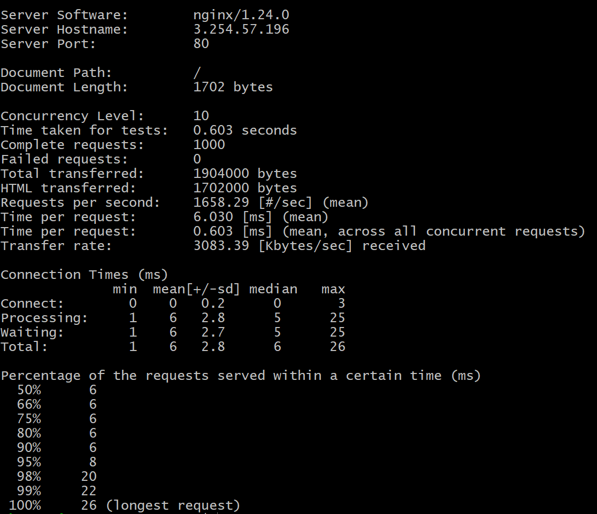

   **Heavy test** (40,000 requests, 500 at a time):

   ```bash
   ab -n 40000 -c 500 http://3.254.57.196/
   ```
   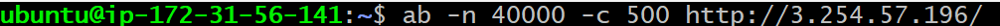
   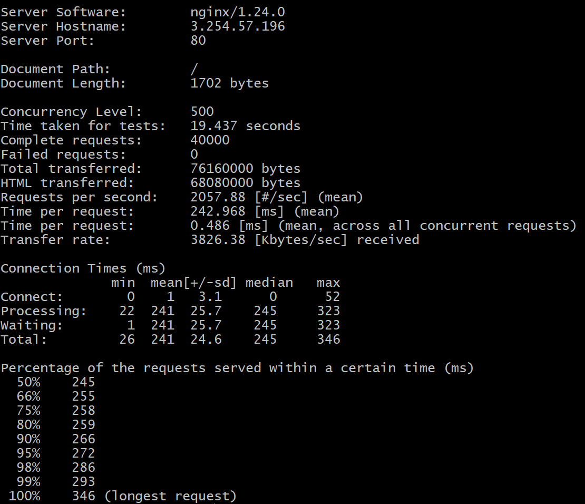

## What the flags mean

| Flag | Meaning |
|------|---------|
| `-n` | Total number of requests to send |
| `-c` | Number of requests to send at the same time (concurrency) |


# Create a CPU Usage Alarm in AWS CloudWatch

## Goal

Send an **email** to my Sparta Outlook address when the app VM's CPU usage is **above 50% for 2 consecutive minutes**.

> Adjust the percentage and time to suit your needs. This guide uses 50% for 2 minutes so the alarm is easy to trigger during testing.

## Prerequisites

- Detailed monitoring is enabled on the instance (gives 1-minute data instead of 5-minute data).
- `apache2-utils` is installed on the VM (used to generate load).

## Part 1: Create an SNS topic (for the email)

CloudWatch sends alarm notifications through **SNS (Simple Notification Service)**.

1. In the AWS console, search for **SNS** and open it.
2. Click **Topics**, then **Create topic**.
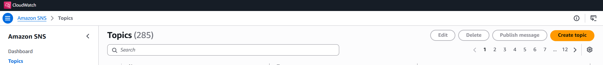
3. Choose type **Standard**.
4. Name it `tech613-yourname-cpu-alerts`.
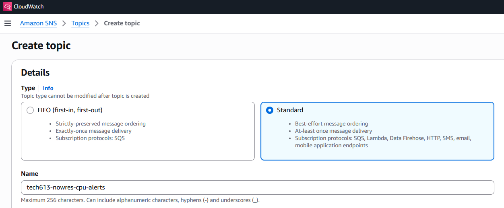
5. Click **Create topic**.
6. On the topic page, click **Create subscription**.
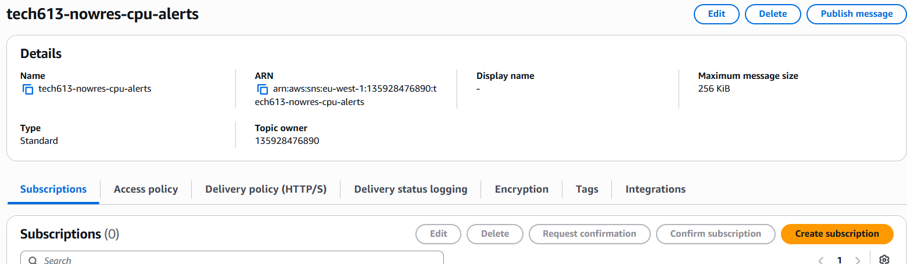
7. Set **Protocol** to **Email**.
8. Set **Endpoint** to your email address.
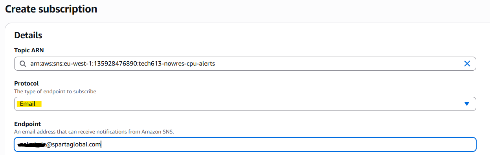
9. Click **Create subscription**.
10. Open your email inbox, find the email from **AWS Notifications**, and click **Confirm subscription**.
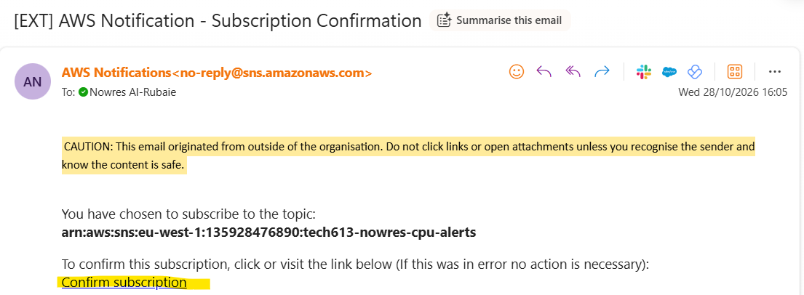

> The subscription status must show **Confirmed**, otherwise no alert emails will be sent. Check your junk folder if the email doesn't arrive.


## Part 2: Create the CloudWatch alarm

1. Search for **CloudWatch** and open it.
2. In the left menu, click **Alarms**, then **All alarms**.
3. Click **Create alarm**.
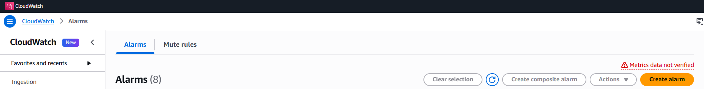
4. Click **Select metric**.
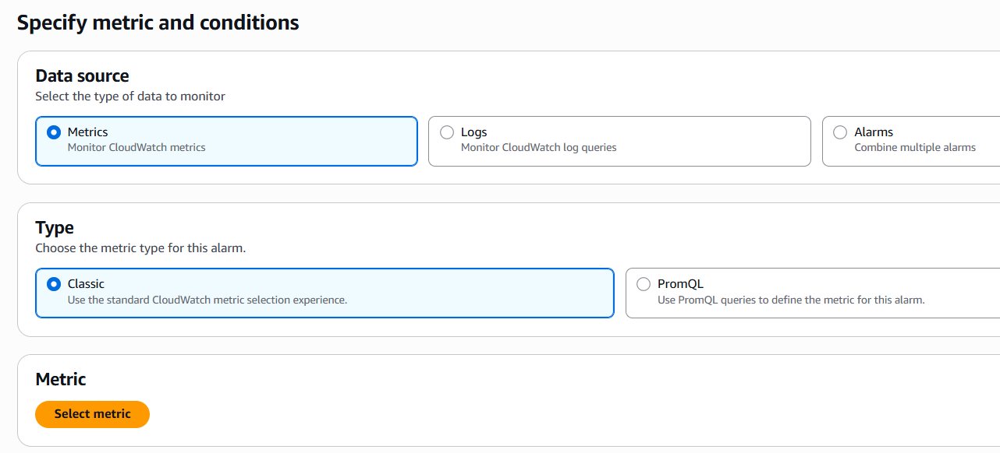
5. Go to **EC2**, then **Per-Instance Metrics**.
6. Search for your instance ID and tick the **CPUUtilization** metric.
7. Click **Select metric**.
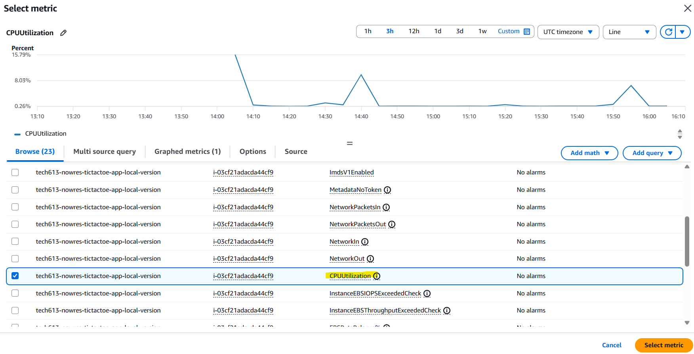


### Set the conditions
| Setting | Value |
|---------|-------|
| Statistic | Average |
| Period | 1 minute |
| Threshold type | Static |
| Condition | Greater than |
| Threshold value | 50 |
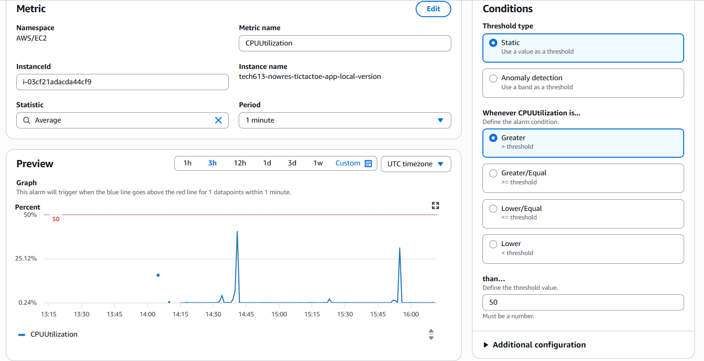

8. Open **Additional configuration** and set **Datapoints to alarm** to **2 out of 2**.
   This means CPU must be above 50% for 2 consecutive minutes before the alarm triggers.
9. Click **Next**.
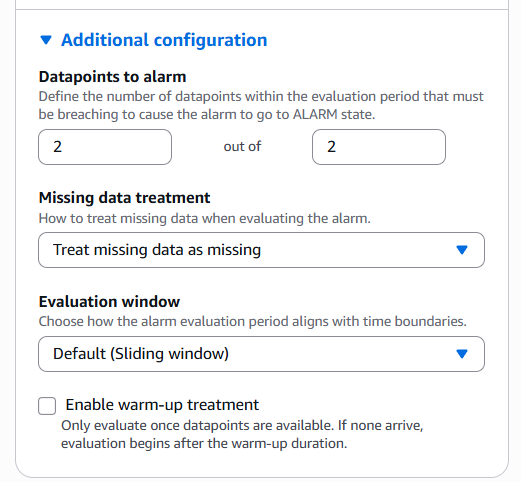
### Set the notification

10. Under **Alarm state trigger**, choose **In alarm**.
11. Choose **Select an existing SNS topic**.
12. Select `tech613-nowres-cpu-alerts`.
13. Click **Next**.
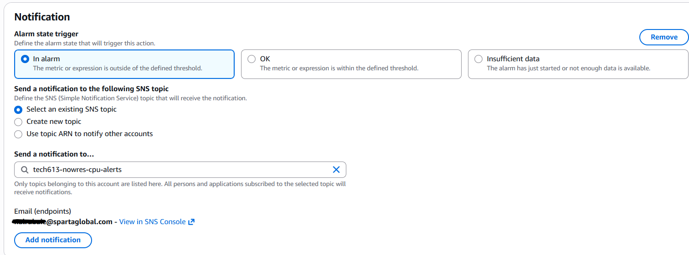

### Name and create

14. Name the alarm `tech613-nowres-high-cpu-alarm`.
15. Add a description, e.g. `CPU above 50% for 2 minutes`.
16. Click **Next**, review, then click **Create alarm**.
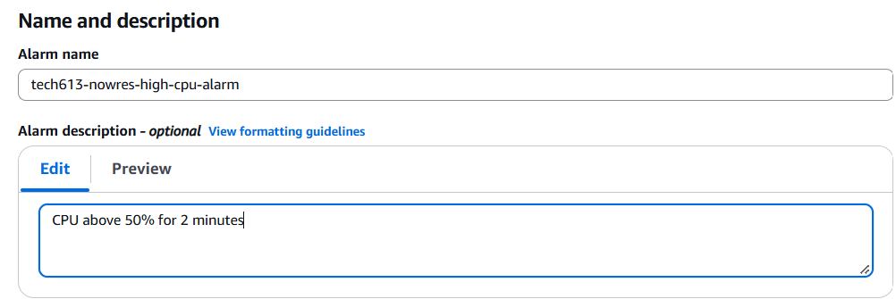


## Part 3: Test the alarm

1. Connect to the VM in bash.
2. Generate heavy load:

   ```bash
   ab -n 100000 -c 200 http://<public-ip>/
   ```

3. In CloudWatch, go to **Alarms** and refresh.
4. Wait a few minutes for the state to change from **OK** to **In alarm**.
5. Check your Outlook inbox for the alert email.
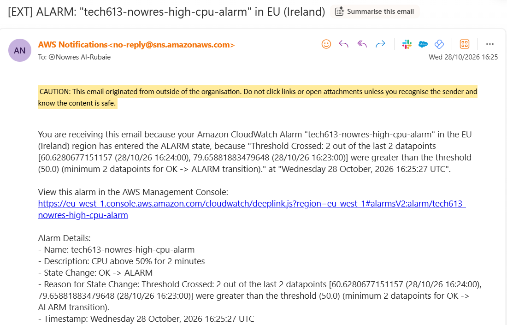


## Alarm states

| State | Meaning |
|-------|---------|
| **OK** | CPU is below the threshold |
| **In alarm** | CPU has breached the threshold for the set time |
| **Insufficient data** | Not enough data yet (common right after creation) |

