# Autoscaling

Auto Scaling in AWS automatically creates or removes EC2 instances depending on demand.

## Horizontal vs Vertical Scaling

- **Vertical scaling** (scale up/down): Increase or decrease the power (CPU/RAM) of one EC2 instance.
  - **Why use it:** It's simple, because there's nothing to change in the app or architecture. It suits apps that can't run on several servers at once, such as a single database or a legacy app.
  - **Downsides:** There's a hardware limit, as an instance can only get so big. It usually needs a restart to resize, so there's downtime. It also leaves a single point of failure.

- **Horizontal scaling** (scale out/in): Add or remove EC2 instances/nodes.
  - **Why use it:** It handles very large loads with no upper limit, and there's no downtime when adding instances. It's more resilient too: if one instance fails, the others keep serving users. It also works with auto scaling, so capacity can follow demand automatically.
  - **Downsides:** The app must work across multiple servers (e.g. no data stored only on one instance), and it needs a load balancer to spread traffic.

| | Vertical | Horizontal |
|---|---|---|
| **Method** | Make one server bigger | Add more servers |
| **Downtime to scale** | Usually yes | No |
| **Limit** | Hardware maximum | Practically none |
| **Fault tolerance** | Single point of failure | High |
| **Best for** | Simple or legacy apps, databases | Web apps, modern cloud apps |

> **In this task:** the Auto Scaling group uses **horizontal scaling**. It adds or removes tic-tac-toe instances behind the load balancer as demand changes.

## Types of Scaling Diagram

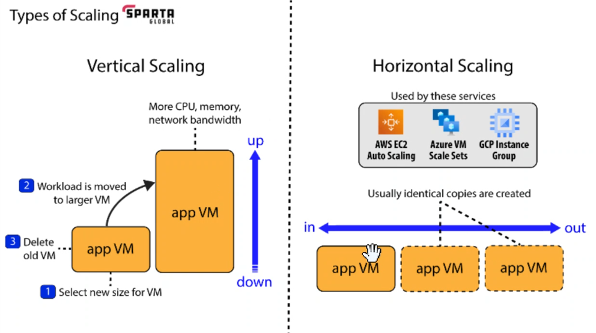

## AWS Auto Scaling Diagram

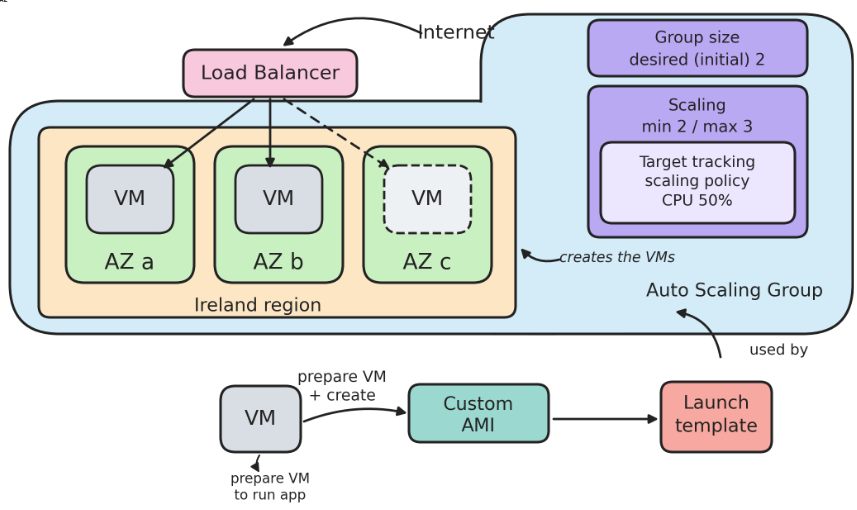
---

# Purpose of Each Resource

## 1. Launch Template
- A saved blueprint for creating instances.
- Stores the AMI (your tic-tac-toe app), key pair, and security group rules.
- Every instance the Auto Scaling group creates uses it, so they are all identical.

## 2. Auto Scaling Group
- Automatically adds or removes EC2 instances depending on demand (horizontal scaling).
- Keeps the number of instances between the minimum (2) and maximum (3).
- Replaces any instance that fails (self-healing).

## 3. Load Balancer
- Sits in front of your instances and is the single entry point for users.
- Spreads incoming traffic across all running instances.
- Gives you one DNS name, so users don't need each instance's IP.

## 4. Target Group
- The list of instances the load balancer sends traffic to.
- Runs health checks and only sends traffic to healthy instances.
- The Auto Scaling group registers new instances into it automatically.

| Resource | Purpose in one line |
|----------|---------------------|
| Launch template | Blueprint for each instance |
| Auto Scaling group | Adds, removes and replaces instances |
| Load balancer | Spreads traffic across instances |
| Target group | Tracks which instances are healthy and receive traffic |

# Create a Launch Template

1. Click **Create launch template**.

   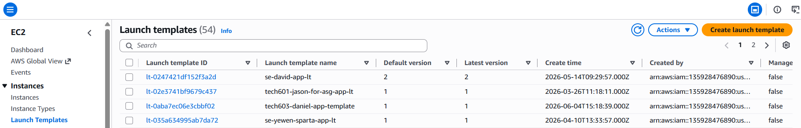

2. Name the launch template and select your tic-tac-toe **AMI**.

   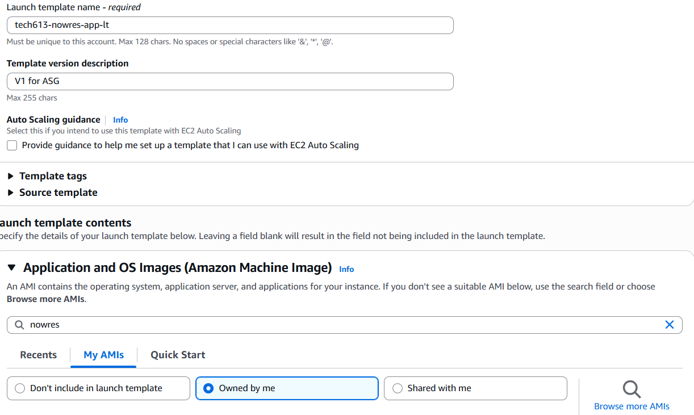

3. Select your **key pair** for logging in.

4. Under **Network settings**, add the following security group rules:

   | Type | Protocol | Port | Source |
   |------|----------|------|--------|
   | HTTP | TCP | 80 | 0.0.0.0/0 |
   | SSH | TCP | 22 | 0.0.0.0/0 |
   | Custom TCP | TCP | 3000 | 0.0.0.0/0 |

5. Click **Create launch template**.

---

# Create Auto Scaling Group

1. Click **Auto Scaling groups**.

   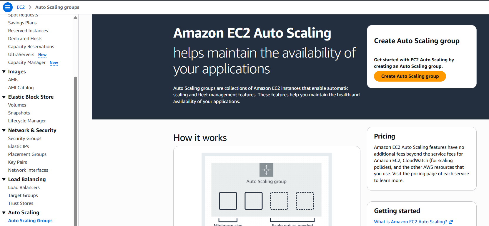

2. Give your Auto Scaling group a name and select your launch template.

   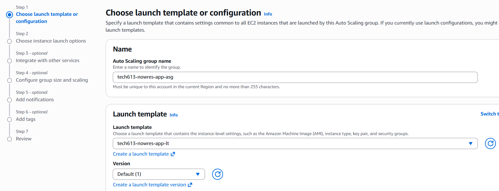

3. On the **step 2** page, select your **availability zones**.

   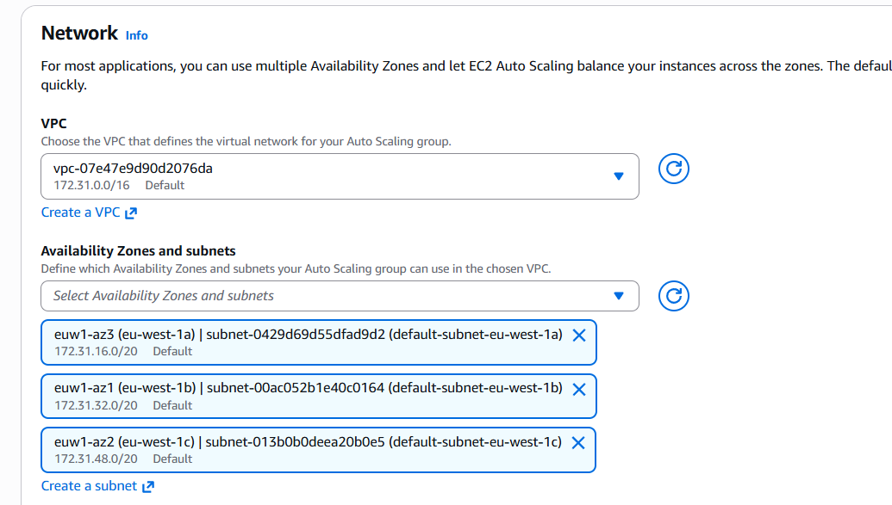

4. On the **step 3** page, select the options shown in the screenshot. Attach a new load balancer, choosing **Application Load Balancer**.

   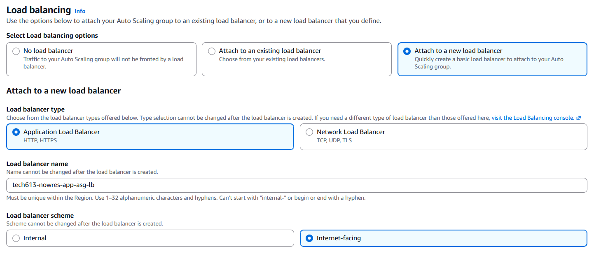

5. Create a **target group** and add `tg` to the end of the target group name.

   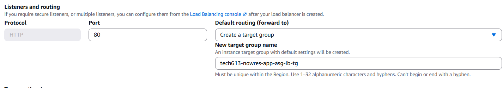

6. In the **Health checks** section, select **Turn on Elastic Load Balancing health checks**.

   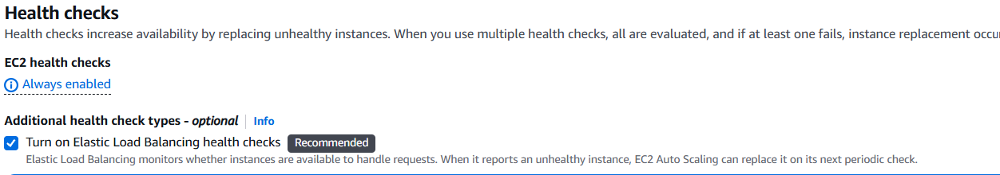

7. On the **step 4** page, set the group size:

   | Setting | Value |
   |---------|-------|
   | Desired capacity | 2 |
   | Minimum desired capacity | 2 |
   | Maximum desired capacity | 3 |

   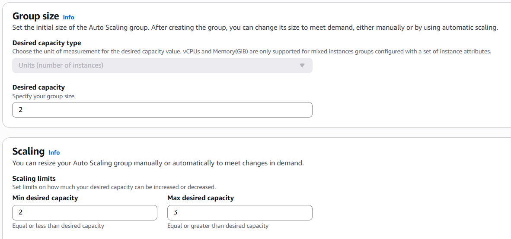

8. Under **Automatic scaling**, select **Target tracking scaling policy**.

   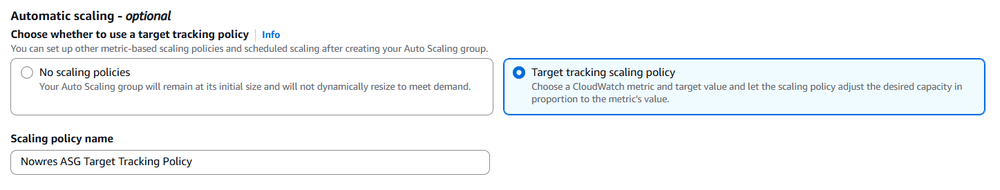

9. Tick **Enable group metrics collection within CloudWatch**.

   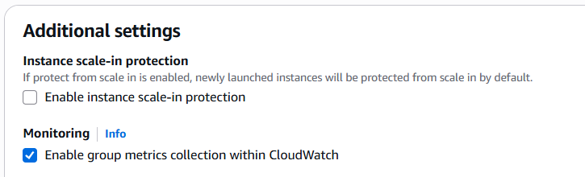

10. On the **step 6** page, add a **tag**.

    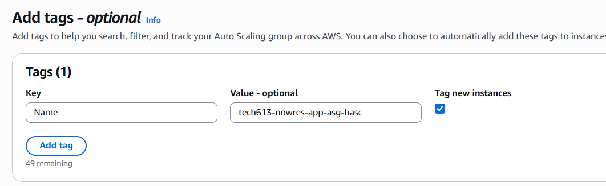

---

# Test the Auto Scaling Group

## Test an instance directly

1. Open **Instance management**.
2. Click any of the instances and paste its **public IP address** into your browser's URL bar (using `http`).
3. The tic-tac-toe app will appear.

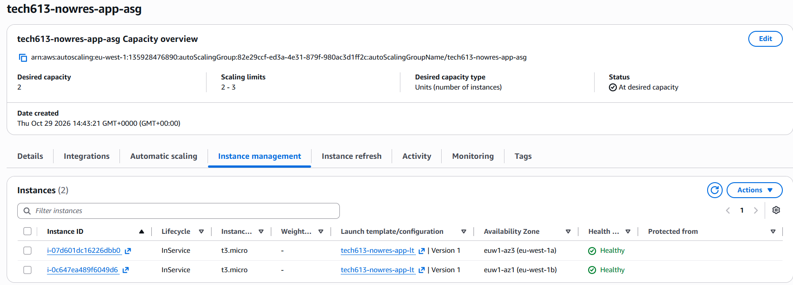

## Test through the load balancer

1. Open **Load balancers**.

   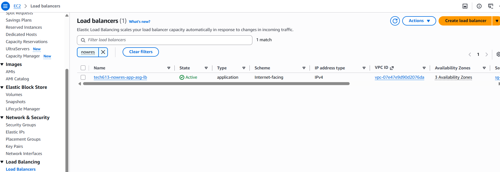

2. Copy the **DNS name** and paste it into your browser's URL bar. It will open one of the instances (containers).

   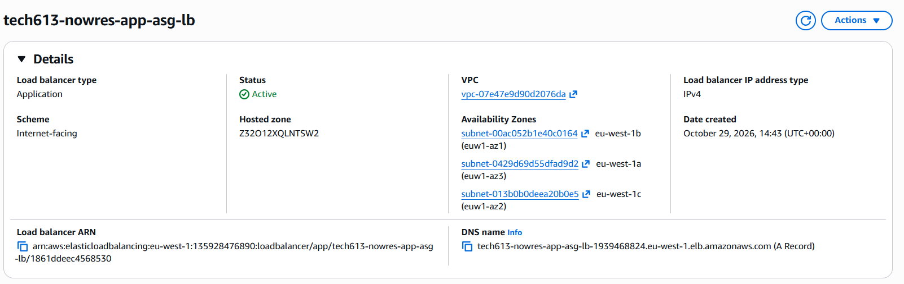

## Test self-healing

If you have two instances and delete one (from **Instances**), another instance will appear automatically in **Instance management**, because the minimum number of instances was set to 2.

---

# Clean Up

Delete resources in this order:

1. **Auto Scaling group** (this also deletes its instances)
2. **Load balancer**
3. **Target group**

> **Do not delete the launch template.**