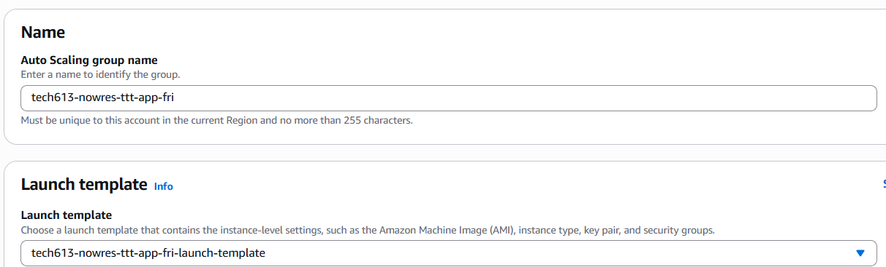
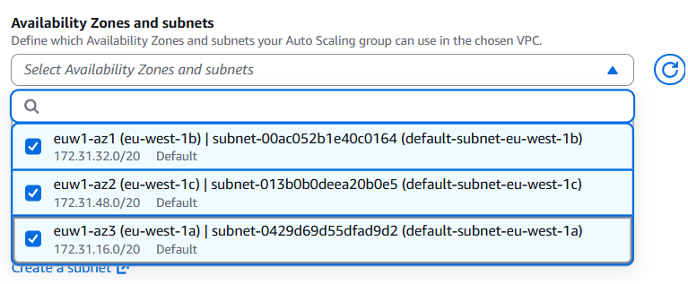
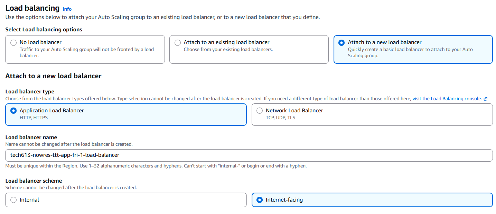
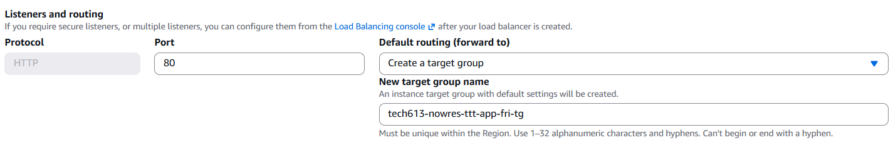
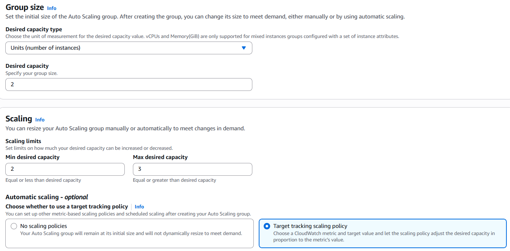
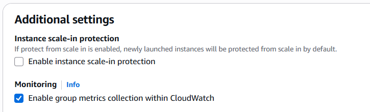
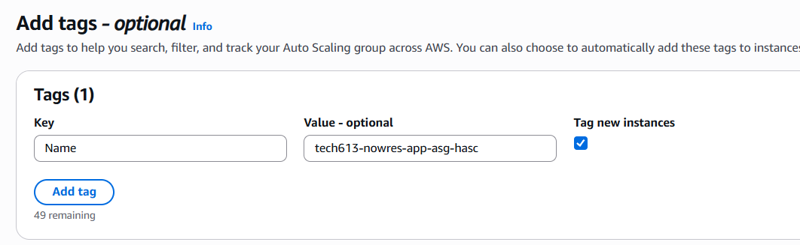
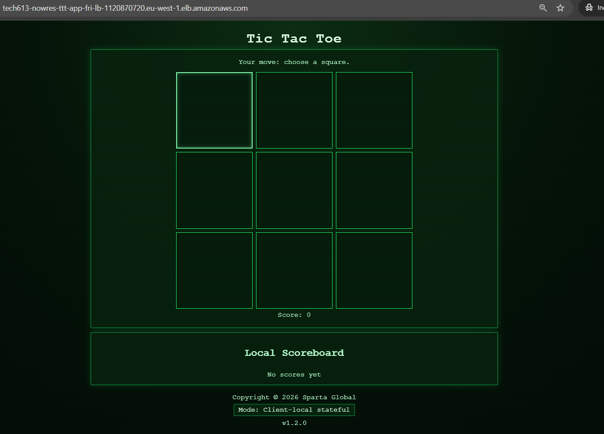

# Task: Create a New Auto Scaling Group (ASG) with the Tic-Tac-Toe App and DB

## Architecture

### 1. DB Instance (Database Server) 
**What it is:**  
A separate EC2 instance that stores all the game data.

**Purpose:**
- Stores game moves and results.
- Keeps data safe even if an app server restarts.
- Runs separately from the ASG because databases cannot be easily scaled by simply adding more instances.

**Think of it as:**  
A filing cabinet that stores all the information.

---

### 2. ASG (Auto Scaling Group) 
**What it is:**  
A service that automatically creates and removes app servers as needed.

**Purpose:**
- Replaces failed app instances automatically.
- Adds more instances when traffic increases.
- Removes unnecessary instances when traffic decreases.
- Decides which availability zone an instance is in.

**Think of it as:**  
A manager who hires more workers when the workload increases.

---

### 3. App Instances (Tic-Tac-Toe Servers) 
**What they are:**  
EC2 instances running the tic-tac-toe application.

**Purpose:**
- Receive and process user requests.
- Run the game logic.
- Read from and write data to the database.

**Think of them as:**  
Workers serving customers.

---

### 4. Launch Template 
**What it is:**  
A blueprint used by the ASG to create new instances.

**Purpose:**
- Defines the AMI, instance type, security groups, and startup configuration.
- Ensures every new app instance is configured identically.

**Think of it as:**  
A recipe for creating identical workers.

---

### 5. Application Load Balancer (ALB) 
**What it is:**  
The entry point for all user traffic.

**Purpose:**
- Receives incoming requests from users.
- Distributes traffic across app instances.
- Prevents any single instance from becoming overloaded.

**Think of it as:**  
A receptionist directing customers to available workers.

---

## Step 1: Check the DB instance
1. Make sure the DB instance is running.
2. Note its **private IP address** (use private, not public, for app-to-DB traffic).
3. Check its security group allows the DB port from the app's security group:

   | Type | Protocol | Port | Source |
   |------|----------|------|--------|
   | SSH | TCP | 22 | Your IP |
   | Custom TCP (DB port, e.g. 27017 for MongoDB) | TCP | 27017 | App security group |

## Step 2: Prepare the App AMI
1. Open your existing app instance and set the DB connection to the DB's private IP (e.g. `DB_HOST=<db-private-ip>`).
2. Test the app works with the DB.
3. Create a new **AMI** from that instance so every ASG instance connects to the DB automatically.

## Step 3: Create the Launch Template
1. Click **Create launch template**.
2. Name it and select your tic-tac-toe **AMI**.
3. Select your **key pair**.
4. Add security group rules:

   | Type | Protocol | Port | Source |
   |------|----------|------|--------|
   | HTTP | TCP | 80 | 0.0.0.0/0 |
   | SSH | TCP | 22 | 0.0.0.0/0 |
   | Custom TCP | TCP | 3000 | 0.0.0.0/0 |

5. Click **Create launch template**.

## Step 4: Create the Auto Scaling Group
1. Click **Auto Scaling groups** → **Create**.
2. Name it **tech613-nowres-ttt-app-fri** and select your launch template.
   
3. Step 2: select your **availability zones**.
    
4. Step 3: attach a new **Application Load Balancer**.
    
5. Create a **target group** with `tg` at the end of its name.
    
6. Turn on **Elastic Load Balancing health checks**.
7. Step 4: set the group size:

   | Setting | Value |
   |---------|-------|
   | Desired capacity | 2 |
   | Minimum capacity | 2 |
   | Maximum capacity | 3 |

8. Choose **Target tracking scaling policy**.

    
9.  Tick **Enable group metrics collection within CloudWatch**.
    
10. Step 6: add a **tag**.
    
11. Click **Create Auto Scaling group**.

## Step 5: Test
1. **Instance directly:** open an instance's public IP in the browser (`http`). The app should load.
2. **Load balancer:** go to **Load balancers**, copy the **DNS name** and open it in the browser.
3. **DB check:** use the app in a way that reads or writes data (e.g. save or load a game/score). If it works, the DB is connected.
4. **Self-healing:** delete one instance. Another should appear automatically.

## Troubleshooting
| Problem | Likely cause | Fix |
|---------|--------------|-----|
| App loads but DB doesn't work | Wrong DB IP in AMI, or DB security group blocks the app | Update the IP, rebuild the AMI, allow the DB port from the app SG |
| Targets show unhealthy | App not running on the health check port | Check the app starts on boot and the target group port is correct |
| LB DNS times out | Security group or subnet issue | Allow HTTP 80 and check AZs match the instances |

## Clean Up (order matters)
1. **Auto Scaling group** (also deletes its instances)
2. **Load balancer**
3. **Target group**

> **Do not delete the launch template.**
>
> 