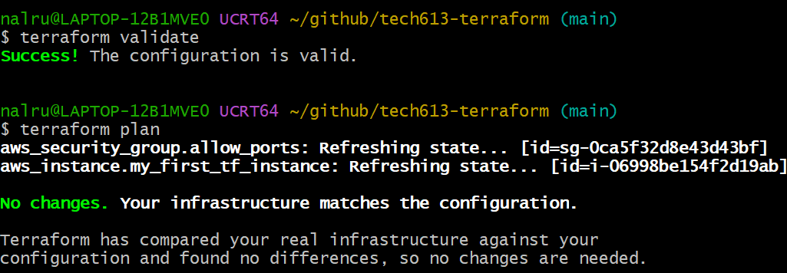
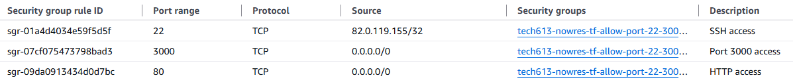
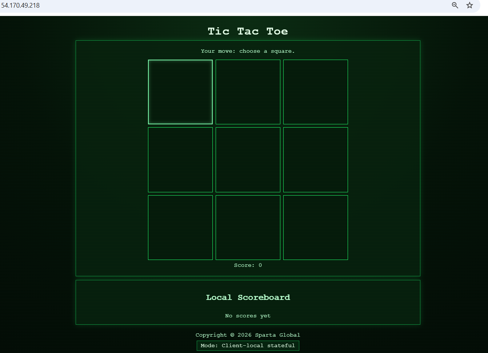
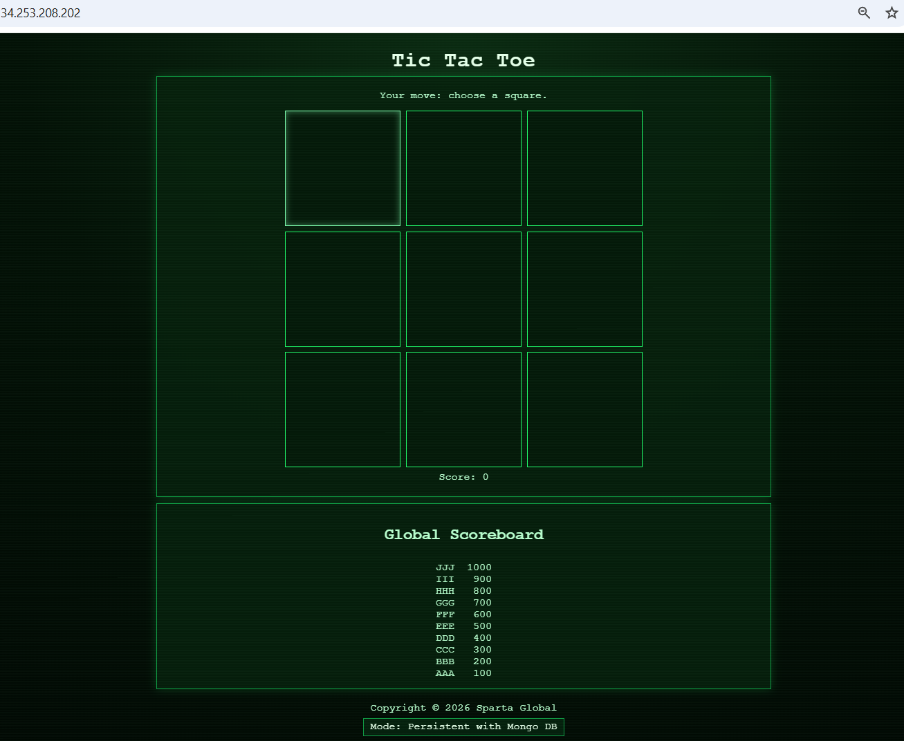
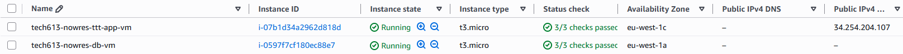
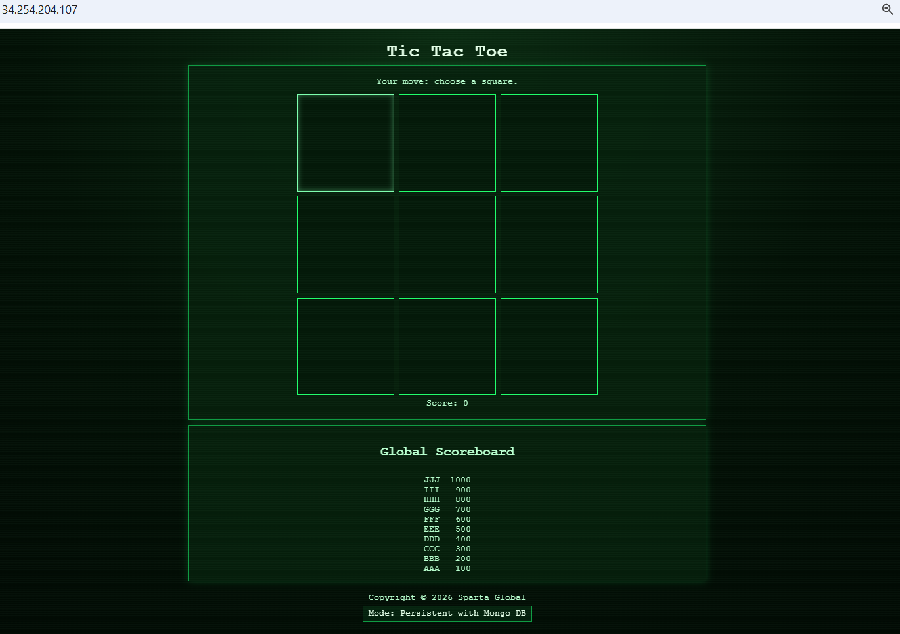

# Creating an AWS Security Group and Attaching it to an EC2 Instance using Terraform 

## Source Code 

- [View source code](https://github.com/n-al-rubaie/tech613-terraform)

## Task Requirements

- Create an AWS Security Group named `tech613-nowres-tf-allow-port-22-3000-80`
- Allow SSH access (port 22) from my local machine only
- Allow port 3000 from all IP addresses
- Allow port 80 from all IP addresses
- Attach the Security Group to an EC2 instance
- Attach an AWS Key Pair to the EC2 instance
- Verify the infrastructure was created successfully

---


## Add this code to your main.tf file 

```hcl
# Create infrastructure in AWS Ireland region
provider "aws" {

  # AWS Region (Ireland)
  region = "eu-west-1"
}

# Security Group created by Terraform
resource "aws_security_group" "allow_ports" {

  # Security Group name required by the task
  name = "tech613-nowres-tf-allow-port-22-3000-80"

  # Allow SSH from my machine only
  ingress {
    description = "SSH access"
    from_port   = 22
    to_port     = 22
    protocol    = "tcp"
    cidr_blocks = ["my_ip_address/32"]
  }

  # Allow application access from anywhere
  ingress {
    description = "Port 3000 access"
    from_port   = 3000
    to_port     = 3000
    protocol    = "tcp"
    cidr_blocks = ["0.0.0.0/0"]
  }

  # Allow web traffic from anywhere
  ingress {
    description = "HTTP access"
    from_port   = 80
    to_port     = 80
    protocol    = "tcp"
    cidr_blocks = ["0.0.0.0/0"]
  }

  # Allow all outbound traffic
  egress {
    from_port   = 0
    to_port     = 0
    protocol    = "-1"
    cidr_blocks = ["0.0.0.0/0"]
  }

  tags = {
    Name = "tech613-nowres-tf-allow-port-22-3000-80"
  }
}

# Create an EC2 instance
resource "aws_instance" "my_first_tf_instance" {

  # Ubuntu 22.04 AMI
  ami = "ami-0c1c30571d2dae5c9"

  # Instance size
  instance_type = "t3.micro"

  # Existing AWS Key Pair
  key_name = "tech613-nowres-aws-key"

  # Attach Security Group created above
  vpc_security_group_ids = [
    aws_security_group.allow_ports.id
  ]

  # Instance Name tag
  tags = {
    Name = "tech613-nowres-tf-first-vm"
  }
}
```


A Security Group was created using Terraform with the following rules:

| Port | Usage | Source |
|--------|--------|--------|
| 22 | SSH | My public IP address only |
| 3000 | Application Access | Anywhere |
| 80 | HTTP Web Traffic | Anywhere |

An outbound rule was also configured to allow all traffic

---


The EC2 instance was updated to:

- Use the existing AWS Key Pair (`tech613-nowres-aws-key`)
- Use the Terraform-created Security Group
- Launch a `t3.micro` Ubuntu instance in the Ireland region (`eu-west-1`)

---

## Validate Terraform Configuration

Execute the commands below in bash:

```bash
terraform validate
terraform plan
```

- **Terraform validate**: Verifies that the Terraform configuration is valid and contains no syntax errors

- **Terraform plan**: Previews the infrastructure changes Terraform will make before deployment


The validation completed successfully and Terraform generated an execution plan showing the resources that would be created

---

## Deploy Infrastructure

Deploy the infrastructure by running the code below in bash:

```bash
terraform apply
```

Terraform successfully created:

- Security Group
- EC2 Instance

---

## Verify in AWS

Open the name of your instance in AWS to confirm that the Security Group had been created correctly.




---


#  Deploy Tic Tac Toe App VM with Terraform

## 1. Configure Variables

### Purpose

Variables allow values to be stored separately from the main Terraform configuration. This makes the code easier to maintain and update, as values can be changed in one place without modifying the resource configuration.

The variables were stored in `variables.tf`:

```hcl
# Custom application AMI ID. ttt = Tic Tac Toe
variable "ttt_ami_id" { 
  default = "ami-08589c5b85a9fba1a"
}

# EC2 instance size
variable "instance_type" {
  default = "t3.micro"
}

# AWS Key Pair used for SSH access
variable "key_name" {
  default = "tech613-nowres-aws-key"
}

# Name assigned to the EC2 instance
variable "instance_name" {
  default = "tech613-nowres-tf-first-vm"
}
```

These variables were then referenced in `main.tf`:

```hcl
ami           = var.ttt_ami_id
instance_type = var.instance_type
key_name       = var.key_name

tags = {
  Name = var.instance_name
}


```

## 2. Configure the EC2 Instance

### Purpose

Defines the virtual machine that Terraform will create.

This configuration (main.tf) specifies:

- Which AMI to use.
- The EC2 instance size.
- Which AWS key pair to attach.
- Which Security Group to attach.
- Whether the instance should receive a public IP address.
- Which user-data script should run on startup.

```hcl
# Create an EC2 virtual machine in AWS
resource "aws_instance" "my_first_tf_instance" {

  # Custom application AMI used to build the instance
  ami = var.ttt_ami_id

  # EC2 instance size (CPU and memory allocation)
  instance_type = var.instance_type

  # Existing AWS key pair used for SSH access
  key_name = var.key_name

  # Assign a public IP address so the application can be accessed externally
  associate_public_ip_address = true

  # Attach the Security Group created by Terraform
  vpc_security_group_ids = [
    aws_security_group.allow_ports.id
  ]

  # Run the user-data script automatically when the instance is first launched
  user_data = file("app-user-data.sh")

  # Add a friendly name tag to the instance
  tags = {
    Name = var.instance_name
  }
}
```

## 3. Configure User Data

### Purpose

User data allows commands to run automatically when the EC2 instance is first created.

This removes the need to manually connect to the server and start the application after deployment.

User data script (app-user-data.sh):

```bash
#!/bin/bash

# Navigate to the application directory
cd /repo/app

# Start the application using PM2 and assign it the name "app"
pm2 start index.js --name app

# Save the PM2 process list so the configuration can be restored
pm2 save
```

The script was attached to the EC2 instance (main.tf) using:

```hcl
# Run user data script on first boot

user_data = file("app-user-data.sh")
```

---


## 4. Deploy Infrastructure

### Purpose

Terraform commands are used to check, preview and deploy the infrastructure.

```bash
terraform fmt
terraform validate
terraform plan
terraform apply
```

- `fmt` formats the configuration.
- `validate` checks the configuration.
- `plan` previews changes.
- `apply` creates the resources.

---

## 5. Recreate the Instance

### Purpose

User data only runs when an instance is first created.

Recreating the instance ensures any changes made to the user-data script are applied.

```bash
terraform taint aws_instance.my_first_tf_instance
terraform apply
```

---




The application was verified by opening the public IP address in a browser and confirming the front page loaded successfully.

---

# Deploy Tic Tac Toe App with Database (MongoDB)

## Objective

Deploy both the Tic Tac Toe application server and MongoDB database server using Terraform.

The application server should automatically connect to the database server and run in **Database Mode** rather than **Local Mode**.

---

## 1. Configure Database Variables

### Purpose

Additional variables were added to store the database AMI ID and database server name.

This keeps the configuration reusable and prevents values being hardcoded directly into resources.

### variables.tf

```hcl
# Custom MongoDB database AMI ID
variable "db_ami_id" {
  default = "YOUR_DATABASE_AMI_ID"
}

# Name assigned to the database EC2 instance
variable "db_instance_name" {
  default = "tech613-nowres-db-vm"
}
```

---

## 2. Create the Database Security Group

### Purpose

A dedicated Security Group was created for the database server.

MongoDB uses port **27017** and should only accept traffic from the application server.

### main.tf

```hcl
# Database Security Group
resource "aws_security_group" "db_sg" {

  # Database Security Group name
  name = "tech613-nowres-db-sg"

  # Allow MongoDB traffic only from the App Security Group
  ingress {
    from_port       = 27017
    to_port         = 27017
    protocol        = "tcp"
    security_groups = [aws_security_group.allow_ports.id]
  }

  # Allow all outbound traffic
  egress {
    from_port   = 0
    to_port     = 0
    protocol    = "-1"
    cidr_blocks = ["0.0.0.0/0"]
  }

  tags = {
    Name = "tech613-nowres-db-sg"
  }
}
```

---

## 3. Create the Database EC2 Instance

### Purpose

A second EC2 instance was deployed using the custom MongoDB database AMI.

This instance hosts the database used by the Tic Tac Toe application.

### main.tf

```hcl
# Create Database EC2 instance
resource "aws_instance" "database_vm" {

  # Custom MongoDB database AMI
  ami = var.db_ami_id

  # EC2 instance size
  instance_type = var.instance_type

  # Existing AWS Key Pair
  key_name = var.key_name

  # Attach the Database Security Group
  vpc_security_group_ids = [
    aws_security_group.db_sg.id
  ]

  # Assign a friendly name to the instance
  tags = {
    Name = var.db_instance_name
  }
}
```

---

## 4. Output the Database Private IP Address

### Purpose

The application server needs to know where the MongoDB server is located.

Terraform outputs the database private IP address so it can be passed into the application.

### main.tf

```hcl
# Output database private IP address
output "database_private_ip" {
  value = aws_instance.database_vm.private_ip
}
```

After deployment:

```bash
terraform output database_private_ip
```

Example output:

```text
172.31.57.9
```

---

## 5. Configure the Application to Use MongoDB

### Purpose

The Tic Tac Toe application checks the environment variable:

```text
MONGODB_URI
```

If this variable is configured correctly, the application automatically switches from Local Mode to Database Mode.

---

## 6. Pass Database IP into User Data

### Purpose

Terraform was updated to dynamically pass the database private IP address into the application startup script.

This removes the need to manually edit configuration after deployment.

### main.tf

```hcl
# Pass database private IP into user-data
user_data = templatefile("app-user-data.sh", {
  db_ip = aws_instance.database_vm.private_ip
})
```

---

## 7. Update User Data Script

### Purpose

The startup script sets the MongoDB connection string and starts the application automatically.

### app-user-data.sh

```bash
#!/bin/bash

# Set the MongoDB connection string using the database VM private IP
export MONGODB_URI="mongodb://${db_ip}:27017/tictactoe"

# Navigate to the Tic Tac Toe application directory
cd /repo/app

# Start the application in PM2 and assign it the name "app"
pm2 start index.js --name app

# Save the PM2 process list so it can be restored automatically
pm2 save
```

---

## 8. Recreate the Application Instance

### Purpose

User-data only executes when an EC2 instance is first created.

The application instance was recreated so the updated startup script would run.

```bash
terraform taint aws_instance.my_first_tf_instance
terraform apply
```

---

## 9. Deploy Infrastructure

### Purpose

Terraform validates, plans and applies the infrastructure changes.

```bash
terraform fmt
terraform validate
terraform plan
terraform apply
```

---

## Outcome

Run the **Public IPv4 Address** of the application EC2 instance from the AWS Console.

Open the address in a web browser:

```text
http://APP_PUBLIC_IP
```




# Deploy Tic Tac Toe App & Database in a Custom VPC

## Objective

The objective of this task was to improve the existing Terraform deployment by moving both the application server and database server into a custom VPC.

The infrastructure was updated so that:

- The application server runs inside a public subnet
- The database server runs inside a private subnet
- The application remains accessible from the internet
- The database is protected from direct external access
- MongoDB traffic is restricted to the application server only

---

## Architecture

```text
Internet
    │
    ▼
Internet Gateway
    │
    ▼
Public Route Table
    │
    ▼
Public Subnet
    │
    ▼
App VM
    │
MongoDB (27017)
    │
    ▼
Private Subnet
    │
    ▼
Database VM
```

---

## 1. Create a Custom VPC

### Purpose

A custom VPC was created to provide an isolated network environment for the application infrastructure.

### main.tf

```hcl
# Create a custom VPC to host all application infrastructure
resource "aws_vpc" "main" {
  cidr_block = "10.0.0.0/16"

  tags = {
    Name = "tech613-nowres-vpc"
  }
}
```

### Explanation

- `10.0.0.0/16` defines the CIDR block of the VPC
- All networking resources are deployed inside this VPC

---

## 2. Create Public and Private Subnets

### Purpose

Separate subnets were created to isolate public-facing resources from backend resources.

### main.tf

```hcl
# Public subnet used for resources that require internet access
resource "aws_subnet" "public" {
  vpc_id                  = aws_vpc.main.id
  cidr_block              = "10.0.2.0/24"
  map_public_ip_on_launch = true

  tags = {
    Name = "tech613-nowres-public-subnet"
  }
}

# Private subnet used for resources that should not be publicly accessible
resource "aws_subnet" "private" {
  vpc_id     = aws_vpc.main.id
  cidr_block = "10.0.3.0/24"

  tags = {
    Name = "tech613-nowres-private-subnet"
  }
}
```

### Explanation

- The public subnet hosts the application server
- The private subnet hosts the database server
- Separating the subnets improves security by preventing direct public access to the database

---

## 3. Create an Internet Gateway

### Purpose

An Internet Gateway was created to provide internet access to resources in the public subnet.

### main.tf

```hcl
# Attach an Internet Gateway to provide internet access
resource "aws_internet_gateway" "igw" {
  vpc_id = aws_vpc.main.id

  tags = {
    Name = "tech613-nowres-igw"
  }
}
```

### Explanation

Without an Internet Gateway, users would not be able to access the application through a web browser.

---

## 4. Create a Public Route Table

### Purpose

A route table was created to direct internet traffic through the Internet Gateway.

### main.tf

```hcl
# Route table for directing public traffic to the Internet Gateway
resource "aws_route_table" "public_rt" {
  vpc_id = aws_vpc.main.id

  route {

    # Route all internet traffic through the Internet Gateway
    cidr_block = "0.0.0.0/0"
    gateway_id = aws_internet_gateway.igw.id
  }

  tags = {
    Name = "tech613-nowres-public-route-table"
  }
}
```

### Explanation

The route:

```text
0.0.0.0/0
```

represents all internet traffic and forwards that traffic through the Internet Gateway.

---

## 5. Associate the Route Table with the Public Subnet

### Purpose

The public subnet must be associated with the route table to allow internet communication.

### main.tf

```hcl
# Associate the public subnet with the public route table
resource "aws_route_table_association" "public_assoc" {
  subnet_id      = aws_subnet.public.id
  route_table_id = aws_route_table.public_rt.id
}
```

### Explanation

This association enables resources inside the public subnet to communicate with the internet.

---

## 6. Update the Security Groups

### Purpose

The Security Groups were updated so they would be created inside the custom VPC rather than the default AWS VPC.

### main.tf

```hcl
resource "aws_security_group" "allow_ports" {

  name   = "tech613-nowres-tf-allow-port-22-3000-80"
  vpc_id = aws_vpc.main.id

  ...
}
```

```hcl
resource "aws_security_group" "db_sg" {

  name   = "tech613-nowres-db-sg"
  vpc_id = aws_vpc.main.id

  ...
}
```

### Explanation

Adding:

```hcl
vpc_id = aws_vpc.main.id
```

ensures both Security Groups are deployed inside the new custom VPC.

---

## 7. Deploy the Application Server into the Public Subnet

### Purpose

The application server was moved into the public subnet so users could access the Tic Tac Toe application from the internet.

### main.tf

```hcl
# Deploy the application server
resource "aws_instance" "my_first_tf_instance" {

  # Custom Tic Tac Toe AMI
  ami = var.ttt_ami_id

  # EC2 instance size
  instance_type = var.instance_type

  # Existing AWS Key Pair
  key_name = var.key_name

  # Launch instance into the public subnet
  subnet_id = aws_subnet.public.id

  # Assign a public IP address
  associate_public_ip_address = true

  # Attach the App Security Group
  vpc_security_group_ids = [
    aws_security_group.allow_ports.id
  ]

  # Pass the database private IP into user data
  user_data = templatefile("app-user-data.sh", {
    db_ip = aws_instance.database_vm.private_ip
  })

  tags = {
    Name = var.instance_name
  }
}
```

### Explanation

The application server:

- Uses the custom Tic Tac Toe AMI
- Receives a public IP address
- Is accessible from the internet
- Connects to MongoDB using the database VM's private IP address

---

## 8. Deploy the Database Server into the Private Subnet

### Purpose

The database server was moved into the private subnet to improve security.

### main.tf

```hcl
# Deploy the MongoDB database server
resource "aws_instance" "database_vm" {

  # Custom MongoDB AMI
  ami = var.db_ami_id

  # EC2 instance size
  instance_type = var.instance_type

  # Existing AWS Key Pair
  key_name = var.key_name

  # Launch instance into the private subnet
  subnet_id = aws_subnet.private.id

  # Attach the Database Security Group
  vpc_security_group_ids = [
    aws_security_group.db_sg.id
  ]

  tags = {
    Name = var.db_instance_name
  }
}
```

### Explanation

The database server:

- Uses the custom MongoDB AMI
- Runs inside the private subnet
- Does not require direct public access
- Only accepts MongoDB traffic from the application server

---

## 9. Configure the Application to Use the Database

### Purpose

Terraform automatically passes the database private IP address into the application startup script.

### main.tf

```hcl
# Pass database private IP into user-data
user_data = templatefile("app-user-data.sh", {
  db_ip = aws_instance.database_vm.private_ip
})
```

### app-user-data.sh

```bash
#!/bin/bash

# Set the MongoDB connection string using the database VM private IP
export MONGODB_URI="mongodb://${db_ip}:27017/tictactoe"

# Navigate to the Tic Tac Toe application directory
cd /repo/app

# Start the application in PM2 and assign it the name "app"
pm2 start index.js --name app

# Save the PM2 process list so it can be restored automatically
pm2 save
```

### Explanation

Terraform retrieves the database instance private IP address and injects it into the MongoDB connection string during startup.

This allows the application to run automatically in Database Mode.

---

## 10. Deploy the Infrastructure

### Purpose

Terraform commands were used to validate and deploy the infrastructure.

```bash
terraform fmt
terraform validate
terraform plan
terraform apply
```

### Explanation

- `terraform fmt` formats Terraform files.
- `terraform validate` checks for configuration errors.
- `terraform plan` previews infrastructure changes.
- `terraform apply` creates the infrastructure.

---

## 11. Output Useful Information

### Purpose

Terraform outputs were configured to display important information after deployment.

### main.tf

```hcl
# Output database private IP address
output "database_private_ip" {
  value = aws_instance.database_vm.private_ip
}

# Output application public IP address
output "app_public_ip" {
  value = aws_instance.my_first_tf_instance.public_ip
}
```

### Explanation

These outputs provide:

- The database private IP address used internally by the application
- The application public IP address used to access the website

---

## Outcome

Terraform successfully created:

- A custom VPC
- A public subnet
- A private subnet
- An Internet Gateway
- A Public Route Table
- Application and Database Security Groups
- An Application EC2 Instance
- A Database EC2 Instance

The Tic Tac Toe application was successfully accessed using the EC2 instance public IP address:

```text
http://APP_PUBLIC_IP
```





The database server remained isolated inside the private subnet and only accepted MongoDB traffic from the application server on port `27017`.

This completed the deployment of the Tic Tac Toe application and database infrastructure within a secure custom VPC using Terraform.