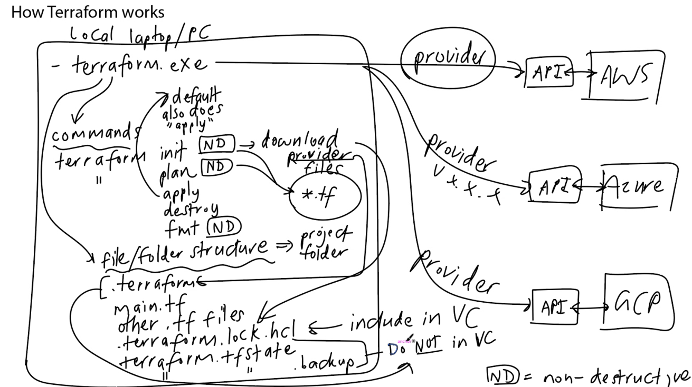

## Intro to Terraform

## What is Terraform?
Terraform is an **Infrastructure as Code (IaC)** tool used to create, update, and manage cloud infrastructure using code.


- Automates infrastructure creation
- Makes deployments repeatable
- Reduces manual errors
- Allows infrastructure to be version controlled
- Terraform code = source of truth

---


### How terraform works diagram


* .terraform.lock.hcl - must be shared with rest of team, as it specifies provider file being used for project, included in VC.

### Why use Terraform? The benefits?
* Declarative - say what you want, not how to do it
* Easy to use
* Sort of open-source
  
  In 2023, started using Business Source License (BSL). This means...
  * Terraform can't be used to create a competing commerical product
  * Some organisations have started using OpenTofu instead
    * OpenTofu aims to be a drop-in replacement
* Cloud-agnostic - deploy to any cloud provider
  * Use different providers (like a plugin) to interface with different cloud providers
  * Each cloud vendor maintains its own provider
* Expressive (refering to the language) and extendable (refering to being able to use different providers to manage different resources)

### Alternatives to Terraform

* Pulumi (not declarative)
* AWS CloudFormation, Azure ARM/Bicep templates, GCP Deployment Manager

### Who is using Terraform in the industry?

Some examples:
* Tech Companies and Startups: Uber, Spotify, Airbnb, Coinbase
* Financial Institutions (regulated industry): JPMorgan Chase, Goldman Sachs, Capital One
* Cloud Providers and SaaS Platforms: AWS, Google Cloud, Salesforce
* Media and Entertainment: The New York Times, Netflix
* Healthcare (regulated industry) and Life Sciences: Philips, Cerner
* Telecommunications: Verizon, T-Mobile
* Retail and E-Commerce: Walmart, Target
* Gaming Industry: Electronic Arts (EA), Riot Games (they make/run League of Legends)
* Government and Public Sector: UK Government Digital Service (GDS), NASA
* Consulting and Cloud Services: Accenture, Deloitte
* Education and Research Institutions: Harvard University, MIT

<br>

### In IaC, what is orchestration?

* Process of automating and managing the entire lifecycle of infrastructure resources

### How does Terraform act as "orchestrator"?
 
* Co-ordinating the piece of instructure to work together
* Includes
  * Setting things up/destroying in the right order
  * Makes sure things are connected together properly

To do this, it relies on understanding the dependencies between resources

### Give access to Terraform to use your cloud provider

#### (🟠 AWS) Best practice supplying AWS credentials to Terraform

What is order in which Terraform looks up AWS credentials (which ways take precedence/priority)?
1. Env variables: AWS_ACCESS_KEY_ID and AWS_SECRET_ACCESS_KEY (Mediocre unless you temporarily set them such as through a key vault to retrieve them when needed)
2. Terraform variables (Worst in terms of security)

   Example:
   
   provider "aws" {
     access_key = "your_access_key"
     secret_key = "your_secret_key"
   }
   
   💥Danger! Never do this! Always avoid hard-coding credentials

3. AWS CLI shared credentials file (saved here when you do `aws configure` command) (Mediocre in terms of security)

4. If using Terraform through an EC2 instance, set IAM role permissions (Best)

<br>

#### (🌐 Azure) Give Terraform access to Azure

If you need to give access from your workstation, the quickest and easiest way:
1. Install Azure CLI
2. Login to Azure using command `az login`

Hint:
* Make sure you only try to create Terraform resources inside of the resource group you've been using
  * e.g. If you try to create your own resource group you will get a permissions error

<br>

#### (🌈 GCP) Give Terraform access to GCP

If you need to give access from your workstation, the quickest and easiest way:
1. Install Google Cloud (gcloud) CLI
2. Login to Azure using command `gcloud init`
3. Create Application Default Credentials (ADC): `gcloud auth application-default login`

Hint:
* There is no need to specify any credentials file when using ADC - Terraform will automatically pickup the credentials

<br>

### Why use Terraform for different environments (e.g. production, testing, etc)

* Production
  * Easily create a larger-scale or more scalable version of infrastructure

* Dev and Testing environments
  * Easily spin up infrastructure for testing/dev that mirrors production
  * Easily tear it down when not needed

<br>

# Terraform Installation

## Objective

Install Terraform and configure it so it can be run from any terminal.

## Steps Completed

### 1. Created IaC Documentation Repository

Created folder in C:\Users\nalru\github:

```
tech613-IaC
```

### 2. Installed Terraform

Downloaded Terraform from the HashiCorp website and extracted the binary

### 3. Configured PATH

Moved terraform.exe to:

```
C:\my-cmd-line-tools\terraform
```

Added this directory to the Windows PATH environment variable
### 4. Verified Installation

Command:

```bash
terraform --version
```

Output:

```bash
Terraform v1.17.1
on windows_amd64
```

### 5. Installed VS Code Extension

Installed the official HashiCorp Terraform extension

## Outcome

Terraform is installed and accessible from any terminal window


# AWS Credentials Setup

## Steps Completed

### 1. Opened Environment Variables

- Searched for "Environment Variables" in Windows
- Opened **Edit the system environment variables**
- Clicked **Environment Variables**

### 2. Added AWS Access Key

Under **User Variables**:

- Clicked **New**
- Variable Name:

```text
AWS_ACCESS_KEY_ID
```

- Variable Value:

```text
[Access Key ID from provided CSV file]
```

### 3. Added AWS Secret Access Key

Under **User Variables**:

- Clicked **New**
- Variable Name:

```text
AWS_SECRET_ACCESS_KEY
```

- Variable Value:

```text
[Secret Access Key from provided CSV file]
```

### 4. Saved Changes

- Clicked **OK** to save all changes
- Closed the Environment Variables windows

### 5. Verified the Configuration

Opened a new Git Bash terminal and ran:

```bash
printenv AWS_ACCESS_KEY_ID
```

Verified the displayed value matched the Access Key ID from the CSV file

Ran:

```bash
printenv AWS_SECRET_ACCESS_KEY
```

Verified the displayed value matched the Secret Access Key from the CSV file

### Security Note

AWS credentials have not been included in this documentation for security reasons

## Outcome

AWS credentials were successfully stored as permanent user environment variables and can now be used by Terraform and AWS tools


# Terraform Workflow

## 1. Write Terraform Configuration

Create `.tf` files:

```text
main.tf
variables.tf
outputs.tf
```

- Defines the infrastructure you want
- Stored as code
- Easy to share and reuse

---

## 2. Run `terraform init`

```bash
terraform init
```

**What it does**
- Downloads provider plugins
- Creates `.terraform` folder

- Terraform needs the provider to communicate with the cloud platform

Example:

```text
AWS Provider
Azure Provider
GCP Provider
```

---

## 3. Run `terraform plan`

```bash
terraform plan
```

**What it does**
- Shows what Terraform will create, change, or destroy

- Allows you to review changes before making them
- Prevents accidental mistakes

**Non-destructive**
- Nothing is changed yet

---

## 4. Run `terraform apply`

```bash
terraform apply
```

**What it does**
- Creates or updates infrastructure

- Applies the changes defined in the `.tf` files

Example:

```text
Create EC2 instance
Create VPC
Create S3 bucket
```

---

## 5. Terraform Uses a Provider

```text
Terraform
    ↓
Provider
    ↓
Cloud API
    ↓
Cloud Platform
```

### AWS Example

```text
Terraform
    ↓
AWS Provider
    ↓
AWS API
    ↓
AWS Resources
```

- Terraform cannot talk directly to AWS, Azure, or GCP
- The provider translates Terraform commands into API calls

---

# Important Commands

## terraform init

```bash
terraform init
```

- Downloads provider files

---

## terraform plan

```bash
terraform plan
```

- Preview changes safely

---

## terraform apply

```bash
terraform apply
```

- Create or modify infrastructure

---

## terraform destroy

```bash
terraform destroy
```

- Remove infrastructure when no longer needed

---

## terraform fmt

```bash
terraform fmt
```

- Automatically formats Terraform code
- Keeps code consistent and readable

---

# Files and Folders

```text
terraform/
├── main.tf
├── other .tf files
├── .terraform.lock.hcl
├── terraform.tfstate
└── terraform.tfstate.backup
```

## main.tf

- Main configuration file containing infrastructure code

---

## .terraform.lock.hcl

- Locks provider versions
- Ensures everyone uses the same provider version

Include in Git ✅

---

## terraform.tfstate

- Stores the current state of infrastructure
- Terraform uses it to track what already exists

Do NOT commit to Git ❌

---

## terraform.tfstate.backup

- Backup of the state file

Do NOT commit to Git ❌

---

# What Goes into Git?

### Include ✅

```text
main.tf
other .tf files
.terraform.lock.hcl
```

- These define the infrastructure code

### Exclude ❌

```text
terraform.tfstate
terraform.tfstate.backup
.terraform/
```

- Generated files
- Environment-specific data
- May contain sensitive information

---

# Easy Way to Remember

```text
Write .tf files
        ↓
terraform init
        ↓
terraform plan
        ↓
terraform apply
        ↓
Resources created in AWS/Azure/GCP
```

