# S3 Storage Manipulation using AWS CLI and Boto3

## Table of Contents

1. [Introduction to AWS S3](#1-introduction-to-aws-s3)
2. [Prerequisites](#2-prerequisites)
3. [Installing the AWS CLI](#3-installing-the-aws-cli)
4. [Working with S3 using the AWS CLI](#4-working-with-s3-using-the-aws-cli)
5. [Using Python Boto3 to Manipulate S3](#5-using-python-boto3-to-manipulate-s3)
6. [Adding Blob Images to the Tic Tac Toe App](#6-adding-blob-images-to-the-tic-tac-toe-app)

---

# 1. Introduction to AWS S3

**AWS S3 = Simple Storage Service**

- Used to store or retrieve any amount of data from anywhere you are connected to the Internet.
- Easy to configure to host a static website on the cloud.
- Provides built-in redundancy: a copy of the data is kept in a minimum of 3 availability zones in the region.
- Can be accessed from the **AWS Console** and the **AWS CLI**.
- Equivalent to **Azure Blob Storage**.

> **Redundancy** in Amazon S3 is the automatic distribution and duplication of data across multiple physical devices and Availability Zones to guarantee high durability and continuous availability.

### How is data stored?

In **buckets** (equivalent to *containers* on Azure).

---

# 2. Prerequisites

An instance called: `tech613-yourname-s3`

| Setting | Value |
|---------|-------|
| Image | Ubuntu 24.04 LTS |
| Security group | SSH open |

SSH into your new instance.

## Security Group Rules

### Inbound Rules

| Port | Protocol | Source    | Purpose |
|------|----------|-----------|---------|
| 22   | TCP      | 0.0.0.0/0 | Allows SSH access to the EC2 instance for remote administration. |
| 80   | TCP      | 0.0.0.0/0 | Allows HTTP traffic so users can access the web application. |

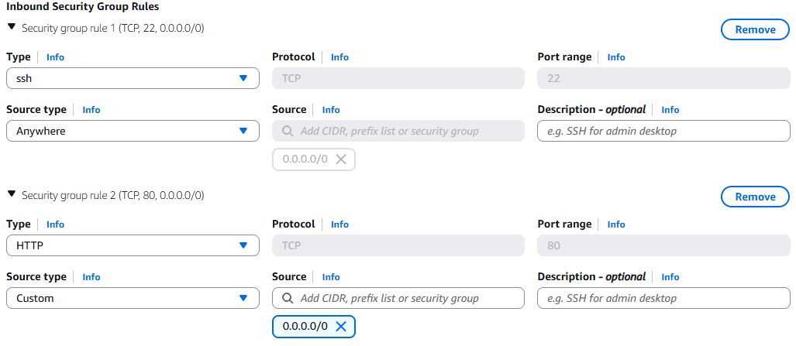

### Outbound Rules 
(AWS adds the outbound rule automatically: All traffic, All ports, 0.0.0.0/0.)

| Port | Protocol | Destination | Purpose |
|------|----------|-------------|---------|
| All  | All      | 0.0.0.0/0   | Allows the instance to communicate with the internet and AWS services, including downloading updates and accessing S3. |

### Notes

- **SSH (Port 22)** is used to connect to the EC2 instance from a terminal using an SSH key.
- **HTTP (Port 80)** allows web traffic to reach the application running on the server.
- The **outbound rule** allows all outgoing traffic, which is required for software installation, updates, and communication with AWS services.

---

# 3. Installing the AWS CLI

## Update the VM

In your Ubuntu VM, run:

```bash
sudo apt-get update
```

Then:

```bash
sudo apt-get upgrade
```

Ensure Python is installed:

```bash
python3 --version
```

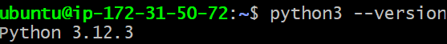

## Install the AWS CLI

```bash
sudo apt update
sudo apt install unzip curl -y
curl "https://awscli.amazonaws.com/awscli-exe-linux-x86_64.zip" -o "awscliv2.zip"
unzip awscliv2.zip
sudo ./aws/install
```

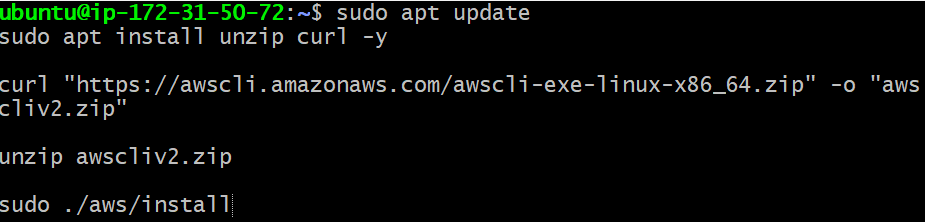

## Verify the AWS CLI is installed

```bash
aws --version
```

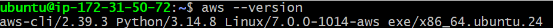

## Log in to the AWS CLI

```bash
aws configure
```

Then enter:

| Prompt | Value |
|--------|-------|
| AWS Access Key ID | *your access key* |
| AWS Secret Access Key | *your secret key* |
| Default region name | `eu-west-1` |
| Default output format | `json` |

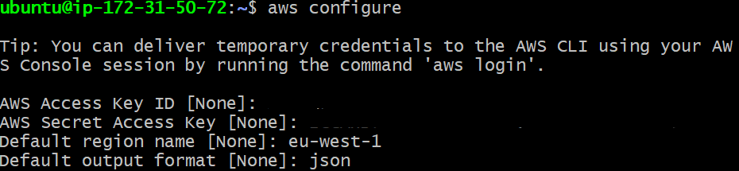

---

# 4. Working with S3 using the AWS CLI

## Access S3

View current buckets:

```bash
aws s3 ls
```


## Create a bucket

```bash
aws s3 mb s3://tech613-nowres-first-bucket
```


Confirmation message that a bucket has been made:

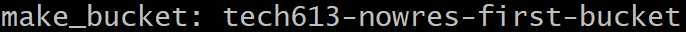

## Put a file in an S3 bucket

Create a text file with some text in it:

```bash
echo This is the first line in a test file > test.txt
```

Then run `ls` to ensure the `.txt` file has been made.

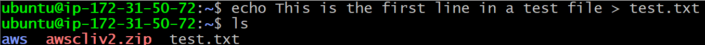

Copy the text file to your bucket:

```bash
aws s3 cp test.txt s3://tech613-nowres-first-bucket
```

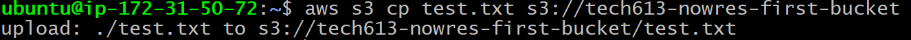

## List the files in a bucket

```bash
aws s3 ls s3://tech613-nowres-first-bucket
```

> `38` = 38 characters (the file size in bytes).

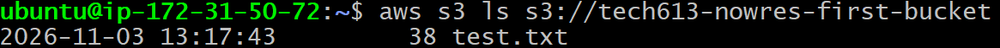

Create another `.txt` file called `test2.txt` and add it to the bucket:

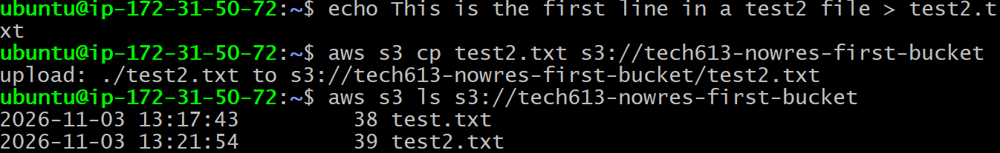

## Download files from the bucket

Create a new downloads folder and go into it:

```bash
mkdir downloads
cd downloads
```

Then run:

```bash
aws s3 sync s3://tech613-nowres-first-bucket .
```

> `.` = synchronise everything that's in the bucket with the current directory.

Run `ls` to ensure the files have been downloaded.

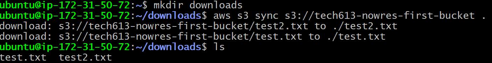

## Remove a single file (`test.txt`) from the bucket

While in the `downloads` folder, run:

```bash
aws s3 rm s3://tech613-nowres-first-bucket/test.txt
```

> **Note:** this removes the file from the bucket only.

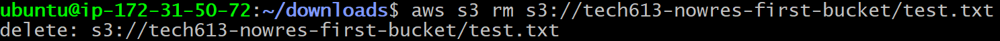

## Remove all files from the bucket

```bash
aws s3 rm s3://tech613-nowres-first-bucket --recursive
```


## Remove the bucket (with files in it)

You must use `--force` to remove a bucket that still contains files:

```bash
aws s3 rb s3://tech613-nowres-first-bucket --force
```

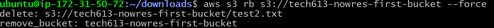

---

# 5. Using Python Boto3 to Manipulate S3

| Tool | Purpose |
|------|---------|
| **AWS CLI** | Manage S3 using terminal commands |
| **boto3** | Manage S3 using Python code |
| **S3** | Store files in AWS cloud storage |
| **AWS Access Keys** | Let your CLI and Python scripts authenticate with AWS |

**Benefit:** automate cloud storage management instead of doing it manually in the AWS Console.

## What each script does

| Script | Description |
|--------|-------------|
| `list_buckets.py` | Displays all S3 buckets |
| `create_bucket.py` | Creates a new S3 bucket |
| `upload_file.py` | Uploads a file to the bucket |
| `download_file.py` | Downloads a file from the bucket |
| `delete_file.py` | Removes a file from the bucket |
| `delete_bucket.py` | Deletes the bucket |

---

## Dependencies

Ensure that you are logged in to your VM with your access key, and that you have installed the AWS CLI, Python and boto3.

### Update the instance

```bash
sudo apt update
sudo apt upgrade -y
```

### Install the AWS CLI

```bash
curl "https://awscli.amazonaws.com/awscli-exe-linux-x86_64.zip" -o "awscliv2.zip"
unzip awscliv2.zip
sudo ./aws/install
```

Verify installation:

```bash
aws --version
```

### Install Python and boto3

```bash
sudo apt install python3-pip -y
pip3 install boto3
```

### Test the installation

```bash
aws --version
```

```bash
python3 -c "import boto3; print(boto3.__version__)"
```

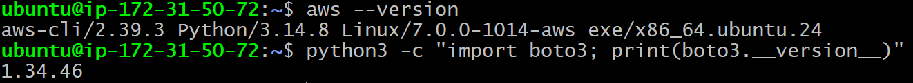

### Confirm you are logged in

```bash
aws sts get-caller-identity
```

---

## Running Boto3 Scripts

### Option 1: Save each script as a `.py` file

In your Ubuntu VM, run:

```bash
nano name_of_python_file.py
```


Then type in your Python code:

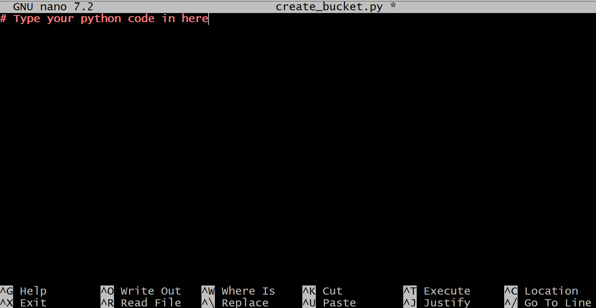

Then:

1. Press `Ctrl + O` (Write Out / save).
2. Press `Enter` to confirm the filename.
3. Press `Ctrl + X` to exit.

To run the file, in your Ubuntu VM run:

```bash
python3 name_of_python_file.py
```

### Option 2: Run Python code without saving a `.py` file

In your Ubuntu VM, type:

```bash
python3
```

Then simply add in the Python code and press Enter to run it. To exit the Python terminal, run:

```python
exit()
```

---

## Script 1: List All S3 Buckets

```python
import boto3

s3 = boto3.client("s3")

response = s3.list_buckets()

for bucket in response["Buckets"]:
    print(bucket["Name"])
```

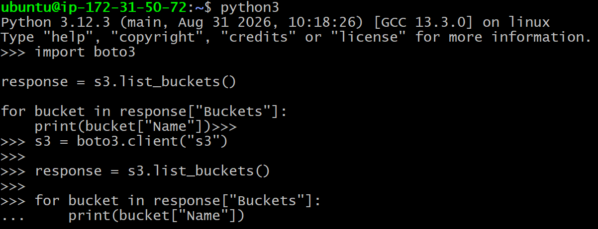

All the S3 buckets will be listed.

---

## Script 2: Create a Bucket (called `tech613-nowres-test-boto3`)

```python
import boto3

s3 = boto3.client("s3")

s3.create_bucket(
    Bucket="tech613-nowres-test-boto3",
    CreateBucketConfiguration={
        "LocationConstraint": "eu-west-1"
    }
)

print("Bucket created")
```

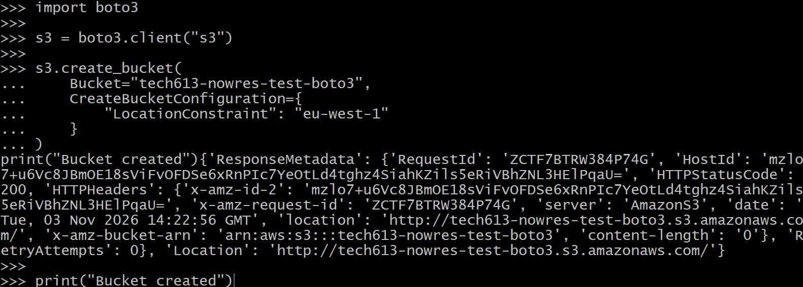

---

## Script 3: Upload a File/Data to the S3 Bucket

Exit the Python terminal by typing:

```python
exit()
```

Then in the Ubuntu VM shell, run the command below to create a `.txt` file:

```bash
echo "Hello from boto3" > test.txt
```


Then go back to the Python shell by running:

```bash
python3
```

Then run:

```python
import boto3

s3 = boto3.client("s3")

s3.upload_file(
    "test.txt",
    "tech613-nowres-test-boto3",
    "test.txt"
)

print("File uploaded")
```

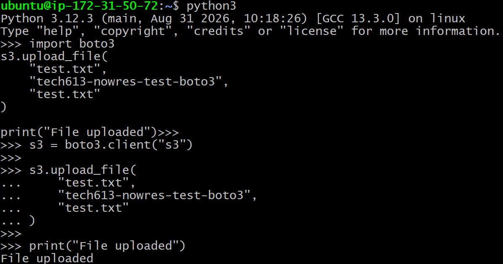

---

## Script 4: Download/Retrieve a File from the S3 Bucket

```python
import boto3

s3 = boto3.client("s3")

s3.download_file(
    "tech613-nowres-test-boto3",
    "test.txt",
    "downloaded.txt"
)

print("File downloaded")
```

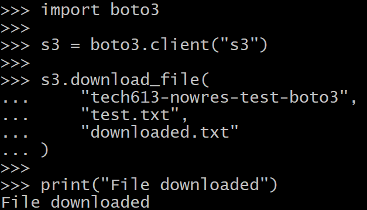

To verify, exit Python using `exit()`, then run:

```bash
cat downloaded.txt
```

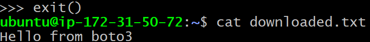

---

## Script 5: Delete a File from the S3 Bucket

```python
import boto3

s3 = boto3.client("s3")

s3.delete_object(
    Bucket="tech613-nowres-test-boto3",
    Key="test.txt"
)

print("File deleted")
```

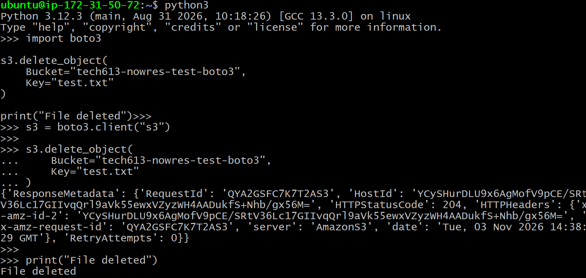

---

## Script 6: Delete the Bucket

```python
import boto3

s3 = boto3.client("s3")

s3.delete_bucket(
    Bucket="tech613-nowres-test-boto3"
)

print("Bucket deleted")
```

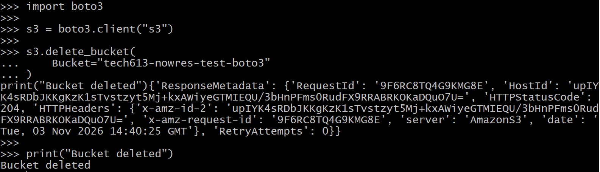

---

# 6. Adding Blob Images to the Tic Tac Toe App

> **Blob** = a file/object stored in cloud storage.

**Purpose:** allows a web application to store and load files from AWS S3 instead of keeping them on the server.

## Before

The Tic Tac Toe app uses local images, loaded directly from the VM:

```text
VM
├── x.png
└── o.png
```

## After

The images are stored in S3, and the app loads them using public URLs:

```text
S3 Bucket
├── x.png (dog)
└── o.png (cat)
```

## Why?

This teaches:

- S3 storage
- Uploading files to S3
- Making files publicly accessible
- Connecting AWS services to an application
- Automation with Bash scripts

## What's the real-world benefit?

Instead of every server storing its own files:

```text
Server 1 → cat.png
Server 2 → cat.png
Server 3 → cat.png
```

all servers can use:

```text
S3 Bucket → cat.png
```

One central storage location.

---

## Step 1: Create the Tic Tac Toe app instance

| Setting | Value |
|---------|-------|
| Name | `tech613-nowres-ttt-images` |
| AMI | Working AMI of the Tic Tac Toe app |

**Security group:**

| Type | Port |
|------|------|
| SSH | 22 |
| HTTP | 80 |
| Custom TCP | 3000 (if your app uses port 3000) |

SSH in:

```bash
ssh -i your-key.pem ubuntu@<public-ip>
```

## Step 2: Install dependencies

In your Ubuntu VM, run:

```bash
sudo apt-get update
```

Then:

```bash
sudo apt-get upgrade
```

### Install the AWS CLI

```bash
sudo apt update
sudo apt install unzip curl -y
curl "https://awscli.amazonaws.com/awscli-exe-linux-x86_64.zip" -o "awscliv2.zip"
unzip awscliv2.zip
sudo ./aws/install
```

Ensure the AWS CLI is installed:

```bash
aws --version
```

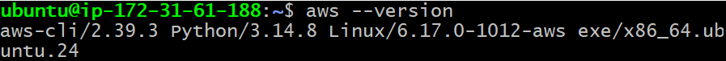

## Step 3: Log in to the AWS CLI

```bash
aws configure
```

Then enter:

| Prompt | Value |
|--------|-------|
| AWS Access Key ID | *your access key* |
| AWS Secret Access Key | *your secret key* |
| Default region name | `eu-west-1` |
| Default output format | `json` |

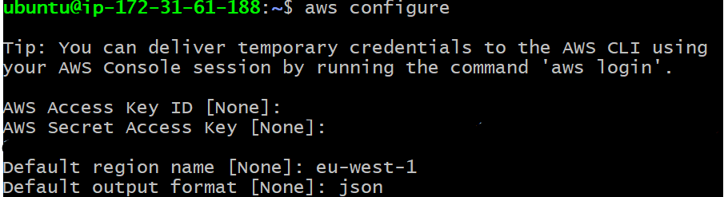

To check you're logged in successfully, run:

```bash
aws sts get-caller-identity
```

## Step 4: Create the S3 bucket

```bash
aws s3 mb s3://tech613-nowres-ttt-images
```

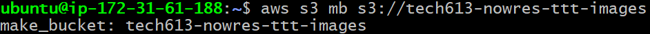

## Step 5: Create an `images` directory

```bash
mkdir images
cd images
```

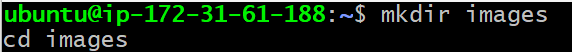

## Step 6: Download a cat and a dog image

```bash
curl -L https://cataas.com/cat -o o.png
curl -L https://placedog.net/500/500 -o x.png
```

Run `ls` to ensure the images are there. Ensure they are `.png` files.

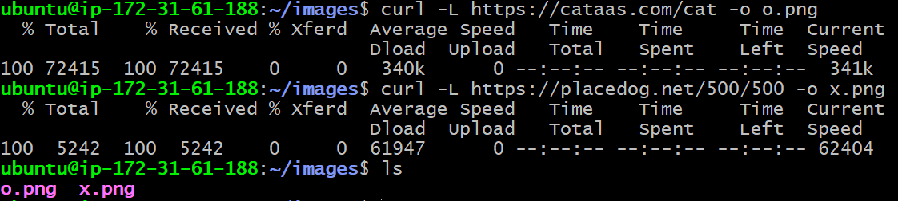

## Step 7: Upload the images to the bucket

```bash
aws s3 cp o.png s3://tech613-nowres-ttt-images/
aws s3 cp x.png s3://tech613-nowres-ttt-images/
```

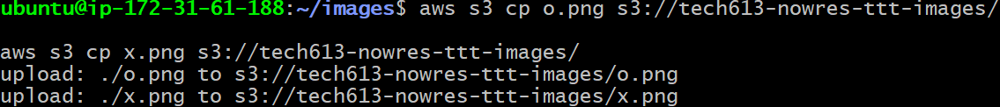

## Step 8: Make the images publicly accessible

### 1. Open the AWS Console

Go to:

```text
S3 → tech613-nowres-ttt-images
```

### 2. Disable Block Public Access

Go to **Bucket → Permissions → Block public access**, then click **Edit** and untick **Block all public access**.

> You must disable *Block all public access* because your Tic-Tac-Toe application needs to display images stored in your S3 bucket to users through a public URL. Disabling Block Public Access allows you to configure public read access so visitors can view the images without needing AWS credentials.

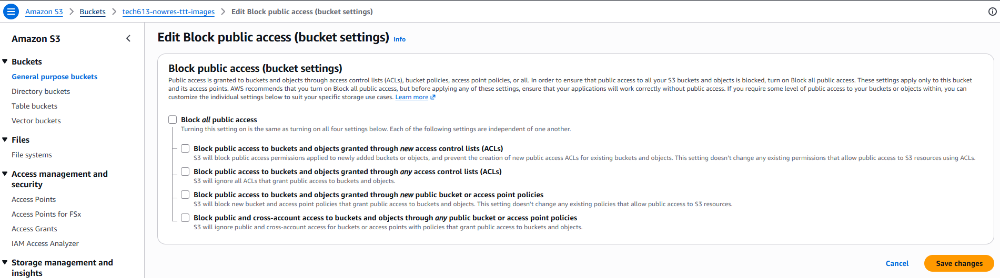

### 3. Make the objects public

Select:

```text
o.png
x.png
```

Choose:

```text
Actions → Make public using ACL
```

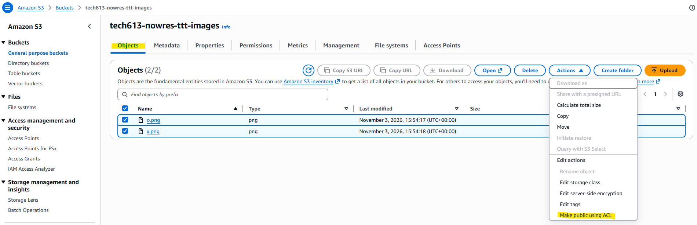

## Step 9: Test the image URLs

Type these into your web browser's URL bar:

```text
https://tech613-nowres-ttt-images.s3.eu-west-1.amazonaws.com/o.png
https://tech613-nowres-ttt-images.s3.eu-west-1.amazonaws.com/x.png
```

You should see the two images appearing.

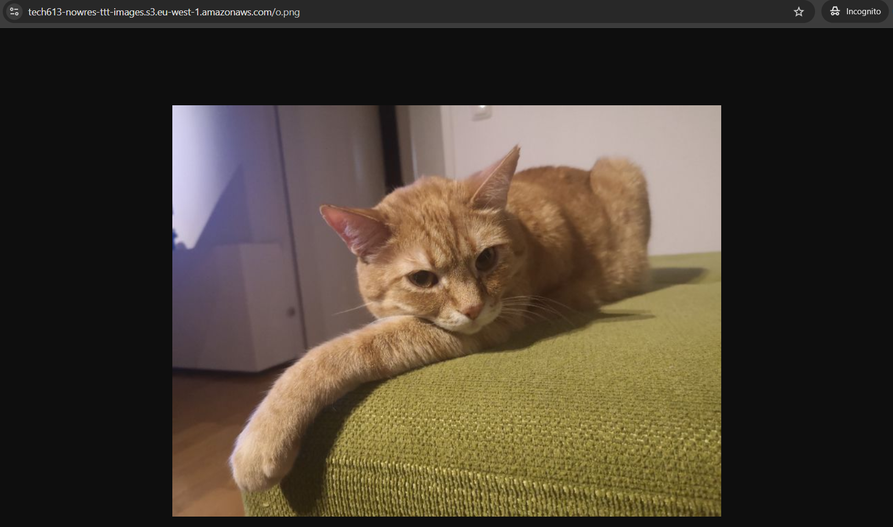
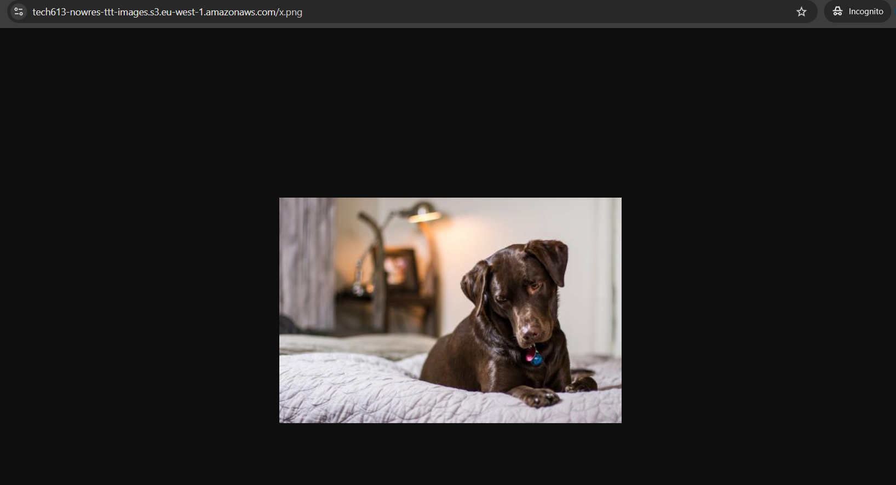

## Step 10: Configure the Tic Tac Toe app

Set the environment variables:

```bash
export USE_MARKER_IMAGES=true
export MARKER_IMAGES_PATH=https://tech613-nowres-ttt-images.s3.eu-west-1.amazonaws.com
```

Check they are set:

```bash
printenv USE_MARKER_IMAGES
printenv MARKER_IMAGES_PATH
```

You should see:

```text
true
https://tech613-nowres-ttt-images.s3.eu-west-1.amazonaws.com
```

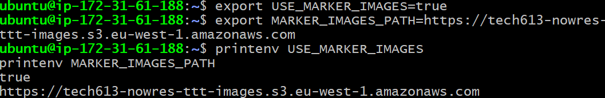

## Step 11: Restart the application

Stop the currently running application:

```bash
pm2 delete all
```

Start the application using PM2:

```bash
USE_MARKER_IMAGES=true MARKER_IMAGES_PATH=https://tech613-nowres-ttt-images.s3.eu-west-1.amazonaws.com pm2 start npm --name tic -- start
```

## Step 12: Verify the application is working

Open the application in a browser by entering the Public IPv4 address in your web browser's URL bar:

```text
http://<Public_IPv4_address>
```

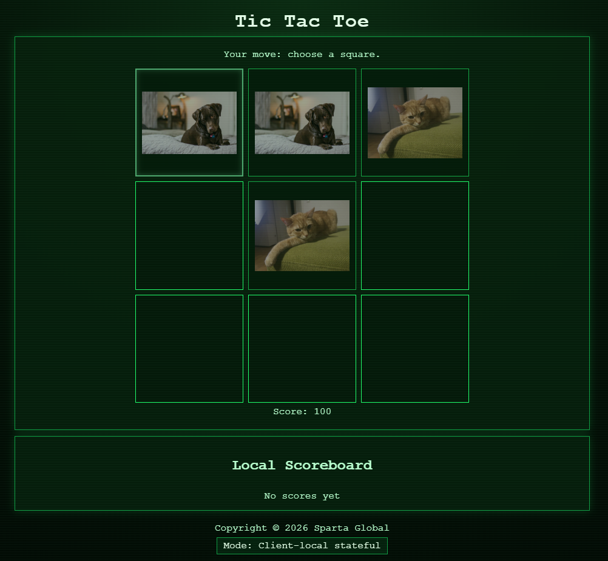