# Virtual Private Cloud (VPC)

A **VPC (Virtual Private Cloud)** is a private network in AWS that contains and connects resources such as EC2 instances, load balancers, and databases while providing network isolation and security.

A **subnet** is a portion of a VPC that contains AWS resources. It helps organise and control network traffic within the VPC. Subnets can be public or private. Each subnet must be associated with an Availability Zone.

---


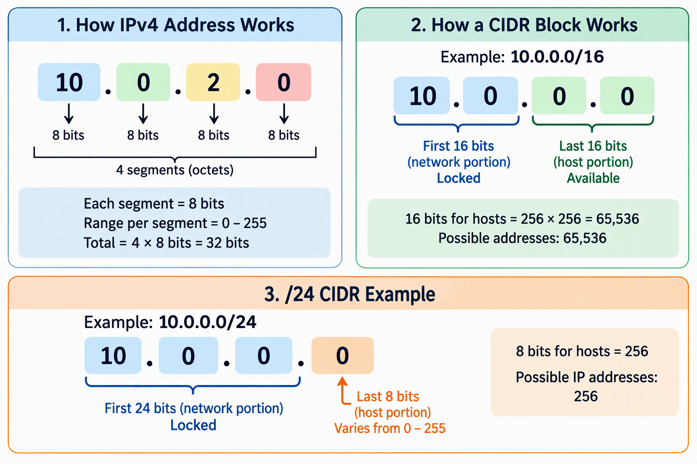

---

## Types of Subnets

### Public Subnet
Resources can be accessed from the internet.

**Example:** Tic-tac-toe app.

### Private Subnet
Resources cannot be accessed directly from the internet.

**Example:** MongoDB database server.

---

## Why Have Multiple Subnets?

### Separate Resources

**Public subnet:** Tic-tac-toe app

**Private subnet:** Database

### Improve Security

- Databases can be hidden from the internet.
- Only web servers are publicly accessible.

### Increase Availability

AWS recommends placing resources in different Availability Zones.

If one Availability Zone fails, resources in another can continue working.

---

# Custom VPC Used to Improve DB Security

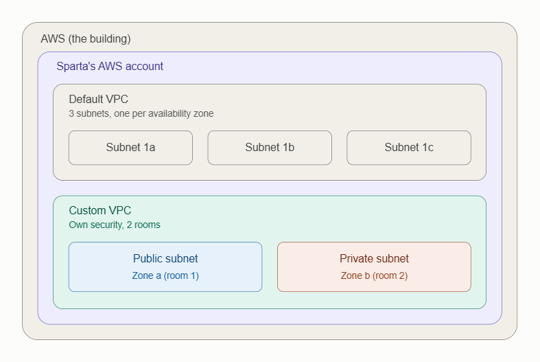

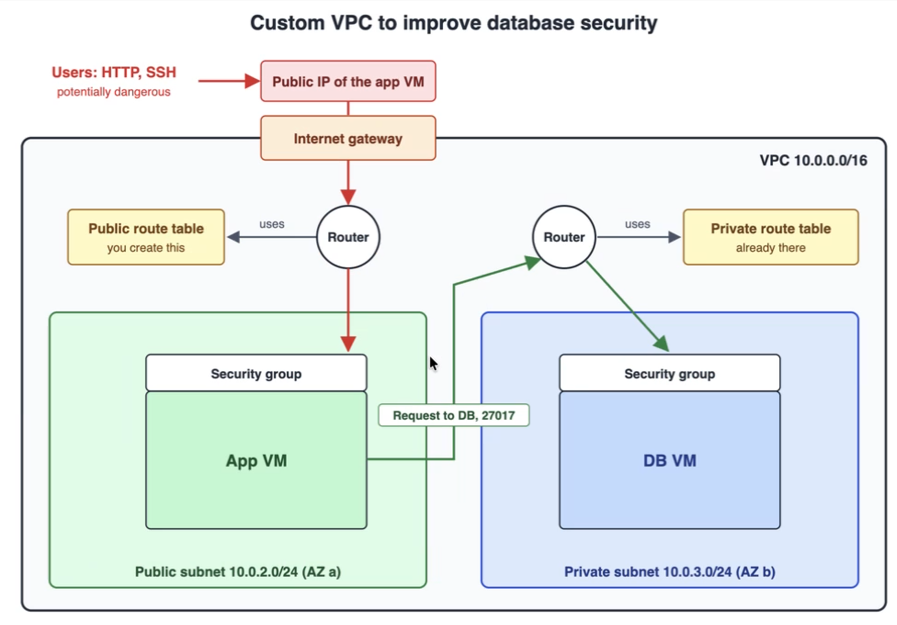

Any VPC IP address starting with `10.` is private.

Example:

```text
10.0.0.0/16
```

The start of the public subnet IP range must match the start of the VPC IP range.

### Public Route Table

Must be created manually.

A route table is a set of rules that directs network traffic from a subnet to the internet through an Internet Gateway.

### Private Route Table

Automatically created with the VPC.

---

## Why Do We Need a VPC?

Without a VPC, AWS resources would exist in a shared environment. A VPC gives us our own private network where we control:

- IP address ranges
- Security rules
- Routing
- Internet access

**Example:** The Tic-Tac-Toe application and MongoDB database are placed inside the same VPC so they can communicate securely using private IP addresses.

---

## Why Do We Need Subnets?

Subnets help us:

- Organise resources
- Separate public and private systems
- Apply different networking rules
- Improve security

**Simple analogy:** VPC = House, Subnets = Rooms.

---

## Why Use a Public Subnet?

A public subnet contains resources that users need to access from the internet.

**Example:**
- Tic-Tac-Toe App Server
- Load Balancer

**Purpose:** Allows users to access the application through a public IP address.

---

## Why Use a Private Subnet?

A private subnet contains resources that should not be accessible from the internet.

**Example:**
- MongoDB Database

**Purpose:** Protects sensitive resources from direct internet access.

Even if someone knows the database IP address, they cannot connect to it directly.

---

## Why Use Both Public and Private Subnets?

```text
Internet
    |
    v
Public Subnet
(App Server)
    |
    v
Private Subnet
(Database)
```

### Benefits

- Better security
- Better organisation
- Industry best practice

The application is public, but the database remains hidden.

---

## Why Do We Need an Internet Gateway (IGW)?

An Internet Gateway connects a VPC to the internet.

Without an Internet Gateway:

- Users cannot access the application.
- EC2 instances cannot access the internet.

**Simple analogy:** The Internet Gateway is the front door of the VPC.

---

## Why Do We Need Route Tables?

A route table contains rules that tell AWS where network traffic should go.

Example:

```text
0.0.0.0/0 → Internet Gateway
```

This means:

> Send all internet traffic to the Internet Gateway.

Without route tables, AWS would not know where to send traffic.

---

## Why Do We Need a Public Route Table?

A public route table contains a route to the Internet Gateway.

**Purpose:** Makes a subnet public.

Without it, the application would not be accessible from the internet.

---

## Why Do We Need a Private Route Table?

A private route table does not contain a route to the Internet Gateway.

**Purpose:** Keeps resources isolated from the internet.

This helps protect databases and other sensitive resources.

---

## Why Do We Need Security Groups?

Security Groups act as virtual firewalls for EC2 instances.

They control:

- Who can connect
- Which ports are open
- Which traffic is blocked

### App VM

- HTTP (80) → Allows users to access the website
- SSH (22) → Allows administrators to log in

### DB VM

- MongoDB (27017) → Allows the application to connect to the database

**Purpose:** Only the application server should be allowed to access the database.

---

## Why Put MongoDB in a Private Subnet?

Databases store important application data.

If the database is placed in a public subnet:

❌ Anyone on the internet can attempt to connect.

If the database is placed in a private subnet:

✅ Only the application server can access it.

This significantly improves security.

---

## Traffic Flow

```text
User
  |
  v
Internet
  |
  v
App VM (Public Subnet)
  |
  v
MongoDB VM (Private Subnet)
```

1. User accesses the app using the App VM's public IP.
2. The App VM receives the request.
3. The App VM communicates with MongoDB using its private IP.
4. MongoDB returns the data.
5. The App VM sends the response back to the user.

### Result

- Application accessible from the internet
- Database protected from the internet
- Secure 2-tier architecture
- AWS best practice
``` ```

# Creating the VPC and Subnets

## 1. Go to VPC in AWS

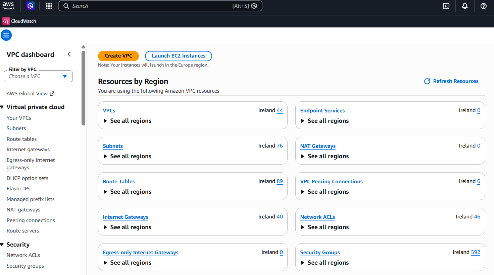

## 2. Click **Create VPC**

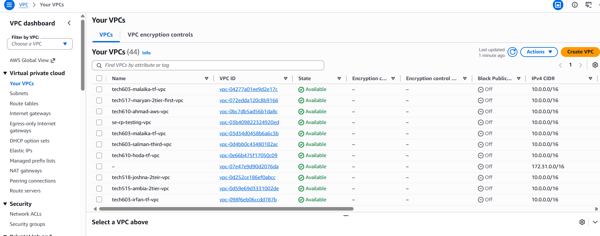

## 3. Create Your VPC

- Name your VPC.
- Set IPv4 CIDR to:

```text
10.0.0.0/16
```

- Click **Create VPC**.

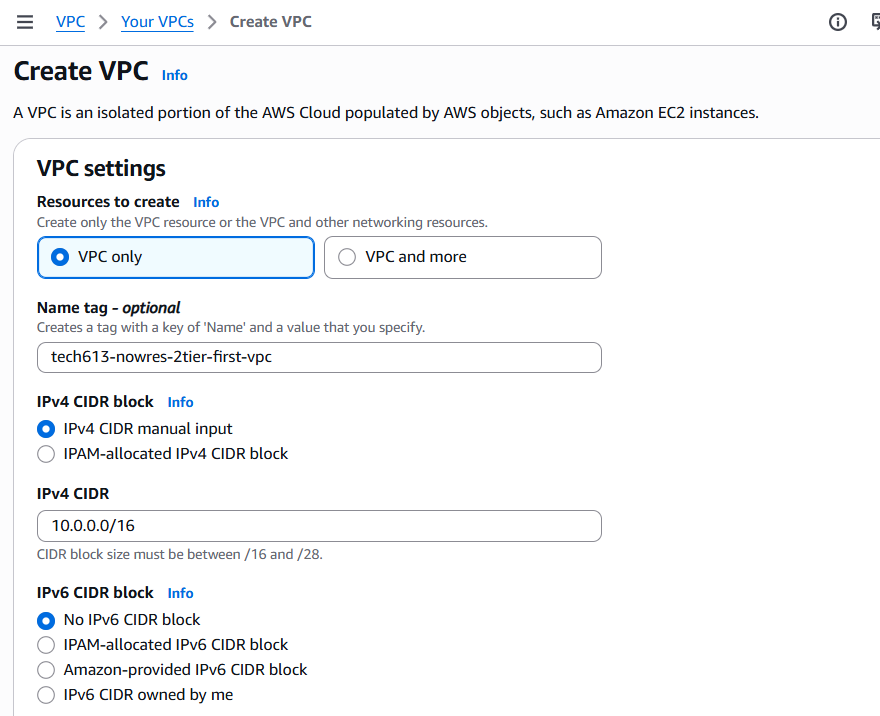

---

# Creating Subnets

## 4. Click **Subnets** → **Create Subnet**

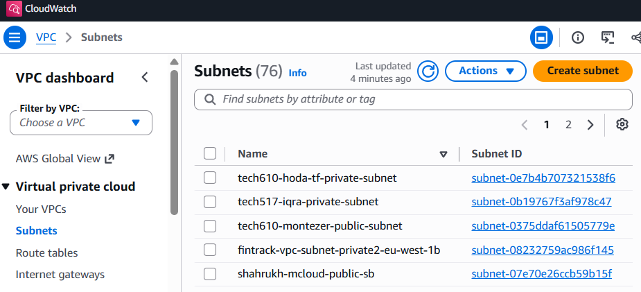

## 5. Create Your Public Subnet

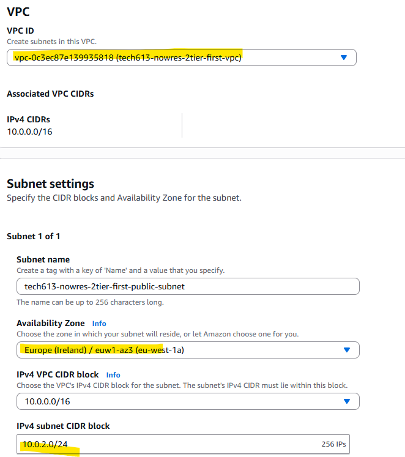

## 6. Create Your Private Subnet

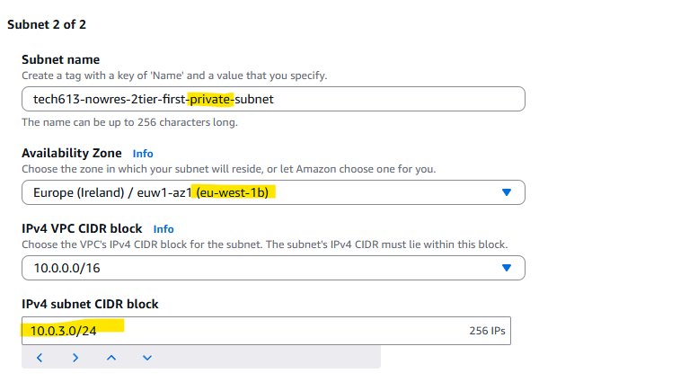

---

# Internet Gateway

## 7. Click **Internet Gateways** → **Create Internet Gateway**

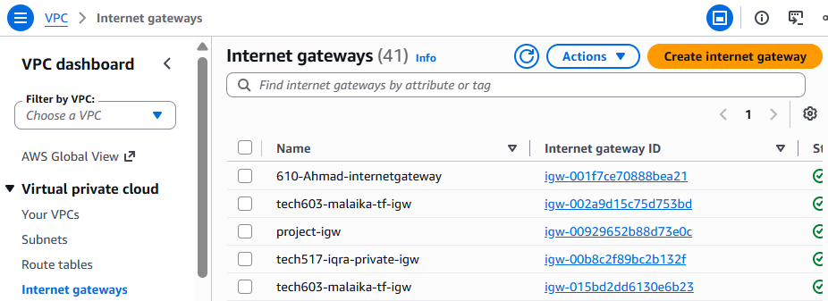

## 8. Name Your Gateway

Click **Create**.

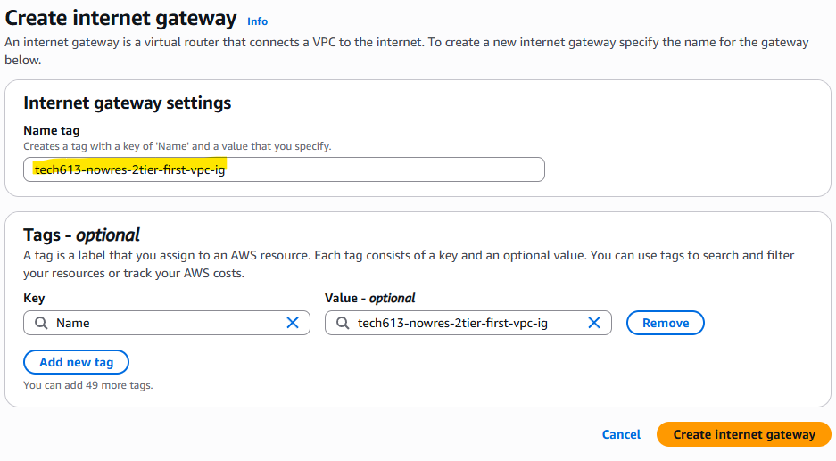

## 9. Attach the Gateway to Your VPC

Click **Attach to VPC** and select your VPC.

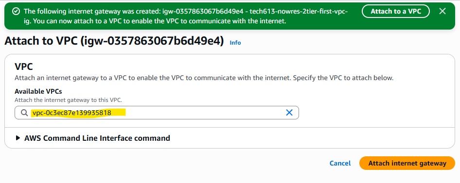

---

# Create a Route Table

## 10. Create a Route Table

- Click **Route Tables**.
- Click **Create Route Table**.
- Give it a name.
- Select your VPC.

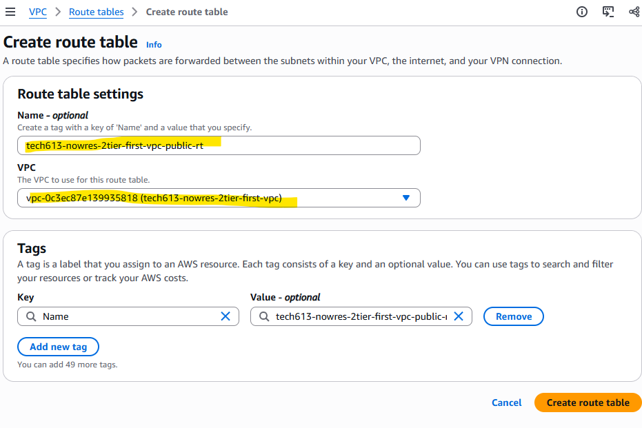

## 11. Edit Subnet Associations

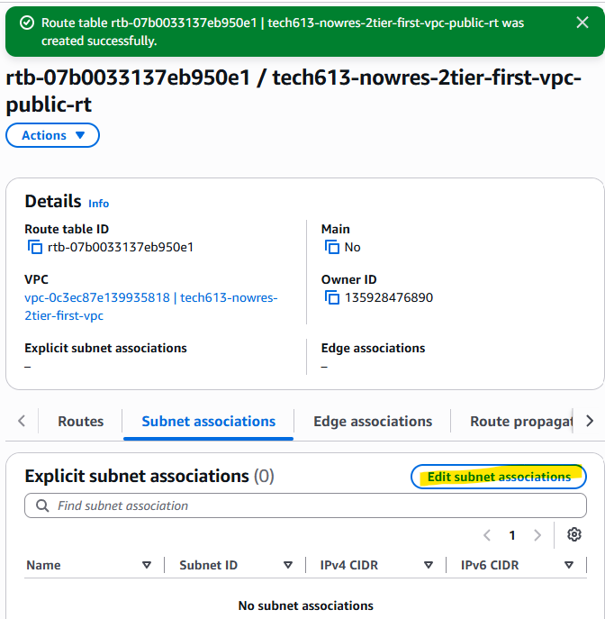

## 12. Associate the Public Subnet

- Select only the public subnet.
- Click **Save Associations**.

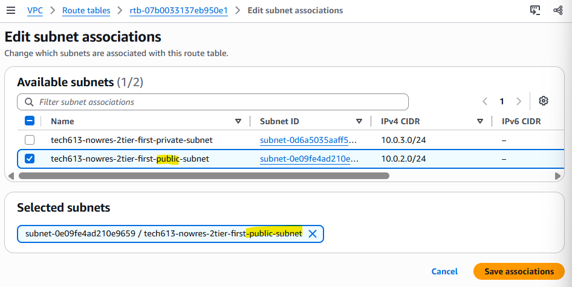

---

# Add Internet Gateway Route

## 13. Edit Routes

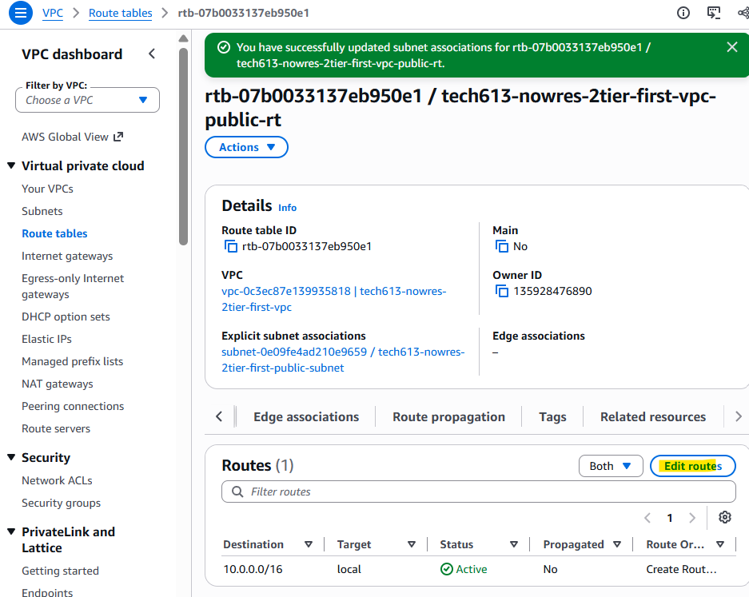

## 14. Add a Route

Add:

| Setting | Value |
|----------|----------|
| Destination | `0.0.0.0/0` |
| Target | Internet Gateway |
| Gateway | Select your IGW |

Then click **Save**.

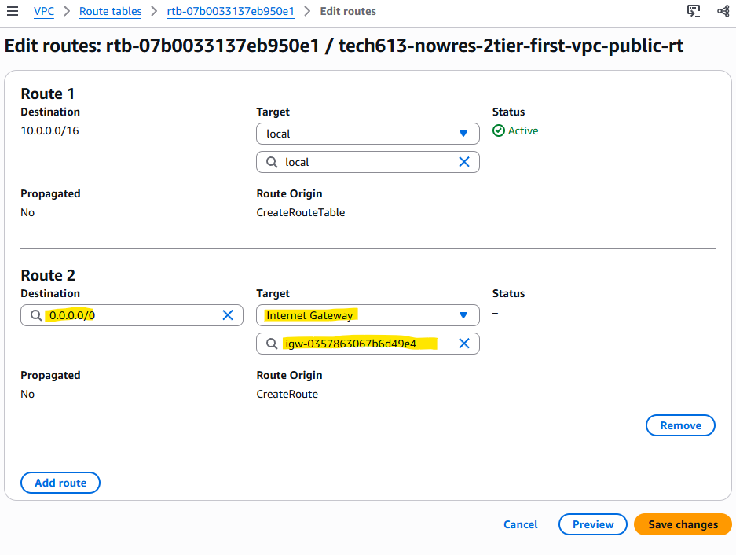

---

# Check the VPC

## 15. Open Resource Map

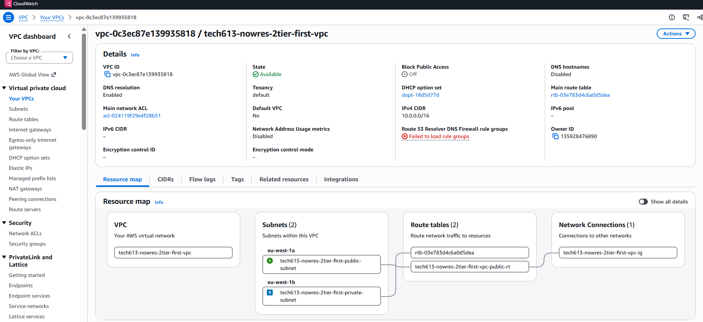

---

# Create a DB VM

## 16. Launch the MongoDB Database AMI

Launch an instance using your MongoDB AMI.

Instance name:

```text
tech613-yourname-2tier-first-vpc-ttt-db-vm
```

Select:

- Your key pair
- Firewall/security group

## 17. Configure Network Settings

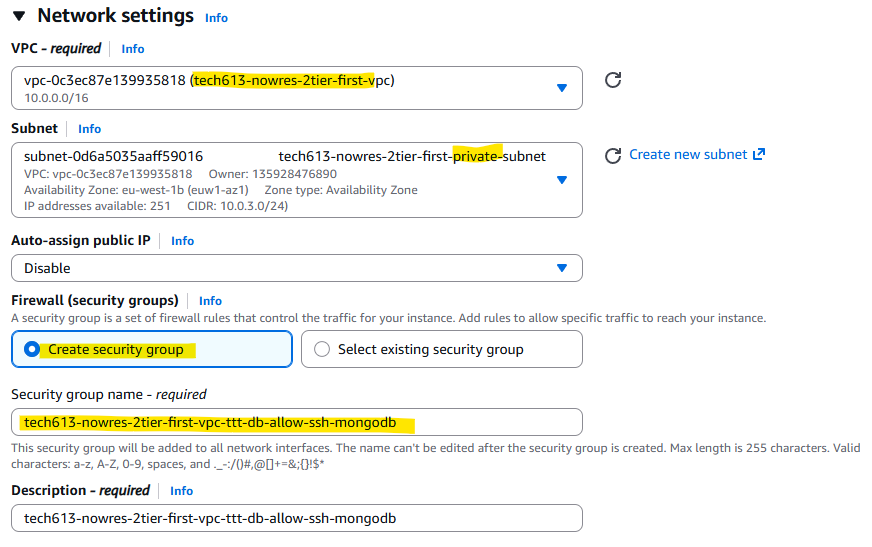

## 18. Configure Inbound Security Group Rules

Allow access to the database only from the public subnet.

Then launch the instance.

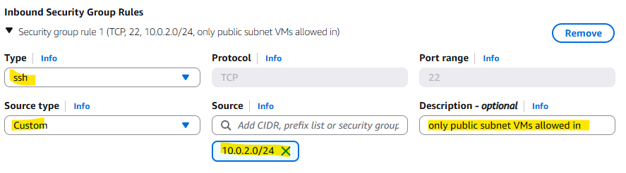

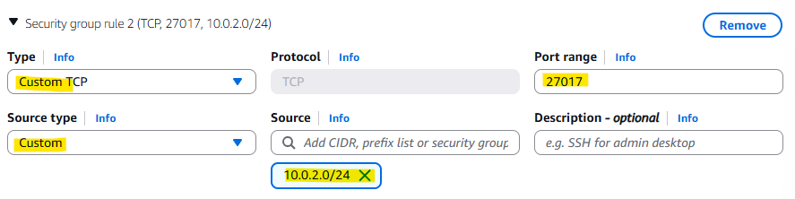

---

# Testing

## 19. Launch the Tic-Tac-Toe AMI

Go to **AMIs** and launch the Tic-Tac-Toe application.

## 20. Configure Network Settings

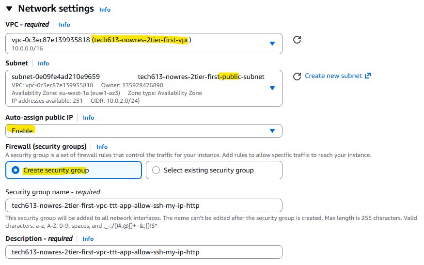

## 21. Configure Inbound Security Group Rules

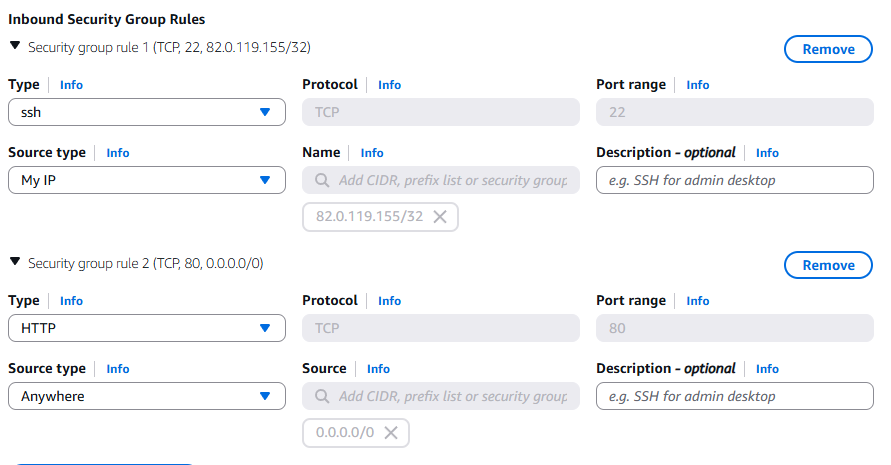

## 22. Add User Data

```bash
#!/bin/bash

cd repo/app

export MONGODB_URI=mongodb://private_ip_of_db_instance:27017/tictactoe

pm2 start index.js --name tic
```

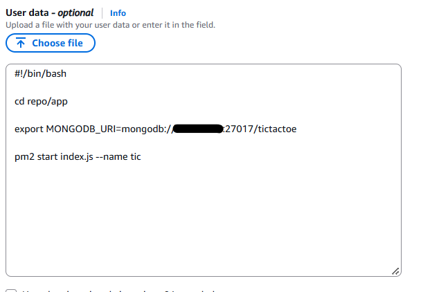

## 23. Launch the Instance

To test the application:

1. Copy the **Public IPv4 Address** of the app instance.
2. Paste it into your browser.

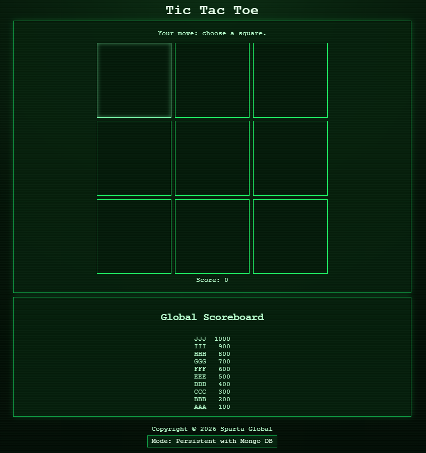

---

## App Instance Name


---

## Database Instance Name

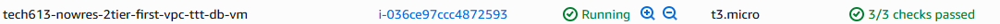