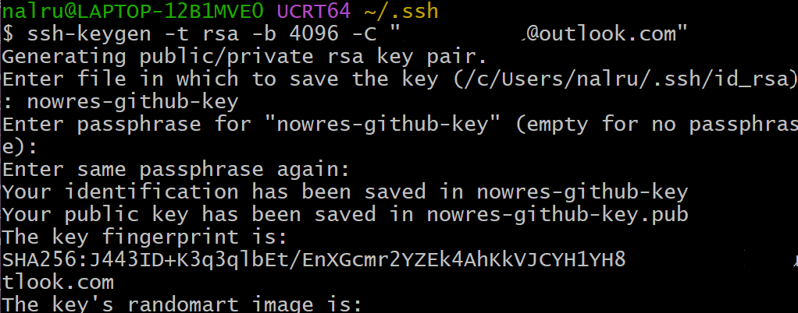
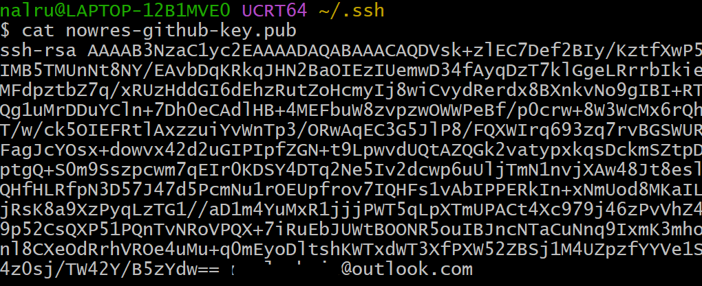
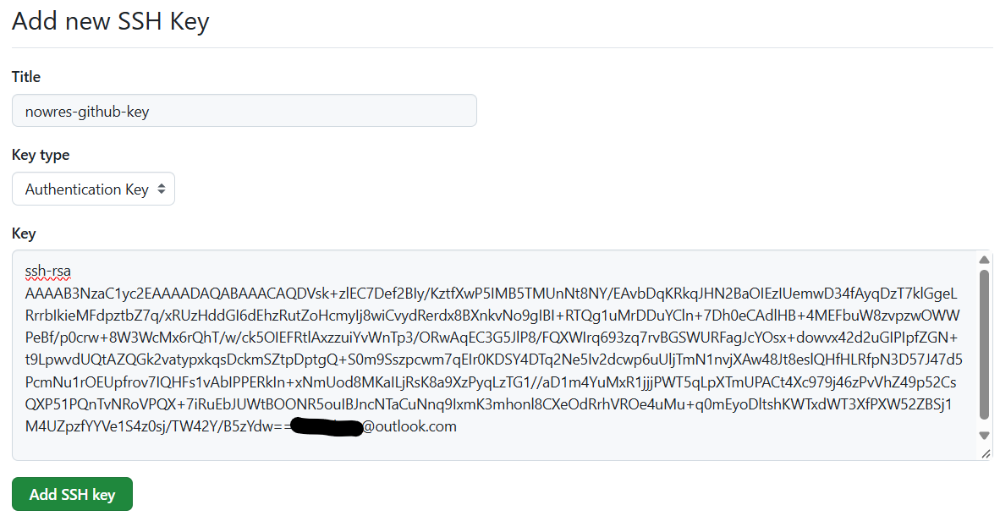
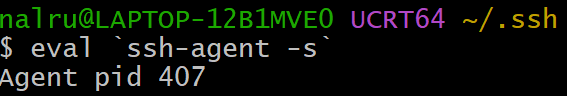
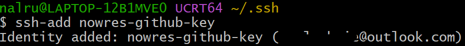
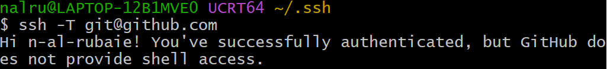
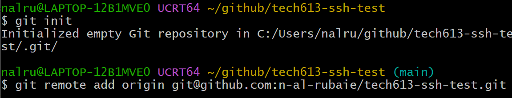
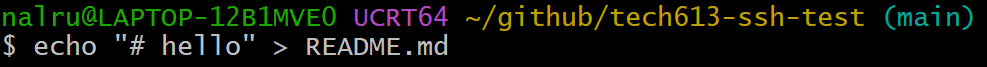
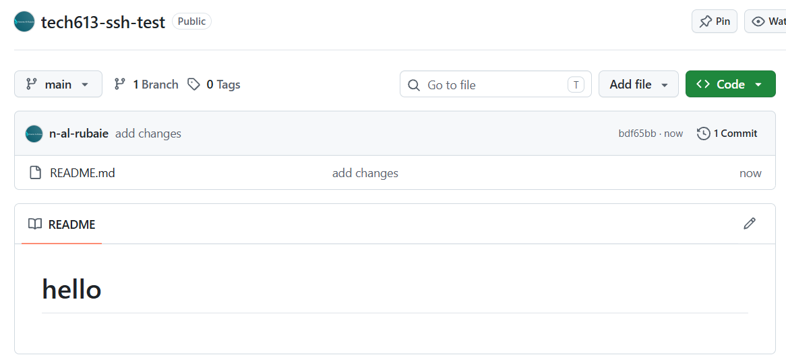

# Using SSH to Push Changes to GitHub


## Contents

- [Using SSH to Push Changes to GitHub](#using-ssh-to-push-changes-to-github)
  - [Contents](#contents)
  - [Introduction](#introduction)
- [Step 1: Create SSH Key pair (RSA) (Consists of public/private key)](#step-1-create-ssh-key-pair-rsa-consists-of-publicprivate-key)
- [Step 2: Register Padlock with Public Key on GitHub](#step-2-register-padlock-with-public-key-on-github)
- [Step 3: Add Private Key to SSH Register](#step-3-add-private-key-to-ssh-register)
- [Step 4: Create Test Repo](#step-4-create-test-repo)
- [Step 5: Push Changes to Repo](#step-5-push-changes-to-repo)
- [Result](#result)


## Introduction

This guide demonstrates how to configure SSH authentication between a local machine and GitHub. Using SSH eliminates the need to repeatedly enter GitHub credentials when pushing code and provides a secure method of authenticating Git operations.

The process involves creating an SSH key pair, registering the public key with GitHub, configuring the local SSH agent with the private key, and testing the connection by pushing code to a GitHub repository.


# Step 1: Create SSH Key pair (RSA) (Consists of public/private key)

In Git Bash terminal, go to the `.ssh` folder:

```bash
ssh-keygen -t rsa -b 4096 -C "yourownpersonalemail"
```

Name for key:

```text
firstname-github-key
```



---

# Step 2: Register Padlock with Public Key on GitHub

Get your public key via Bash:

```bash
cat nowres-github-key.pub
```



Go to **GitHub → Settings → SSH and GPG keys**.

Create a new SSH key, paste the public key, then click **Add SSH key**.



---

# Step 3: Add Private Key to SSH Register

Start SSH Agent, add with backticks:

```bash
eval `ssh-agent -s`
```

**pid** = process ID



Then run:

```bash
ssh-add nowres-github-key
```



Then run:

```bash
ssh -T git@github.com
```



---

# Step 4: Create Test Repo

Create a new repository called:

```text
tech613-ssh-test
```

---

# Step 5: Push Changes to Repo

Make a new directory in Bash in your local GitHub folder:

```bash
mkdir tech613-ssh-test
```

Then run:

```bash
git init
```

Then run:

```bash
git remote add origin git@github.com:n-al-rubaie/tech613-ssh-test.git
```



Create a new `.md` file with the title:

```text
Hello
```



Then add, commit and push the project to GitHub.



---

# Result

The project has now successfully been pushed using SSH.