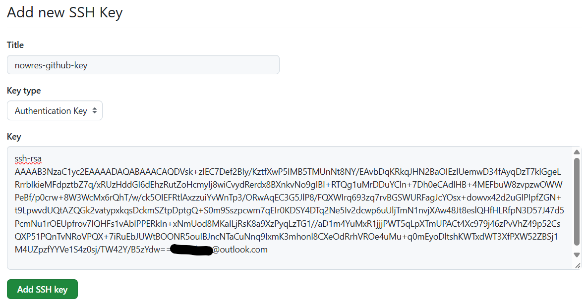
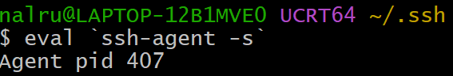
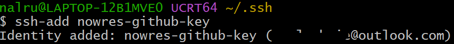
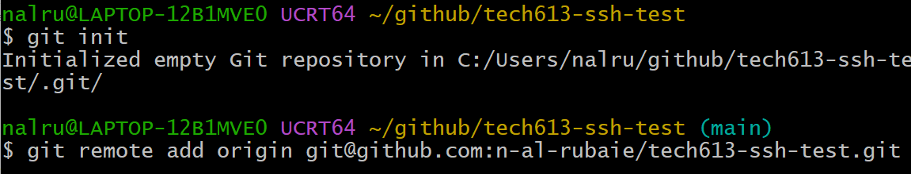
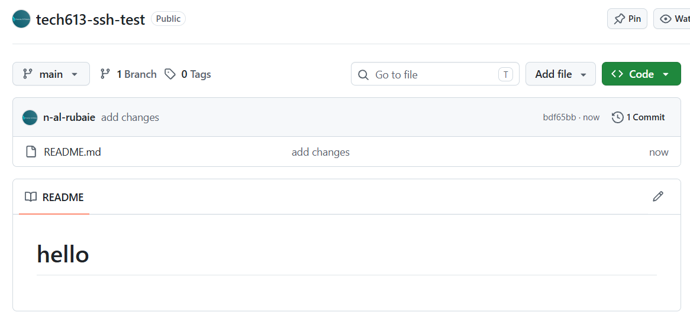

# Using SSH to Push Changes to GitHub

## Overview

1. Create SSH Key pair (RSA) (Consists of public/private key)
2. Register padlock with public key (setting: any repo can be accessed)
3. Add private key to SSH register
4. Create test repo
5. Push changes to test repo

---

# Step 1: Create RSA Key Pair

In Git Bash terminal, go to the `.ssh` folder:

```bash
ssh-keygen -t rsa -b 4096 -C "yourownpersonalemail"
```

Name for key:

```text
firstname-github-key
```


---

# Step 2: Register Padlock with Public Key on GitHub

Get your public key via Bash:

```bash
cat nowres-github-key.pub
```


Go to **GitHub → Settings → SSH and GPG keys**.

Create a new SSH key, paste the public key, then click **Add SSH key**.



---

# Step 3: Add Private Key to SSH Register

Start SSH Agent, add with backticks:

```bash
eval `ssh-agent -s`
```

**pid** = process ID



Then run:

```bash
ssh-add nowres-github-key
```



Then run:

```bash
ssh -T git@github.com
```


---

# Step 4: Create Test Repo

Create a new repository called:

```text
tech613-ssh-test
```

---

# Step 5: Push Changes to Repo

Make a new directory in Bash in your local GitHub folder:

```bash
mkdir tech613-ssh-test
```

Then run:

```bash
git init
```

Then run:

```bash
git remote add origin git@github.com:n-al-rubaie/tech613-ssh-test.git
```



Create a new `.md` file with the title:

```text
Hello
```


Then add, commit and push the project to GitHub.



---

# Result

The project has now successfully been pushed using SSH.