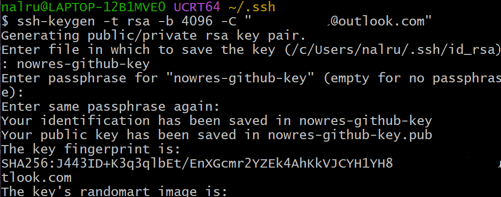
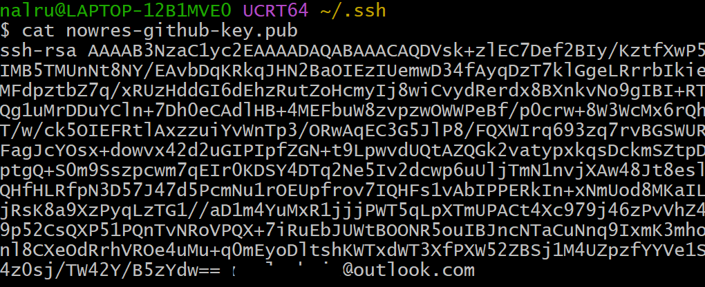
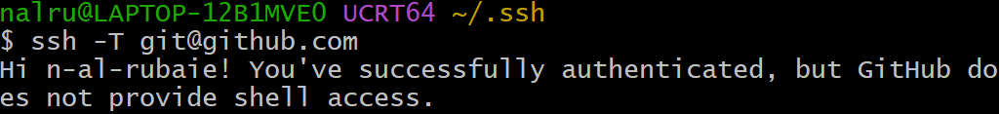
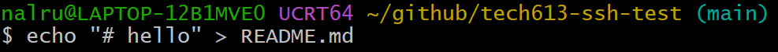

# Using SSH to push changes to GitHub

1) Create SSH Key pair (RSA) (Consists of public/private key)
2) Register padlock with public key (setting: any repo can be accessed)
3) Add private key to SSH register
4) Create test repo
5) Push changes to test repo

# Step 1: Create RSA key pair

In git bash terminal, go to .ssh folder:

ssh-keygen -t rsa -b 4096 -C "yourownpersonalemail"

name for key: firstname-github-key

# Step 2: Register padlock with public key on GitHub

Get your public key via bash:

cat nowres-github-key.pub

Go to GitHub, settings, create a new SSH key, paste public key, click on Add SSH key. 

# Step 3: Add private key to SSH register
Start SSH Agent, add with backticks

eval `ssh-agent -s`

pid = process ID

Then run:

ssh-add nowres-github-key

Then run:

ssh -T git@github.com

# Step 4: Create test repo

Create new repo, call it:

tech613-ssh-test

# Step 5: Push changes to repo

Make new directory in bash in local gihub folder:

mkdir tech613-ssh-test

Then run:

git init

Then run:

git remote add origin git@github.com:n-al-rubaie/tech613-ssh-test.git

Create new .md file with title "Hello"

Then add, commit and push project to GitHub. 

The project has now succesfully been pushed using SSH. 