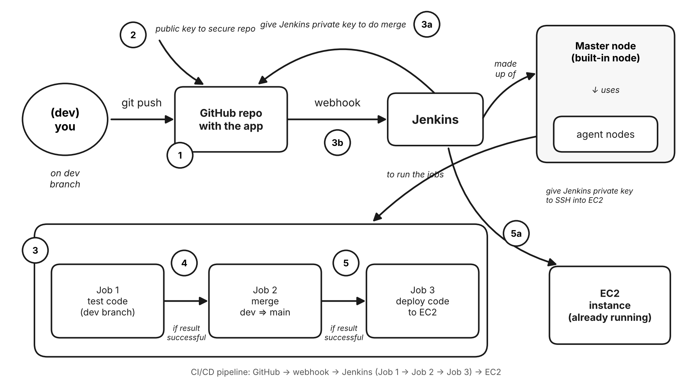
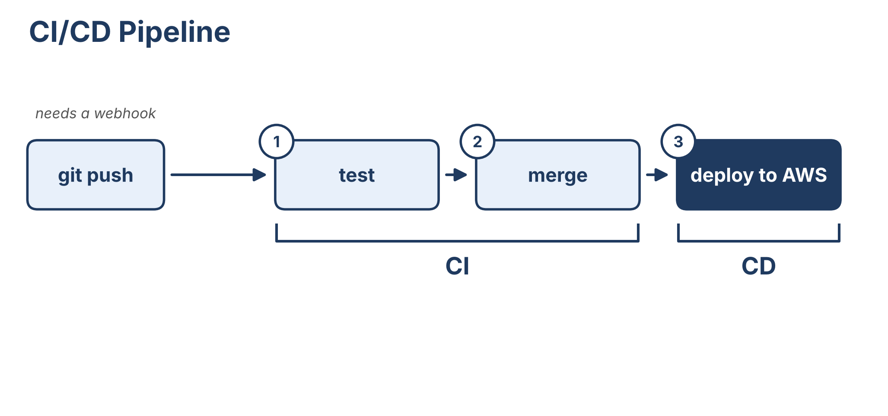

# Intro to Jenkins & CICD

## What is CI? Benefits?

* Continuous Integration
* Automatically merging code
* Triggered by developers frequently pushing code changes to a shared repository
* Tests are run automatically on the code before it is integrated into the main code

### Benefits

* Helps identify and resolve bugs early
  * Reduces costs
* Helps maintain a stable and functional software build

## What is CD? Benefits?

* Can mean:
  * Continuous Delivery (manual sign-off/approval before production)
  * Continuous Deployment (automatically deploys code to production)

Continuous Delivery (manual sign off/approval)

* ensure software is always in a deployable state, ready/
can be pushed production any time
* often involves producing deployable artifact (artifact =  a file or package produced during the software build process that is ready to be deployed. E.g: Docker images, executable files, and ZIP packages)
* requires a manual release decision
* benefit:
  * always have a deployable artifact ready to deploy to
  end users

Continuous Deployment (automatically deploys code to production)

* extends Continuous Delivery by automating the final
step of deploying to production
* no manual intervention required
* benefit which is also a disadvantage:
  * removes the human approval, relys entired on
  automated processes

## What is Jenkins?

* automation server
* open-source
* primary used for CICD, but can automate much more

## Why use Jenkins? Benefits of using Jenkins?
Disadvantages?

* Benefits:
  * Automation
  * Extensibility: Jenkins has over 1800 plugins
  * Scalability: Jenkins server can scale easily by adding/using worker nodes/agents to run jobs
  * Community support
  * Cross-platform: Works across Windows, Linux, MacOS

* Disadvantages
  * Can be complex for beginners
  * Maintainance overhead
  * Resource-intensive when running multiple jobs
  * User interface: outdated?

## Stages of Jenkins

A typical Jenkins CICD pipeline involves the following stages:

1. Source Code Management (SCM)
2. Build: Compile the code, build into executable artifact
3. Test: Automated tests (unit, integration, etc)
4. Package: Package into deployable artifact
5. (If using Cont. Deployment) The package is deployed into the target environment e.g. test, production
6. (If using Cont. Deployment) Monitor: Monitoring tools may be deployed/configured to observe performance, log issues, etc after deployment

## What alternatives are there for Jenkins

* GitLab CI
* GitHub Actions
* CircleCI
* Travis CI
* Bamboo
* TeamCity
* GoCD
* Azure DevOps (Azure Pipelines to run the CICD pipelines)

## Why build a pipeline? Business value?

* cost savings - automating repetitive processes
* faster time to market
* reduced risk
* improved quality through continuous feedback and
improvement

## Diagram - How a Git Push Triggers Jenkins via a Webhook 

## Diagram - CI/CD Pipeline: Test, Merge, and Deploy to AWS 

## Review

1. **Webhook:** Automatically notifies Jenkins when code is pushed to GitHub, triggering the pipeline.

2. **Why CI/CD?** Automates testing and deployment, saves time and reduces errors. Benefits developers, testers and clients.

3. **Jobs:**
   - Job 1: Tests code on dev.
   - Job 2: Merges dev into main if tests pass.
   - Job 3: Deploys code to EC2 if the merge succeeds.

4. **Security:** Use SSH keys to securely connect Jenkins to GitHub and EC2. Store keys in Jenkins Credentials.

## CI/CD Pipeline 

- **Git push:** Developer pushes code changes to GitHub.
- **Webhook:** Automatically triggers Jenkins when code is pushed.
- **Build queue:** Holds jobs waiting to be assigned.
- **Master node:** Manages jobs and assigns them to worker nodes.
- **Worker node:** Runs pipeline jobs. It is an EC2 instance with the required dependencies.

### Three Jenkins Jobs

1. **Job 1:** Tests the code.
2. **Job 2:** Merges dev into main if tests pass.
3. **Job 3:** Deploys the updated code to the application.

### Important Points

- Each job only runs if the previous job succeeds.
- Worker nodes can stay idle for 10–15 minutes before being terminated.
- Keeping a worker node ready makes future pipelines faster.
- The demonstration deployed updated code in under a minute (49.6 seconds).
- Testing usually takes the longest.

**Main purpose:** Automate testing, merging and deployment so developers can deliver updates quickly and reliably.