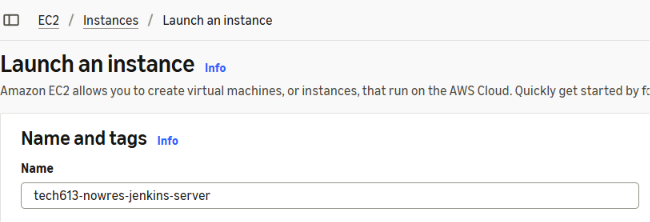
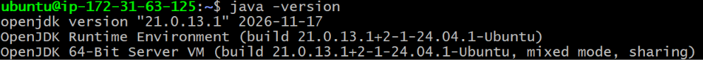
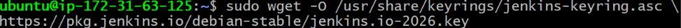
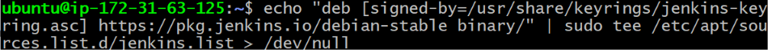
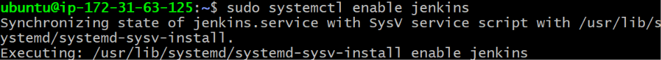
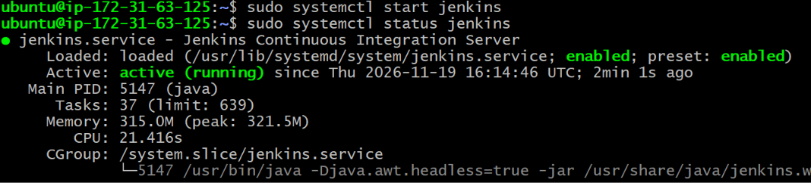

# Building and Configuring My Own Jenkins Server

## Overview

The objective of this task is to build and configure an independent Jenkins server on AWS EC2 and recreate a three-job CI/CD pipeline.

Unlike the previous shared Jenkins environment, all jobs will execute directly on the Jenkins built-in node. No additional agent or worker nodes will be configured.

## Infrastructure

| Component | Configuration |
|---|---|
| Cloud Provider | AWS |
| Service | EC2 |
| Operating System | Ubuntu Server 24.04 LTS |
| Instance Type | t3.micro |
| Storage | 12 GB |
| VPC | Default VPC |
| CI/CD Tool | Jenkins |
| Job Execution | Built-in node only |

## CI/CD Pipeline

The pipeline consists of three jobs:

1. **Job 1 – CI Testing:** Runs automated tests against the application's development branch.
2. **Job 2 – Merge:** Merges the development branch into the main branch following successful testing.
3. **Job 3 – Deployment:** Deploys the updated application to the application server.

All three jobs will execute on the built-in Jenkins node.

## Implementation

The following stages will be documented:

1. Creating and configuring the AWS EC2 instance.
2. Installing Java and Jenkins.
3. Accessing and configuring the Jenkins GUI.
4. Configuring Jenkins to use its built-in node.
5. Recreating the three-job CI/CD pipeline.
6. Testing the complete pipeline.
7. Verifying successful application deployment.


## Instance Name

```text
tech613-firstname-jenkins-server
```


## Application and OS Images (AMI)

- **Ubuntu Server 24.04 LTS**
- **64-bit (x86)**

## Instance Type

```text
t3.micro
```

- 2 vCPUs
- 1 GiB memory

## Key Pair

- Select an existing key pair you can access, or create a new one.
- Keep the `.pem` file safe.

## Network Settings

- VPC: Default VPC
- Auto-assign public IP: Enable
- Allow SSH traffic: Your IP

## Configure Storage

- **12 GiB**
- General Purpose SSD (**gp3**)

# Configure the Security Group

This is important because you need to access Jenkins through your browser.

Under **Firewall (security groups)**, configure:

| Type | Port | Source |
|--------|--------|--------|
| SSH | 22 | My IP |
| Custom TCP | 8080 | My IP |

Port **8080** is the default Jenkins web interface port.

> Do not expose SSH or Jenkins to everyone (`0.0.0.0/0`) unnecessarily.

# Launch the Instance

Before clicking **Launch instance**, double-check:

- Ubuntu 24.04 LTS
- t3.micro
- 12 GiB storage
- Default VPC
- Public IP enabled
- SSH and TCP 8080 security group rules

Click **Launch instance**.

## Update Ubuntu and install Java 21

SSH into the instance, then run:

`sudo apt update`


`sudo apt install fontconfig openjdk-21-jre -y`


## Ensure java 21 is installed

`java -version`



## Install jenkins 

## Add the Jenkins repository key
```
sudo wget -O /usr/share/keyrings/jenkins-keyring.asc \
https://pkg.jenkins.io/debian-stable/jenkins.io-2026.key
```



## Add the Jenkins repository

```
echo "deb [signed-by=/usr/share/keyrings/jenkins-keyring.asc] https://pkg.jenkins.io/debian-stable binary/" | sudo tee /etc/apt/sources.list.d/jenkins.list > /dev/null
```



## Update package list

`sudo apt update`


## Install jenkins

`sudo apt install jenkins -y`


## Configure Jenkins to start automatically whenever the server is restarted.

`sudo systemctl enable jenkins`



`sudo systemctl start jenkins`

`sudo systemctl status jenkins`





# Create instance with terraform

AWS CLI and terraform must already been insatlled and configured on your system beforehand.

## What will be created using Terraform

| Resource | Purpose |
|-----------|---------|
| AWS Provider | Connect Terraform to AWS |
| Security Group | Allow SSH (22) and Jenkins (8080) |
| EC2 Instance | Host your Jenkins server |
| AMI | Ubuntu 24.04 LTS |
| Instance Type | t3.micro |
| Storage | 12 GB |
| VPC | Default VPC |

## Create a terraform directory in a new empty repo

Name of repo - `tech613-create-own-jenkins-server`

Name of directory in the repo: `terraform`


## Terraform Configuration Files

Four main files shall be created:

| File | Purpose |
|--------|---------|
| `provider.tf` | Connect Terraform to AWS |
| `variables.tf` | Store configurable values |
| `main.tf` | Define the EC2 instance and security group |
| `outputs.tf` | Display useful information after deployment |


## Terraform configuration

## Terraform Deployment Settings

| Setting | Value |
|----------|--------|
| AWS Region | `eu-west-1` (Ireland) |
| EC2 Instance | `t3.micro` |
| Operating System | Ubuntu 24.04 LTS |
| Storage | 12 GB gp3 |
| VPC | Default VPC |
| SSH Key Pair | `tech613-nowres-aws-key` |
| SSH Access | Your IP only |
| Jenkins Access | Your IP only, port 8080 |

