# Jenkins CI/CD Pipeline Project

## Introduction

This project demonstrates how to build a complete Continuous Integration and Continuous Deployment (CI/CD) pipeline using Jenkins, GitHub, and AWS EC2.

The pipeline automates the software delivery process by testing code changes, merging approved code into the main branch, and deploying the application to a live server. Throughout this project, Jenkins is configured using multiple jobs that work together to create an automated deployment workflow for a Tic Tac Toe application.

By the end of this project, code pushed to GitHub automatically triggers testing, deployment, and application updates on AWS.

## Instances Used in This Project

This project uses **three EC2 instances**:

**Note: Larger environments may have multiple Jenkins agents and separate development, testing, staging, and production servers.**

1. **Jenkins Controller Instance**
   - Hosts the Jenkins server
   - Manages the CI/CD pipeline
   - Receives GitHub webhooks
   - Schedules and controls jobs

2. **Jenkins Agent Instance**
   - Acts as a worker node - a Jenkins agent that executes pipeline jobs such as testing, merging, and deployment. In this project, the worker node is a separate EC2 instance containing the tools and dependencies required to run the pipeline.
   - Runs Jenkins jobs
   - Executes testing, merging, and deployment tasks

3. **Application EC2 Instance**
   - Hosts the Tic Tac Toe application
   - Receives deployed code from Jenkins
   - Runs the application using PM2

## Pipeline Architecture

```text
GitHub
   ↓
Jenkins Controller
   ↓
Jenkins Agent (Worker Node)
   ├─ Job 1 (Test)
   ├─ Job 2 (Merge)
   └─ Job 3 (Deploy)
   ↓
Application EC2
```

> Although the pipeline contains three Jenkins jobs, they are not separate EC2 instances. Job 1, Job 2, and Job 3 run on the Jenkins Agent instance as part of the CI/CD pipeline.

## Contents

1. [Creating Job 1 - Linux Version](#creating-a-job)
2. [Creating Job 2 - Date and Time](#second-job)
3. [Building the CI/CD Pipeline](#build-cicd-pipeline)
4. [Creating Jenkins SSH Credentials](#generate-new-key-pair-for-jenkins-for-scm)
5. [Configuring GitHub Webhooks](#setting-up-webhook-github-repository--jenkins)
6. [Testing Continuous Integration](#test-cicd-on-jenkins-with-ttt-app)
7. [Creating Job 2 - Automatic Merge](#jenkins-pipeline-to-deploy-app)
8. [Continuous Deployment to AWS EC2](#continuous-deployment)
9. [Creating Job 3 - Deployment Job](#create-job-3)
10. [Job Chaining](#chain-job-3-from-job-2)
11. [Pipeline Testing](#testing)
12. [Project Summary](#summary)


# Creating a Job

This job demonstrates how Jenkins can execute shell commands automatically. The purpose of this job is to retrieve and display the Linux version running on the Jenkins server.

## Job Details

**Job Name:** `nowres-get-linux-version`

**Job Type:** Freestyle Project

## Description and Discard Old Builds

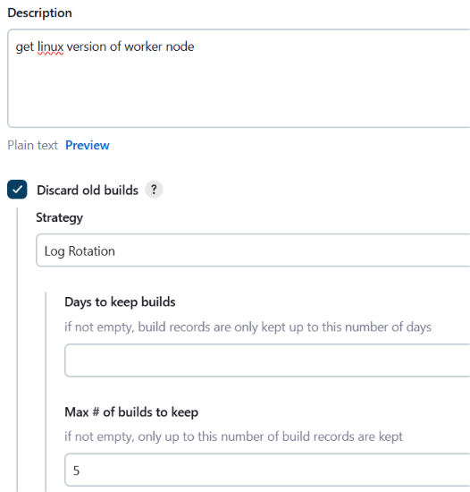

## Execute Shell

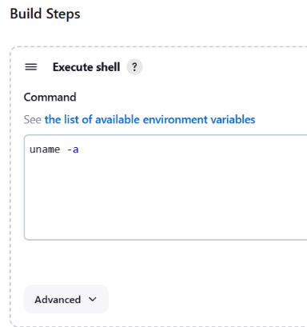

Click **Build Now**.

---

# Second Job

This job retrieves the current system date and time. It is later linked to the first job to demonstrate basic Jenkins job orchestration.

## Job Details

**Job Name:** `nowres-get-date-time`

**Job Type:** Freestyle Project

## Description and Discard Old Builds

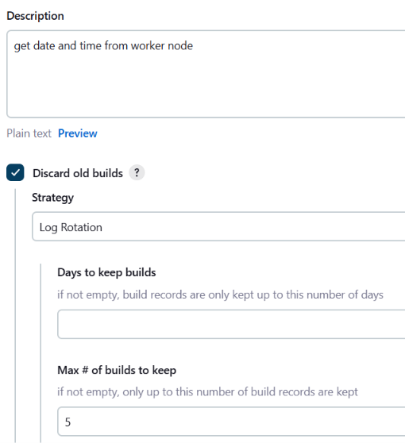

## Execute Shell

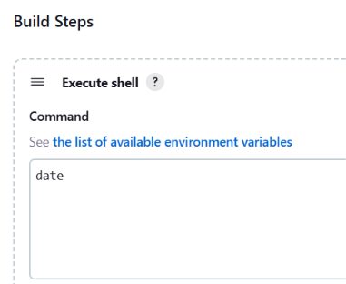

## Link the Two Jobs Together

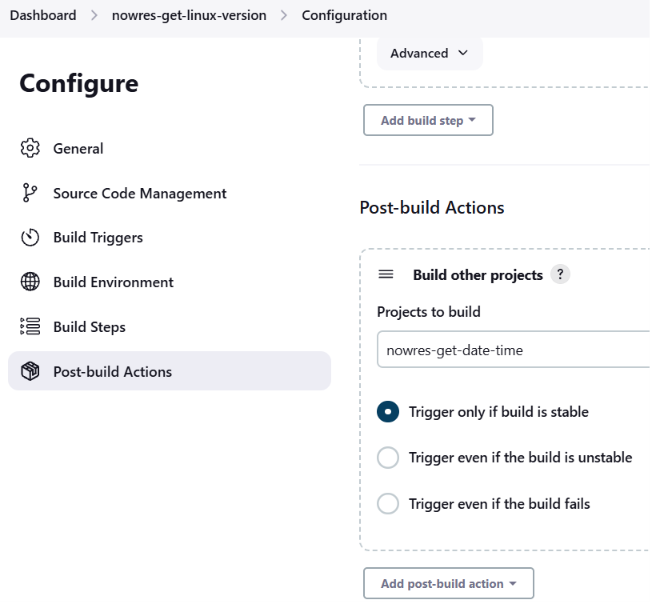

Save and click **Build Now**.

---

# Build CI/CD Pipeline

In this section, Jenkins is connected to GitHub using SSH authentication. This allows Jenkins to securely clone repositories, run tests, and automate software delivery tasks.

# Generate New Key Pair for Jenkins for SCM

**SCM = Source Control Management**

Go to your `.ssh` folder in Bash and run:

```bash
ssh-keygen -t ed25519 -a 100 -C "jenkins@ttt-scm-3job-cicd"
```

Give your key the name:

```text
firstname-jenkins-2-github-ttt-app
```

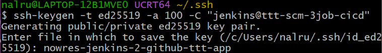

## Add Public Key to GitHub

In Bash, enter:

```bash
cat firstname-jenkins-2-github-ttt-app.pub
```

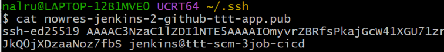

Copy and paste the public key into GitHub when adding a new key.

Ensure you allow write access.

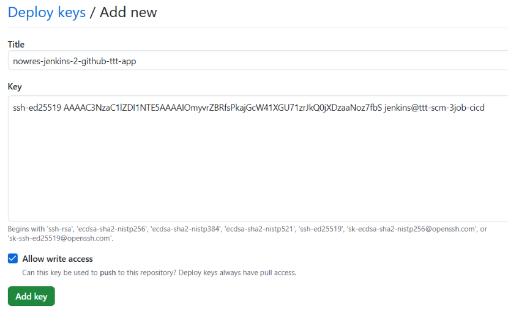

The key has now been deployed.

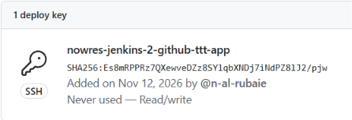

## Create a New Freestyle Job

Create a new Jenkins job called:

```text
firstname-job1-ci-test
```

Ensure you add a description and enable **Discard Old Builds**.

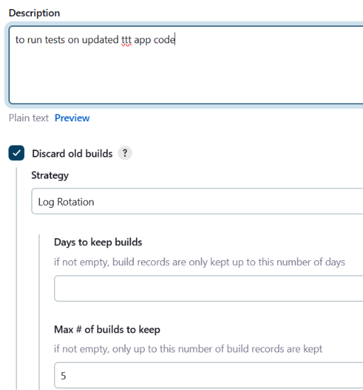

## Add GitHub Project to the Job

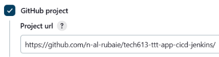

## Enter SSH Link and Private Key

In **Source Code Management**, add the SSH URL of the GitHub repository and your private SSH key.

The private key can be displayed in Bash:

```bash
cat firstname-jenkins-2-github-ttt-app
```

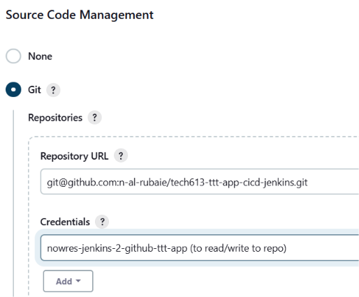

Click **Add** under credentials and paste the private key.

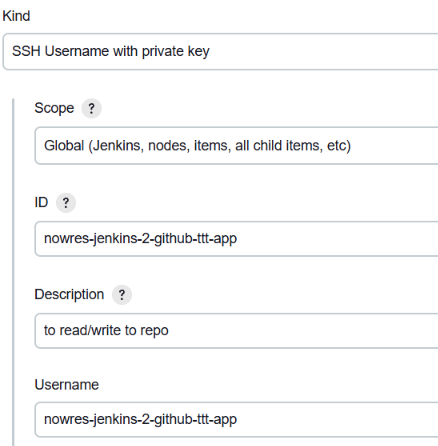

## Specify Main Branch

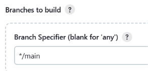

## Build Environment

Select:

**Provide Node and npm bin/folder to PATH**

Change to:

**NodeJS Version:** `20`

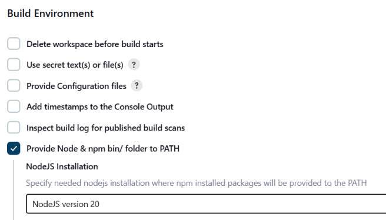

## Build Step

Add an **Execute Shell** build step:

```bash
cd app

npm ci

npm test
```

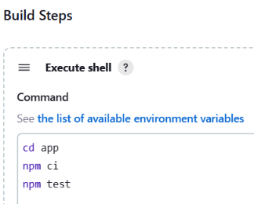

Click **Save** and then **Build Now**.

## Test Results

The console shows 6 skipped tests because they are integration tests.

Integration tests check whether different components of the application work together, such as the backend and database.

They are skipped because the required services or configuration may not be available, or they are disabled in the pipeline.

You can find this information in the console output.

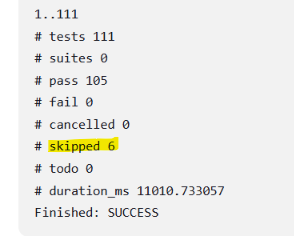

## Setting Up Webhook (GitHub Repository → Jenkins)

### Set Up Webhook on GitHub

In your GitHub repository, go to:

**Settings → Webhooks**

Add the following payload URL:

http://54.73.244.32:8080/github-webhook/

Where:

http://54.73.244.32:8080/

is the Jenkins URL.

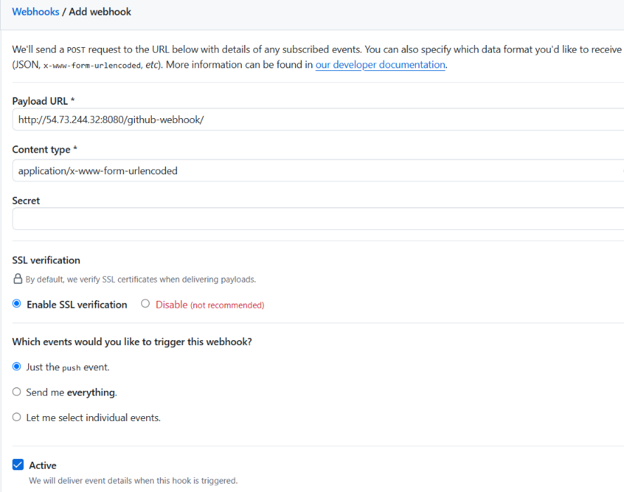

### Set Up Webhook on Jenkins

Go to your Jenkins job configuration and tick:

**GitHub hook trigger for GITScm polling**

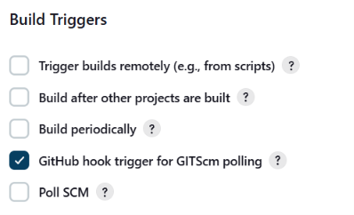

# Test CI/CD on Jenkins with TTT App

Open `tech613-ttt-app-cicd-jenkins` in Visual Studio Code.

Add the following to the README file:

```text
Test webhook is working on main branch
```

Push changes to GitHub using the `main` branch.

You should then see your CI/CD job appear in the Jenkins Build Queue.

---

## Change Branch in Jenkins

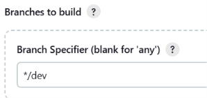

---

## Create Dev Branch in Bash

```bash
git branch dev

git switch dev
```

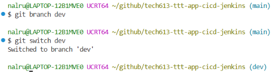

---

## Push Project to GitHub via Dev Branch

```bash
git add .

git commit -m "push to dev branch"

git push
```

You should then see your CI/CD job appear in the Jenkins Build Queue.

---

# Jenkins Pipeline to Deploy App

Duplicate `firstname-job1-ci-test` and name it:

```text
firstname-job2-ci-test
```

In **firstname-job2-ci-test**:

Go to:

**Post Build Actions → Add Git Publisher**

Configure:

- Push only if build succeeds
- Branch to push: `main`
- Target remote name: `origin`

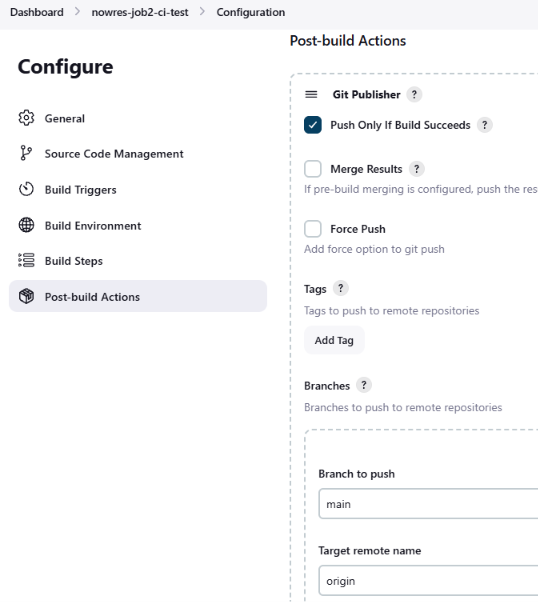

---

## Add Additional Shell Build Step

Add another **Execute Shell** build step to:

`firstname-job2-ci-test`

```bash
git fetch origin

git checkout -B main origin/main

git merge --no-ff origin/dev -m "Merge dev into main"

git log -1 --oneline
```

This creates the merge commit locally after all tests have passed.

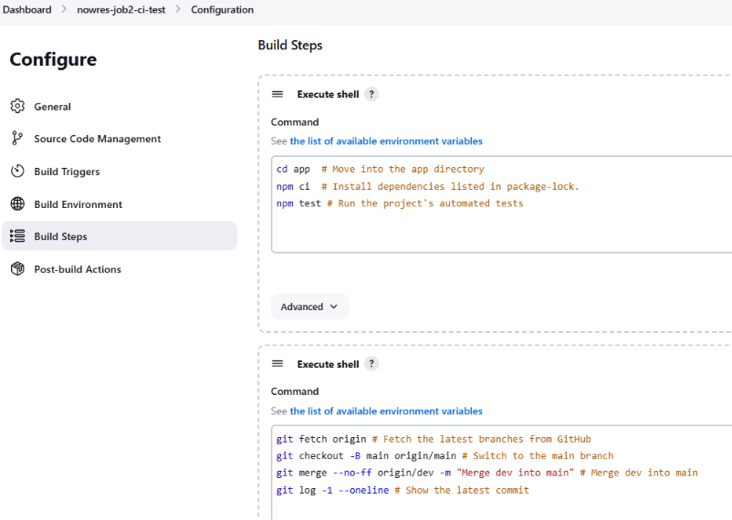

---

## Add SSH Agent

Ensure you add your SSH Agent.

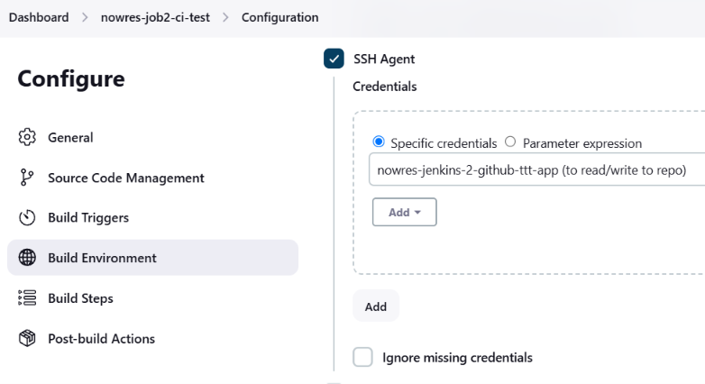

Save Job 2.

---

## Test Job Chaining

Run:

```text
firstname-job1-ci-test
```

You should then see:

```text
firstname-job2-ci-test
```

The code from the `dev` branch should be merged into the `main` branch in GitHub.

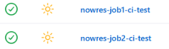

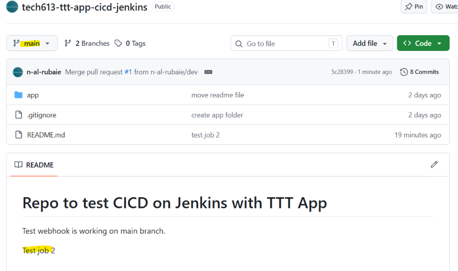

---

# Continuous Deployment

This section extends the pipeline by automatically deploying tested code to an AWS EC2 instance. Jenkins copies the application files, installs dependencies, and restarts the application.

## Copy Tested Code from Jenkins to AWS EC2 and Restart the App

Create an EC2 instance for the Tic Tac Toe application and SSH into it.

---

## Ensure Prerequisites Are Installed

Run:

```bash
node -v

npm -v

pm2 -v

rsync --version | head -1

pm2 list
```

---

## Create the Deployment Folder on EC2

Create an empty application folder that Job 3 will deploy into:

```bash
mkdir -p ~/app
```

To verify:

```bash
sh

ls ~
```

You should see:

```text
app
```

in the list.

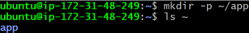

---

## Add Your EC2 Key to Jenkins

This allows Jenkins to connect to your EC2 instance.

Display your `.pem` file:

```bash
cat tech613-nowres-aws-key.pem
```

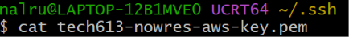

Copy everything including:

```text
-----BEGIN ...
```

and

```text
-----END ...
```

Go to:

```text
Manage Jenkins
→ Credentials
→ (global)
→ Add Credentials
```

Configure:

```text
Kind: SSH Username with private key

ID: nowres-ec2-key

Username: nowres-ec2-key

Private Key:
Enter directly
```

Paste the key and click **Create**.

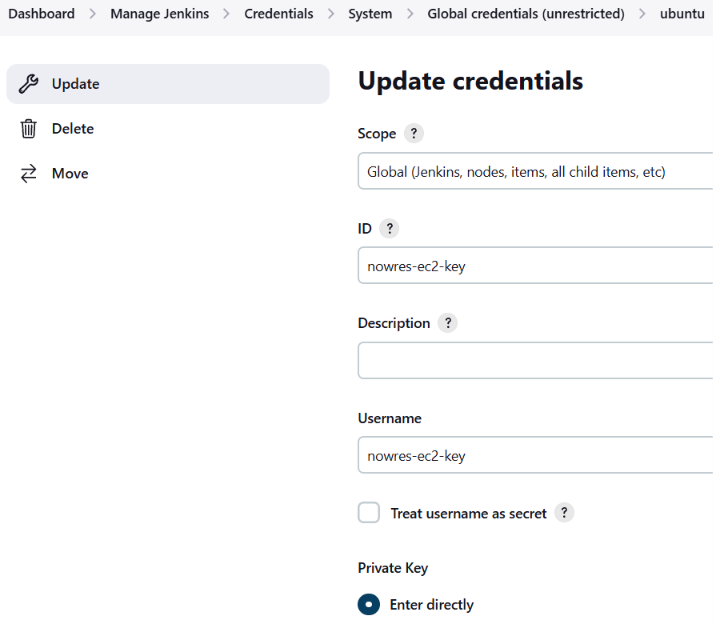

---

# Create Job 3

On the Jenkins dashboard:

```text
New Item
```

Name it:

```text
nowres-ttt-job3-cd-deploy
```

Select:

```text
Freestyle Project
```

Click **OK**.

Add the configuration shown below.

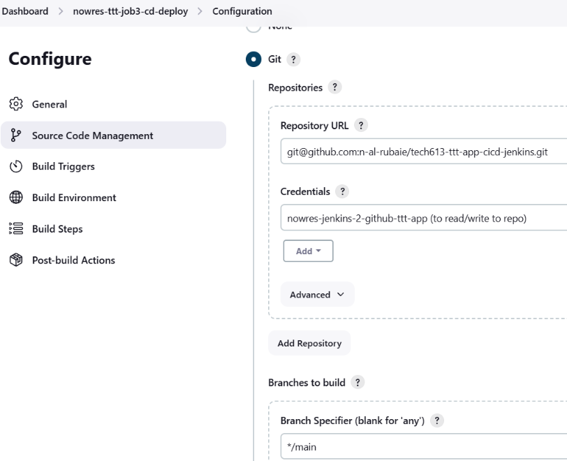

For SSH key select:

```text
firstname-ec2-key
```

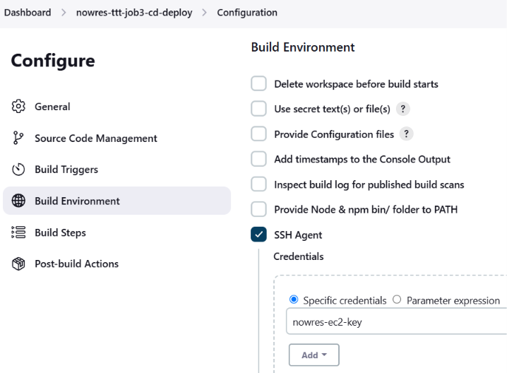

---

## Build Step

Add:

```text
Build Step → Execute Shell
```

Paste the following and replace `<PUBLIC_IP>` with your EC2 public IPv4 address:

```bash
EC2_HOST=ubuntu@<PUBLIC_IP>
SSH_OPTS="-o StrictHostKeyChecking=no"

# Copy tested code from Jenkins to EC2
rsync -avz --delete \
  --exclude node_modules --exclude .git \
  -e "ssh $SSH_OPTS" \
  app/ $EC2_HOST:/home/ubuntu/app/

# SSH into EC2, install dependencies and restart app
ssh $SSH_OPTS $EC2_HOST << 'EOF'
  cd /home/ubuntu/app
  npm ci --omit=dev
  pm2 restart ttt-app || pm2 start npm --name ttt-app -- start
  pm2 save
EOF
```

Click **Save**.

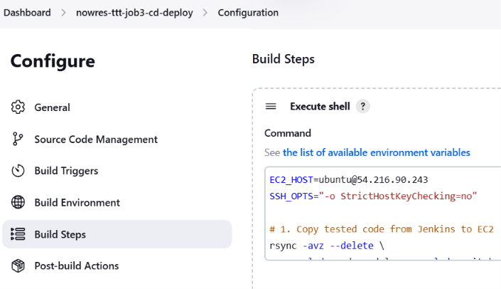

---

## Run Job 3

Run Job 3 in Jenkins.

You should see successful output similar to:

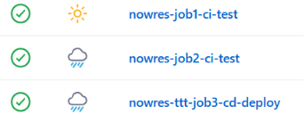

---

## Confirm the Application Is Live

Open your browser and enter:

```text
http://54.216.90.243/
```

The Tic Tac Toe game should appear successfully.

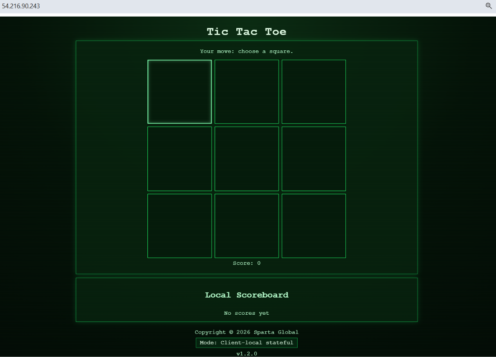


# Chain Job 3 from Job 2

Chain Job 2 → Job 3.

Open:

```text
Job 2 → Configure → Post-build Actions
```

Click:

```text
Add post-build action
→ Build other projects
```

Configure:

```text
Projects to build:
nowres-ttt-job3-cd-deploy
```

Select:

```text
Trigger only if build is stable
```

Click **Save**.

Keep your existing **Git Publisher** action in Job 2.

> **Important:** The order of post-build actions matters.
>
> Git Publisher should run before **Build other projects** so that Job 3 deploys the latest merged code after it has been pushed to GitHub.

You can drag and reorder the post-build actions if necessary.

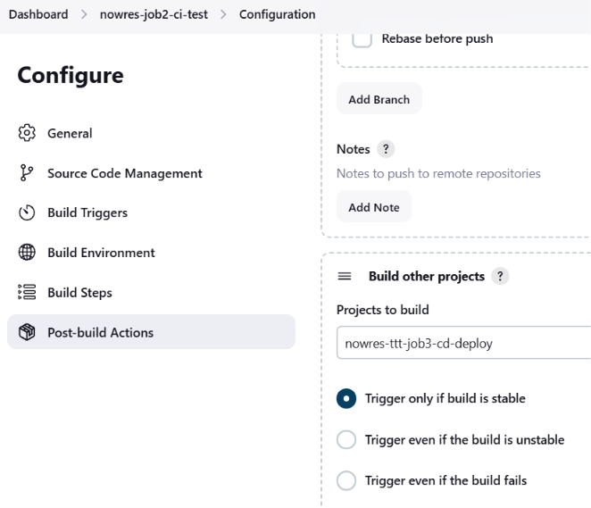

---

# Testing

The following tests verify that the complete CI/CD pipeline works correctly. Each test confirms that code changes move automatically from GitHub to Jenkins and then to the live AWS environment.


The expected workflow is:

```text
Developer Push
      ↓
GitHub Webhook
      ↓
Job 1 (CI Test)
      ↓
Job 2 (Merge Dev to Main)
      ↓
Job 3 (Deploy to EC2)
      ↓
Live Application Updates
```

---

# Test 1

Make a change to the application code.

Commit and push the change to the `dev` branch.

```bash
git add .

git commit -m "test pipeline"

git push
```

The GitHub webhook should automatically trigger the Jenkins pipeline.

Verify the build begins in Jenkins.

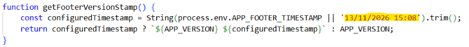

Verify the pipeline continues successfully through the chained jobs.


Confirm deployment completed successfully.

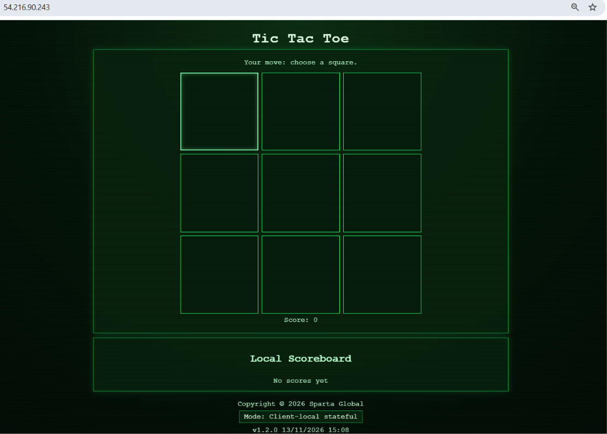

Verify the updated application is available on the EC2 instance.

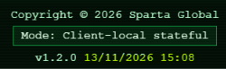

---

# Test 2

Make another small change to the application.

Commit and push the changes to the `dev` branch.

```bash
git add .

git commit -m "second pipeline test"

git push
```

The webhook should again trigger:

```text
Job 1
↓
Job 2
↓
Job 3
```

Confirm the Jenkins build starts successfully.

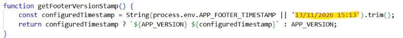

Verify the deployment phase completes successfully.

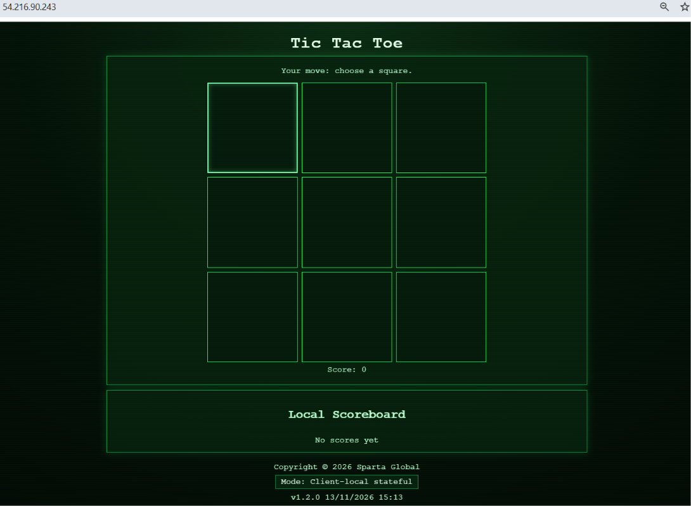

Confirm the changes are visible on the live application.

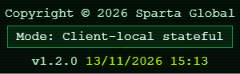

---

# Test 3 - Change Panel Colour to Red

As a final test, modify the application styling by changing the panel colour to red.

Commit and push the change:

```bash
git add .

git commit -m "change panel colour to red"

git push
```

The GitHub webhook should trigger the complete CI/CD pipeline automatically.

Verify the styling change appears in the repository.

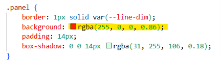

After Job 1, Job 2, and Job 3 complete successfully, verify the application running on EC2 reflects the new styling update.

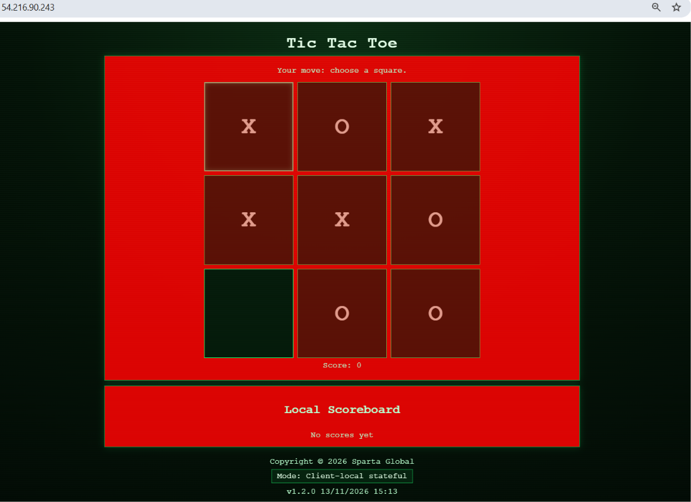

---

# Summary

The completed CI/CD pipeline now performs the following actions automatically:

1. Developer pushes code to GitHub
2. GitHub webhook triggers Jenkins
3. **Job 1** performs automated testing
4. **Job 2** merges the `dev` branch into the `main` branch after successful tests
5. **Job 3** deploys the tested code to AWS EC2
6. The application is restarted using PM2
7. The updated application becomes available to users

Pipeline Flow:

```text
GitHub Push
    ↓
Webhook
    ↓
Job 1 (Tests)
    ↓
Job 2 (Merge Dev → Main)
    ↓
Job 3 (Deploy to EC2)
    ↓
PM2 Restart
    ↓
Live Application