## Creating job

## Job name - nowres-get-linux-version
## Job - freestyle project

## description and Discard old builds
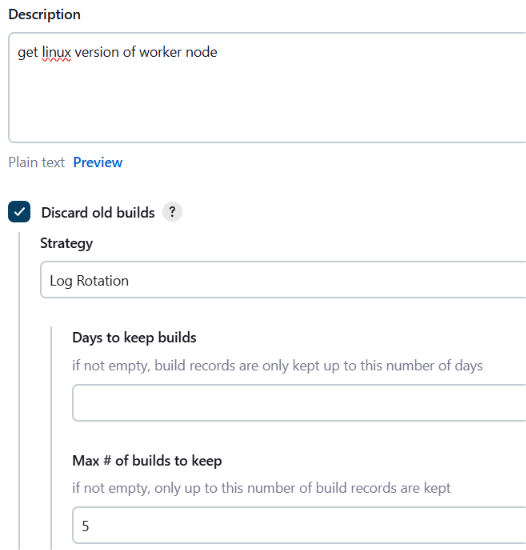

## Execute shell
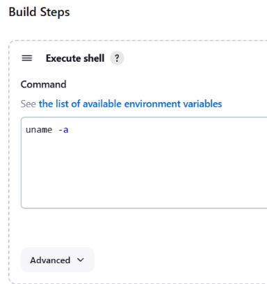

Click on "Build Now"

# Second job
## Job name - nowres-get-date-time
## Job - freestyle project

## description and Discard old builds
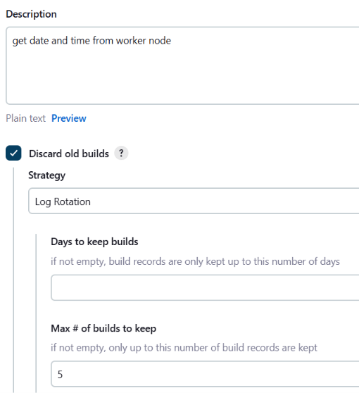

## Execute shell

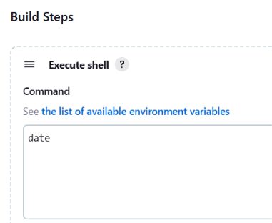

## Link the two jobs together
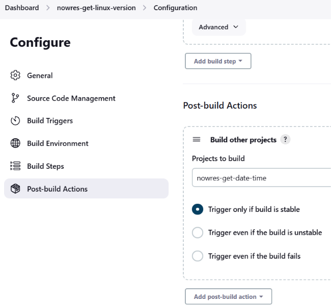
Save then click on build now

# Build CI/CD pipeline
# Generate new key pair for Jenkins for SCM

scm = Source Control Management

Got .ssh folder in bash, run:

ssh-keygen -t ed25519 -a 100 -C "jenkins@ttt-scm-3job-cicd"

Give your key a name: 

firstname-jenkins-2-github-ttt-app
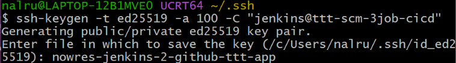

Add public key to GitHub repo, in bash window enter:

cat firstname-jenkins-2-github-ttt-app.pub

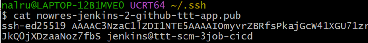

Copy / paste public key into GitHub repo when adding new key. Ensure you allow write access. 

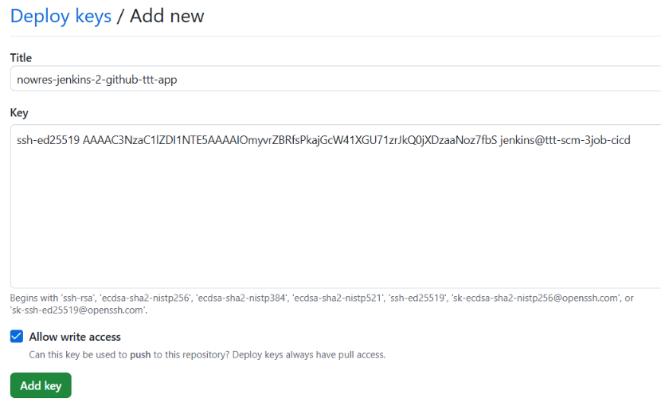

The key has now been deployed.

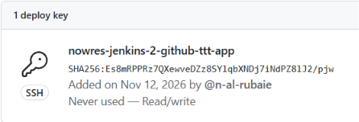

Create new freestyle job on jenkins called:

firsname-job1-ci-test

ensure to give description and discard old builds
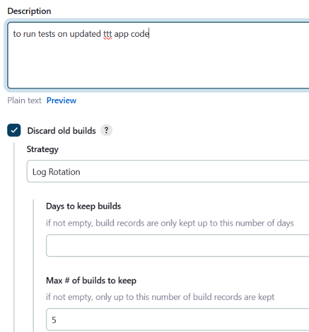

## Add GitGub project to the job:

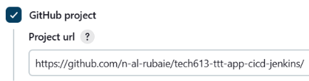

## Enter ssh link and private key

In Source Code Management, add in .ssh link of the GitHub repo and private .ssh key

Enter your private key in Jenkins, the private key can be found by typing in bash:

cat firstname-jenkins-2-github-ttt-app

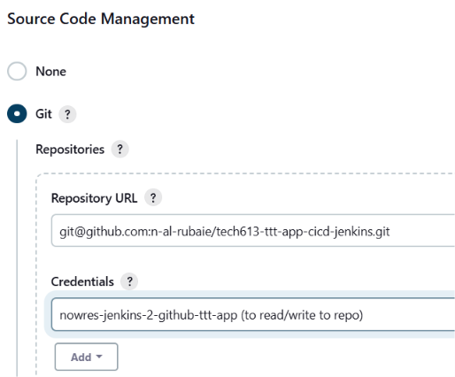

Click on "Add" below credentials to open input your private key.

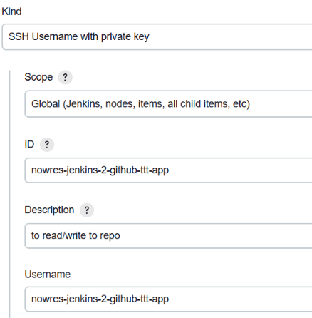

## Specify main branch 

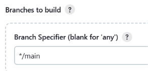

## In build environment
Select provide Node and npm bin/ folder to Path

Change to NodeJS version 20
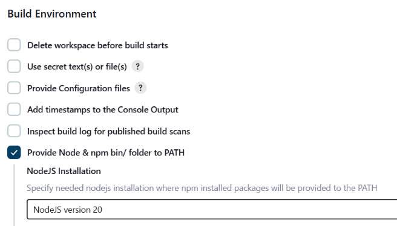

In builds steps, add in execute shell:

cd app       # Move into the app directory

npm ci       # Install dependencies listed in package-lock.json

npm test     # Run the project's automated tests

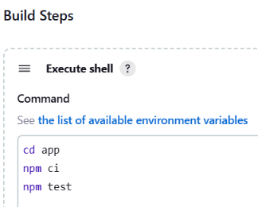

click Save then build now

In console, 6 tests skipped as they are integration tests.

Integration tests check whether different parts of the application work together, such as the backend and database.

They are skipped because the required services or configuration may not be available, or they are disabled in the pipeline.

You find the info below in the console output section

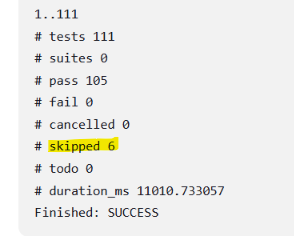

## Setting up webhook (from GitHub repo to Jenkins)

## Set up webhook on GitHub

In your guthub repo, go to settings then webhook.

add in payload URL:

http://54.73.244.32:8080/github-webhook/

http://54.73.244.32:8080/ = URL of jenkins

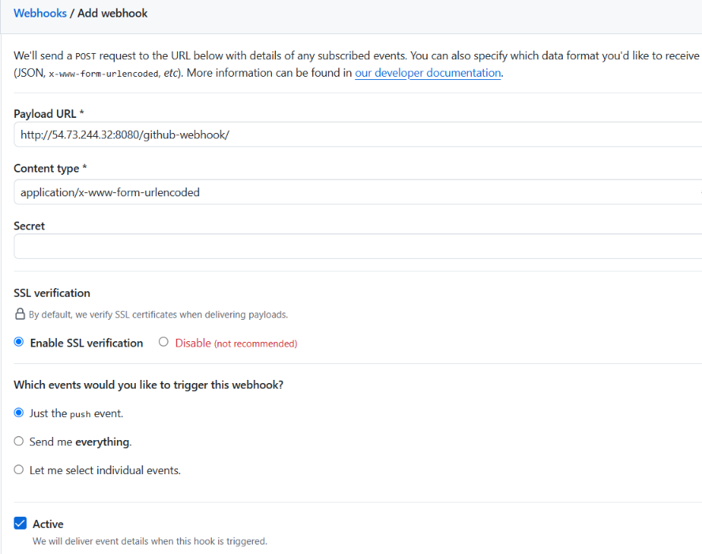

## Set up webhook on jenkins

Go to configure settings on your job on jenkins, tick GitHub hook trigger for GITScm polling
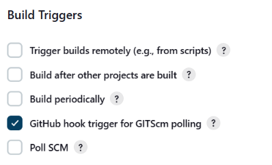

#  test CI/CD on Jenkins with TTT App

Open tech613-ttt-app-cicd-jenkins in Visual Studio Code. 

Add in readme file of the repo:

Test webhook is working on main branch

Push changes to GitHub (via main branch)

You should then see your CI/CD in Build Queue in Jenkins

## Change branch in Jenkins

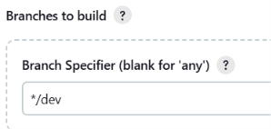

## Create dev branch on bash

git branch dev

git switch dev
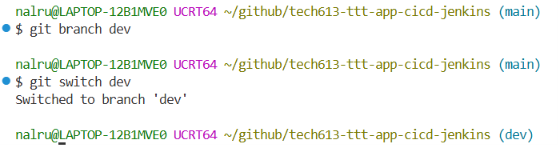

## Push project to github via dev branch
git add .

git commit -m "push to dev branch"

git push

You should then see your CI/CD in Build Queue in Jenkins

# Jenkins pipeline to deploy app

Duplicate firstname-job1-ci-test and name it:

firstname-job2-ci-test

In job2-ci-test on jenkins, go to post build actions, add a git publisher, select push only if build succeeds, set branch to push to: main, set target remote name to: origin.

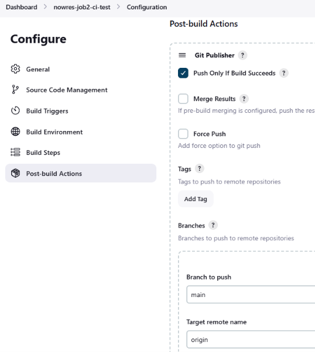

Add another shell build step to:

firstname-job2-ci-test

git fetch origin # Fetch the latest branches from GitHub
git checkout -B main origin/main # Switch to the main branch
git merge --no-ff origin/dev -m "Merge dev into main" # Merge dev into main
git log -1 --oneline # Show the latest commit

This creates the merge commit locally, after the tests have passed.

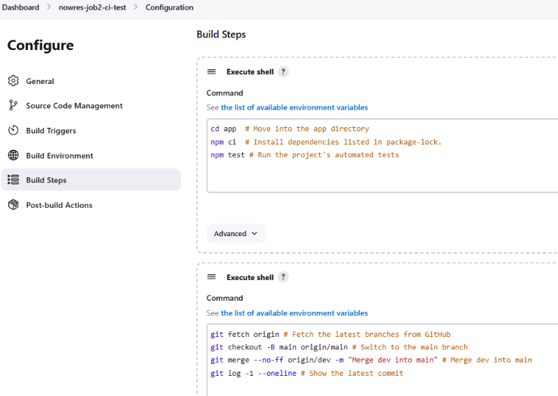

Ensure you add in your SSH agent.

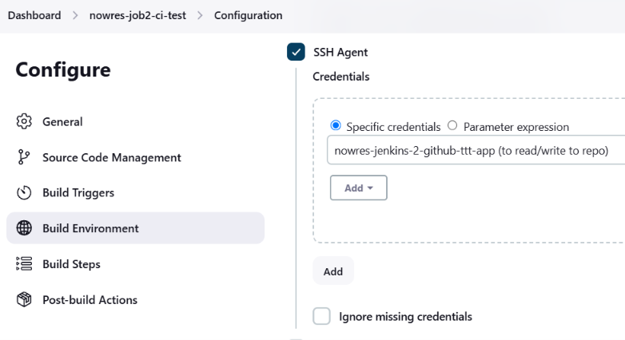

Save job2.

Run firstname-job1-ci-test on jenkins, you should then see firstname-job2-ci-test the code from the dev branch added into the main branch on github repo.

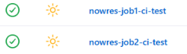

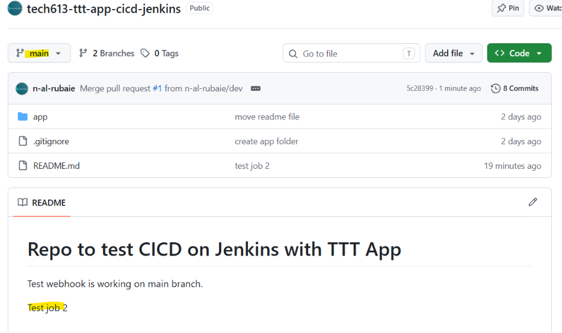

# Continuous Deployment (Copy Tested Code from Jenkins to AWS EC2 and Restart the App)

Create EC2 instance of tic tac toe app, SSH into it, then:

## Ensure prerequisites are installed:

node -v
npm -v
pm2 -v
rsync --version | head -1
pm2 list

## Create the folder on your EC2 instance, it makes an empty folder called app where Job 3 will put your code.

mkdir -p ~/app

To check it worked, type:

sh
ls ~

You should see app in the list.

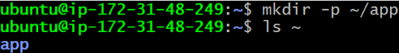

## Add your EC2 key to Jenkins

Add your EC2 key to Jenkins

This lets Jenkins log in to your EC2 instance. You need your .pem key file for this.

Get the private key contents. Open your .pem file in bash, type in:

cat tech613-nowres-aws-key.pem
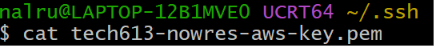

 and copy everything, including the -----BEGIN and -----END lines.
Open Jenkins and go to Manage Jenkins → Credentials.
Click (global), then Add Credentials.
Fill in the form:
Kind: SSH Username with private key
ID: nowres-ec2-key
Username: nowres-ec2-key
Private Key: tick Enter directly, click Add, and paste the key into the box
Click Create.

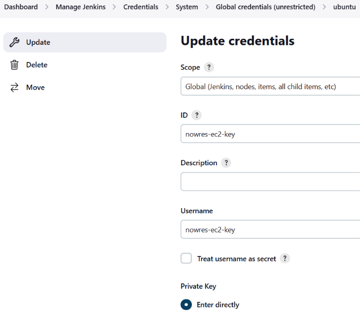

# Create Job 3

On the Jenkins dashboard click New Item.
Name it nowres-ttt-job3-cd-deploy, choose Freestyle project, click OK.

Add details from screenshot to job.

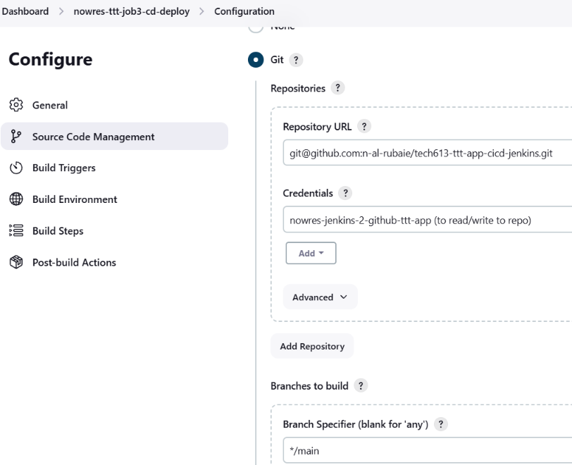

For SSh key - select: firstname-ec2-key
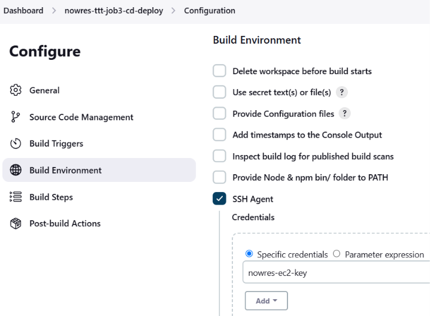

## Build step

Add build step → Execute shell, and paste this. Replace <PUBLIC_IP> with your EC2’s public IPv4 address:

EC2_HOST=ubuntu@<PUBLIC_IP>
SSH_OPTS="-o StrictHostKeyChecking=no"

Copy tested code from Jenkins to EC2
rsync -avz --delete \
  --exclude node_modules --exclude .git \
  -e "ssh $SSH_OPTS" \
  app/ $EC2_HOST:/home/ubuntu/app/

SSH in, install dependencies, restart the app
ssh $SSH_OPTS $EC2_HOST << 'EOF'
  cd /home/ubuntu/app
  npm ci --omit=dev
  pm2 restart ttt-app || pm2 start npm --name ttt-app -- start
  pm2 save
EOF

Click Save.

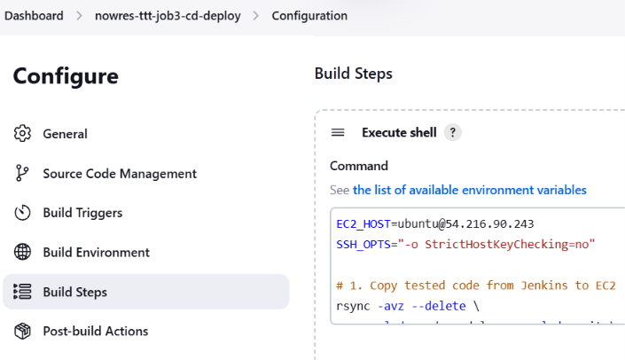

Run job 3 in jenkins, you should then see the successful output like below:

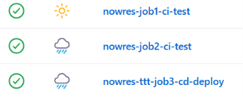

## Confirm the app is live

Type in url of web broswer public ipv4 address of tic tac toe instance using http:

http://54.216.90.243/

The tic tac toe game appears successfully.

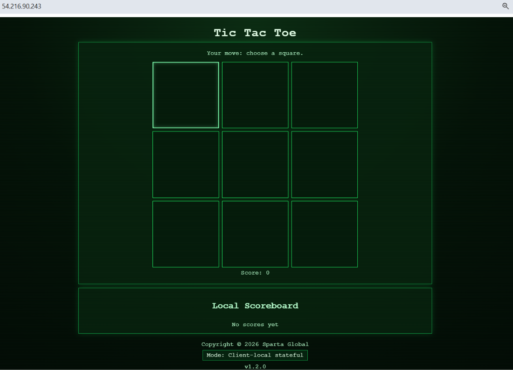

## Chain Job 3 from Job 2

Chain Job 2 → Job 3 now
Open Job 2 → Configure → Post-build Actions.
Click Add post-build action → Build other projects.
Projects to build: nowres-ttt-job3-cd-deploy
Choose Trigger only if build is stable.
Click Save.

Keep your Git Publisher action in Job 2. Order matters: Git Publisher should run before “Build other projects”, so Job 3 deploys after the merge is pushed. You can drag the post-build actions to reorder them.

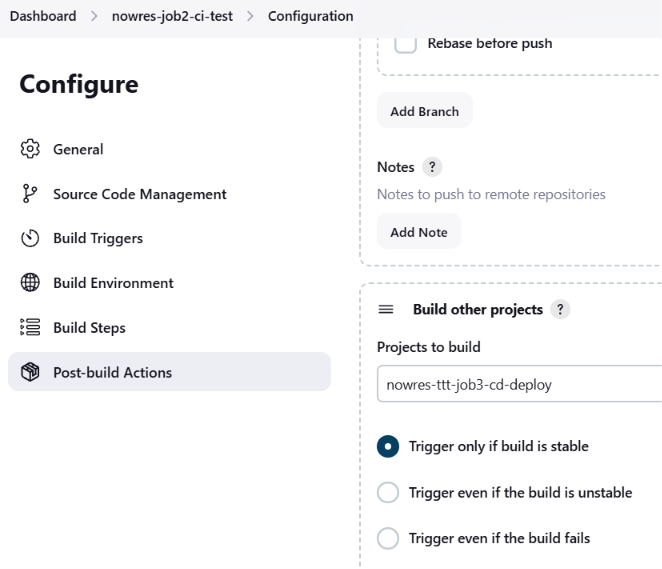

# Testing

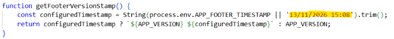

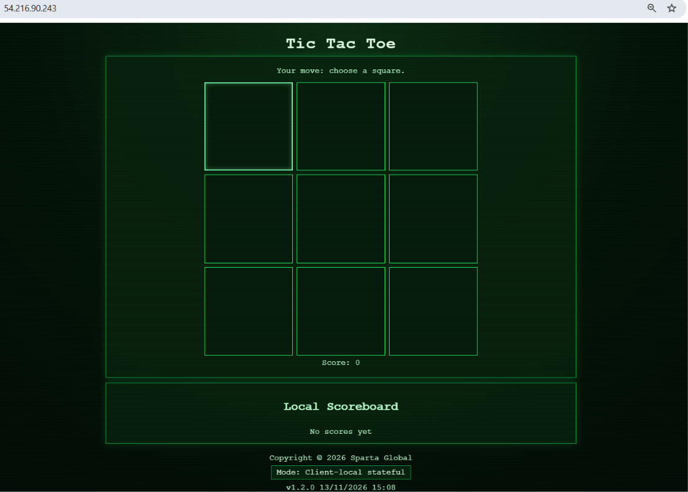
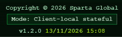

# 2nd test

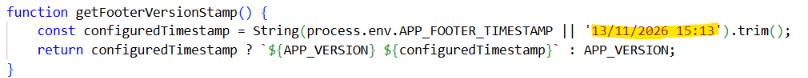
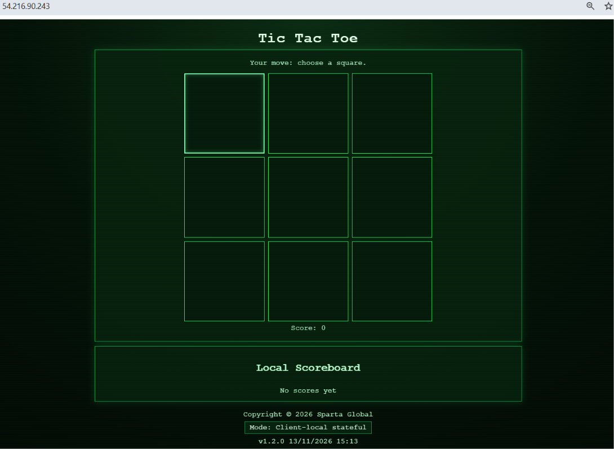
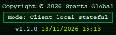

# 3rd test - change panel colour to red

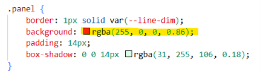
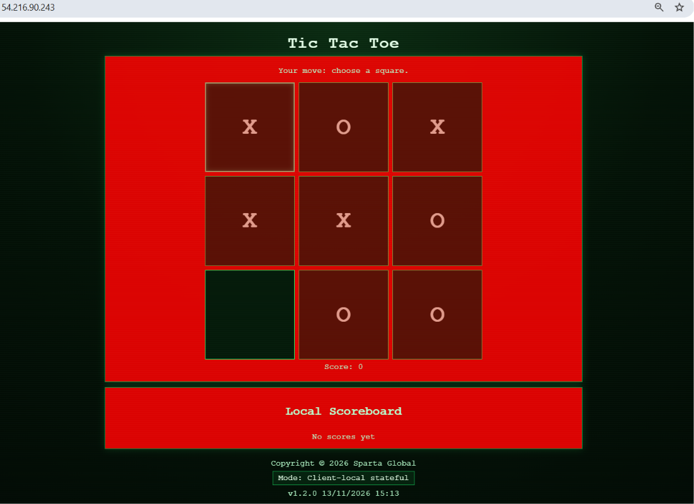