# Automate docker image creation using a Dockerfile

Create the folder and move into it in shell:


`mkdir tech613-mod-nginx-dockerfile`

`cd tech613-mod-nginx-dockerfile`

## Create your own index.html file 

EOF = End of file

```bash
cat > index.html << 'EOF'
<!DOCTYPE html>
<html>
  <head><title>Nowres's nginx</title></head>
  <body>
    <h1>Welcome to Nowres's tech 613 container, built with a Dockerfile!</h1>
  </body>
</html>
EOF
```

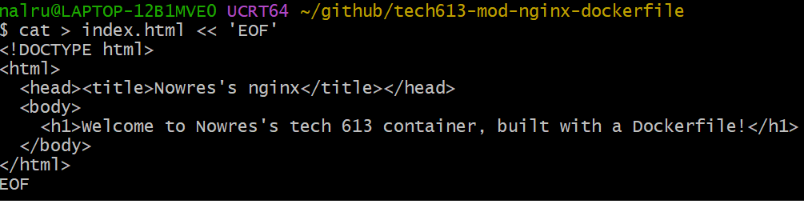

## Create the dockerfile

| Line | Meaning |
|------|---------|
| `FROM nginx` | Start from the official Nginx base image. |
| `COPY index.html /usr/share/nginx/html/index.html` | Replace Nginx's default web page with your custom `index.html` file. |

Result: When the container starts, Nginx serves your custom webpage instead of the default Nginx welcome page.

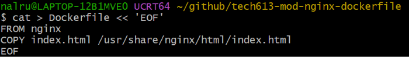

## Build the image 

## 5. Build the Image

Tag it with your Docker Hub username so you can push it later:

```bash
docker build -t <dockerhub-username>/tech613-nginx-auto:1.0 .
```

- The `.` at the end means **"use the current folder"** as the build context.


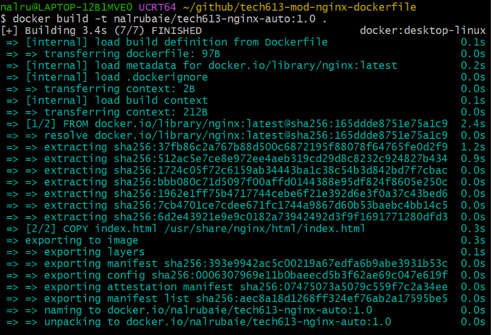

## Verify that the image was created successfully:

```bash
docker images
```

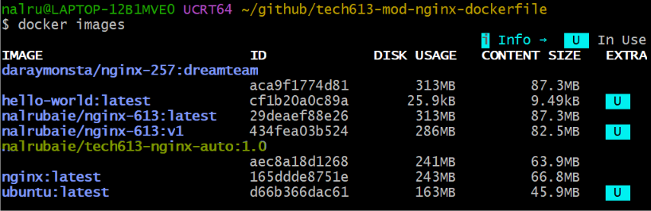

## Remove any container already using port 80

First, stop any container already using port 80:

```bash
docker ps
```

Then remove the running container:

```bash
docker rm -f <container-id>
```

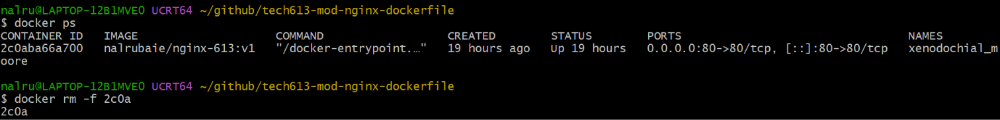

## Start your Nginx container:

```bash
docker run -d -p 80:80 <dockerhub-username>/tech613-nginx-auto:1.0
```

- `-d` runs the container in the background.
- `-p 80:80` maps port 80 on the host to port 80 in the container.
- `<dockerhub-username>/tech613-nginx-auto:1.0` specifies the image to run.

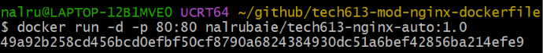

## Test the container

Open the following address in your browser to verify that your custom heading is displayed instead of the default Nginx welcome page:

```text
http://localhost
```


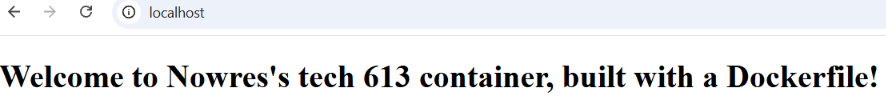

## Push to Docker Hub

Log in to Docker Hub:

```bash
docker login
```

Push the image to your Docker Hub repository:

```bash
docker push <dockerhub-username>/tech613-nginx-auto:1.0
```


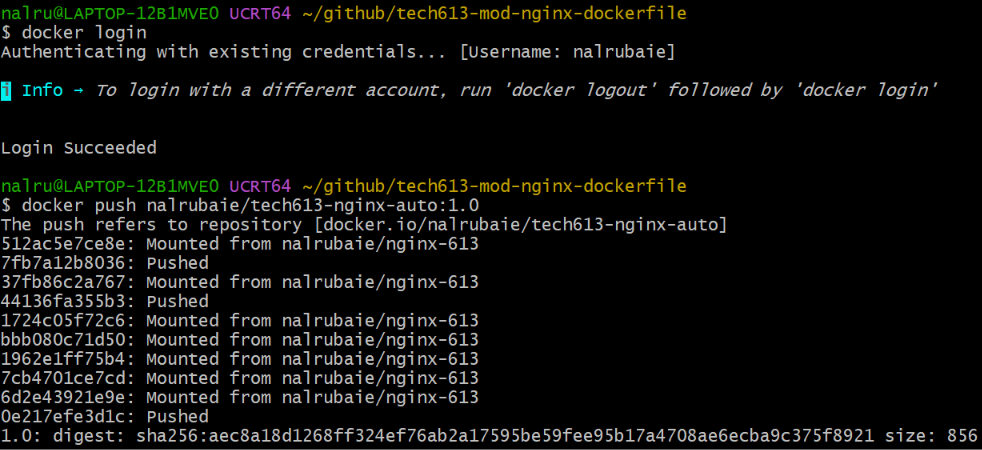

After the push completes, the image will be available in your Docker Hub account and can be pulled from any machine.

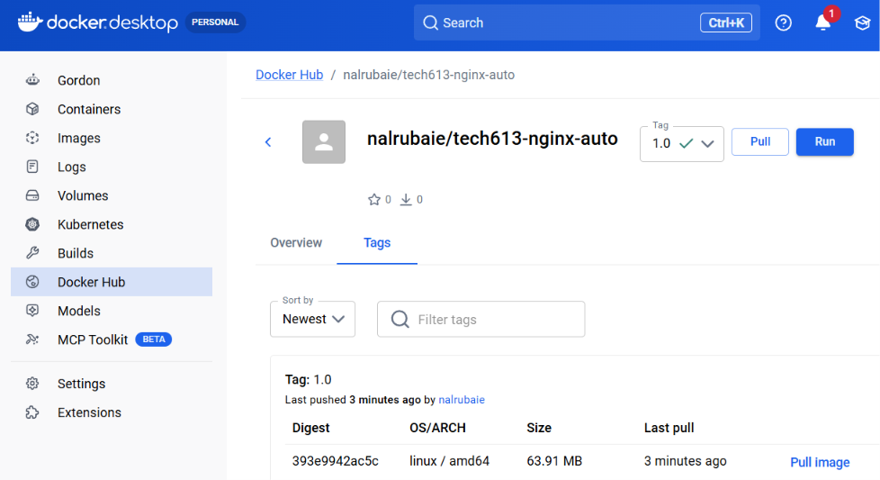

## To share with others

`docker run -d -p 80:80 <dockerhub-username>/tech613-nginx-auto:1.0`


## Remove local copy of custom image
`docker ps -a`


Remove the container named: tech613-nginx-auto.

`docker rm -f <container-id>`

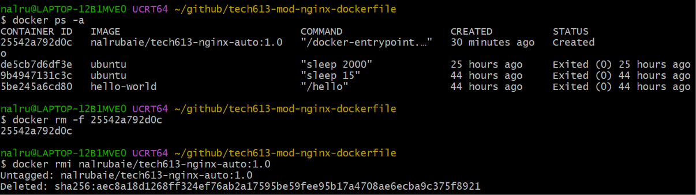

## Re-run your container and force docker to pull the custom image from Docker Hub

`docker run -d -p 80:80 nalrubaie/tech613-nginx-auto:1.0
`

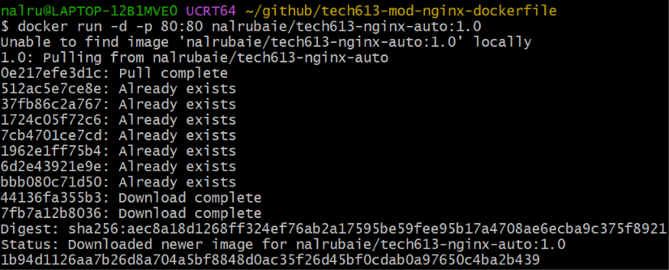

## lists the containers that are currently running.

You should be able to see tech613-nginx-auto:1.0

`docker ps`

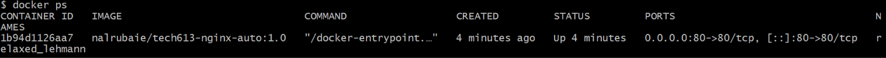

## Test the container

Open the following address in your browser to verify that your custom heading is displayed instead of the default Nginx welcome page:

```text
http://localhost
```

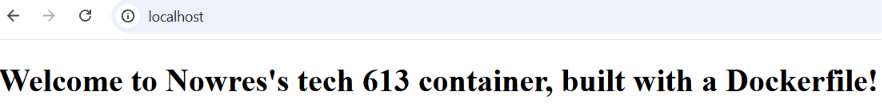
