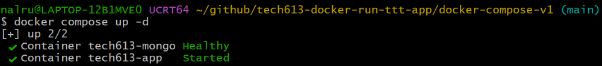
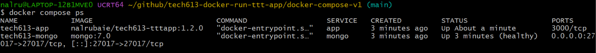
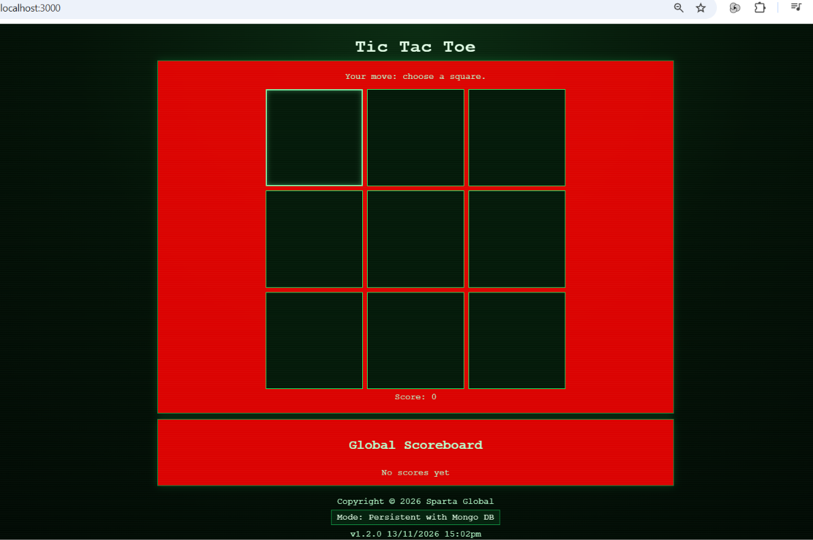
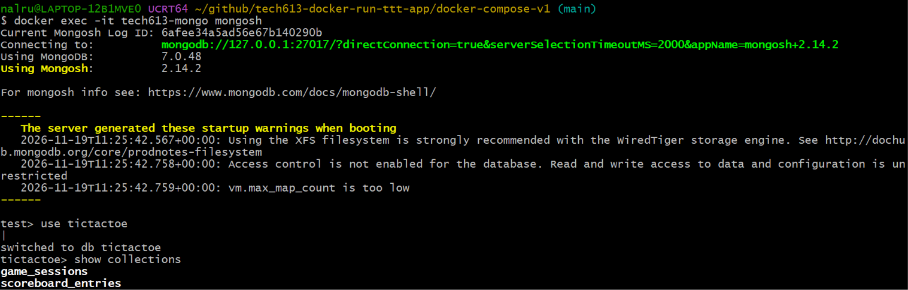
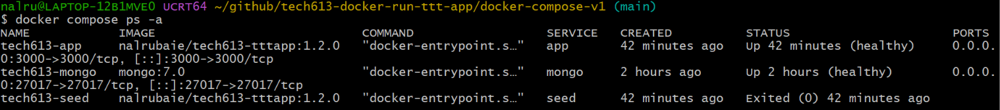

# Using Docker Compose to run tic tac toe app and database containers

Create a new directory called docker-compose-v1 and go into the directory.

`mkdir docker-compose-v1`

`cd dockr-compose-v1/`


## Create and write the Docker Compose configuration to docker-compose.yaml

Ensure you are currently in the docker-compose-v1 directory.
```
cat > docker-compose.yaml << 'EOF'

services:
  # MongoDB database service
  mongo:
    # Use MongoDB version 7.0 image
    image: mongo:7.0
    
    # Assign a fixed container name
    container_name: tech613-mongo
    
    # Automatically restart unless manually stopped
    restart: unless-stopped
    
    # Expose MongoDB on the host machine
    ports:
      - "27017:27017"
    
    # Persist database data using a named volume
    volumes:
      - mongo-data:/data/db
    
    # Check that MongoDB is healthy before dependent services start
    healthcheck:
      test: ["CMD", "mongosh", "--quiet", "--eval", "db.adminCommand('ping').ok"]
      interval: 5s
      timeout: 3s
      retries: 10
      start_period: 10s

  # Tic-Tac-Toe application service
  app:
    # Pull the application image from Docker Hub
    image: nalrubaie/tech613-tttapp:1.2.0
    
    # Assign a fixed container name
    container_name: tech613-app
    
    # Automatically restart unless manually stopped
    restart: unless-stopped
    
    # Expose the web application on port 3000
    ports:
      - "3000:3000"
    
    # Environment variables passed to the application
    environment:
      # Connection string to the MongoDB container
      MONGODB_URI: mongodb://mongo:27017/tictactoe
    
    # Wait until MongoDB passes its health check
    depends_on:
      mongo:
        condition: service_healthy

# Define named volumes used by services
volumes:
  # Stores MongoDB data persistently
  mongo-data:

EOF
```


## Start both containers (tic tac toe app and MongoDB)

Run:

`docker compose up -d`

Docker Compose will:
1. Download the MongoDB image if necessary
2. Create the MongoDB container
3. Wait for MongoDB to become healthy
4. Create and start the Node.js application container




## Check both containers are running

`docker compose ps`

displays the status of all containers managed by the current Docker Compose project




## Check the application runs
Open:
`http://localhost:3000`

If the page loads and it says Global Scoreboard, the application is accessible and is connected to MongoDB.



You can also check if MongoDB is connected by running:

`docker compose logs app`

The output below confirms that the two containers are successfully connected and running

```
"code":"MDB_001",
"message":"Mongo connection established",
"mode":"Persistent with Mongo DB",
"mongoTarget":"mongo:27017/tictactoe"
```

## Inspect the data stored in your MongoDB database

List all collections in the current database. This is done to verify that the application is actually storing data in MongoDB.

`docker exec -it tech613-mongo mongosh`

`use tictactoe`

`show collections`

Both outputs below confirm that the app has already created database collections

game_sessions → stores Tic-Tac-Toe game data (moves, players, game state, etc.).

scoreboard_entries → stores scores or leaderboard information.



## Seed the database (manually and automatically)

### What does `seed.js` do?

It follows this process:

1. Loads the default scoreboard data from `seedData.js`
2. Checks whether the application is running
3. Sends a `POST` request to `/api/seed` to populate the running application
4. If the app request fails, it attempts to connect directly to MongoDB using `MONGODB_URI`
5. Deletes the existing documents in `scoreboard_entries` and inserts the default scoreboard records

> [!IMPORTANT]
> The direct MongoDB method **deletes all existing records in `scoreboard_entries`** before inserting the seed data.
>
> It **does not delete** the `game_sessions` collection.

## Manually run the seed script

`docker exec tech613-app node seeds/seed.js`

The output `Seeded active app state via /api/seed (10 records).` means:
- The seed script ran successfully inside tech613-app
- It sent a POST request to the running app's /api/seed endpoint
- The app successfully seeded 10 scoreboard records
- The app is using MongoDB for persistent storage.
  


## Automate database seeding

In the docker-compose.yaml file, we already have:


```
 # Wait until MongoDB passes its health check
    depends_on:
      mongo:
        condition: service_healthy
```

**Add in the new code here in between these two sections of code**
```
# Define named volumes used by services
volumes:
  # Stores MongoDB data persistently
  mongo-data:
```

Add in the code below in between the two sections above to update the docker-compose.yaml file:
```
    # Check that the application is responding before marking it as healthy
    healthcheck:
      # Send a request to the app on port 3000
      # Exit code 0 = healthy, Exit code 1 = unhealthy
      test: ["CMD", "node", "-e", "fetch('http://127.0.0.1:3000/').then(r => process.exit(r.ok ? 0 : 1)).catch(() => process.exit(1))"]
      
      # Run the health check every 5 seconds
      interval: 5s
      
      # Fail the check if it takes longer than 3 seconds
      timeout: 3s
      
      # Mark the container as unhealthy after 10 failed checks
      retries: 10
      
      # Allow 10 seconds for the application to start before checking
      start_period: 10s

  # Seed database with default scoreboard data
  seed:
    # Use the same application image
    image: nalrubaie/tech613-tttapp:1.2.0
    
    # Assign a fixed container name
    container_name: tech613-seed
    
    # Run once and do not restart after completion
    restart: "no"
    
    # Execute the database seeding script
    command: ["node", "seeds/seed.js"]
    
    # Environment variables used by seed.js
    environment:
      # MongoDB connection string
      MONGODB_URI: mongodb://mongo:27017/tictactoe
      
      # URL used to access the running application
      SEED_BASE_URL: http://app:3000
    
    # Wait until the application passes its health check
    depends_on:
      app:
        condition: service_healthy
```

### Now three services are present

| Service | Responsibility |
|----------|---------------|
| `mongo` | Runs the MongoDB database |
| `app` | Runs the Node.js application |
| `seed` | Automatically seeds the database |

## Run the three containers: 


Run:

`docker compose up -d`


## Check the seed logs

Run:
`docker compose logs seed`


You should see something similar to:

`Seeded active app state via /api/seed (10 records).`


The Automated seeding is successful

What happened?
1. Docker Compose started MongoDB.
2. Docker waited for MongoDB's health check to pass.
3. Docker started the Node.js app.
4. Docker waited for the app's health check to pass.
5. Docker started the seed container.
6. The seed container populated the scoreboard with 10 records and exited.
Database seeding is now automated using Docker Compose.

## Check current containers

Run:

`docker compose ps -a`



### Container Status

| Container | Status | Meaning |
|-----------|---------|---------|
| `tech613-mongo` | Up (healthy) | MongoDB is running correctly. |
| `tech613-app` | Up (healthy) | The Node.js application is running correctly. |
| `tech613-seed` | Exited (0) | Seeding completed successfully. |

> **Note**
>
> Exit code `0` means **Success**.
>
> The `seed` container is designed to stop after completing its task. It only runs the seeding process and does not need to remain running.
