# Using Docker Compose to run tic tac toe app and database containers

Create a new directory called docker-compose-v1 and go into the directory.

`mkdir docker-compose-v1`

`cd dockr-compose-v1/`

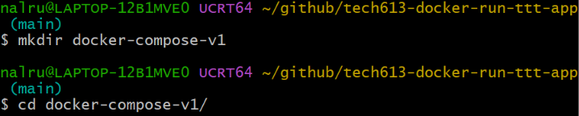


## Create and write the Docker Compose configuration to docker-compose.yaml

Ensure you are currently in the docker-compose-v1 directory.
```
cat > docker-compose.yaml << 'EOF'

services:
  # MongoDB database service
  mongo:
    # Use MongoDB version 7.0 image
    image: mongo:7.0
    
    # Assign a fixed container name
    container_name: tech613-mongo
    
    # Automatically restart unless manually stopped
    restart: unless-stopped
    
    # Expose MongoDB on the host machine
    ports:
      - "27017:27017"
    
    # Persist database data using a named volume
    volumes:
      - mongo-data:/data/db
    
    # Check that MongoDB is healthy before dependent services start
    healthcheck:
      test: ["CMD", "mongosh", "--quiet", "--eval", "db.adminCommand('ping').ok"]
      interval: 5s
      timeout: 3s
      retries: 10
      start_period: 10s

  # Tic-Tac-Toe application service
  app:
    # Pull the application image from Docker Hub
    image: nalrubaie/tech613-tttapp:1.2.0
    
    # Assign a fixed container name
    container_name: tech613-app
    
    # Automatically restart unless manually stopped
    restart: unless-stopped
    
    # Expose the web application on port 3000
    ports:
      - "3000:3000"
    
    # Environment variables passed to the application
    environment:
      # Connection string to the MongoDB container
      MONGODB_URI: mongodb://mongo:27017/tictactoe
    
    # Wait until MongoDB passes its health check
    depends_on:
      mongo:
        condition: service_healthy

# Define named volumes used by services
volumes:
  # Stores MongoDB data persistently
  mongo-data:

EOF
```
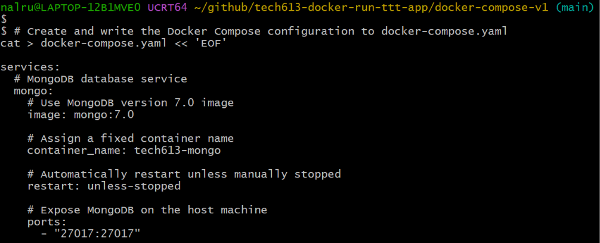

## Start both containers (tic tac toe app and MongoDB)

Run:

`docker compose up -d`

Docker Compose will:
1. Download the MongoDB image if necessary
2. Create the MongoDB container
3. Wait for MongoDB to become healthy
4. Create and start the Node.js application container


## Check both containers are running

`docker compose ps`

displays the status of all containers managed by the current Docker Compose project


## Check the application runs
Open:
`http://localhost:3000`

If the page loads and it says Global Scoreboard, the application is accessible and is connected to MongoDB.


You can also check if MongoDB is connected by running:

`docker compose logs app`

The output below confirms that the two containers are successfully connected and running

```
"code":"MDB_001",
"message":"Mongo connection established",
"mode":"Persistent with Mongo DB",
"mongoTarget":"mongo:27017/tictactoe"
```

## Inspect the data stored in your MongoDB database

List all collections in the current database. This is done to verify that the application is actually storing data in MongoDB.

`docker exec -it tech613-mongo mongosh`

`use tictactoe`

`show collections`

Both outputs below confirm that the app has already created database collections

game_sessions → stores Tic-Tac-Toe game data (moves, players, game state, etc.).

scoreboard_entries → stores scores or leaderboard information.


## Seed the database (manually and automatically)

### What does `seed.js` do?

It follows this process:

1. Loads the default scoreboard data from `seedData.js`
2. Checks whether the application is running
3. Sends a `POST` request to `/api/seed` to populate the running application
4. If the app request fails, it attempts to connect directly to MongoDB using `MONGODB_URI`
5. Deletes the existing documents in `scoreboard_entries` and inserts the default scoreboard records

> [!IMPORTANT]
> The direct MongoDB method **deletes all existing records in `scoreboard_entries`** before inserting the seed data.
>
> It **does not delete** the `game_sessions` collection.

## Manually run the seed script

`docker exec tech613-app node seeds/seed.js`

The output `Seeded active app state via /api/seed (10 records).` means:
- The seed script ran successfully inside tech613-app
- It sent a POST request to the running app's /api/seed endpoint
- The app successfully seeded 10 scoreboard records
- The app is using MongoDB for persistent storage.
  
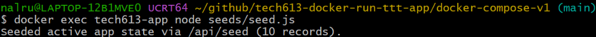

## Automate database seeding

In the docker-compose.yaml file, we already have:


```
 # Wait until MongoDB passes its health check
    depends_on:
      mongo:
        condition: service_healthy
```

**Add in the new code here in between these two sections of code**
```
# Define named volumes used by services
volumes:
  # Stores MongoDB data persistently
  mongo-data:
```

Add in the code below in between the two sections above to update the docker-compose.yaml file:
```
    # Check that the application is responding before marking it as healthy
    healthcheck:
      # Send a request to the app on port 3000
      # Exit code 0 = healthy, Exit code 1 = unhealthy
      test: ["CMD", "node", "-e", "fetch('http://127.0.0.1:3000/').then(r => process.exit(r.ok ? 0 : 1)).catch(() => process.exit(1))"]
      
      # Run the health check every 5 seconds
      interval: 5s
      
      # Fail the check if it takes longer than 3 seconds
      timeout: 3s
      
      # Mark the container as unhealthy after 10 failed checks
      retries: 10
      
      # Allow 10 seconds for the application to start before checking
      start_period: 10s

  # Seed database with default scoreboard data
  seed:
    # Use the same application image
    image: nalrubaie/tech613-tttapp:1.2.0
    
    # Assign a fixed container name
    container_name: tech613-seed
    
    # Run once and do not restart after completion
    restart: "no"
    
    # Execute the database seeding script
    command: ["node", "seeds/seed.js"]
    
    # Environment variables used by seed.js
    environment:
      # MongoDB connection string
      MONGODB_URI: mongodb://mongo:27017/tictactoe
      
      # URL used to access the running application
      SEED_BASE_URL: http://app:3000
    
    # Wait until the application passes its health check
    depends_on:
      app:
        condition: service_healthy
```

### Now three services are present

| Service | Responsibility |
|----------|---------------|
| `mongo` | Runs the MongoDB database |
| `app` | Runs the Node.js application |
| `seed` | Automatically seeds the database |

## Run the three containers: 


Run:

`docker compose up -d`


## Check the seed logs

Run:
`docker compose logs seed`


You should see something similar to:

`Seeded active app state via /api/seed (10 records).`


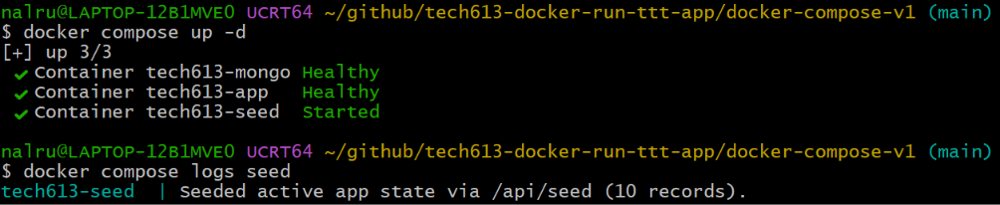

The Automated seeding is successful

What happened?
1. Docker Compose started MongoDB.
2. Docker waited for MongoDB's health check to pass.
3. Docker started the Node.js app.
4. Docker waited for the app's health check to pass.
5. Docker started the seed container.
6. The seed container populated the scoreboard with 10 records and exited.
Database seeding is now automated using Docker Compose.

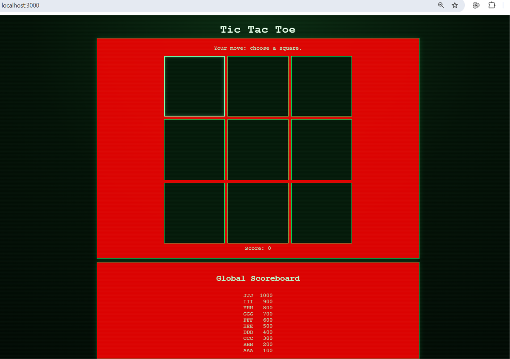

## View seeded data on bash

`cat ../app/seeds/seedData.js`

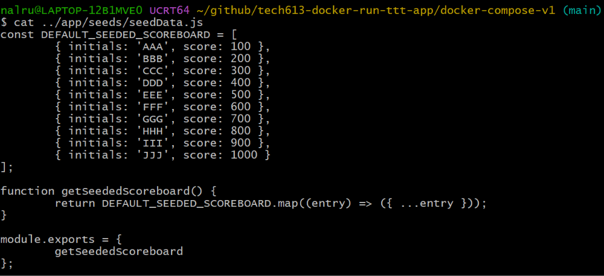

## Check current containers

Run:

`docker compose ps -a`


### Container Status

| Container | Status | Meaning |
|-----------|---------|---------|
| `tech613-mongo` | Up (healthy) | MongoDB is running correctly. |
| `tech613-app` | Up (healthy) | The Node.js application is running correctly. |
| `tech613-seed` | Exited (0) | Seeding completed successfully. |

> **Note**
>
> Exit code `0` means **Success**.
>
> The `seed` container is designed to stop after completing its task. It only runs the seeding process and does not need to remain running.


## second automated seeding method.

 MongoDB's `/docker-entrypoint-initdb.d` mechanism
 MongoDB can automatically execute initialisation scripts when it initialises a fresh database volume.


## Create MongoDB init directory and file


In the `docker-compose-v1` directory run:

`mkdir -p mongo-init`

`touch mongo-init/init.js`

- `mkdir -p mongo-init` → Creates a folder named `mongo-init`.
- `touch mongo-init/init.js` → Creates an empty file named `init.js` inside that folder.
-  `-p` → Creates the directory if it doesn't exist, and avoids an error if it already exists.
- `touch` → Creates an empty file (or updates the file's timestamp if it already exists).

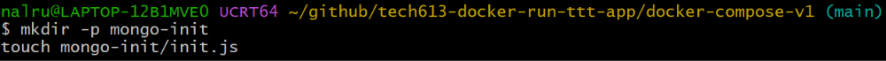

## Add code 

Go into the init.js file, this can be done on bash using:

`nano mongo-init/init.js`

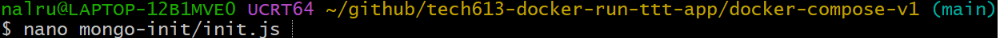

Add in the code below and then save/exit out of nano.

```
// Connect to (or create) the 'tictactoe' database
const db = db.getSiblingDB('tictactoe');

// Create a timestamp to use for all records
const now = new Date();

// Insert 10 sample scoreboard entries into the collection
db.scoreboard_entries.insertMany([
    { initials: 'AAA', score: 100, createdAt: now, updatedAt: now },
    { initials: 'BBB', score: 200, createdAt: now, updatedAt: now },
    { initials: 'CCC', score: 300, createdAt: now, updatedAt: now },
    { initials: 'DDD', score: 400, createdAt: now, updatedAt: now },
    { initials: 'EEE', score: 500, createdAt: now, updatedAt: now },
    { initials: 'FFF', score: 600, createdAt: now, updatedAt: now },
    { initials: 'GGG', score: 700, createdAt: now, updatedAt: now },
    { initials: 'HHH', score: 800, createdAt: now, updatedAt: now },
    { initials: 'III', score: 900, createdAt: now, updatedAt: now },
    { initials: 'JJJ', score: 1000, createdAt: now, updatedAt: now }
]);

// Print a success message after the records have been inserted
print('MongoDB initialisation completed: 10 scoreboard records inserted.');
```

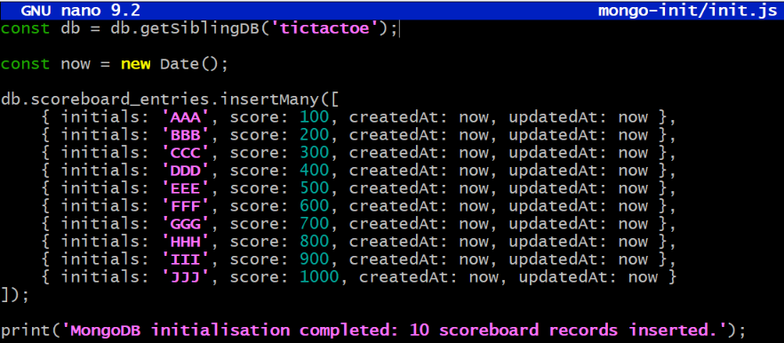

## Create a separate Compose file for testing

`touch docker-compose-init-test.yaml`

- `touch` → Creates an empty file (or updates the file's timestamp if it already exists).

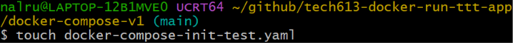


Why are we using a separate container?
- The  existing MongoDB continues running on port 27017.
- The test MongoDB uses port 27018.
- It has its own volume, mongo-init-test-data.
- The init.js file is mounted into MongoDB's initialisation directory.
When MongoDB starts with an empty data directory, its official entrypoint automatically executes the JavaScript file.

## Add in code to the docker-compose-init-test.yaml file

The code below creates a MongoDB container using Docker, stores database data in a persistent volume, automatically runs database initialisation scripts, and checks that MongoDB is healthy and responding.

```
services:
  # MongoDB container used for testing database initialisation
  mongo-init-test:
    # Use the official MongoDB 7.0 image
    image: mongo:7.0

    # Assign a custom container name
    container_name: tech613-mongo-init-test

    ports:
      # Map host port 27018 to container port 27017
      - "27018:27017"

    volumes:
      # Persist MongoDB data
      - mongo-init-test-data:/data/db

      # Mount init scripts as read-only
      - ./mongo-init:/docker-entrypoint-initdb.d:ro

    healthcheck:
      # Check MongoDB is responding
      test: ["CMD", "mongosh", "--quiet", "--eval", "db.adminCommand('ping').ok"]

      # Run health check every 5 seconds
      interval: 5s

      # Fail check if it takes longer than 3 seconds
      timeout: 3s

      # Mark container unhealthy after 10 failures
      retries: 10

      # Wait 10 seconds before starting checks
      start_period: 10s

volumes:
  # Named volume used to store MongoDB data persistently
  mongo-init-test-data:
```

## Start the test MongoDB container

`docker compose -f docker-compose-init-test.yaml up -d`


## Verify that the second automation inserted all 10 records into MongoDB


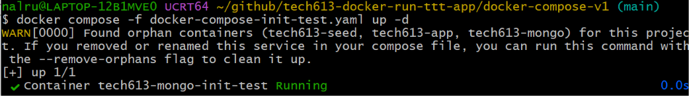


Run:

`docker exec -it tech613-mongo-init-test mongosh`

Then run:

###  Open the MongoDB Shell

You should enter the MongoDB shell and see a prompt similar to:

```shell
test>
```

### Select the Database

Type:

```javascript
use tictactoe
```

### Count the Records

Type:

```javascript
db.scoreboard_entries.countDocuments()
```

**Expected result:** `10`

###  Display All 10 Records

Type:

```javascript
db.scoreboard_entries.find().sort({ score: 1 }).pretty()
```

You should see the 10 entries sorted by score, from **AAA (100)** to **JJJ (1000)**.

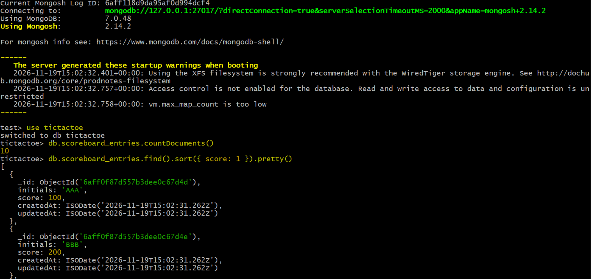

The second automated seeding method works.

There are now two automated seeding methods:
1. Docker Compose seed service: waits for the app to become healthy, then runs seeds/seed.js.
2. MongoDB initialisation script: runs mongo-init/init.js automatically when MongoDB starts with a fresh, empty data volume.


---

## Separate the three seeding methods

To organise the project, I created two separate directories:

- `manual-seeding/` – contains the Docker Compose file for manual seeding.
- `automatic-seeding/` – contains the Docker Compose files and MongoDB initialisation script for the two automated methods.

The project structure is now:

```text
tech613-docker-run-ttt-app/
│
├── app/
│
├── manual-seeding/
│   └── docker-compose.yaml
│
├── automatic-seeding/
│   ├── docker-compose.yaml
│   ├── docker-compose-init.yaml
│   └── mongo-init/
│       └── init.js
│
├── Dockerfile
└── .dockerignore
```

### Run the three methods on separate ports

Each method has its own application container and MongoDB container. This allows all three applications to run simultaneously without conflicting ports or sharing database volumes.

| Method | Application port | MongoDB port |
|---|---:|---:|
| Manual seeding | 3000 | 27017 |
| Automatic seeding using Docker Compose | 3001 | 27018 |
| Automatic seeding using MongoDB `init.js` | 3002 | 27019 |

### Start the manual seeding method

From the project root directory, run:

```bash
docker compose -f manual-seeding/docker-compose.yaml up -d
```

This starts the MongoDB and application containers. The database can then be seeded manually using:

```bash
docker exec manual-tech613-app node seeds/seed.js
```

Access the application at:

`http://localhost:3000`

### Start the first automatic seeding method

Run:

```bash
docker compose -p automatic-compose -f automatic-seeding/docker-compose.yaml up -d
```

The `-p automatic-compose` option assigns a separate Docker Compose project name.

This configuration:

1. Starts MongoDB.
2. Waits for MongoDB to become healthy.
3. Starts the application.
4. Waits for the application to become healthy.
5. Starts the seed service.
6. Automatically inserts the 10 scoreboard records.

The seed container exits after successfully completing the task.

Access the application at:

`http://localhost:3001`

### Start the second automatic seeding method

Run:

```bash
docker compose -p automatic-init -f automatic-seeding/docker-compose-init.yaml up -d
```

This starts a separate MongoDB container and application.

The MongoDB container mounts the `mongo-init` directory into:

`/docker-entrypoint-initdb.d`

When MongoDB initialises a fresh, empty data volume, it automatically executes `init.js` and inserts the 10 scoreboard records.

Access the application at:

`http://localhost:3002`

### Why use separate Docker Compose project names?

Both automatic Compose files are inside the same directory. Docker Compose normally uses the directory name as the project name.

Using separate project names prevents the two configurations from interfering with each other:

- `automatic-compose` – first automated method.
- `automatic-init` – second automated method.

### Check all running containers

Run:

```bash
docker ps
```

This displays the running containers, their status and their port mappings.

### Access all three applications

| Seeding method | Application URL |
|---|---|
| Manual | `http://localhost:3000` |
| Automatic Compose seeding | `http://localhost:3001` |
| Automatic MongoDB initialisation | `http://localhost:3002` |

All three applications were successfully started and tested. Each application was accessible through its own port, and each database contained 10 seeded scoreboard records.

### Stop all three methods

To stop the containers while preserving the database volumes and stored data, run:

```bash
docker compose -f manual-seeding/docker-compose.yaml down

docker compose -p automatic-compose -f automatic-seeding/docker-compose.yaml down

docker compose -p automatic-init -f automatic-seeding/docker-compose-init.yaml down
```

The `down` command removes the containers and networks but preserves the named volumes unless the `-v` option is added.


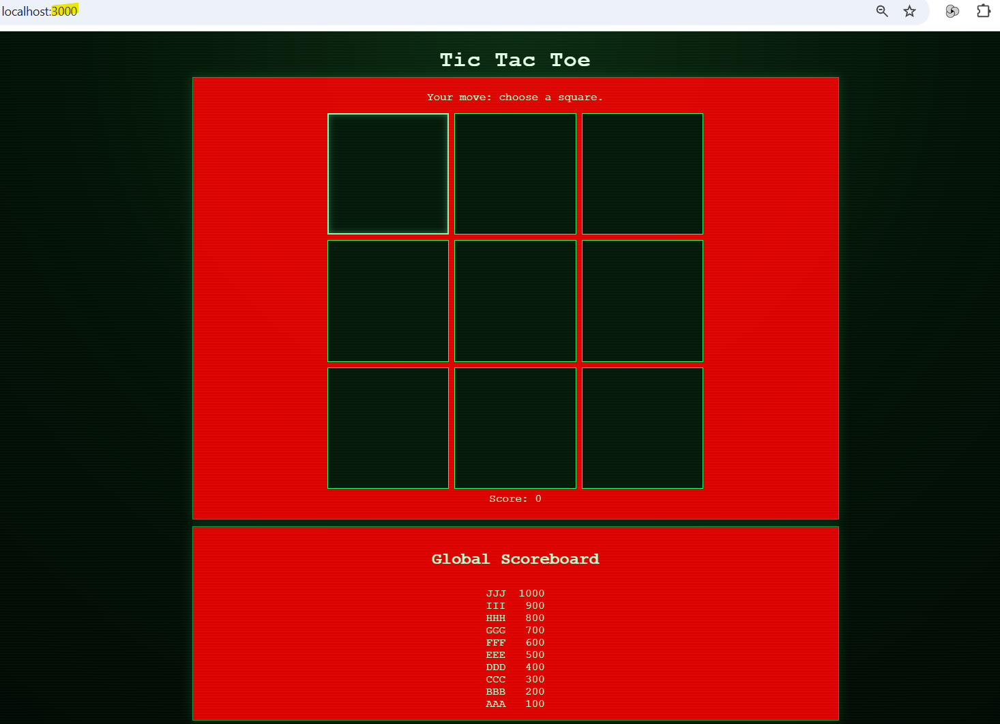

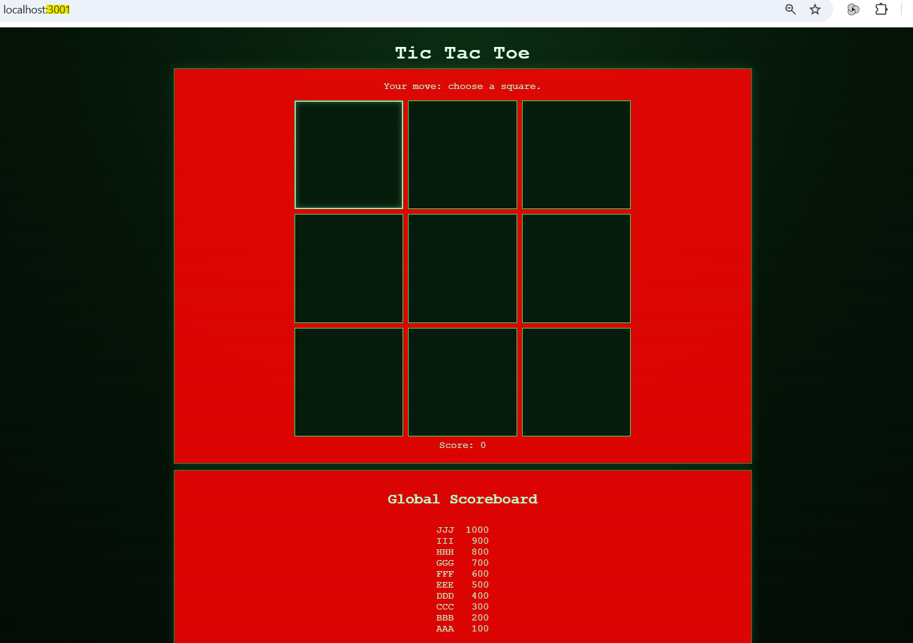

