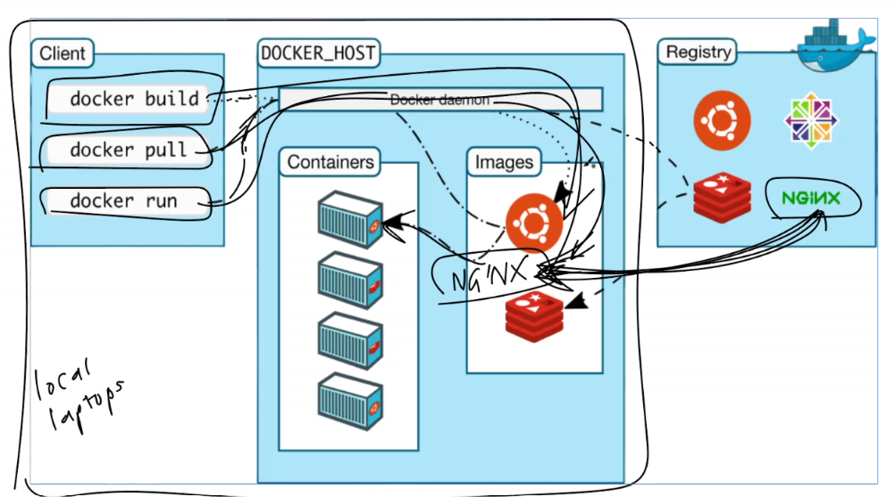
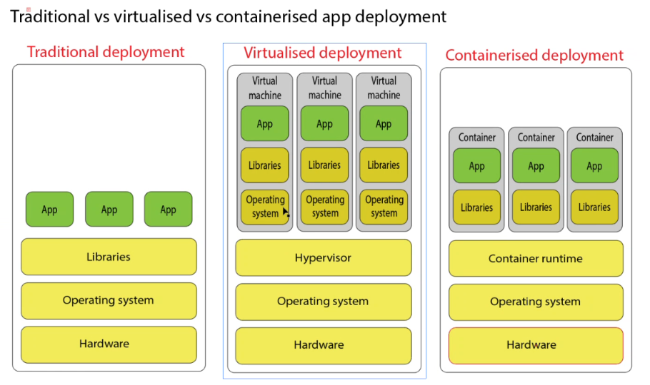

## Intro to  microservices, containers and Docker

### Virtualisation vs containerisation

| | Virtual machine (VM) | Container |
|---|---|---|
| What it is | A full computer simulated in software | A lightweight, isolated package for one app |
| What's included | Its own full OS, plus the app and its dependencies | The app and its dependencies only; it shares the host's OS kernel |
| Size | Gigabytes | Megabytes |
| Start-up | Minutes | Seconds |

**Benefits of each**
- **VM:** strong isolation (each has its own OS), can run different operating systems on one machine.
- **Container:** fast, light, and runs the same everywhere ("works on my machine" problem solved).
- **VM over the traditional architecture:** before VMs, one app ran on one physical server, which wasted capacity. VMs let many servers share one machine, which cuts hardware costs, makes backups and moving servers easier, and isolates apps from each other.

### Microservices

- **What:** an app built as many small, independent services (for example login, payments, search), each doing one job and talking to the others through APIs.
- **How they're made possible:** containers (package each service), APIs, and automation (CI/CD, orchestration such as Kubernetes).
- **Benefits:**
  - Update or fix one service without redeploying everything
  - Scale only the busy parts
  - A failure in one service doesn't take down the whole app
  - Teams can work independently

### Docker

- **What is it:** a tool for building, shipping and running containers.
- **Why Docker:** the same container runs identically on a laptop, a test server and production. It's fast, lightweight and easy to share through Docker Hub.
- **Alternatives:** Podman, containerd, LXC, and CRI-O.
- **How it works (architecture):**
  - **Docker client (CLI):** where you type commands like `docker run`
  - **Docker daemon:** runs in the background and does the work, receiving requests through the Docker API
  - **Images:** read-only templates used to create containers
  - **Containers:** running instances of images
  - **Registry (Docker Hub):** where images are stored and shared

  Flow: `docker run` → client sends the request to the daemon → the daemon pulls the image from the registry if needed → it starts the container.

- **Success story:** PayPal used Docker to modernise its infrastructure, moving thousands of applications into containers. This helped it deploy faster and use servers more efficiently. 

## How docker works diagram

### Podman vs Docker: Pros and Cons of Podman (compared to Docker)

| Pros of Podman (vs Docker) | Cons of Podman (vs Docker) |
|---|---|
| **Daemonless:** Docker relies on an always-running daemon, Podman doesn't, so there's no single point of failure | **Smaller community:** fewer tutorials and answers online than Docker |
| **Rootless by default:** Docker's daemon usually runs as root, Podman doesn't need to | **Rootless limits:** some tasks, like using ports below 1024, need extra setup |
| **More secure:** smaller attack surface than Docker's root daemon | **Compose differences:** Docker Compose is the standard, and `podman-compose` can behave differently |
| **Docker-compatible commands:** `alias docker=podman` works for most tasks | **Tool support:** many tools and CI systems assume Docker and need adjusting |
| **Free and open source:** no Docker Desktop licence fees for larger companies | **Windows and macOS:** Docker Desktop is smoother, while Podman needs a VM behind the scenes |
| **Pods:** works like Kubernetes pods, which makes a later move to Kubernetes easier | **Less familiar:** more teams and job listings use Docker |
| **systemd integration:** run containers as Linux services that start on boot | **Fewer built-in features:** for example, Docker has Swarm for clustering |

## Traditional vs virtualised vs containerised app deployment diagram

