# Run nginx in docker container

`docker pull niginx`

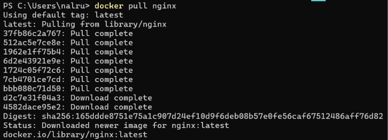

# Running an nginx Web Server in a Docker Container (docker run)

`docker run -d -p 80:80 nginx`

| Part | Meaning |
|---|---|
| `docker run` | Start a new container |
| `-d` | Run it in the background (detached), so the terminal stays free |
| `-p 80:80` | Connect port 80 on the host to port 80 in the container (`host-port:container-port`) |
| `nginx` | The image to use: the pre-built nginx web server |

**Result:** open `http://localhost` (or the server's IP) to see the nginx welcome page.

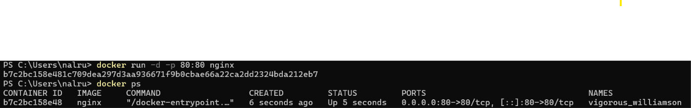

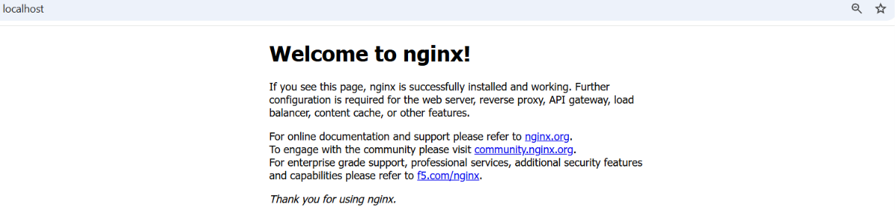

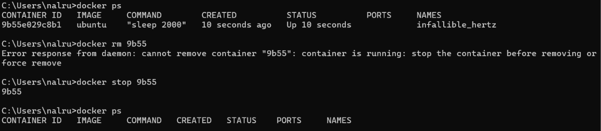

# View current docker images

`docker images`

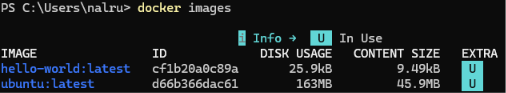

# Stop container

`docker ps`

`docker stop <id or name of container>`
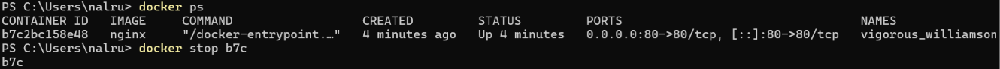

If you run `docker ps -a`, you will see that the container exited recently.

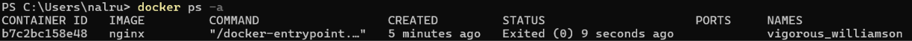

## Start container

`docker start <id or name of container>`

If you run `docker ps -a`, you will see that the container is now up.

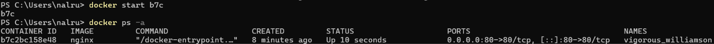

## Remove a container

`docker rm <id or name of container>`

## Force remove a container (stops container and then removes it)

`docker rm <id or name of container> -f`

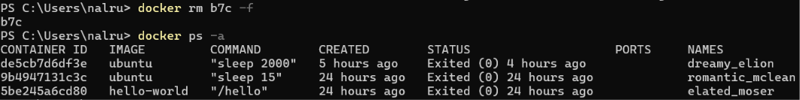

## Log in to nginx container (container must already be made)

`docker exec -it <id or name of container> sh`

`ls`

`uname`

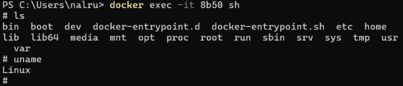

## update and upgrade

`apt-get update -y`

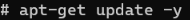

`apt-get upgrade -y`

## Install sudo

`apt-get install sudo`

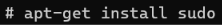

## Install nano

`apt-get install nano`

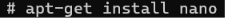

## Open index.html file

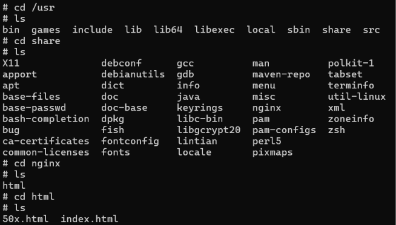
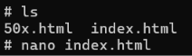

## Edit title to "Welcome to Tech613" when opening index.html file, refresh local host to see result.

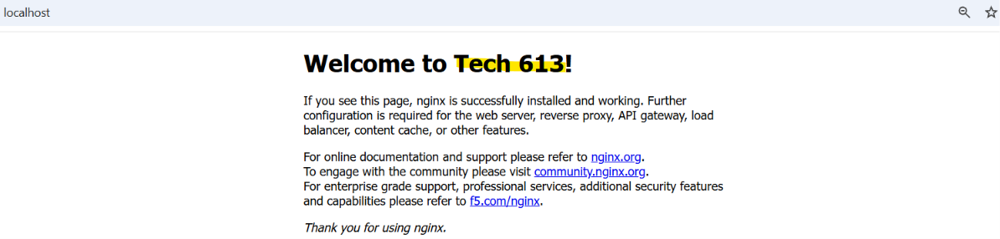

# Run different container on a different port
`docker run -d -p 90:80 daraymonsta/nginx-257:dreamteam`

| Part | Meaning |
|---|---|
| `docker run` | Start a new container |
| `-d` | Run it in the background (detached), so the terminal stays free |
| `-p 90:80` | Connect port 90 on the host to port 80 in the container (`host-port:container-port`) |
| `daraymonsta/nginx-257` | The image: `daraymonsta` is the Docker Hub account, `nginx-257` is the image name |
| `:dreamteam` | The tag, which selects a specific version of the image |

If the image isn't on your machine, Docker downloads it from Docker Hub first.

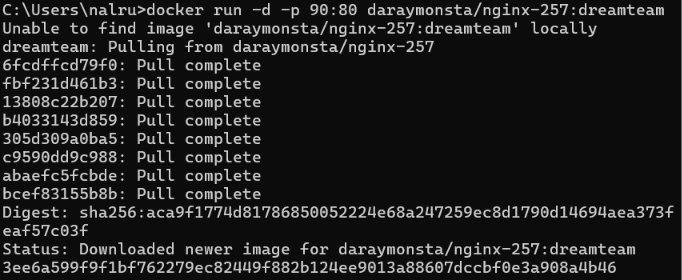

**Result:** open `http://localhost:90` (or `http://<server-IP>:90`) to see the page served by the container.

**Difference from the plain nginx command:** it uses a custom image with a tag (`:dreamteam`) and a different host port (90 instead of 80). On a server, the security group must allow port 90.
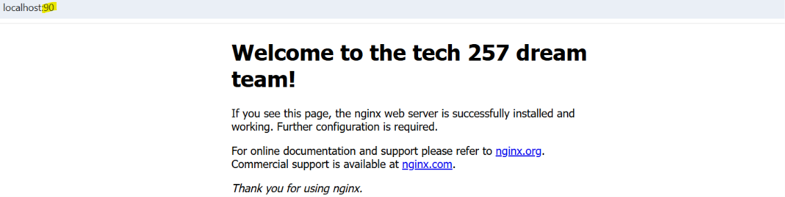

## Diagram showing current layout

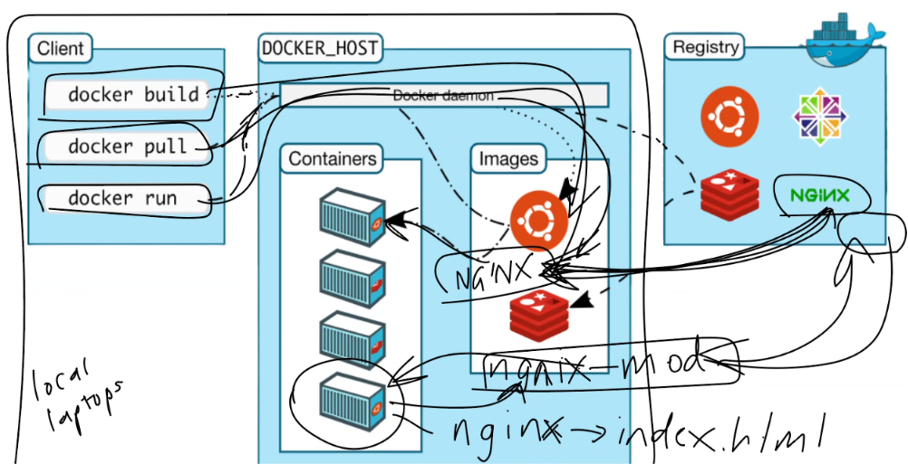

# Push host-custom-static-webpage container image to Docker Hub

## Log in to Docker Hub
`docker login`

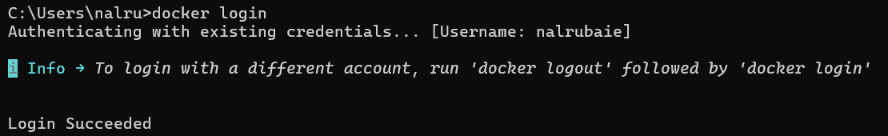

## Find your running container

`docker ps`

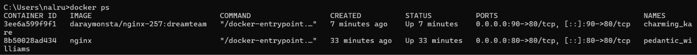

## Create the image from it (docker commit)

`docker commit <container-name-or-id> <dockerhub-username>/nginx-613:v1`

## Push the image

`docker push <dockerhub-username>/nginx-613:latest (or v1)`

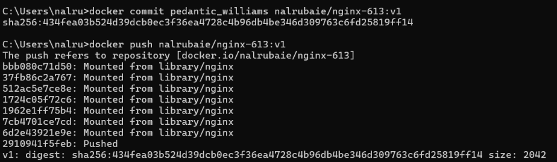

## Test it

docker rm -f pedantic_williams

docker rmi <dockerhub-username>/nginx-613:v1

docker run -d -p 80:80 <dockerhub-username>/nginx-613:v1

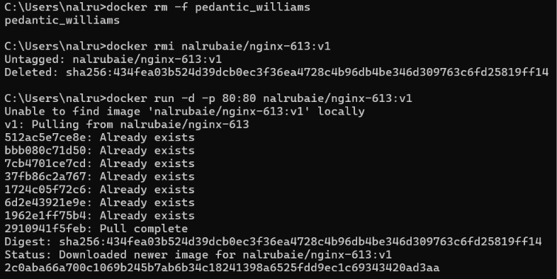

In url run:

localhost

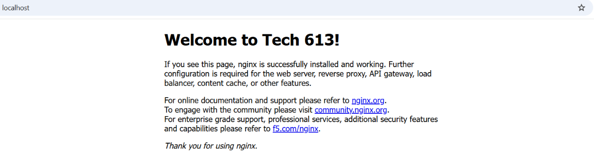

## Send command for others to use the container

`docker run -d -p 80:80 <dockerhub-username>/nginx-613:v1`