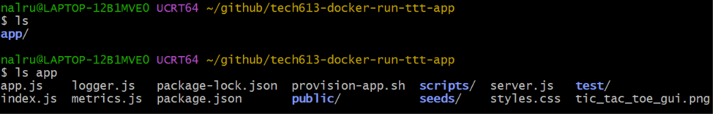
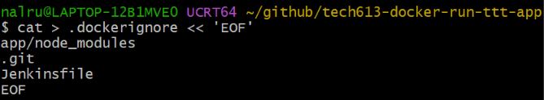
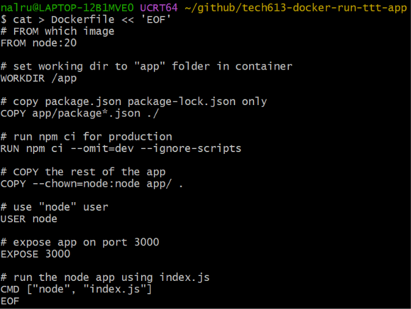
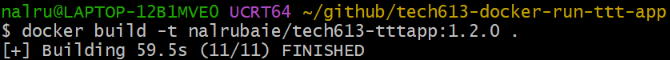
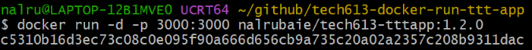
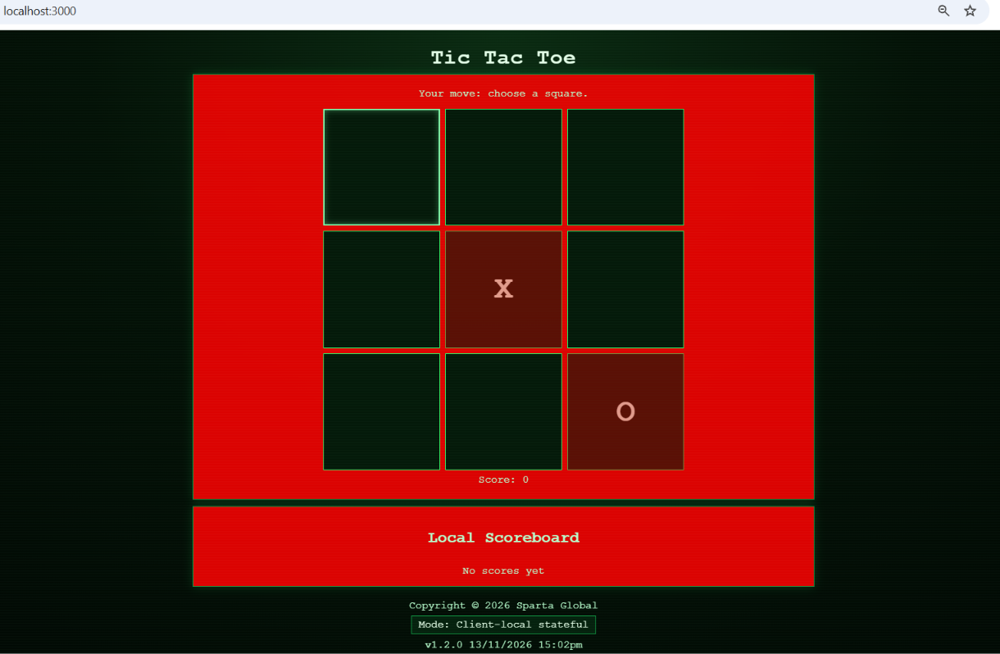
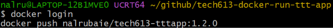

# Run Tic Tac Toe app in docker container and push the image to DockerHub

## Ensure the app folder is in your directory



## Create the .dockerignore

The purpose of .dockerignore is to stop unnecessary files being sent to Docker during the image build.

```
cat > .dockerignore << 'EOF'
app/node_modules
.git
Jenkinsfile
EOF
```



## Create the Dockerfile



## Build the docker image

`docker build -t nalrubaie/tech613-tttapp:1.2.0 .`




## Run the docker image

`docker run -d -p 3000:3000 nalrubaie/tech613-tttapp:1.2.0`

```bash
docker run -d -p 3000:3000 nalrubaie/tech613-tttapp:1.2.0
```

Runs a container from the `nalrubaie/tech613-tttapp:1.2.0` Docker image.

- `docker run` – Creates and starts a new container.
- `-d` – Runs the container in detached mode (in the background).
- `-p 3000:3000` – Maps port 3000 on the host machine to port 3000 inside the container.
- `nalrubaie/tech613-tttapp:1.2.0` – Specifies the image name and version tag to run.




## Test the docker image

Open `http://localhost:3000` to access the tic tac toe app.



## Push image to docker hub

Pushing the image to Docker Hub makes it available online so that it can be downloaded and run on other systems.

```
docker login
docker push nalrubaie/tech613-tttapp:1.2.0
```



## Command to share

This command can be shared with other users so they can run your docker image (in this case the tic tac toe app) without needing the source code or build process.

`docker run -d -p 3000:3000 nalrubaie/tech613-tttapp:1.2.0`