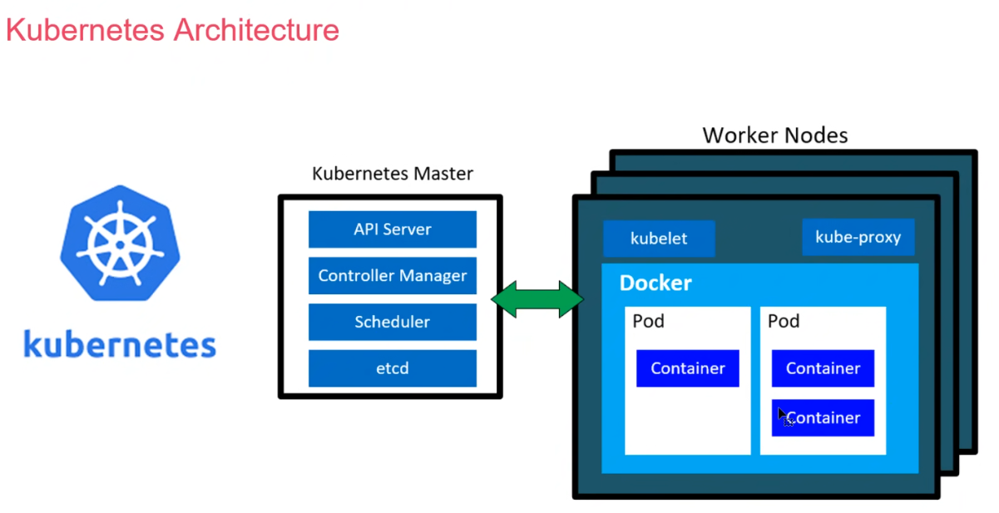

# Kubernetes 




# Kubernetes

## Some of the biggest challenges facing enterprises

*Why it matters: DevOps work is about solving these problems for developers, and Kubernetes is one of the tools used.*

* handling traffic/load on their applications
  * demand can spike suddenly
  * hardware can fail too (disasters, cut cables), so systems need to be resilient
* cybersecurity - and using AI to assist
  * attackers now have AI to help them find vulnerabilities and plan hacks
  * AI can also help defenders: finding vulnerabilities, patching bugs, simulated attacks to test resilience
  * trainer: "we need to be constantly vigilant". Waiting for end users to find vulnerabilities "might be too late"
* migration to the cloud
  * many organisations are still doing digital transformation
  * legacy systems often weren't designed for the cloud, so they may need re-coding and re-architecting
  * controlling cost, auditing
    * running and training AI models in the cloud costs a lot
    * resources get forgotten about but still cost money
    * checking what is still needed is "a job in itself" (cloud auditor)
  * data governance
    * governing the data properly and meeting regulation
* how to use AI to speed up development, testing, deployment - but safely
  * speed to market: release features quickly without breaking things
  * using AI to go faster can cause security issues
  * DevOps makes life easier for testers and developers so they can focus on writing and testing code, not deployment
* data - shadow AI? where is the data stored? how to secure it?
  * shadow AI = staff using AI tools that are not authorised by the organisation
  * data is probably the next most valuable asset after staff. A breach hits reputation
  * where is the data stored, including data AI can access?
  * are you allowed to keep certain data in the cloud, or in another country/region? Some data has to stay on-premises
* sustainability and energy (added by a student, trainer agreed it "definitely comes into it")
  * training AI models uses huge amounts of data and energy
* may want to use Kubernetes
  * enough expertise?
    * trainer: it "is a bit of a beast"
    * organisations often have a dedicated Kubernetes team (or several)
    * the real expertise is in troubleshooting and keeping it running, not just getting it going
    * if it goes down, who can troubleshoot? Where has the data gone? Data loss must be avoided
    * may need to bring in new talent or upskill existing staff
  * need to be able to abstract complexity of Kubernetes away from developers
    * developers should not have to worry about Kubernetes
    * done with the right tools, methods and platforms
  

## Intro to Kubernetes

* Why is Kubernetes needed

  * manage containers, especially to make things more resilient + scalable
  * recap: Docker is not only for creating containers. It is also for managing containers and container images, but it has limitations
  * Docker runs containers on one machine. Kubernetes can spread them over multiple servers, scale up and down with demand and load balance
  * if one machine goes down, containers on other machines keep handling the workload
  * Docker Compose and scaling: the trainer was unsure ("there might be a way"). Scaling is where Kubernetes excels
  * *Why it matters: running containers across many machines without a single point of failure is the problem Kubernetes solves.*

* Benefits of Kubernetes

  * orchestrate/schedule and manage containers at scale
  * open-source
  * can run practically anywhere
    * on-prem, private data centre, public cloud, even embedded hardware like Raspberry devices (likely Raspberry Pi)
  * self healing
    * recovers automatically from failures
  * auto scaling
  * load balancing
    * with several containers, something has to spread the load and direct the traffic
    * in Kubernetes you can define load balancers
  * rolling updates and rollbacks
    * an application does not have to be brought down for an update
    * if something is not working, roll back to the last version that was used
    * done systematically: containers are replaced a few at a time, so the app keeps running
    * rollbacks work the same way
  * define the desired state for the application
    * define in code how you want the application architected (e.g. how many containers to run)
    * Kubernetes takes care of making sure that state is achieved
  * increased velocity, efficiency, scaling, reducing latency
    * some benefits come from using containers rather than VMs, e.g. using hardware more efficiently

* Success stories

  * Pokemon Go application
    * launched July 2016, ran on Google Kubernetes Engine (GKE)
    * Kubernetes was relatively new then
    * supposedly 50 times the load they expected ("I've read"), and Kubernetes handled it
    * it pushed the limits of the infrastructure at the time, but they coped

* Kubernetes architecture

  Built from what the trainer described, not his on-screen diagram:

  ```mermaid
  flowchart LR
      U["You: kubectl or cloud GUI"] --> CP
      subgraph CP["Control plane (master node)"]
          API["API server"]
          CM["Controller manager"] --> API
          API <--> ETCD["etcd"]
          SCH["Scheduler"]
      end
      subgraph WN["Worker node (data plane)"]
          KL["kubelet"]
          KP["kube-proxy"]
          CE["Container engine"]
          POD["Pods (containers inside)"]
      end
      API --> KL
  ```

  * a pod is the smallest entity in Kubernetes
  * a pod can contain multiple containers, but not to run 2 copies of the app
  * containers share a pod when they work closely together, sharing the same storage or network
  * example: an app plus a helper container, e.g. one that collects logs. This is called a sidecar container
  * a container is not a Kubernetes object. It is used within a pod, which is the object
  * the pod is the unit for delivering software
  * *Why it matters: you will be reading and writing these objects in the next tasks, so knowing what runs where helps with debugging.*

* The cluster setup
  * What is a cluster
    * At least one master node
    * must have at least one worker node
    * can be multi-node (several workers) or a single worker
    * single node setup is only for dev/testing env - not very resilient - can use Minikube
      * the trainer thinks Minikube can now do multiple nodes ("I think it's been updated")

  * What is a node (Adnan's question)
    * depends on the system
    * cloud-managed cluster: each node is a different virtual machine
    * Minikube: master and worker nodes run on a single VM
    * what really defines master vs worker is "the components that they run"

  * Azure Kubernetes Service (AKS) - how it works
    * each big cloud provider has its own cloud-managed Kubernetes
    * Master node and worker nodes are kept separate
    * With AKS...
      * Azure takes care of the master node
      * think of it as your primary Kubernetes server. You can't manage it directly or even see it
      * the provider keeps it resilient behind the scenes, so it should always be up
      * Not charged for the master node
      * One VM will run each worker node (paid for each)
      * a one node cluster means one worker node
    * On AWS Elastic Kubernetes Service (EKS) or Google Kubernetes Engine (GKE)...
      * Charge for the master node (about 10p/hr, "last time I checked") - adds up if left running
    * Extra benefit: Kubernetes dashboard (GUI interface) on the cloud provider's console/portal
      * shows what is going on and helps you manage the cluster

  * Minikube
    * Both the master and worker nodes run on a single VM, sharing the same resources
    * good for experimentation and learning or dev/testing, not production

  * Master vs worker nodes

    * Master node:
      * Runs on K8s (K8S) control plane (managing K8s, managing the worker nodes & what is run on them)
      * "Master node" and "control plane" are synonymous
      * How many needed for prod env?
        * Min of 3 control plane/master nodes (recommended), across different machines for resilience
        * If using cloud managed K8s, you don't need worry about it
    * Worker nodes
      * Often just called `nodes`
      * Where your containers will be deploy and run
      * Work on the data plane

  * Pros and cons of using managed service vs launching your own

    Managed service benefits:
    * Less experts required (but you still usually need a dedicated Kubernetes team)
    * security - less maintenance
      * upgrades and security patches are taken care of for you
    * easier to hook into the cloud provider's IAM (Identity Access Management)
      * needed so your containers can access things like S3 storage
      * doing it yourself adds complexity
    * save time not having to work out as many issues with master nodes
    * focus on delivering value to customers

    Managed service disadvantage:
    * GKE and EKS - need to pay for master node as well as worker nodes. On Azure you only pay for worker node VMs (whatever size you choose)

    Running your own: support and answers are harder to find when Kubernetes issues come up.

  * Control plane vs data plane

    Control plane (master node) components:

    | Component | What it does | Notes |
    |---|---|---|
    | API server | central hub for all interactions with Kubernetes. It authenticates and validates requests | the only component that interacts with etcd |
    | Controller manager | monitors for changes in the cluster, e.g. a node failure or a new deployment to be made | takes the appropriate action by talking to the API server |
    | etcd | stores the entire state of the cluster. It is a key value store | provides configuration data to control plane components so they can make decisions. Back it up for disaster recovery |
    | Scheduler | specifies where to allocate resources | e.g. which worker node pending pods should run on |

    Worker node (data plane) components:

    | Component | What it does | Notes |
    |---|---|---|
    | Pods | run the containers inside them | most have one container, sometimes a sidecar |
    | Kubelet | connects directly to the API server and receives instructions from it | e.g. pod needs creating, updating or deleting |
    | Kube proxy | configures and updates network rules on the node | keeps routing in sync with the cluster so things can talk to each other |
    | Container engine | trainer's understanding: manages the containers | said tentatively |

    * you talk to the control plane using the GUI (cloud portal) or the CLI with the `kubectl` command. The control plane then does what is needed on the worker nodes
    * *Why it matters: when something breaks, you need to know whether it is a control plane or a worker node problem.*

* Kubernetes objects
  * They are all objects individually. They describe the state: how you want to architect your application with Kubernetes
  * Only the most common ones were covered ("there are a lot of them")

  | Object | What it is |
  |---|---|
  | Pod | smallest unit. Holds one or more containers |
  | Deployment | defines multiple pods running, e.g. several instances of the tic-tac-toe app. Contains a replica set |
  | ReplicaSet | sits inside a deployment and contains the pods (the replicas) |
  | Service | a way to connect to the pods and expose your application |
  | Volume | a way to persist storage of data, connected to pods |
  | ConfigMap | a key value database to store your configuration |
  | Secret | a way to store sensitive information (usernames, passwords, SSH keys) |
  | Namespace | a way to logically group your resources together |

  * Deployment, ReplicaSet and pods
    * replicas are copies. Pods are mostly identical but have different IP addresses so they can talk to each other
    * why a replica set in between: it makes lifecycle management easier, and gives rolling updates, rollbacks and scaling
    * the normal way is deployment, then replica set, then pods. Putting pods straight into a deployment is unconventional and harder to manage
    * without a replica set you would scale and update manually and lose rollbacks, not good for production
  * Service
    * you talk to the service, not directly to the pods, so you don't worry about pods' internal IP addresses
    * choose the right service type to decide whether pods are reachable from outside
    * a database pod probably should not be reachable from outside (better security). The front page of your app has to be exposed through a service
  * Secret
    * does not provide very good security
    * secrets do not encrypt sensitive information. They are encoded in base 64, which can easily be converted to plain text
  * Selectors and labels
    * a service is matched to its pods by selector and label matching
    * you need to match them up to connect the right things together
  * *Why it matters: these objects are what you define in code for the desired state, and what you will be creating in the practical.*

  * What does it mean a pod is "ephemeral"
    * pods can be terminated or destroyed and recreated
    * e.g. updating the container image means destroying the old pod and creating a new one
    * "pods come and go", so data stored inside them may be gone
    * that is why persistent volumes matter: the data is not lost when a pod is destroyed

* How to mitigate security concerns with containers
  * Use maintained container images
  * Use automatic vulnerability scanning on container registry
  * Scan your own security scanning tools on your container images
  * NEVER run container with root privileges 
  * Monitor and/or log container activity
  

* Maintained images
  * What are they
    * Container image which is regularly updated, managed by a maintainer
    * Maintainer could be an organisation, a community or an individual e.g. Ubuntu images maintained by Canonical
    * Designed to provide a reliable, secure, up-to-date foundations for building and running applications
  * Pros and cons of using maintained images for your base container images
  * Pros: Security patches handled for you, less maintenance, built-in best practices, signed provenance, consistency across teams.
  * Cons: Dependence on the maintainer, licensing or access changes, floating tags that can break builds, bloat and CVE noise, limited customisation


---


## Some of the biggest challenges facing enterprises

- Handling Traffic and Load on Applications
- Cybersecurity and Using AI to Assist
- Migration to the Cloud
- Controlling Costs and Auditing
- Data Governance

- How to Use AI to Speed Up Development, Testing, and Deployment Safely
- Managing Shadow AI and Understanding Where Data Is Stored
- Securing Data Used by AI Tools
- Evaluating Whether Kubernetes Is Needed
- Assessing Whether There Is Enough Internal Expertise
- Abstracting the Complexity of Kubernetes Away from Developers
