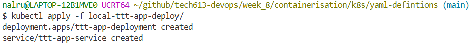
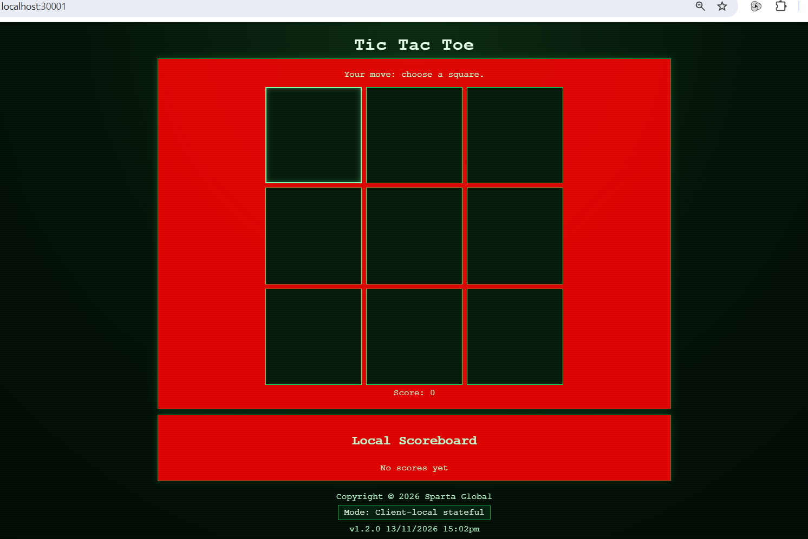

# K8s deployment of NodeJS TTT app

 ## Confirmed Application Configuration

| Setting | Value |
|----------|----------|
| Docker image | `nalrubaie/tech613-tttapp:1.2.0` |
| Application | Node.js |
| Container port | `3000` |
| Database environment variable | `MONGODB_URI` |
| Database port | `27017` |
| Database name | `tictactoe` |   


# Update ttt-app-deploy.yml in local-ttt-app-deploy folder with:

```
# Kubernetes Deployment API version
apiVersion: apps/v1

# Resource type
kind: Deployment

metadata:
  # Name of the Deployment
  name: ttt-app-deployment

spec:
  # Run 3 replicas (pods) of the application
  replicas: 3

  # Select pods with the label app: ttt-app
  selector:
    matchLabels:
      app: ttt-app

  # Pod template definition
  template:
    metadata:
      labels:
        # Label assigned to created pods
        app: ttt-app

    spec:
      containers:
        # Container configuration
        - name: ttt-app

          # Docker image to deploy
          image: nalrubaie/tech613-tttapp:1.2.0

          ports:
            # Expose container port 3000
            - containerPort: 3000
```

# Update ttt-app-service.yml in local-ttt-app-deploy folder with:

```
# Kubernetes API version
apiVersion: v1

# Resource type
kind: Service

metadata:
  # Name of the Service
  name: ttt-app-service

spec:
  # Expose the service on a port of each cluster node
  type: NodePort

  # Route traffic to pods with this label
  selector:
    app: ttt-app

  ports:
    # Service port configuration
    - port: 3000

      # Port on the container/pod
      targetPort: 3000

      # External port on the Kubernetes node
      nodePort: 30001
```

## Deploy the app 

`kubectl apply -f local-ttt-app-deploy/`

This tells Kubernetes to create the Deployment and Service using your YAML files.



## View deployments, pods and services

Run these commands one at a time:

`kubectl get deployments`


`kubectl get pods`


`kubectl get services`

The first Kubernetes deployment is running successfully.
3/3 pods running
Your results confirm:
- Deployment: 3/3 replicas ready.
- Pods: all three are Running, with zero restarts.
- Service: NodePort, forwarding port 30001 to application port 3000.


## Open the application

`http://localhost:30001/`




## deploy MongoDB

Copy `ttt-app-deploy.yml` and  `ttt-app-service.yml` from `local-ttt-app-deploy` directory to `local-ttt-app-mongo-deploy`

In the  `local-ttt-app-mongo-deploy` directory, create a new file called: `mongo-deploy.yml` and add the following code in it:

```
# Kubernetes Deployment API version
apiVersion: apps/v1

# Resource type
kind: Deployment

metadata:
  # Name of the MongoDB deployment
  name: mongo-deployment

spec:
  # Run one MongoDB pod
  replicas: 1

  # Match pods with the label app: mongo
  selector:
    matchLabels:
      app: mongo

  # Pod template configuration
  template:
    metadata:
      labels:
        # Label assigned to the MongoDB pod
        app: mongo

    spec:
      containers:
        # MongoDB container configuration
        - name: mongo

          # Official MongoDB Docker image
          image: mongo:7.0

          ports:
            # MongoDB listens on port 27017
            - containerPort: 27017
```

## Create mongodb service 

In the  `local-ttt-app-mongo-deploy` directory, create a new file called: `mongo-service.yml` and add the following code in it:

```
# Kubernetes API version
apiVersion: v1

# Resource type
kind: Service

metadata:
  # Name of the MongoDB service
  name: mongo-service

spec:
  # Internal service accessible within the cluster
  type: ClusterIP

  # Route traffic to the MongoDB pod
  selector:
    app: mongo

  ports:
    # Service port configuration
    - port: 27017

      # Port on the MongoDB container
      targetPort: 27017
```

An internal Kubernetes address shall be provided:

`mongo-service:27017`

The application pods will use this address to communicate with MongoDB.

Next step: 3. Update the application Deployment