## Contents

1. [Kubernetes Deployment of the NodeJS TTT App](#k8s-deployment-of-nodejs-ttt-app)
2. [Two-Tier Deployment with MongoDB and Persistent Storage](#2-tier-deployment-with-pv-for-database)
3. [Scaling the App with HPA](#using-horizontal-pod-autoscaler-hpa-to-scale-the-app)

# K8s deployment of NodeJS TTT app

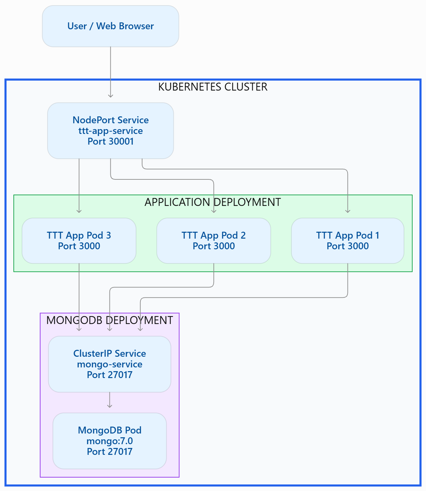

## How the Deployment Works

1. **User:** Opens the Tic-Tac-Toe application through `localhost:30001`.
2. **NodePort Service:** `ttt-app-service` receives external traffic on port `30001` and forwards it to port `3000`.
3. **Application Deployment:** Kubernetes distributes requests between the three Node.js application pods.
4. **MongoDB Service:** Each application pod connects to MongoDB using `mongo-service:27017`.
5. **MongoDB Pod:** Receives database requests and accesses the `tictactoe` database.


 ## Confirmed Application Configuration

| Setting | Value |
|----------|----------|
| Docker image | `nalrubaie/tech613-tttapp:1.2.0` |
| Application | Node.js |
| Container port | `3000` |
| Database environment variable | `MONGODB_URI` |
| Database port | `27017` |
| Database name | `tictactoe` |   


# Update ttt-app-deploy.yml in local-ttt-app-deploy folder with:

```
# Kubernetes Deployment API version
apiVersion: apps/v1

# Resource type
kind: Deployment

metadata:
  # Name of the Deployment
  name: ttt-app-deployment

spec:
  # Run 3 replicas (pods) of the application
  replicas: 3

  # Select pods with the label app: ttt-app
  selector:
    matchLabels:
      app: ttt-app

  # Pod template definition
  template:
    metadata:
      labels:
        # Label assigned to created pods
        app: ttt-app

    spec:
      containers:
        # Container configuration
        - name: ttt-app

          # Docker image to deploy
          image: nalrubaie/tech613-tttapp:1.2.0

          ports:
            # Expose container port 3000
            - containerPort: 3000
```

# Update ttt-app-service.yml in local-ttt-app-deploy folder with:

```
# Kubernetes API version
apiVersion: v1

# Resource type
kind: Service

metadata:
  # Name of the Service
  name: ttt-app-service

spec:
  # Expose the service on a port of each cluster node
  type: NodePort

  # Route traffic to pods with this label
  selector:
    app: ttt-app

  ports:
    # Service port configuration
    - port: 3000

      # Port on the container/pod
      targetPort: 3000

      # External port on the Kubernetes node
      nodePort: 30001
```

## Deploy the app 

`kubectl apply -f local-ttt-app-deploy/`

This tells Kubernetes to create the Deployment and Service using your YAML files.


## View deployments, pods and services

Run these commands one at a time:

`kubectl get deployments`


`kubectl get pods`


`kubectl get services`

The first Kubernetes deployment is running successfully.
3/3 pods running
Your results confirm:
- Deployment: 3/3 replicas ready.
- Pods: all three are Running, with zero restarts.
- Service: NodePort, forwarding port 30001 to application port 3000.

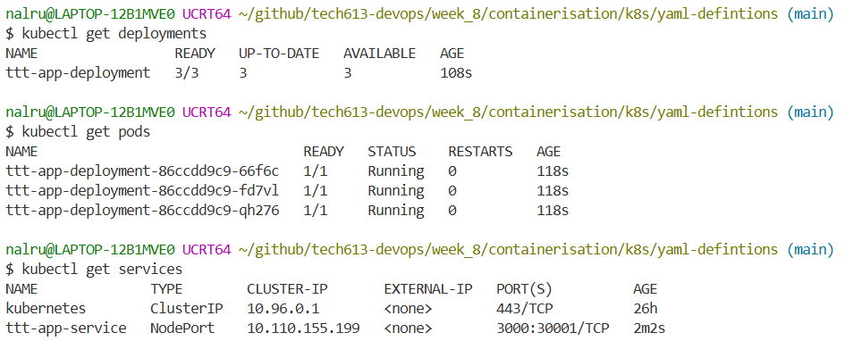

## Open the application

`http://localhost:30001/`


## deploy MongoDB

Copy `ttt-app-deploy.yml` and  `ttt-app-service.yml` from `local-ttt-app-deploy` directory to `local-ttt-app-mongo-deploy`

In the  `local-ttt-app-mongo-deploy` directory, create a new file called: `mongo-deploy.yml` and add the following code in it:

```
# Kubernetes Deployment API version
apiVersion: apps/v1

# Resource type
kind: Deployment

metadata:
  # Name of the MongoDB deployment
  name: mongo-deployment

spec:
  # Run one MongoDB pod
  replicas: 1

  # Match pods with the label app: mongo
  selector:
    matchLabels:
      app: mongo

  # Pod template configuration
  template:
    metadata:
      labels:
        # Label assigned to the MongoDB pod
        app: mongo

    spec:
      containers:
        # MongoDB container configuration
        - name: mongo

          # Official MongoDB Docker image
          image: mongo:7.0

          ports:
            # MongoDB listens on port 27017
            - containerPort: 27017
```

## Create mongodb service 

In the  `local-ttt-app-mongo-deploy` directory, create a new file called: `mongo-service.yml` and add the following code in it:

```
# Kubernetes API version
apiVersion: v1

# Resource type
kind: Service

metadata:
  # Name of the MongoDB service
  name: mongo-service

spec:
  # Internal service accessible within the cluster
  type: ClusterIP

  # Route traffic to the MongoDB pod
  selector:
    app: mongo

  ports:
    # Service port configuration
    - port: 27017

      # Port on the MongoDB container
      targetPort: 27017
```

An internal Kubernetes address shall be provided:

`mongo-service:27017`

The application pods will use this address to communicate with MongoDB.

## Update the application Deployment to connect to MongoDB

Add code below to: `ttt-app-deploy.yml` in the `local-ttt-app-mongo-deploy` folder. 


```
# Kubernetes Deployment API version
apiVersion: apps/v1

# Resource type
kind: Deployment

# Deployment metadata
metadata:
  # Name of the deployment
  name: ttt-app-deployment

# Deployment specification
spec:
  # Number of application pod replicas to run
  replicas: 3

  # Selector used to identify pods managed by this deployment
  selector:
    matchLabels:
      app: ttt-app

  # Template used to create new pods
  template:
    metadata:
      # Labels assigned to the pods
      labels:
        app: ttt-app

    spec:
      # List of containers running inside the pod
      containers:
        # Application container configuration
        - name: ttt-app

          # Docker image to deploy
          image: nalrubaie/tech613-tttapp:1.2.0

          # Container port exposed by the application
          ports:
            - containerPort: 3000

          # MongoDB connection configuration
          env:
            # Environment variable for the MongoDB connection string
            - name: MONGODB_URI

              # MongoDB service address and database name
              value: "mongodb://mongo-service:27017/tictactoe"
```

## Deploy all four Kubernetes resources

Run in bash in the `local-ttt-app-mongo-deploy` folder:

`kubectl apply -f .`


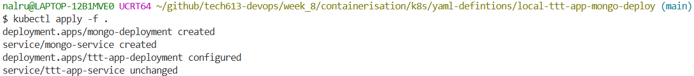

Kubernetes reads all four YAML files in the folder and creates or updates:

1. `ttt-app-deployment` - Runs three replicas of the Node.js application
2. `ttt-app-service` - Exposes the application through NodePort `30001`
3. `mongo-deployment` - Runs one MongoDB replica
4. `mongo-service` - Provides internal access to MongoDB on port `27017`

### What does `-f .` mean?

- `-f` tells Kubernetes to use YAML configuration files
- `.` means the current directory
- Kubernetes will apply all YAML files in the current folder

This will deploy:

- 3 Node.js application replicas
- 1 MongoDB replica
- 1 NodePort Service
- 1 ClusterIP Service

## Check the deployments

`kubectl get deployments`

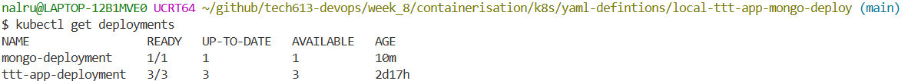

## Check the pods

`kubectl get pods`

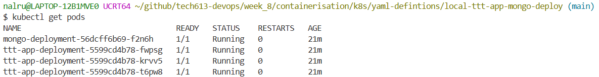

## Check the services

`kubectl get services`

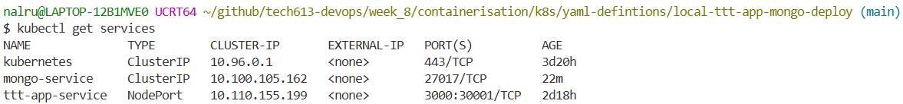


## Display a summary of the main Kubernetes resources in the current namespace

`kubectl get all`


### What does it display?

| Resource | What it shows |
|----------|---------------|
| Pods | Running application containers |
| Services | Network access to your applications |
| Deployments | Desired and available replicas |
| ReplicaSets | Manage the number of pod replicas |

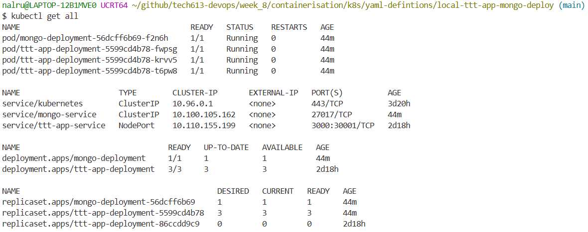


## Test the ttt app (global version connected with MongoDB)

Run in url:

`http://localhost:30001/`

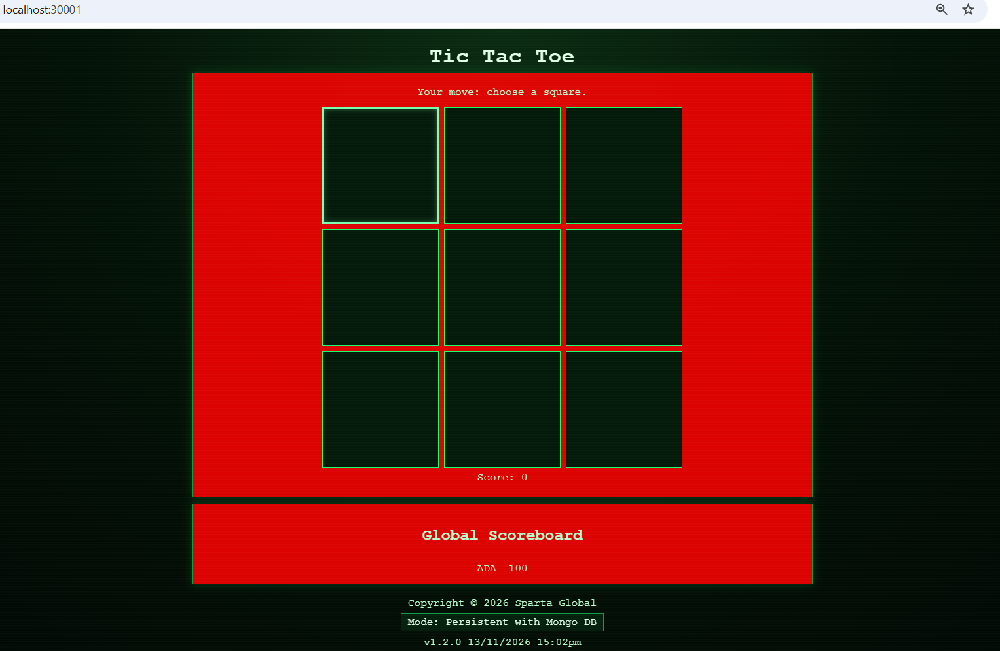

## Verify the MongoDB connection

`kubectl logs deployment/ttt-app-deployment`


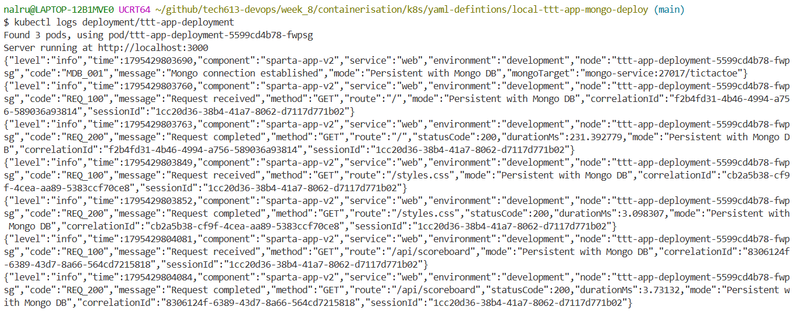

## Results: MongoDB Connection

The most important log entry is:

```json
{
  "code": "MDB_001",
  "message": "Mongo connection established",
  "mode": "Persistent with Mongo DB",
  "mongoTarget": "mongo-service:27017/tictactoe"
}
```

This confirms:

1. **MongoDB connection established:** The application successfully connected to the database.
2. **Persistent with Mongo DB:** The application is operating in database-backed mode.
3. **mongo-service:** Kubernetes successfully resolved the internal MongoDB Service.
4. **27017:** The correct MongoDB port.
5. **tictactoe:** The database being used.

We also have:

```json
{
  "code": "REQ_200",
  "message": "Request completed",
  "statusCode": 200
}
```

This confirms that the application successfully handled HTTP requests, including the scoreboard API request.

#  2-tier deployment with PV for database

## Persistent Volumes (PV) and Persistent Volume Claims (PVC)

Building on the existing Tic-Tac-Toe application, we can make the MongoDB data persistent so that it is not lost when the MongoDB pod is restarted or recreated.

| Component | Purpose |
|-----------|---------|
| PV (Persistent Volume) | Represents storage available to Kubernetes. |
| PVC (Persistent Volume Claim) | Requests a certain amount of storage from a PV. |
| Volume mount | Connects the storage to a directory inside the MongoDB container. |


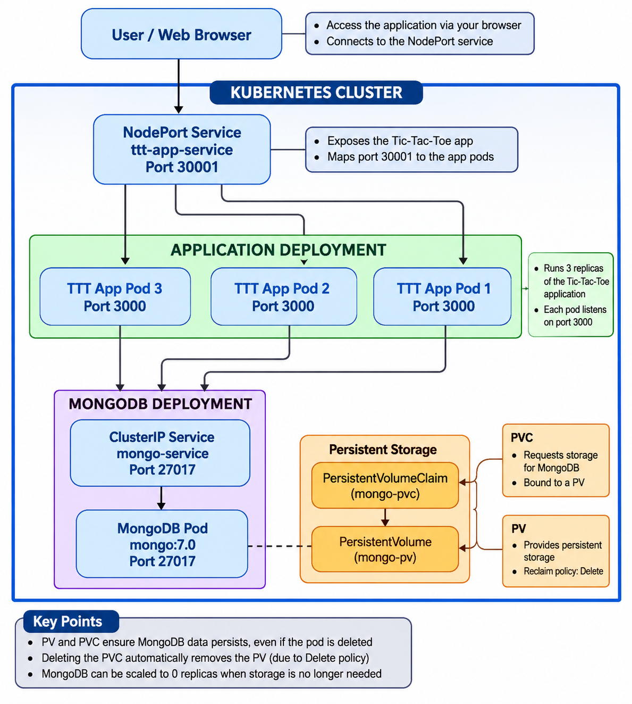

## Create new folder for the persistent-storage version

Create a directory called `local-ttt-app-mongo-pv-deploy` in the `yaml-defintions` directory:

`mkdir local-ttt-app-mongo-pv-deploy`

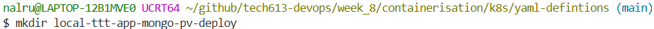

## Copy the 4 existing Kubernetes configuration files into the local-ttt-app-mongo-pv-deploy directory

`cp local-ttt-app-mongo-deploy/* local-ttt-app-mongo-pv-deploy/`

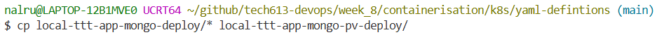

## Create the Persistent Volume Claim (PVC)


1. **PVC (Persistent Volume Claim):** A request for storage
2. We'll request **1Gi (1 gibibyte)**, which is sufficient for this small learning project
3. Kubernetes will use the existing `hostpath` StorageClass to provision the Persistent Volume (PV) automatically

Change to the `local-ttt-app-mongo-pv-deploy` directory.

Then create the `mongo-pvc.yml` file:

`touch mongo-pvc.yml`

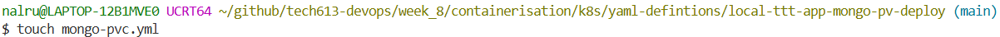

Add the code below into the `mongo-pvc.yml` file:

```
# PersistentVolumeClaim API version
apiVersion: v1

# Resource type
kind: PersistentVolumeClaim

# PVC metadata
metadata:
  # Name of the Persistent Volume Claim
  name: mongo-pvc

# PVC specification
spec:
  # Defines how the volume can be mounted
  accessModes:
    # Volume can be mounted as read-write by a single node
    - ReadWriteOnce

  # Storage resource requirements
  resources:
    requests:
      # Request 1 GiB of storage
      storage: 1Gi

  # StorageClass used to dynamically provision the volume
  storageClassName: hostpath
```

## Create the PVC in Kubernetes

This tells Kubernetes to create the storage request.

`kubectl apply -f mongo-pvc.yml`

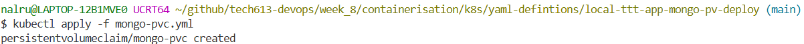

## Check the PVC 

`kubectl get pvc`

This shows the Persistent Volume Claims and whether they have been connected to storage.

Status `Bound`  = successfully connected

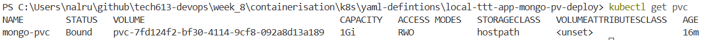

## Check the Persistent Volume

`kubectl get pv`

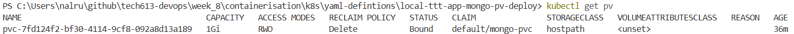

The output confirms that Kubernetes automatically created a Persistent Volume and connected it to the PVC.

Status `Bound`  = successfully connected

## Connect MongoDB to the persistent storage

Update `mongo-deploy.yml` with:

```
# Kubernetes Deployment API version
apiVersion: apps/v1

# Resource type
kind: Deployment

metadata:
  # Name of the MongoDB deployment
  name: mongo-deployment

spec:
  # Run one MongoDB pod
  replicas: 1

  # Match pods with the label app: mongo
  selector:
    matchLabels:
      app: mongo

  # Pod template configuration
  template:
    metadata:
      # Labels assigned to the pod
      labels:
        app: mongo

    spec:
      containers:
        # MongoDB container configuration
        - name: mongo

          # Use MongoDB version 7.0 image
          image: mongo:7.0

          ports:
            # Expose MongoDB default port inside the container
            - containerPort: 27017

          # Connect persistent storage to MongoDB
          volumeMounts:
            # Reference the volume defined below
            - name: mongo-storage

              # Mount path where MongoDB stores database files
              mountPath: /data/db

      # Define the storage used by the pod
      volumes:
        # Name of the volume available to the container
        - name: mongo-storage

          # Use an existing PersistentVolumeClaim
          persistentVolumeClaim:

            # PVC that provides persistent storage for MongoDB
            claimName: mongo-pvc
```

### What was added?

| Configuration | Purpose |
|---------------|---------|
| `volumeMounts` | Connects storage to the MongoDB container |
| `mountPath: /data/db` | MongoDB's database storage directory |
| `volumes` | Defines the volume available to the pod |
| `claimName: mongo-pvc` | Connects the volume to your existing PVC |

## Deploy the updated MongoDB configuration

`kubectl apply -f mongo-deploy.yml`

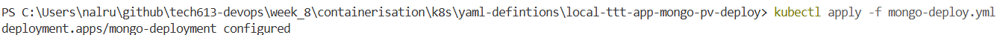

## Check the MongoDB pod

`kubectl get pods`


## Verify the volume is mounted

`kubectl describe pod mongo-deployment-77c68989cb-vx9tk`

### This confirms MongoDB is using the mounted storage directory.
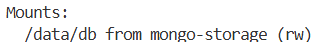


### This confirms the volume is connected to the PVC
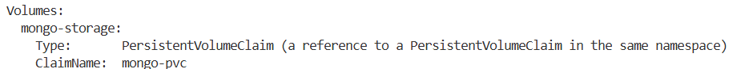

## Open the app and play the game to add scores to the global scoreboard.

`http://localhost:30001/`

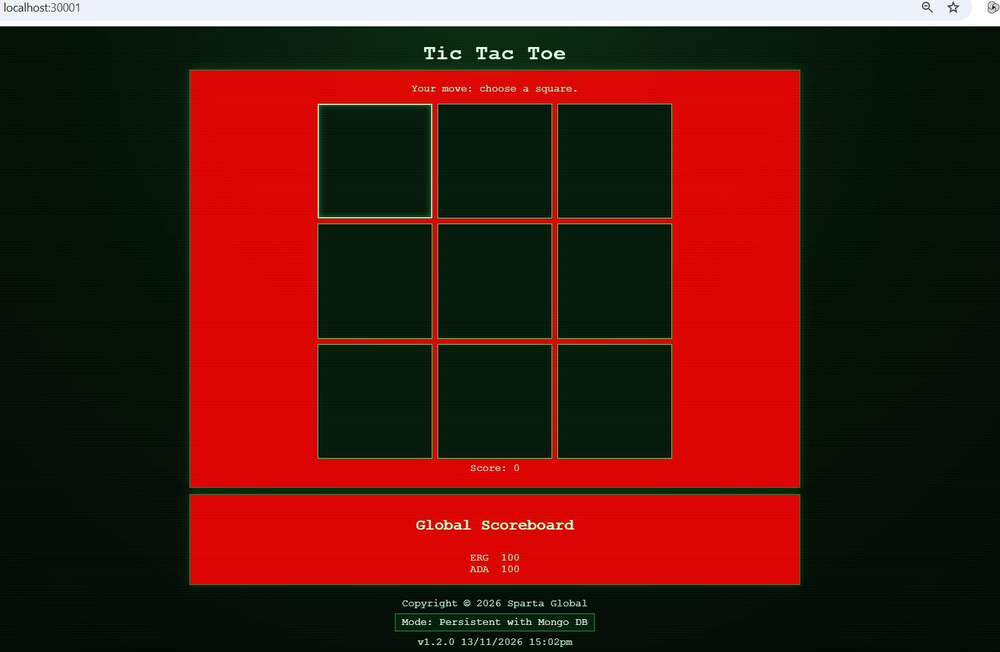


## Delete the MongoDB pod temporarily to test whether persistent storage (PV and PVC) is working. (The database storage is not being deleted).

## Find the MongoDB pod

`kubectl get pods`

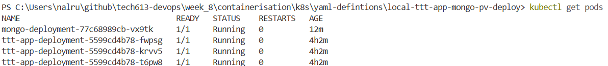

The MongoDB pod in this case is:

`mongo-deployment-77c68989cb-vx9tk`

The three ttt-app pods are the application, so these shall be left alone.

## Delete the MongoDB pod

`kubectl delete <name-of-pod>`

`kubectl delete pod mongo-deployment-77c68989cb-vx9tk`

 

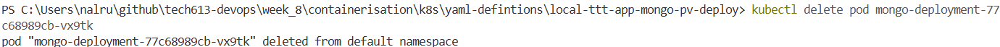

## Check whether Kubernetes created a replacement

`kubectl get pods`

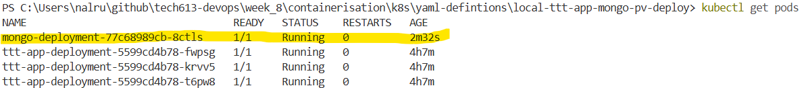

The new MongoDB pod replacement is `mongo-deployment-77c68989cb-8ctls`, it is Running and Ready

## Check whether the scores survived after the mongoDB pod was deleted and then re-created.

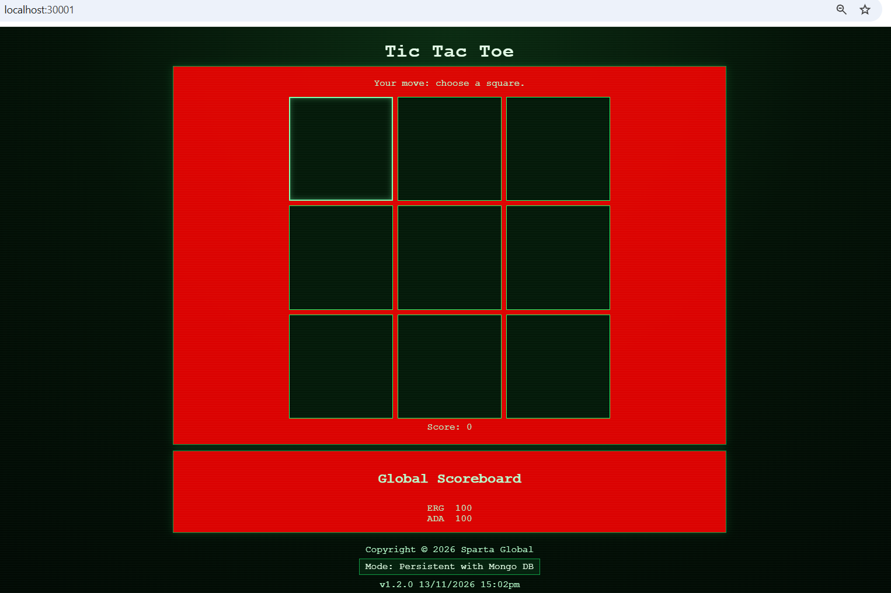


The scores remained on the scoreboard after the MongoDB pod was deleted and recreated. This confirms that MongoDB is using the persistent volume rather than relying on storage inside the original pod.

## Verify the PV and PVC are still bound

`kubectl get pvc`

`kubectl get pv`

Status `Bound`  = successfully connected


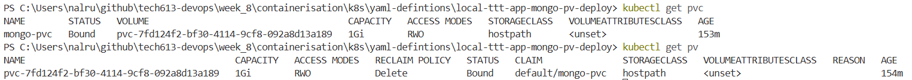

## Removing the PV

## Stop MongoDB temporarily

We stop MongoDB because its pod is currently using the PVC to access the persistent storage. Kubernetes may prevent the PVC from being deleted while a pod is actively using it. This is called PVC protection.

`kubectl scale deployment mongo-deployment --replicas=0`

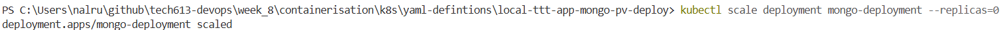

## Delete the PVC

Because the PV has a Delete reclaim policy, Kubernetes should automatically delete the associated PV as well.

`kubectl delete pvc mongo-pvc`

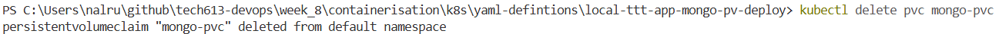

## Verify that the PV has also been deleted

`No resources found` = confirms that the PV has been deleted.

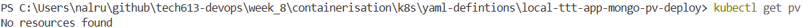

## Verify that the PVC has also been removed

`No resources found in default namespace` = confirms that the PVC has been deleted.

`kubectl get pvc`

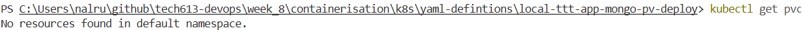

# Using Horizontal Pod Autoscaler (HPA) to scale the app

HPA automatically:
- Scales up: Increases the number of pods when CPU utilisation is too high.
- Scales down: Decreases the number of pods when CPU utilisation falls.

The benefit is:
- High demand: Kubernetes creates more pods to handle traffic.
- Low demand: Kubernetes reduces the number of pods.
- Less manual work: You don't need to adjust replica numbers yourself.
- Resource efficiency: You avoid running unnecessary application pods.
  
HPA doesn't measure how many users are accessing the application directly.
It uses resource metrics, such as CPU utilisation, to decide whether more pods are needed.


## Scaling Configuration

| Setting | Requirement |
|----------|-------------|
| Minimum replicas | 2 |
| Maximum replicas | 10 |
| What scales? | Tic-Tac-Toe application only |
| What triggers scaling? | CPU utilisation |
| How do we test? | Apache Bench (`ab`) |


## Install Metrics Server 

The Horizontal Pod Autoscaler (HPA) needs Metrics Server to read the CPU usage of your application pods. We need to install it before configuring the HPA.

`kubectl apply -f https://github.com/kubernetes-sigs/metrics-server/releases/latest/download/components.yaml`

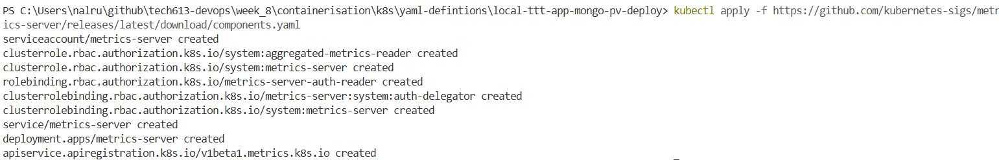

## Check whether Metrics Server is running

`kubectl get pods -n kube-system`


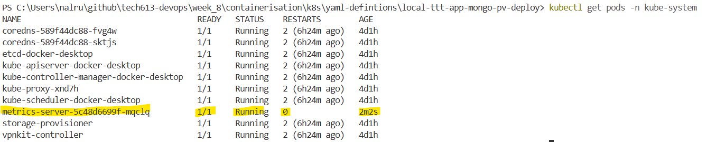


## Verify CPU metrics

`kubectl top nodes`

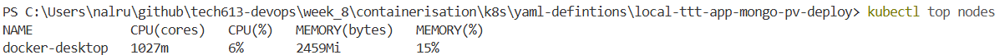

Metrics Server is now collecting resource usage successfully:
- Node: docker-desktop
- CPU usage: 1027m (6%)
- Memory usage: 2459Mi (15%)

## Update ttt-app-deploy.yml

We'll use:
- CPU request: 100m (0.1 CPU core)
- Memory request: 128Mi
- CPU limit: 500m (0.5 CPU core)
- Memory limit: 256Mi

The HPA will target 10% CPU utilisation. With a 100m CPU request, that means it aims for approximately 10m CPU usage per pod.

Open the code for `ttt-app-deploy.yml`, and replace it with:

```
# Kubernetes Deployment API version
apiVersion: apps/v1

# Resource type
kind: Deployment

# Deployment metadata
metadata:
  # Name of the deployment
  name: ttt-app-deployment

# Deployment specification
spec:
  # Number of application pod replicas to run
  replicas: 3

  # Selector used to identify pods managed by this deployment
  selector:
    matchLabels:
      app: ttt-app

  # Template used to create new pods
  template:
    metadata:
      # Labels assigned to the pods
      labels:
        app: ttt-app

    spec:
      # List of containers running inside the pod
      containers:
        # Application container configuration
        - name: ttt-app

          # Docker image to deploy
          image: nalrubaie/tech613-tttapp:1.2.0

          # Container port exposed by the application
          ports:
            - containerPort: 3000

          # CPU and memory resource requirements
          resources:
            requests:
              # Reserve 100 millicores of CPU for the container
              cpu: "100m"

              # Reserve 128 MiB of memory for the container
              memory: "128Mi"

            limits:
              # Maximum CPU the container can use
              cpu: "500m"

              # Maximum memory the container can use
              memory: "256Mi"

          # MongoDB connection configuration
          env:
            # Environment variable for the MongoDB connection string
            - name: MONGODB_URI

              # MongoDB service address and database name
              value: "mongodb://mongo-service:27017/tictactoe"
```


The yml file has been updated with the resources section, this defines the minimum CPU and memory requested by each pod and the maximum it can use. HPA needs to calculate CPU utilisation.

## Apply the updated Deployment

`kubectl apply -f ttt-app-deploy.yml`

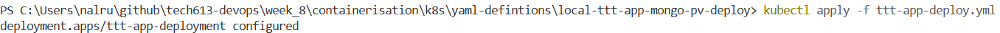

Kubernetes has detected the changes and configured the Deployment with the new CPU and memory requests and limits.

## Check the Deployment rollout

This checks that the application pods have successfully restarted with the updated configuration.

`kubectl rollout status deployment/ttt-app-deployment`

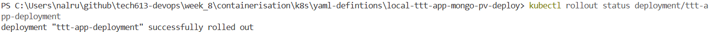

## Verify CPU metrics

`kubectl top pods`

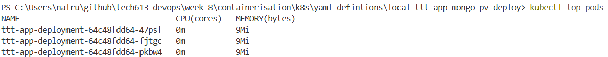

The metrics are working, and all three application pods are reporting CPU and memory usage.

The current readings are:
- CPU: 0m (very low usage while idle)
- Memory: 9Mi per pod
- Pods: 3 running

## Create the HPA configuration

A Horizontal Pod Autoscaler will be made that:
- Targets ttt-app-deployment
- Maintains a minimum of 2 replicas
- Allows a maximum of 10 replicas
- Targets average CPU utilisation of 10%
  
In the `local-ttt-app-mongo-pv-deploy` folder, create a new file called:

`ttt-app-hpa.yml`

Add in the `ttt-app-hpa.yml` file the code below:

```
# Horizontal Pod Autoscaler API version
apiVersion: autoscaling/v2

# Resource type
kind: HorizontalPodAutoscaler

# HPA metadata
metadata:
  # Name of the autoscaler
  name: ttt-app-hpa

# HPA specification
spec:
  # Target deployment that will be scaled automatically
  scaleTargetRef:
    # API version of the target resource
    apiVersion: apps/v1

    # Resource type to scale
    kind: Deployment

    # Name of the deployment to scale
    name: ttt-app-deployment

  # Minimum number of pod replicas to maintain
  minReplicas: 2

  # Maximum number of pod replicas allowed
  maxReplicas: 10

  # Metrics used to determine when scaling should occur
  metrics:
    # Use a resource metric for scaling
    - type: Resource

      resource:
        # Monitor CPU utilisation
        name: cpu

        target:
          # Scale based on average CPU utilisation across pods
          type: Utilization

          # Target CPU utilisation percentage
          # If average CPU usage exceeds 10%, Kubernetes can add more pods
          averageUtilization: 10

```

### What does 10% mean?

The CPU request is 100m per pod. Therefore, the HPA aims to keep average CPU usage around 10m per pod.

A 10% target makes the HPA more sensitive to increases in CPU usage than a 50% target.

## Apply the HPA configuration

`kubectl apply -f ttt-app-hpa.yml`

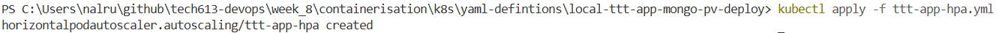

## Check the HPA status

`kubectl get hpa`

This displays:
- TARGETS: Current CPU utilisation compared with the 10% target.
- MINPODS: Minimum of 2 replicas.
- MAXPODS: Maximum of 10 replicas.
- REPLICAS: Current number of application pods.

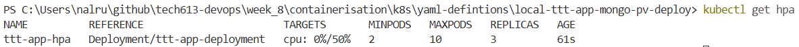

HPA created successfully

| Setting | Current value |
|----------|----------|
| Deployment | `ttt-app-deployment` |
| CPU target | 10% |
| Minimum replicas | 2 |
| Maximum replicas | 10 |
| Current replicas | 3 |
| Current CPU utilisation | 0% |

## Check Apache Bench availability

 Apache Bench (ab) shall be used to generate HTTP traffic and test whether the HPA increases the number of pods.

 With Docker Desktop installed, Apache Bench can be run inside a temporary Docker container instead of installing Apache Bench permanently on Windows.

 `docker run --rm alpine:3.20 sh -c "apk add --no-cache apache2-utils && ab -V"`

 This will:
1. Download a lightweight Alpine Linux image if needed
2. Install Apache Bench inside the container
3. Display its version
4. Automatically remove the container afterwards

 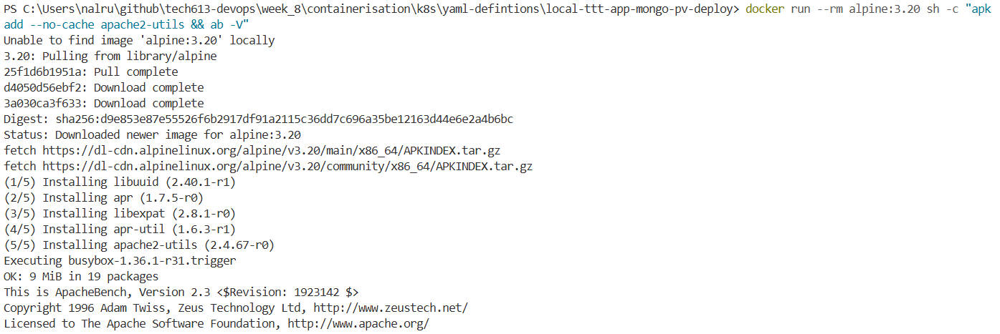

## Monitor the HPA

Open a **second PowerShell window**. Keep the original PowerShell window open for the load test.

`kubectl get hpa ttt-app-hpa --watch`

This continuously displays the HPA status. We'll watch the CPU utilisation and replica count change as traffic increases.

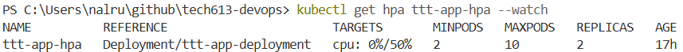

## Generate traffic using Apache Bench

Go back to the first PowerShell window (the one in local-ttt-app-mongo-pv-deploy).

`docker run --rm alpine:3.20 sh -c "apk add --no-cache apache2-utils && ab -n 20000 -c 100 -s 120 http://host.docker.internal:30001/"`

| Option | Meaning |
|----------|---------|
| `-n 20000` | Send 20,000 requests |
| `-c 100` | Send up to 100 requests concurrently |
| `-s 120` | Allow up to 120 seconds for an individual request |
| `host.docker.internal:30001` | Access your application through its NodePort |


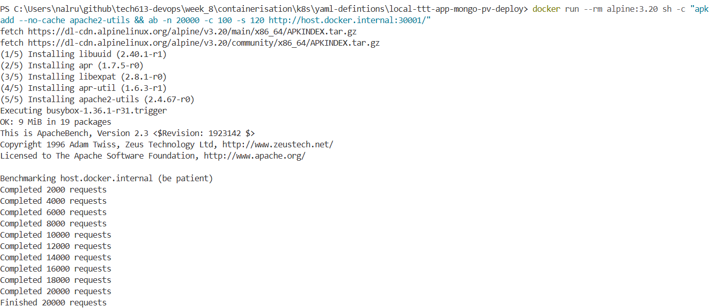
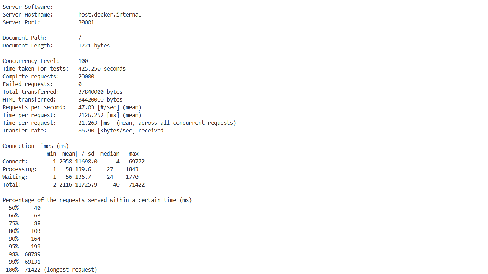

**Apache Bench results:**

| Metric | Result |
|---------|---------|
| Total requests | 20,000 |
| Concurrency | 100 |
| Failed requests | 0 |
| Requests per second | 47.03 |
| Time taken | 425.250 seconds |


The load test completed **20,000 requests** with a concurrency level of **100 users** and **zero failed requests**. The application processed approximately **47 requests per second** and completed the test in **425.250 seconds**.

# HPA Scaling results

Open the second powershell window where the load test is running.

The HPA detected increased CPU utilisation and automatically increased the application replicas:


| CPU Utilisation | Number of Replicas |
|----------------|--------------------|
| 0%             | 2                  |
| 93%            | 2                  |
| 7%             | 4                  |
| 0%             | 8                  |
| 0%             | 10                 |
| 0%             | 10                 |
| 0%             | 3                  |
| 0%             | 2                  |


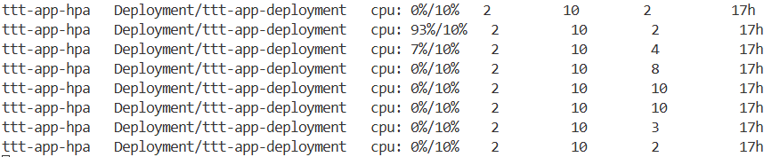

The application successfully scaled from **2** to **10 replicas**, reaching the configured maximum.


## Verify the deployments, pods and HPA

`kubectl get deployments,pods,hpa`

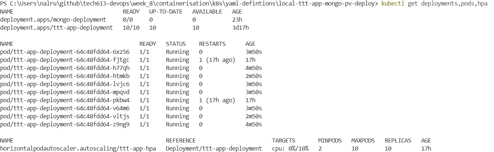

Result: The HPA successfully scaled the application up to its maximum of 10 replicas during the load test. Once CPU utilisation decreased, it automatically scaled back down to its minimum of 2 replicas. MongoDB remained at 0 replicas and was not scaled by the HPA.


## Note: HPA and replica management

The Deployment YAML initially specifies `replicas: 3`. However, once the Horizontal Pod Autoscaler (HPA) is configured, it manages the number of application replicas automatically, scaling between the minimum of 2 and maximum of 10.

When using HPA, it is recommended to remove the `replicas` field from the Deployment YAML. This prevents a future `kubectl apply` from overriding the replica count managed by the HPA.