# Code-along: Nginx deployment with NodePort service

## Ensure k8 is running

`kubectl get all`

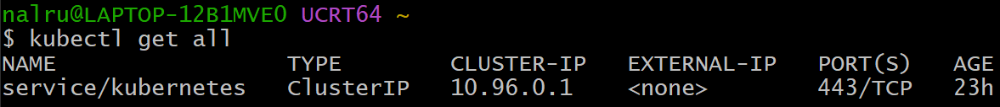

## Get K8s to define what's in the yml file 

` kubectl create -f nginx-deploy.yml `

you can also use 

` kubectl apply -f nginx-deploy.yml `


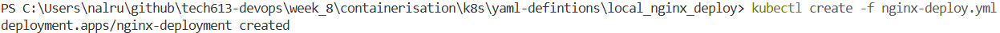

## lists the main resources in the current namespace

`kubectl get all    `

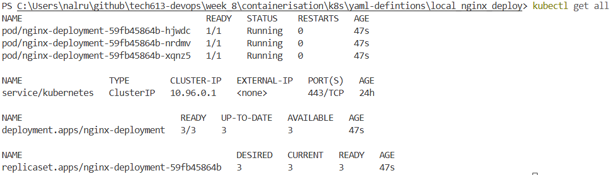

## Add nginx-deploy.yml


```
apiVersion: apps/v1  # specify api to use for deployment
kind: Deployment  # kind of service/object you want to create
metadata:
  name: nginx-deployment # name the deployment
spec:
  selector:
    matchLabels:
      app: nginx  # look for this label/tag to match with k8 service
  # create a replica set of this with instances/pods
  replicas: 3
  template:
    metadata:
      labels:
        app: nginx

    spec:
      containers:
      - name: nginx
        image: daraymonsta/nginx-257:dreamteam # the image you created to run nginx in a container
        ports:
        - containerPort: 80
```


## Add nginx-service.yml

```
apiVersion: v1
kind: Service
metadata:
  name: nginx-svc
  namespace: default
spec:
  ports:
  - nodePort: 30001 # range is 30000-32768
    port: 80
    targetPort: 80

  selector:
    app: nginx  # this label connect this service to the deployment

  type: NodePort  # also use LoadBalancer - for local use cluster IP
```


##  creates or updates a Service in the Kubernetes cluster using the configuration defined in nginx-service.yml.

`kubectl apply -f nginx-service.yml `

list the main resources in the current namespace to see the servicce

`kubectl get all    `

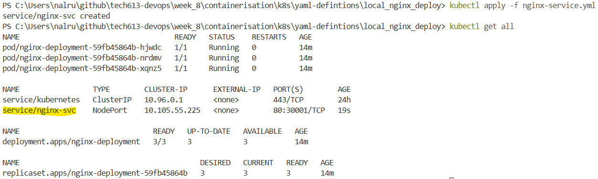

## Test the service

`http://localhost:30001/`

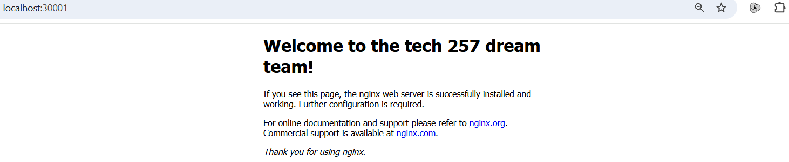


## See services or pods only

`kubectl get services`

`kubectl get pods`


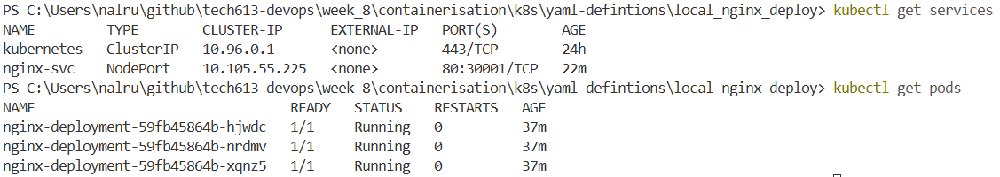

## Delete a pod

`kubectl get pods`

`kubectl delete pod <NAME-OF-POD> `

See current pods again:

A new pod is automatically created when you delete a pod (as it's set to 3 healthy and ready pods)

`kubectl get pods       `

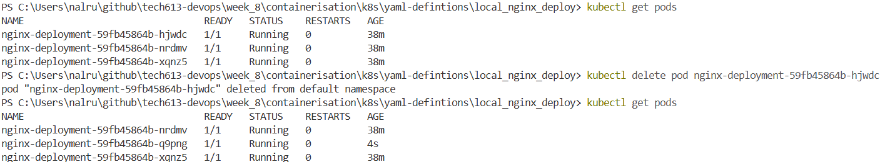

## Increase number of replicas in replicas set

get deployment name

`kube ctl get all`

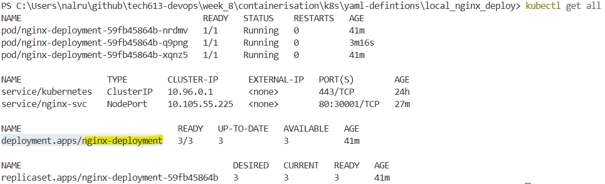

Then run

`kubectl edit deploy <name-of-deployment>  `

in my case

`kubectl edit deploy nginx-deployment`

Change replicas from 3 to 4:

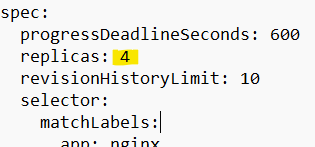

Test it works:

Run 

`kubectl get pods`

4 pods will now appear.

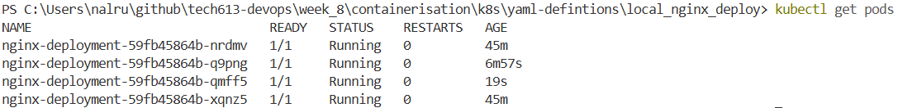

## Another method to change number of pods

In `nginx-deploy.yml` change replicas to 5

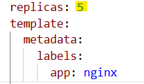

Then run in bash:

`kubectl apply -f nginx-deploy.yml `

Test:

`kubectl get pods`

5 pods will appear:

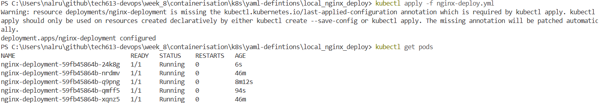

## Another method to change number of pods from 5 to 6 (using scale command)

`kubectl scale --current-replicas=5 --replicas=6 deployment/nginx-deployment`

Test:

`kubectl get pods`

6 pods will appear:


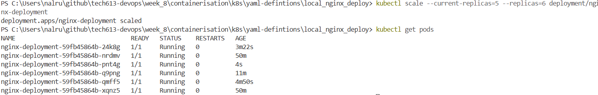

## Delete service

`kubectl delete -f nginx-service.yml `

deletes the Service resource defined in the nginx-service.yml file from your Kubernetes cluster.

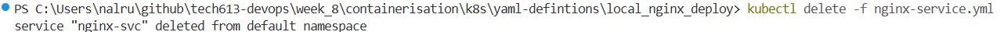


## Delete deploy

`kubectl delete -f nginx-deploy.yml   `

deletes the Deployment defined in the nginx-deploy.yml file.

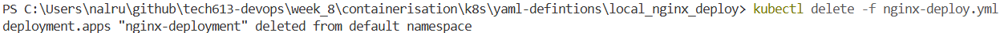

# 