# Docker

## What is docker?
A way to create, monitor and manage containers. The purpose of containers is to package an application and its dependencies so it can run consistently on different machines and systems. Docker helps with microservices and abstracts dependencies.

### Microservices
A microservices application is split into smaller services (e.g., user service, payment service, database service).

Docker allows each service to run in its own container, making them easy to deploy and manage independently.

### Abstracts dependencies
Dependencies are the libraries, tools, and software an application needs to run.

Docker packages the application and all its dependencies together in a container, so it works the same on any machine without installing anything separately.

##  Containerisation vs Virtualisation

## What is virtualisation? 
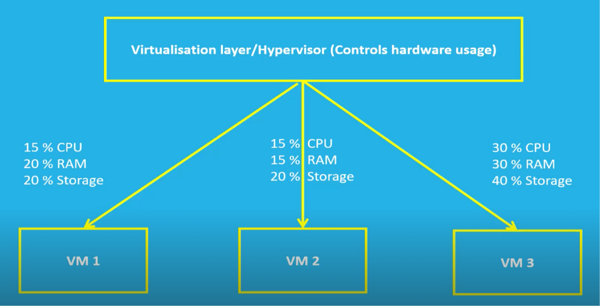

Virtualisation allows you to run **multiple virtual machines (VMs)** on one physical computer.

- Each VM has its **own operating system**
- Managed by a **hypervisor**
- Uses more resources because every VM needs a full OS

**Example:** One computer runs Windows, Ubuntu, and Kali Linux as separate VMs.

## What is containerisation?
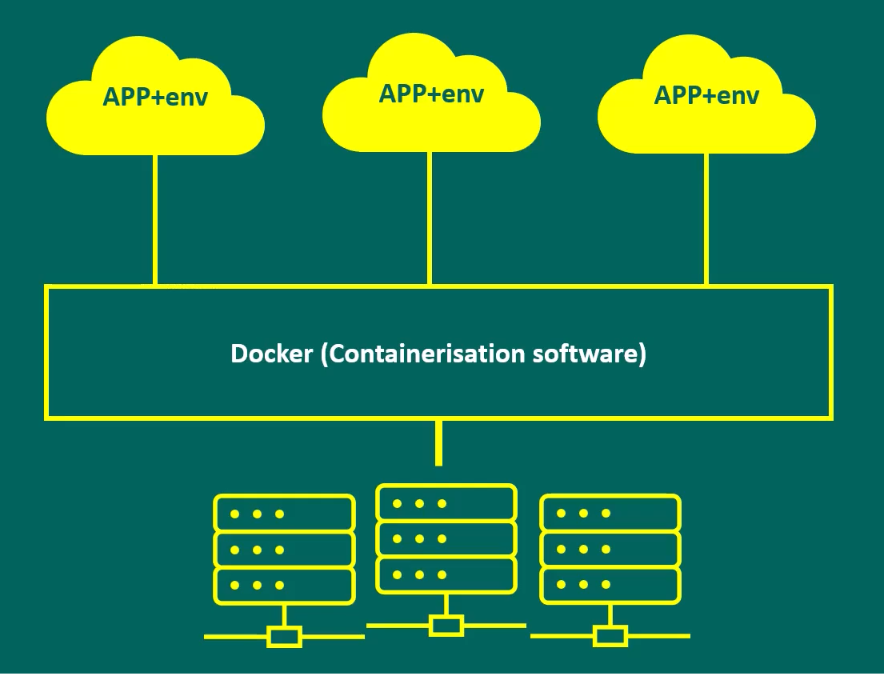

Containerisation packages an application and its dependencies into a **container**.

- Containers **share the host operating system**
- Do not need a full OS for each application
- Lightweight and start very quickly

**Example:** Running a web application in a Docker container.

## Why containers over virtual machines?
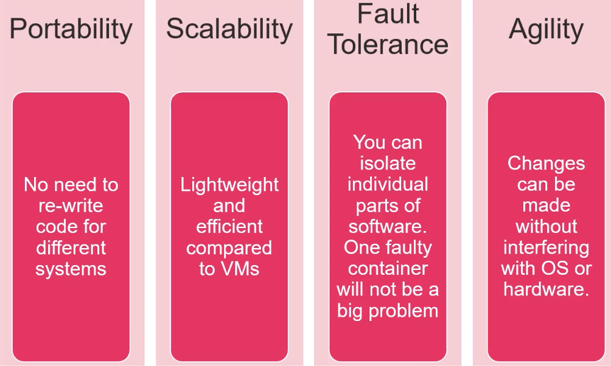

### Summary

- **Virtual Machines = Full OS per machine → Heavier**
- **Containers = Share OS → Lighter and faster**


# Docker images

Pull and run the hello-world image from docker.

docker run hello-world
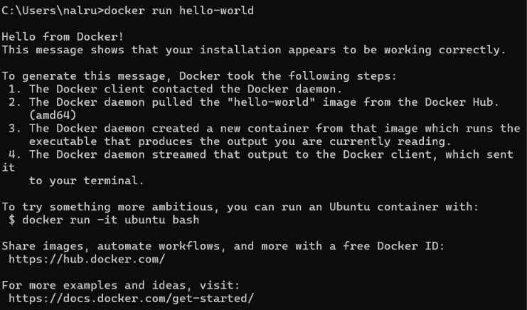
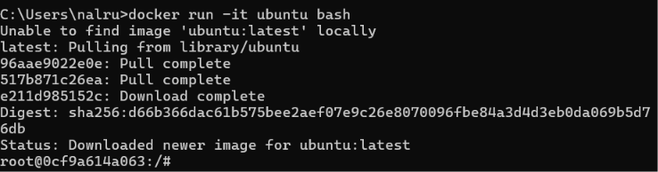
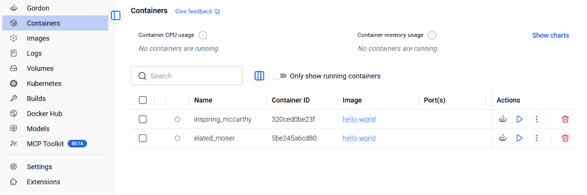

# Run ubuntu container and log in to it

docker run -it ubuntu bash


## Docker Commands

### `docker ps`

Shows only the **currently running containers**.

Example:
```bash
docker ps
```

### `docker ps -a`

Shows **all containers**, including:
- Running containers
- Stopped containers
- Exited containers

Example:
```bash
docker ps -a
```

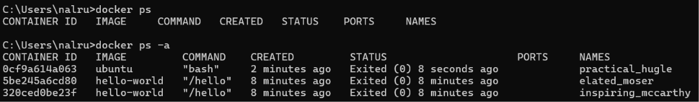

## Docker sleep

`docker run ubuntu sleep 15`

Creates and starts an Ubuntu container that waits for **15 seconds** and then stops.

- `docker run` → Create and start a container
- `ubuntu` → Use the Ubuntu image
- `sleep 15` → Wait for 15 seconds

**Result:** The container runs for 15 seconds and then exits.

`docker run -d ubuntu sleep 15`

Creates and starts an Ubuntu container in the **background** that waits for **15 seconds** and then stops.

- `docker run` → Create and start a container
- `-d` → Run in detached (background) mode
- `ubuntu` → Use the Ubuntu image
- `sleep 15` → Wait for 15 seconds

**Result:** The container runs in the background for 15 seconds and then exits.

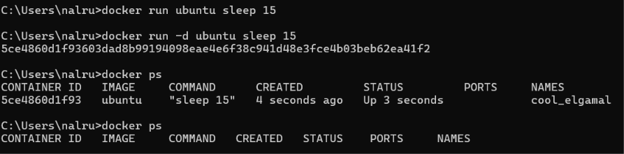

## Docker sleep 2000

`docker run -d ubuntu sleep 2000`

`docker ps`. Name and ID of container generated randomly.
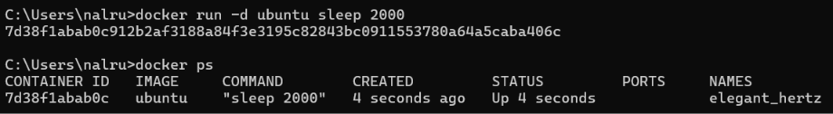


docker exec 7d38f whoami

Runs whoami on docker that has ID starting with 7d38f, no need to quote whole ID part of it is sufficient as long as it is unique. You can also quote name of docker container instead of ID too. 
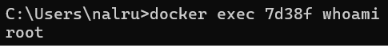

## Connects  terminal to a **running container**.

 `docker attach <container_id>`


- `docker attach` → Connect to a running container
- `<container_id>` → The ID of the container

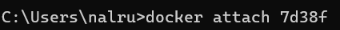

**Result:** You can see and interact with the container from your terminal.

## Stop running container 

Open a new tab of powershell,

docker ps 

Ensures your container is running.

docker stop <container_id>`

Stops your container
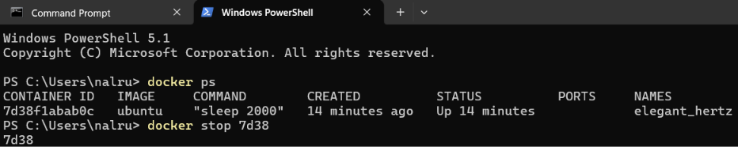

## Remove container


docker rm <container_id>

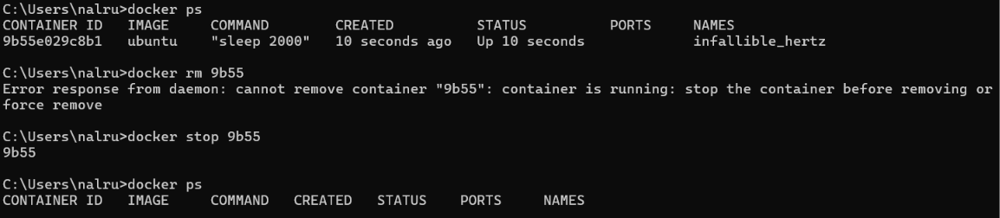

## Force remove a container

Create a container:

`docker run -d ubuntu sleep 2000`

Force remove:

`docker rm -f  `<container_id>` `  
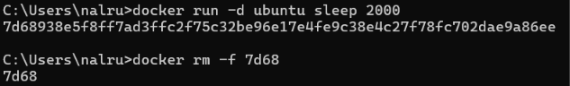

## Remove certain containers 

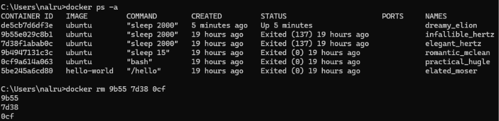