# 2-tier deployment on Azure

Objective:

A repeat of your the two-tier Tic-Tac-Toe deployment (app and database), but this time on Azure in UK South region, with the app connected to MongoDB and Nginx working as the reverse proxy.

## To be deployed
### Public subnet: App VM
- Ubuntu Server 24.04 LTS
- Standard_B1s
- Node.js application
- PM2 process manager
- Nginx reverse proxy: port 80 → port 3000


### Private subnet: Database VM
- Ubuntu Server 24.04 LTS
- Standard_B1s
- MongoDB
- Port 27017 accessible from the app VM, not exposed to the internet

## Generate a separate SSH key for Azure

SSH (Secure Shell) allows you to securely connect to and remotely control a server over a network.

In Azure, your SSH key lets you securely log in to your virtual machine (VM) without needing a password.
- Public key: Stored on the Azure VM
- Private key: Stays on your Windows computer and proves your identity
  
Think of it as a secure digital key to access a server.

In your `.ssh` folder in bash, run:

` ssh-keygen -t ed25519 -C "azure-tech613" -f "tech613-azure-key"`

This command creates a new SSH key pair in your current folder for securely accessing Azure VMs.
- ssh-keygen – Generates SSH keys
- -t ed25519 – Uses the Ed25519 algorithm
- -C "azure-tech613" – Adds a label to identify the key
- -f "tech613-azure-key" – Sets the filename for the keys
  

It creates two files in your current folder:
1. tech613-azure-key – Private key
2. tech613-azure-key.pub – Public key (give to Azure)
   

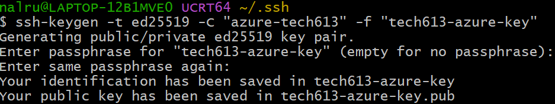

## Display public SSH key

`cat tech613-azure-key.pub`

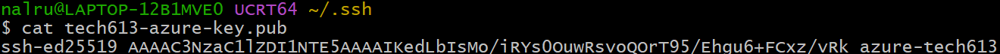

## Create the Azure Virtual Network (VNet)
A VNet is your own private network in Azure. It allows the app VM and database VM to communicate securely with each other.

Think of it as your own private network inside Azure, 
where you control how your VMs connect


1. Search for Virtual networks in the search bar
2. Select Create
3. Fill in the Basics tab:


| Setting | Value |
|----------|----------|
| Subscription | Azure Training |
| Resource group | tech613 |
| Virtual network name | `tech613-firstname-2-subnet-vnet` |
| Region | `UK South` |

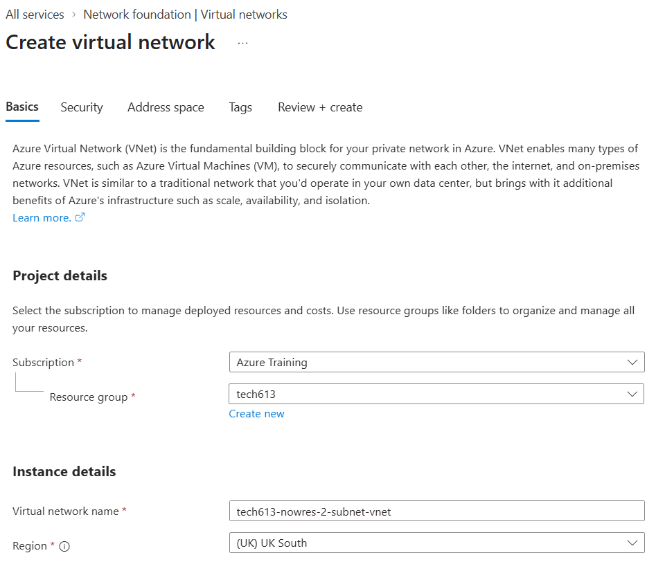


## Create subnets

Subnets separate the VMs into two network sections:
- Public subnet: Hosts the app VM, which users access through the internet
- Private subnet: Hosts the database VM, keeping it separate from the app's public-facing network

In the `Address space` tab:

1. Under **Subnet**, click **+ Add a subnet**

2. Enter the first subnet:

   - Name: `public-subnet`
   - Starting address: `10.0.2.0`
   - Size: `/24`
   - Untick **Enable private subnet (no default outbound access)**

3. Click **Add**

4. Repeat for the second subnet:

   - Name: `private-subnet`
   - Starting address: `10.0.3.0`
   - Size: `/24`
   - Untick **Enable private subnet (no default outbound access)**

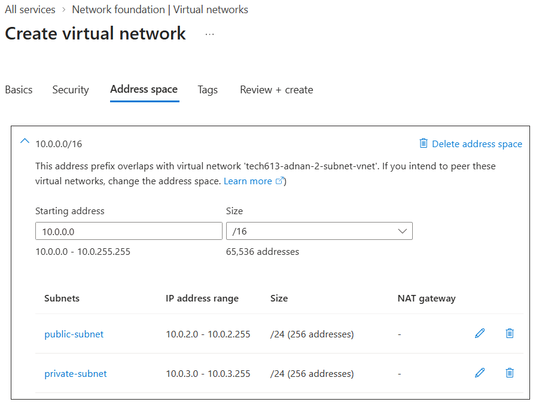

Once both subnets are added, Click `review + create`, then `Create`.


## Create the VM on Azure
## Add the public key to Azure

1. Open the Azure Portal

2. Go to **Virtual Machines**

3. Click **Create → Azure virtual machine**

4. Under **Administrator account**, select **SSH public key** as the authentication type

5. If Azure asks whether to generate a new key pair, select **Use existing public key** (do not choose **Generate new key pair**)

6. Paste the contents of `tech613-azure-key.pub`


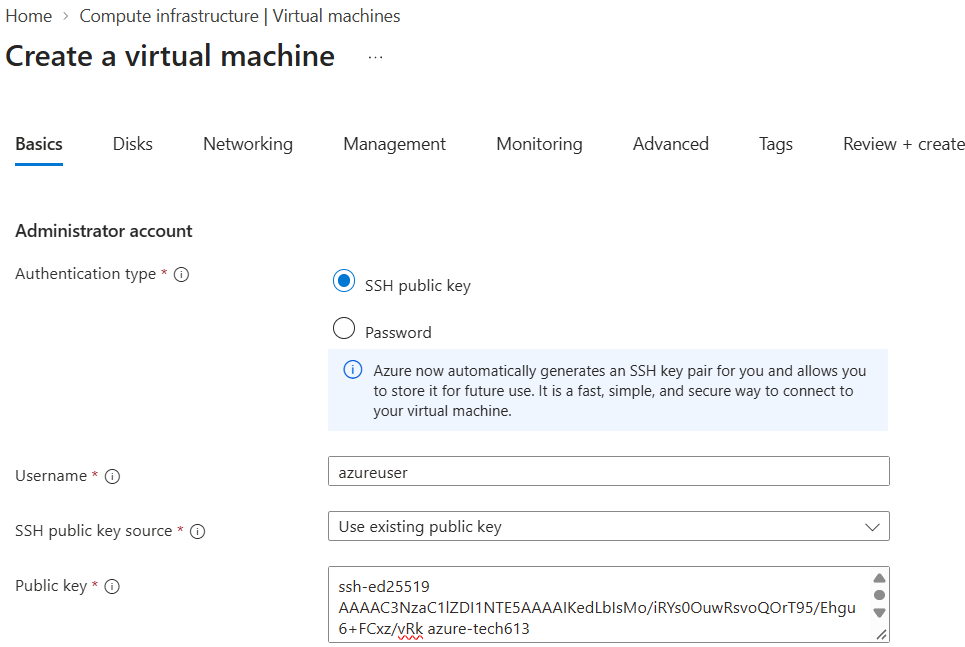


## Create the database VM first

The database VM (MongoDB) shall be created first so we can give the app VM its private IP address later.

In Azure Portal:

1. Search **Virtual machines**

2. Click **Create → Azure virtual machine**

3. On the **Basics** tab, enter:

| Setting | Value |
|----------|----------|
| Resource group | `tech613` |
| Virtual machine name | `tech613-nowres-mongodb` |
| Region | UK South |
| Image | Ubuntu Server 24.04 LTS - x64 Gen2 |
| Size | Standard_B1s |
| Authentication type | SSH public key |
| Username | `adminuser` |
| SSH public key source | Use existing public key |
| SSH public key | Contents of `tech613-azure-key.pub` |

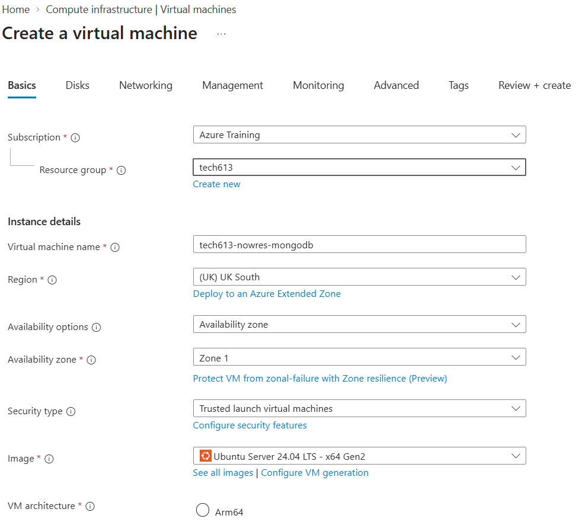
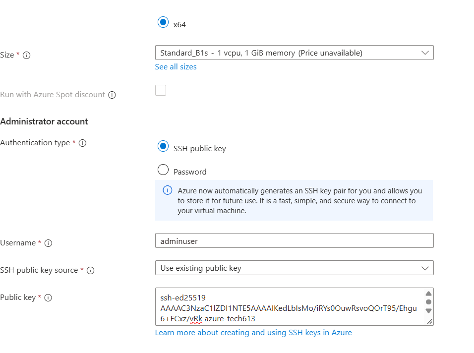
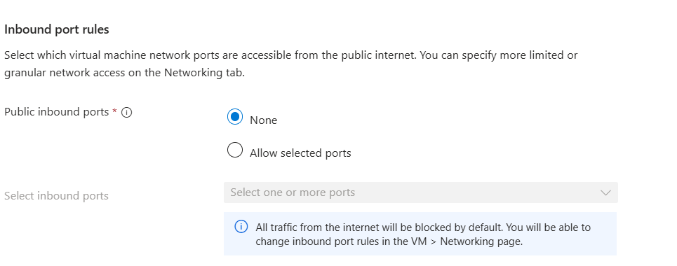


## Disks tab
Ensure that `OS disk type` is set as:

`Standard SSD`

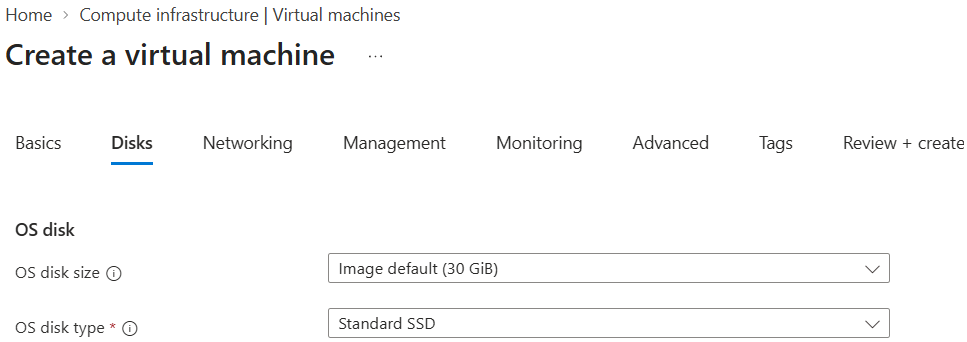

## Networking settings for database VM

Go to the `networking` tab:

| Setting | Value |
|----------|----------|
| Virtual network | `tech613-firstname-2-subnet-vnet` |
| Subnet | `private-subnet (10.0.3.0/24)` |
| Public IP | None |
| NIC network security group | Advanced |
| Network security group | `tech613-nowres-mongodb-nsg` |
| Load balancing option | None |
| Accelerated networking | Disabled (not supported by this VM size) |
| Delete NIC when VM is deleted | Leave default |


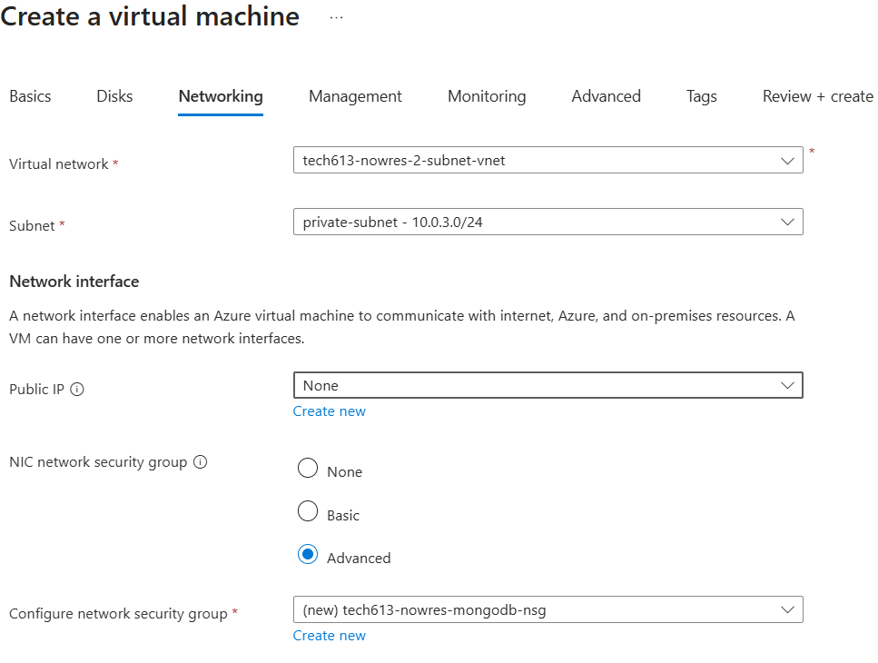
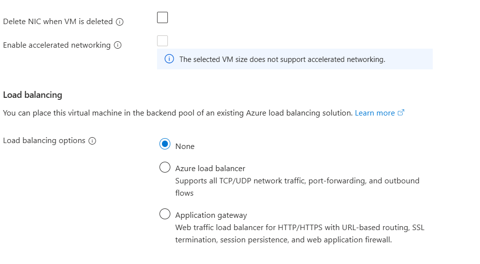

Click `review + create`, then `Create`.

## Get the MongoDB private IP

1. Open Virtual machines in Azure
2. Select tech613-firstname-mongodb
3. On the Overview page, find Private IP address
   
It should look something like 10.0.3.x.

The private IP is needed when configuring the app VM's MongoDB connection string.

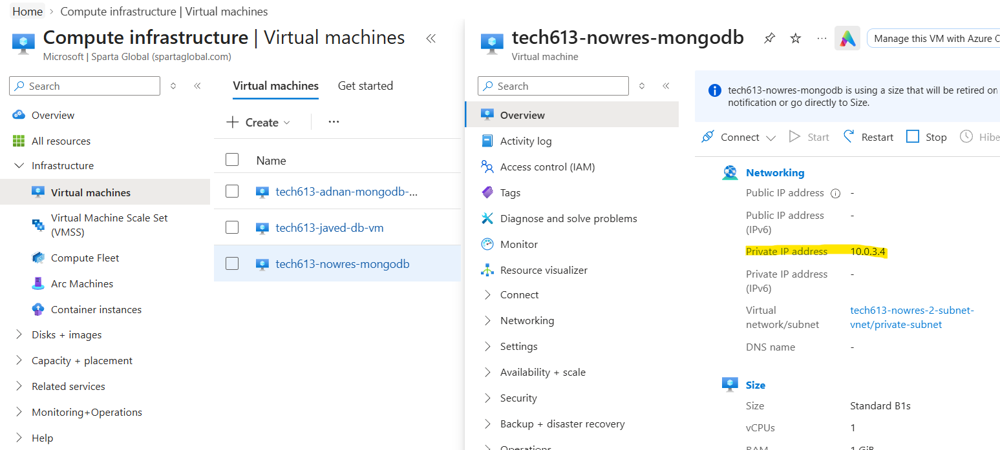

In my case, the private IP is: `10.0.3.4`

This shall be used in the app's MongoDB connection string as: `mongodb://10.0.3.4:27017/tictactoe`

## Create the Tic Tac Toe App VM

On the **Basics** tab, use:

| Setting | Value |
|----------|----------|
| Resource group | `tech613` |
| VM name | `tech613-firstname-ttt-app-vm` |
| Region | UK South |
| Availability options | Same as database VM |
| Security type | Standard (if available) |
| Image | Ubuntu Server 24.04 LTS - x64 Gen2 |
| Size | Standard_B1s |
| Authentication type | SSH public key |
| Username | `adminuser` |
| SSH public key | Your existing Azure public key |
| Public inbound ports | Allow selected ports |

For **Public inbound ports**, select:

- SSH (22)
- HTTP (80)

> Do not allow MongoDB (27017)

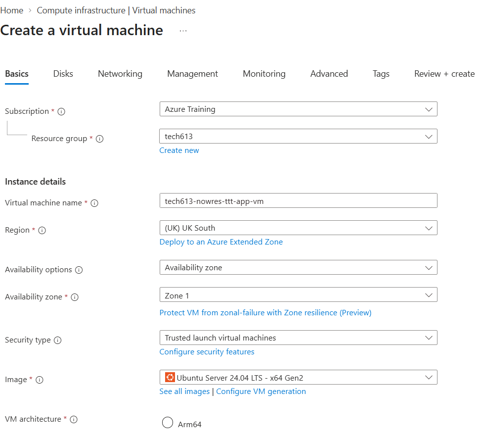
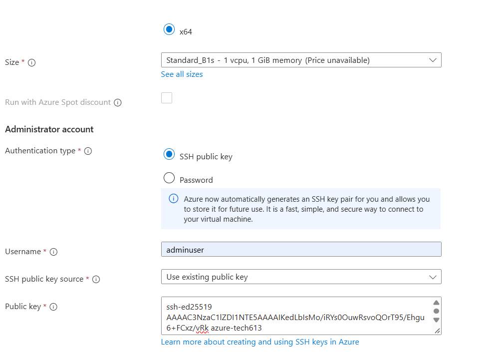
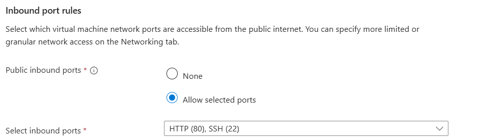

## Disks tab

Ensure that `OS disk type` is set as:

`Standard SSD`

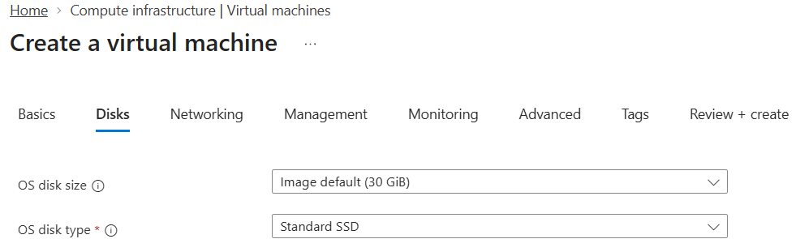


## Networking tab

| Setting | Value |
|---|---|
| Virtual network | `tech613-firstname-2-subnet-vnet` |
| Subnet | `public-subnet (10.0.2.0/24)` |
| Public IP | `tech613-firstname-ttt-app-vm-ip` |
| NIC network security group | Advanced |
| Network security group | `tech613-firstname-ttt-app-vm-nsg` |
| Load balancing option | None |
| Accelerated networking | Off |
| Delete NIC when VM is deleted | Leave default |

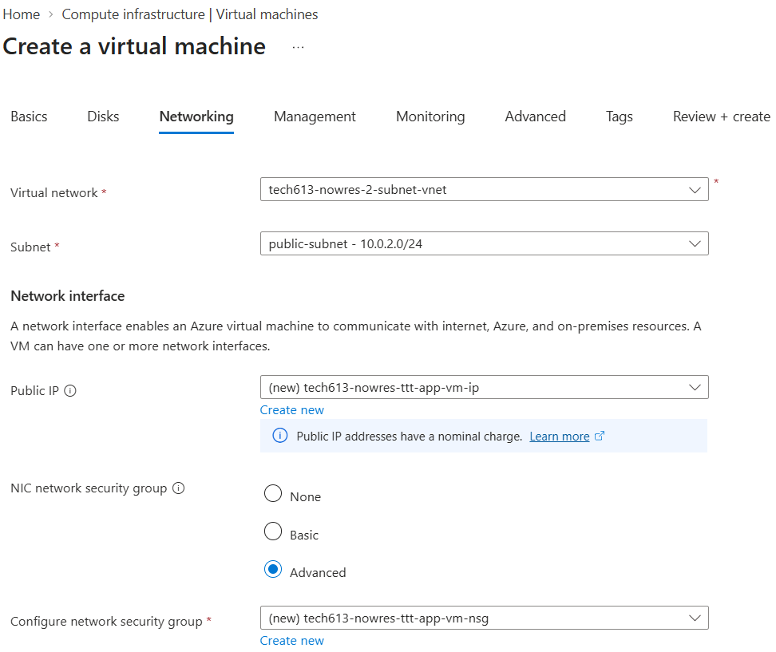
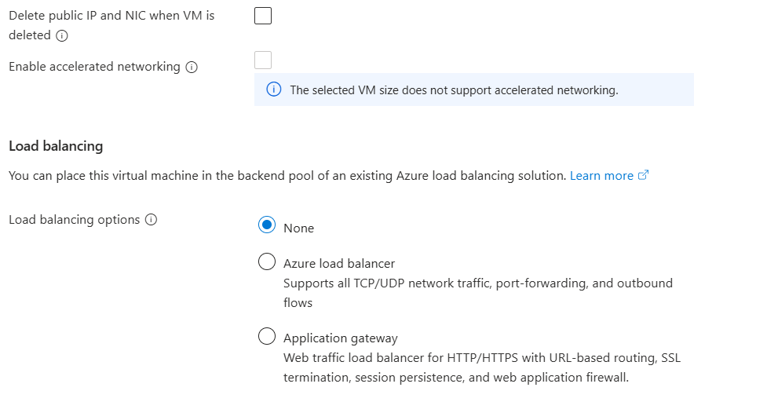

## Tags tab

Add the following tag:

| Name | Value |
|--------|--------|
| Owner | Nowres |

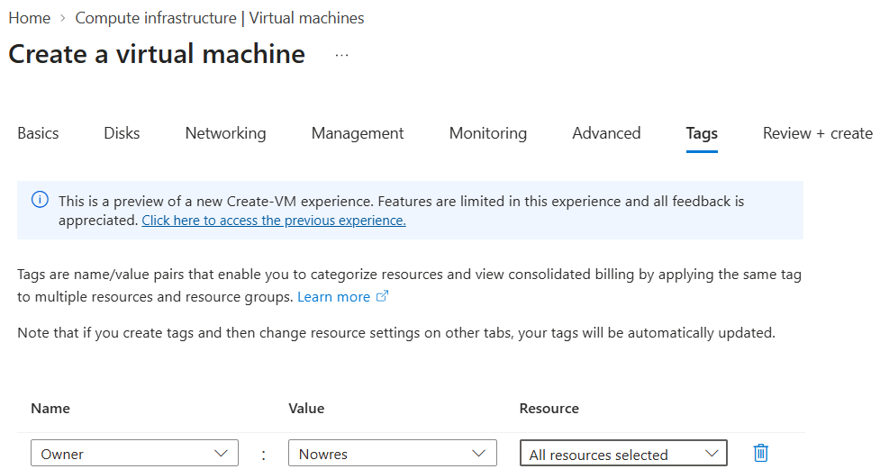

Click `review + create`, then `Create`.

## tech613-nowres-ttt-app-vm


1. Open tech613-nowres-ttt-app-vm
2. Go to Overview
3. Find its Public IP address and Private IP address
Send me both IP addresses

The public IP is used access the app.

The private IP is used for SSH/network configuration.

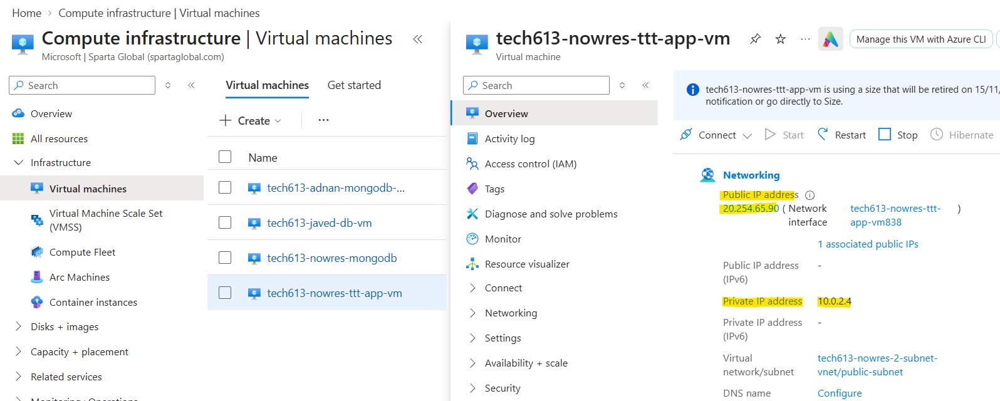

The App VM is now ready:

| IP type | VM | Address |
|----------|----------|----------|
| Public IP | TTT App VM | `20.254.65.90` |
| Private IP | TTT App VM | `10.0.2.4` |
| Private IP | MongoDB VM | `10.0.3.4` |

## Add an inbound HTTP rule to the App VM

The App VM needs to accept incoming HTTP traffic on port 80 so users can access the Tic-Tac-Toe application through Nginx.

In Azure Portal:
1. Search for Network security groups.
2. Open tech613-nowres-ttt-app-vm-nsg.
3. Select Inbound security rules.
4. Click Add.
5. Enter the following settings:

## HTTP Inbound Rule Configuration

| Setting | Value |
|----------|--------|
| Source | Any |
| Source port ranges | `*` |
| Destination | Any |
| Service | HTTP |
| Destination port ranges | `80` |
| Protocol | TCP |
| Action | Allow |
| Priority | `1010` |
| Name | `allow-http` |

Click Add.

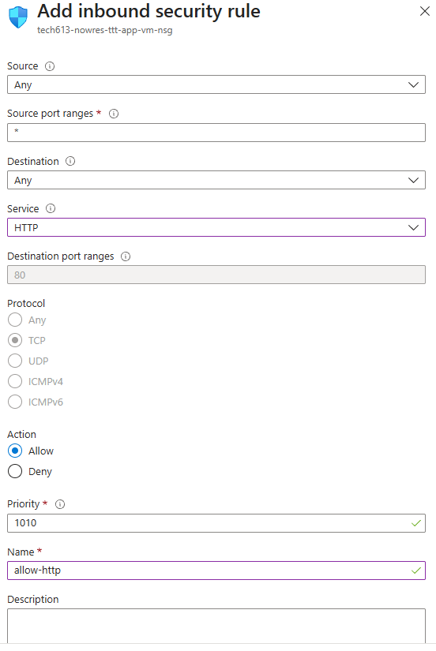


## SSH into the Tic Tac Toe App VM

Open bash and go to `.ssh` directory, then run:

`ssh -i tech613-azure-key adminuser@20.254.65.90`

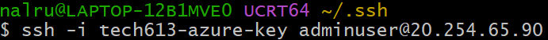

## provision-app-azure.sh

Create a new file in called: 

`provision-app-azure.sh`

In my case, it is located in:

`week_9\azure\scripts`

Add the code below in it:

```

#!/bin/bash

# Stop the script if any command fails
set -e

# ==================================================
# Configuration
# ==================================================

REPO_URL="https://github.com/n-al-rubaie/nodejs20-sparta-tictactoe-v1.git"
APP_DIR="/home/adminuser/app"
APP_NAME="tic-tac-toe"
NGINX_CONFIG="/etc/nginx/sites-available/tic-tac-toe"

# Azure MongoDB VM private IP
MONGODB_URI="mongodb://10.0.3.4:27017/tictactoe"


# ==================================================
# 1. Update Ubuntu and install required packages
# ==================================================

sudo apt-get update
sudo apt-get install -y git nginx curl

# Install Node.js 20 and npm
curl -fsSL https://deb.nodesource.com/setup_20.x | sudo -E bash -
sudo apt-get install -y nodejs


# ==================================================
# 2. Get the application from GitHub
# ==================================================

if [ -d "$APP_DIR/.git" ]; then

    cd "$APP_DIR"
    git pull origin main

else

    if [ -d "$APP_DIR" ] && [ -n "$(ls -A "$APP_DIR")" ]; then
        echo "Error: App directory exists but is not a Git repository."
        exit 1
    fi

    git clone "$REPO_URL" "$APP_DIR"

fi


# ==================================================
# 3. Install application dependencies
# ==================================================

cd "$APP_DIR"

MONGODB_URI="$MONGODB_URI" npm install


# ==================================================
# 4. Install PM2 if needed
# ==================================================

if ! command -v pm2 >/dev/null 2>&1; then
    sudo npm install -g pm2
fi


# ==================================================
# 5. Start or restart the application
# ==================================================

if pm2 describe "$APP_NAME" >/dev/null 2>&1; then

    MONGODB_URI="$MONGODB_URI" pm2 restart "$APP_NAME" --update-env

else

    MONGODB_URI="$MONGODB_URI" pm2 start npm --name "$APP_NAME" -- start

fi

pm2 save


# ==================================================
# 6. Configure Nginx as a reverse proxy
# ==================================================

sudo tee "$NGINX_CONFIG" > /dev/null <<'EOF'
server {
    listen 80;
    server_name _;

    location / {
        proxy_pass http://127.0.0.1:3000;
        proxy_http_version 1.1;

        proxy_set_header Host $host;
        proxy_set_header X-Real-IP $remote_addr;
        proxy_set_header X-Forwarded-For $proxy_add_x_forwarded_for;
        proxy_set_header X-Forwarded-Proto $scheme;
    }
}
EOF


# ==================================================
# 7. Enable the application site in Nginx
# ==================================================

sudo ln -sfn "$NGINX_CONFIG" \
    /etc/nginx/sites-enabled/tic-tac-toe


# ==================================================
# 8. Disable the default Nginx welcome page
# ==================================================

if [ -L /etc/nginx/sites-enabled/default ]; then
    sudo rm /etc/nginx/sites-enabled/default
fi


# ==================================================
# 9. Test and reload Nginx
# ==================================================

sudo nginx -t
sudo systemctl enable nginx
sudo systemctl reload nginx


# ==================================================
# 10. Display deployment status
# ==================================================

echo "Azure application deployment complete."

pm2 status

```


This Bash script **automatically deploys your Tic-Tac-Toe application onto an Azure Ubuntu VM**.

In simple terms, it:

1. **Updates Ubuntu** - Installs Git, Nginx, curl, and Node.js 20

2. **Downloads your application** - Clones your GitHub repository or updates it if it already exists

3. **Installs dependencies** - Runs `npm install` to install the packages required by your application

4. **Installs PM2** - Installs PM2 to manage your Node.js application

5. **Starts the application** - Starts or restarts your Tic-Tac-Toe application using PM2

6. **Connects to MongoDB** - Configures the application to connect to your MongoDB VM at `10.0.3.4`

7. **Configures Nginx** - Sets up Nginx to forward incoming traffic on port 80 to your application on port 3000

8. **Enables Nginx** - Removes the default welcome page and enables your application website

9. **Tests Nginx** - Checks the configuration and reloads Nginx

10. **Displays deployment status** - Shows whether your application is running through PM2

## provision-mongodb-azure.sh

Create a new file in called: 

`provision-mongodb-azure.sh

In my case, it is located in:

`week_9\azure\scripts`

Add the code below in it:

```


#!/bin/bash

# Stop the script if any command fails
set -e

# ==================================================
# 1. Update packages and install required tools
# ==================================================

sudo apt-get update
sudo apt-get install -y curl gnupg


# ==================================================
# 2. Add MongoDB 8.0 signing key
# ==================================================

curl -fsSL https://pgp.mongodb.com/server-8.0.asc \
    | sudo gpg --dearmor --yes \
        -o /usr/share/keyrings/mongodb-server-8.0.gpg


# ==================================================
# 3. Add MongoDB 8.0 repository for Ubuntu 24.04
# ==================================================

echo "deb [ arch=amd64,arm64 signed-by=/usr/share/keyrings/mongodb-server-8.0.gpg ] https://repo.mongodb.org/apt/ubuntu noble/mongodb-org/8.0 multiverse" \
    | sudo tee /etc/apt/sources.list.d/mongodb-org-8.0.list


# ==================================================
# 4. Install MongoDB 8.0
# ==================================================

sudo apt-get update
sudo apt-get install -y mongodb-org


# ==================================================
# 5. Configure MongoDB network access
# ==================================================

# Allow MongoDB to listen on the VM's network interfaces.
# Azure NSG rules must restrict access to trusted private sources.
sudo sed -i 's/^[[:space:]]*bindIp:.*/  bindIp: 0.0.0.0/' /etc/mongod.conf


# ==================================================
# 6. Start MongoDB and enable it on boot
# ==================================================

sudo systemctl enable mongod
sudo systemctl restart mongod


# ==================================================
# 7. Verify MongoDB is running
# ==================================================

sudo systemctl is-active --quiet mongod

echo "Azure MongoDB 8.0 installation and configuration complete."


```


This script **automatically installs and configures MongoDB 8.0 on your Azure Ubuntu VM**, ready for the Tic-Tac-Toe application to use.

It does the following:

1. **Updates Ubuntu** - Updates package lists and installs `curl` and `gnupg`

2. **Adds MongoDB's signing key** - Allows Ubuntu to verify that MongoDB packages are authentic

3. **Adds MongoDB's repository** - Tells Ubuntu where to download MongoDB 8.0 for Ubuntu 24.04

4. **Installs MongoDB** - Downloads and installs MongoDB

5. **Configures network access** - Changes `bindIp` to `0.0.0.0`, allowing other machines to connect to MongoDB

6. **Starts MongoDB** - Starts the MongoDB service

7. **Enables automatic startup** - Ensures MongoDB starts whenever the VM reboots

8. **Verifies MongoDB** - Checks that the MongoDB service is running

**Overall:** This script turns the Azure VM into a MongoDB database server so the Tic-Tac-Toe application VM can connect to it.


## Connect to the MongoDB VM through the app VM


The MongoDB VM has no public IP, which is intentional. It shall be connected to it through the app VM using SSH jump host.

Where: Open a second local Git Bash terminal, change directory to `.ssh`.

Run:

`ssh -i tech613-azure-key \
-o "ProxyCommand=ssh -i tech613-azure-key -W %h:%p adminuser@20.254.65.90" \
adminuser@10.0.3.4`


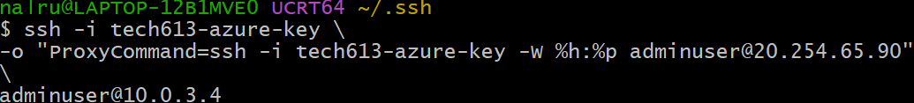


If successful, you should see:

`adminuser@tech613-firstname-mongodb:~$`

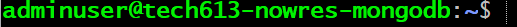

## Transfer `provision-mongodb-azure.sh` from your local machine to the MongoDB VM and execute it.

Open a second local Git Bash terminal, change directory to `.ssh`.

Run:

```
scp -i tech613-azure-key -o "ProxyCommand=ssh -i tech613-azure-key -W %h:%p adminuser@20.254.65.90" ~/github/tech613-devops/week_9/azure/scripts/provision-mongodb-azure.sh adminuser@10.0.3.4:/home/adminuser/
```

This copies the script from your local computer to the Azure MongoDB VM through the app VM.

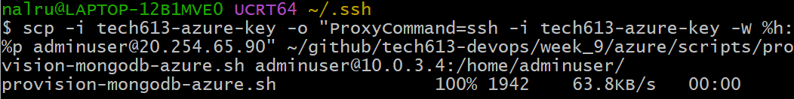

## Configure the App VM as a Temporary Internet Proxy

Since the app VM has internet access but the MongoDB VM does not, we'll temporarily use the app VM as an internet proxy.

## Connect to the app VM

Local Git Bash, in `~/.ssh`.

Run:

`ssh -i tech613-azure-key adminuser@20.254.65.90`

## Install Tinyproxy

Tinyproxy will allow the MongoDB VM to use the app VM's internet connection to download the MongoDB installation files.

```
sudo apt-get update
sudo apt-get install -y tinyproxy
```

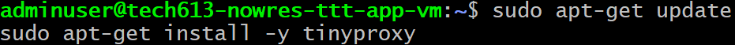

## Edit the Tinyproxy configuration to allow the MongoDB subnet and make Tinyproxy listen on the app VM's private IP (10.0.2.4).

`sudo nano /etc/tinyproxy/tinyproxy.conf`

Add `Listen 10.0.2.4` below Port 8888

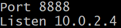

Add `Allow 10.0.3.0/24` below Allow ::1

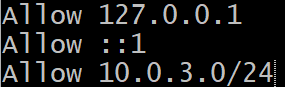


Save the file
- Press Ctrl + O.
- Press Enter to confirm the filename.
- Press Ctrl + X to exit.

## Reload and test 

`sudo systemctl restart tinyproxy`

`sudo systemctl status tinyproxy`

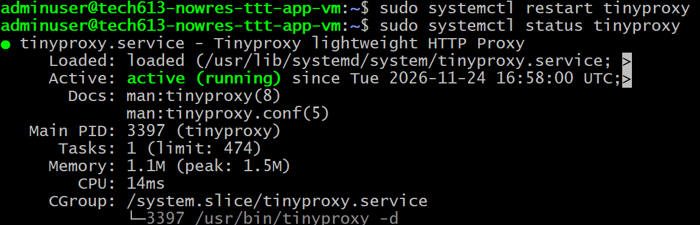

## Connect to the MongoDB VM

In the **MongoDB VM** run:

`curl -I --connect-timeout 10 -x http://10.0.2.4:8888 https://www.mongodb.org/`

This sends the internet request through the app VM's Tinyproxy service.

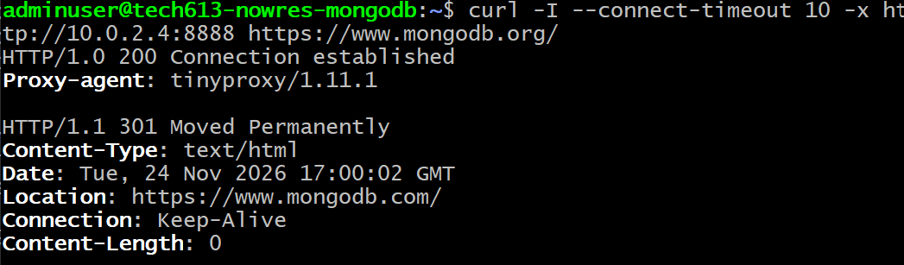

The MongoDB VM can now reach the internet through the app VM.

## Configure Ubuntu to use the proxy

Run this command to tell Ubuntu's package manager to use Tinyproxy:

```
echo 'Acquire::http::Proxy "http://10.0.2.4:8888";' | sudo tee /etc/apt/apt.conf.d/99temporary-proxy
echo 'Acquire::https::Proxy "http://10.0.2.4:8888";' | sudo tee -a /etc/apt/apt.conf.d/99temporary-proxy
```

Then test package access:

`sudo apt-get update`

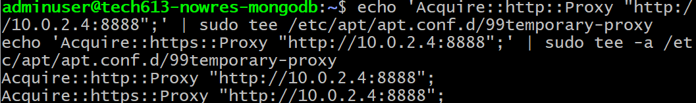

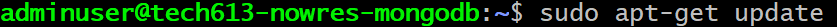

## Run the MongoDB installation script

## Set the proxy for curl

```
export http_proxy="http://10.0.2.4:8888"
export https_proxy="http://10.0.2.4:8888"
```

Then run the installation script:

`./provision-mongodb-azure.sh`

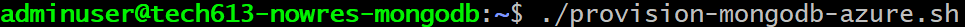

## Configure MongoDB network access

MongoDB must accept connections from the app VM over the private network. In the MongoDB VM run:


`sudo sed -i 's/^[[:space:]]*bindIp:.*/  bindIp: 0.0.0.0/' /etc/mongod.conf`

This allows MongoDB to listen on its network interfaces.

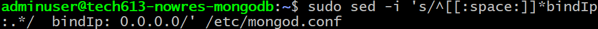

## Start MongoDB and enable it on boot

```
sudo systemctl enable mongod
sudo systemctl restart mongod
```

This:
- Starts MongoDB now.
- Ensures MongoDB starts automatically whenever the VM restarts.

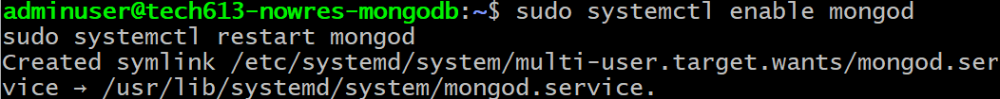

## Verify MongoDB is running

`sudo systemctl status mongod`

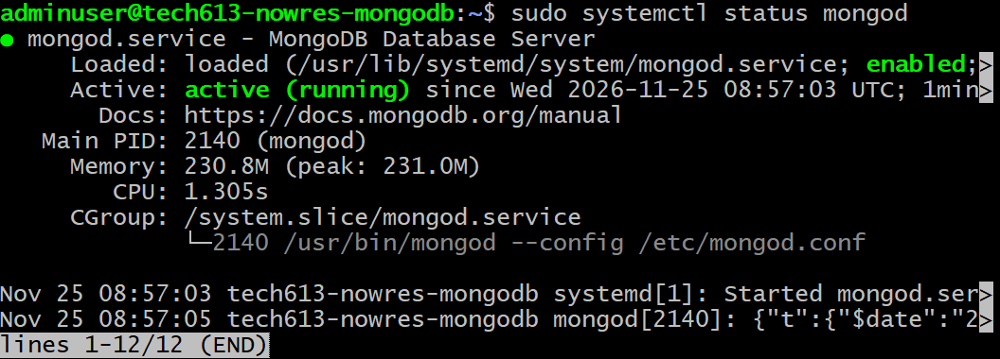

## Verify MongoDB is listening on port 27017

`sudo ss -tlnp | grep 27017`

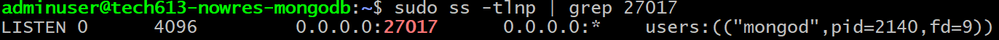

## Test the connection from the app VM

Open the app VM SSH terminal.

Run:

`nc -zv 10.0.3.4 27017`

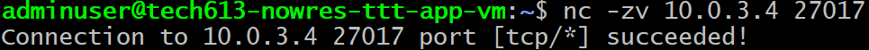

The app VM can reach MongoDB on the private IP 10.0.3.4, port 27017.

## Transfer the application provisioning script

Open a new local Git Bash terminal, in `~/.ssh`:

`scp -i tech613-azure-key ~/github/tech613-devops/week_9/azure/scripts/provision-app-azure.sh adminuser@20.254.65.90:/home/adminuser/`

This copies the script from your computer to the Azure app VM.

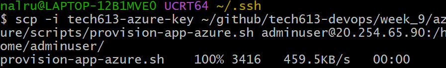

## Make the script executable

In the App VM SSH terminal run:

`chmod +x provision-app-azure.sh`

then run the deployment script:

`./provision-app-azure.sh`

This will install the application dependencies, configure PM2 and Nginx, and start the Tic-Tac-Toe application.

## Run the app

`http://20.254.65.90/`


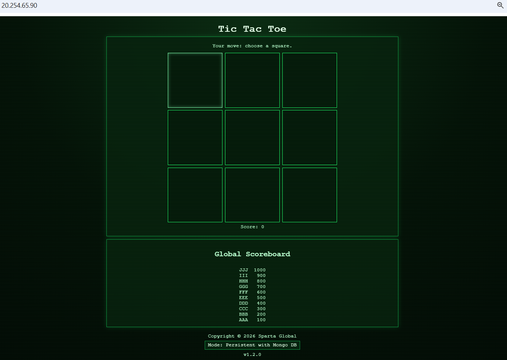


